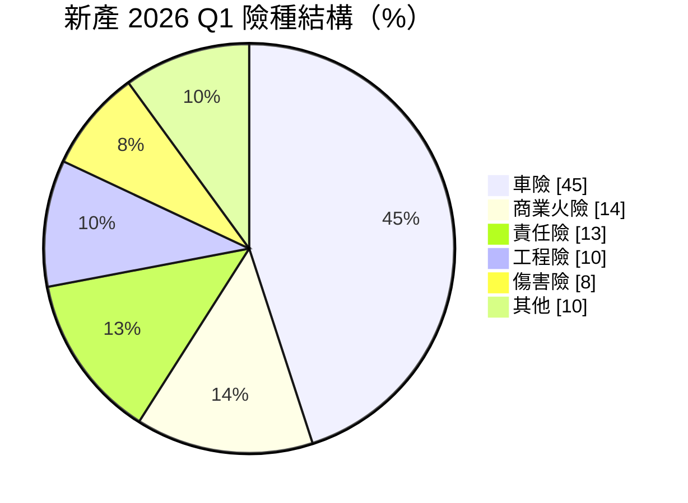
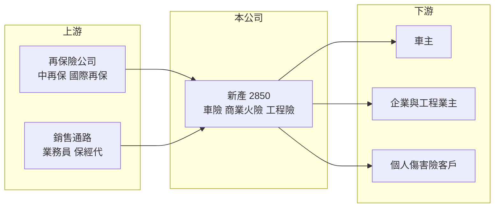

# 2850 新產

> 上市｜[[產業索引-金融保險業|金融保險業]]｜上市（櫃）日期 2000/05/22

# 第一章：企業模式與商業藍圖

> [!info] 撰寫說明
> 精簡版，由 Claude 依公開資料整理，架構比照 [[2330台積電]] 的四章研究，資料截至 2026-10-08。財務數字來源：Goodinfo 年度經營績效頁、富果研究（新光產 2026 年 6 月法說會備忘錄）、證交所開放資料（基本資料、股利、本益比）；集團背景與產業描述為整理性內容，尚未逐條比對原始文件。#待校對

本章說明新光產物保險（股票代號：2850，以下簡稱新產）的商業模式：一家以車險為最大業務的產險公司，如何靠「核保賺錢、投資保守」的經營方式，在競爭激烈的台灣產險市場維持高股東報酬。

- **核心業務：** 新產成立於 1963 年，2000 年上市，屬於新光吳氏家族旗下的產險公司，但並未納入新光金控（股權關係待校對）。產險公司的獲利來自兩部分：一是[[核保損益]]，也就是收到的保費扣除理賠與費用後的差額；二是投資損益，保費在理賠前先拿去投資所賺的收益。新產的特色是核保獲利占比高，2026 年第一季核保損益 12.7 億元，淨投資損益只有 2.38 億元。
- **營收結構：** 2026 年第一季險種結構為車險 45%、商業火險 14%、責任險 13%、工程險 10%、傷害險 8%，其餘為貨物、健康、住宅火險與航船險。車險是最大宗業務，工程險比重從 2025 年的 8% 提高到 10%，受惠於公共工程、半導體與資料中心建廠的投保需求。
- **營運據點：** 總公司位於台北市，在全台設有分支機構並透過業務員、保險經紀人與代理人等多元通路銷售（據點數與通路比重未查得）。
- **長期方向：** 管理層的經營原則是「不盲目擴張業務量」，著重核保專業與風險管控，追求穩定獲利。成長動能主要來自工程險與商業險，另推動綠色保險商品。2026 年起台灣保險業接軌 [[IFRS 17]]，保險收入的認列方式改變，跨年度比較需要留意基礎不同。

# 第二章：護城河深度與競爭優勢

本章分析新產的護城河。產險商品同質性高、費率競爭激烈，長期能維持高 ROE 的產險公司，靠的通常是核保紀律與通路品質，而不是規模。

- **競爭優勢：** 第一是核保紀律。新產的 [[ROE]] 從 2020 年的 13.1% 提高到 2025 年的 19.4%，在台灣產險同業中屬於前段，代表它挑選風險與訂價的能力長期有效。第二是資本與評等，2025 年底 [[RBC]] 422%，遠高於法定的 200%，標準普爾 A、A.M. Best A 的評等讓它在商業險與工程險投標時具信用優勢。第三是保守的投資政策，以國內固定收益為核心並持續減少國外投資，降低了獲利受金融市場波動的程度。
- **主要對手：** 車險市場的主要對手是背靠大型金控與車商的富邦產險（[[2881富邦金]]）、國泰產險（[[2882國泰金]]）與和泰產險（[[2207和泰車]] 旗下），它們有銀行、壽險或汽車經銷通路導客。中小型同業包括 [[2832台產]]、[[2852第一保]]、[[2816旺旺保]]。
- **觀察重點：** 車險損失率能否在修車成本上升下維持穩定、工程險與商業險成長是否伴隨足夠的費率，以及 IFRS 17 接軌後獲利認列節奏的變化。

| 對手 | 定位 | 對新產的影響 |
|---|---|---|
| 金控旗下產險 | 規模大、銀行與壽險交叉銷售 | 在車險與個人險通路上具優勢 |
| 車商體系產險 | 新車銷售時直接承保 | 掌握新車車險源頭 |
| 中小型產險 | 個別險種或通路專精 | 在費率上直接競爭 |

# 第三章：財務體質與盈利規模

資料日期：2026-10-08，表格是撰寫當時的快照；最新月營收、累計 EPS 由自動排程寫在本筆記的屬性欄位（月營收、累計EPS 等）。#待校對

產險業不適用毛利率與營業利益率，本章改用營業收入、稅後淨利、[[ROE]]、[[ROA]]、RBC 與股利檢視新產的獲利品質。

| 年度 | 營業收入（新台幣） | 稅後淨利 | EPS（元） | [[ROE]] | [[ROA]] |
|---|---|---|---|---|---|
| 2020 | 165 億 | 16.3 億 | 5.16 | 13.1% | 4.34% |
| 2021 | 185 億 | 22.5 億 | 7.13 | 15.8% | 5.41% |
| 2022 | 189 億 | 20.0 億 | 6.34 | 13.2% | 4.56% |
| 2023 | 199 億 | 29.1 億 | 9.22 | 17.9% | 6.40% |
| 2024 | 209 億 | 33.1 億 | 10.47 | 18.0% | 6.51% |
| 2025 | 216 億 | 38.8 億 | 12.28 | 19.4% | 6.63% |

註：取自 Goodinfo 合併報表，為 IFRS 17 接軌前的會計基礎。2026 年第一季（IFRS 17 基礎）稅後淨利 12.6 億元、EPS 3.99 元、年化 ROE 23.88%。

- **營收規模：** 2020 至 2025 年營業收入從 165 億元增至 216 億元，年複合成長率約 5.5%（推算），與台灣產險市場的保費成長相近，屬於穩定的低速成長。
- **獲利：** 同期稅後淨利從 16.3 億元增至 38.8 億元，成長超過一倍，2021 至 2025 年平均 ROE 約 16.9%（推算）。獲利成長遠快於營收，代表核保利潤率持續改善。2022 年防疫保單理賠造成台灣產險業普遍重創（待校對），新產當年稅後淨利 20 億元，只比 2021 年小幅減少，曝險相對有限。
- **產業指標：** [[綜合率]]、損失率與投資收益率未查得。2025 年底 [[RBC]] 422%，資本充足。
- **股利：** 2025 年度配發現金股利 7.27 元，配息率約 59%（推算，7.27 ÷ 12.28）。

**ROE 與權益資金成本：** 保險公司的負債主要是保險準備金，屬於營業負債，[[ROIC]] 與 [[WACC]] 的框架不適用，因此改以 ROE 對比 [[CAPM]] 推算的權益資金成本。假設台灣 10 年期公債殖利率 1.75%、市場風險溢酬 6%、β 取產險同業常見值 0.7（同業常見值，非來源數字），權益資金成本約 1.75% ＋ 0.7 × 6% ＝ 5.95%（推算）。新產 2021 至 2025 年平均 ROE 約 16.9%，比權益成本高出約 11 個百分點，是本批金融股中價值創造最明顯的一家。證交所資料顯示股價淨值比約 2.29 倍，市場已經為這種高 ROE 給予溢價。

# 第四章：總體風險與地緣政治

本章分析新產面對的保險週期、巨災與營運風險。

- **產業週期：** 產險有明顯的「硬市場、軟市場」循環。大型損失發生後費率上升、核保利潤改善；利潤好的時期吸引同業降價搶單，費率又會下滑。新產近年 ROE 走高的一部分來自費率循環有利，長期平均可能低於近年高點（推估）。
- **營運風險：** 車險占四成五，修車零件與工資上漲、電動車維修成本較高，都會推升損失率。若費率調整趕不上理賠成本，核保獲利會被壓縮。工程險與商業險單筆金額大，單一事故就可能影響當季獲利，需要靠[[再保險]]分散。
- **其他風險：** 台灣是颱風與地震頻繁地區，巨災事件會同時推高理賠與再保成本。IFRS 17 與新一代清償能力制度接軌，改變獲利認列與資本計算方式。新型態保單（如當年的防疫保單）若訂價失準，可能造成一次性巨額損失，這是產險業的尾端風險。

# 專有名詞解析

## 金融

- **[[核保損益]]**：保險公司收取的保費扣除理賠、準備金提存與營業費用後的損益，代表承保業務本身是否賺錢。
- **[[綜合率]]**：損失率加費用率，低於 100% 代表核保有利潤，是衡量產險經營效率的核心指標。
- **[[RBC]]**：風險資本適足率，保險公司自有資本除以風險資本，台灣法定最低要求為 200%。
- **[[IFRS 17]]**：國際保險合約會計準則，改變保險公司認列保費收入與負債的方式，台灣於 2026 年接軌。
- **[[再保險]]**：保險公司把部分承保風險轉給再保公司，以分散巨災等大額理賠風險。
- **[[ROA]]**：資產報酬率，稅後淨利除以總資產，金融業因槓桿高，ROA 通常偏低。
- **[[CAPM]]**：資本資產定價模型，以無風險利率加上 β 乘以市場風險溢酬，推估股東要求的報酬率。
- **[[ROIC]]**：投入資本報酬率，稅後營業利益除以股東權益加有息負債，衡量本業運用資本的效率；不適用於銀行與保險業。
- **[[WACC]]**：加權平均資金成本，依股權與負債比重加權的資金成本，是判斷 ROIC 是否創造價值的門檻。

# 核心供應鏈

- 上游：再保險公司（國內為 [[2851中再保]]，另有國際再保公司）分擔大額風險；保險經紀人與代理人（例如 [[5878台名]] 這類保經公司）與自有業務員提供通路。
- 下游／客戶：車主、企業商業火險與責任險客戶、公共工程與廠房建設業主、個人傷害險客戶。
- 同業：[[2832台產]]、[[2852第一保]]、[[2816旺旺保]]；金控與車商體系產險 [[2881富邦金]]、[[2882國泰金]]、[[2207和泰車]]。

## 最新新聞
<!-- news:start -->
<!-- news:end -->

## 相關連結
- [公開資訊觀測站](https://mopsov.twse.com.tw/mops/web/t05st03?step=1&firstin=1&co_id=2850)
- [Goodinfo](https://goodinfo.tw/tw/StockDetail.asp?STOCK_ID=2850)
- [Yahoo 股市](https://tw.stock.yahoo.com/quote/2850)
- [鉅亨網新聞](https://www.cnyes.com/twstock/2850/news)
