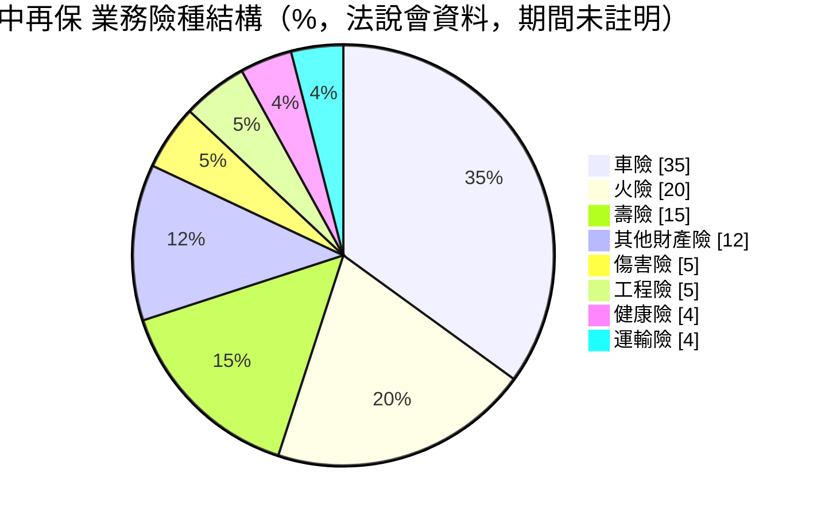
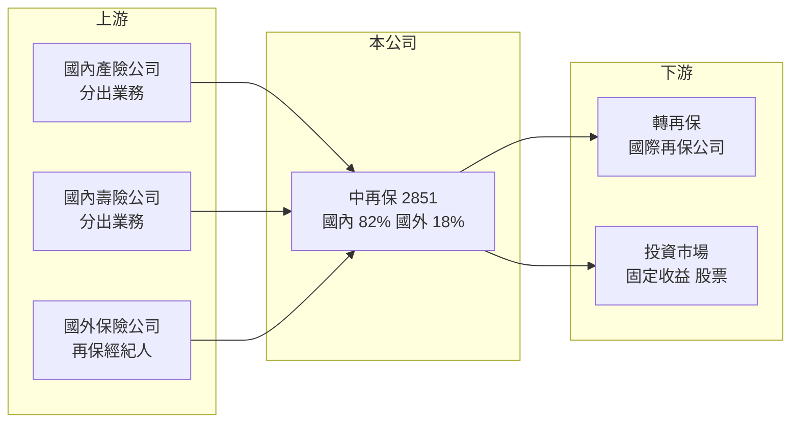

# 2851 中再保

> 上市｜[[產業索引-金融保險業|金融保險業]]｜上市（櫃）日期 2000/07/06

# 第一章：企業模式與商業藍圖

> [!info] 撰寫說明
> 精簡版，由 Claude 依公開資料整理，架構比照 [[2330台積電]] 的四章研究，資料截至 2026-10-08。財務數字來源：Goodinfo 年度經營績效頁、富果研究（中再保 2026 年 5 月法說會備忘錄）、證交所開放資料（基本資料、股利、本益比）；公司沿革與產業描述為整理性內容，尚未逐條比對原始文件。#待校對

本章說明中央再保險（股票代號：2851，以下簡稱中再保）的商業模式。再保險是「保險公司的保險」，中再保不直接面對一般保戶，而是承接國內外保險公司轉出的部分風險，是台灣保險業的風險分散樞紐。

- **核心業務：** 中再保成立於 1968 年，原為政府設立的再保險機構，後來民營化並於 2000 年上市（民營化年份與現有股東結構待校對）。它是台灣主要的本土專業[[再保險]]公司：產險與壽險公司把超出自身承擔能力的風險分出，中再保收取再保費、在事故發生時分攤理賠。獲利同樣來自[[核保損益]]與投資收益兩部分。
- **營收結構：** 依法說會資料，業務來源國內 82%、國外 18%；產險 81%、壽險 19%。險種上以車險 35%、火險 20%、壽險 15% 為前三大，其餘為其他財產險、傷害險、工程險、健康險與運輸險。業務結構與台灣直接簽單市場高度相似，等於持有整個台灣保險市場的一小塊縮影。
- **營運據點：** 總公司位於台北市，海外業務透過國際再保經紀人與合約承接（海外據點未查得）。2026 年 3 月底資產總額 592 億元。
- **長期方向：** 國內業務要鞏固市場領導地位、優化財產險承接條件並控管累積曝險；國際業務以獲利為導向而非追求保費規模，嚴控各區域巨災曝險。資金運用以穩健為原則，並參考氣候相關財務揭露框架把氣候風險納入決策。

# 第二章：護城河深度與競爭優勢

本章分析中再保的護城河。再保險是資本密集、靠信用與專業的行業，客戶（保險公司）最在意的是再保人能不能在大災後如期付款。

- **競爭優勢：** 第一是本土地位與長期關係，中再保長年承接台灣產壽險公司的分出業務，熟悉在地風險（颱風、地震、車險損失型態），也參與政策性保險的風險分攤。第二是信用評等，A.M. Best A、S&P Global A、中華信評 twAA+，展望皆為穩定，是保險公司選擇再保人的門檻條件。第三是規模夠大的國內市占，讓它能取得穩定的分出業務流量。整體屬於「窄護城河」：國內有地緣優勢，但在國際市場只是小型參與者。
- **主要對手：** 國際大型再保公司（Munich Re、Swiss Re、Hannover Re、SCOR 等）以及勞合社市場，它們資本規模遠大於中再保，在大型商業險與巨災再保上更具承接能力。國內保險公司也可以提高自留比例，減少對再保的需求。
- **觀察重點：** 全球再保費率循環（2026 年 1 月續約時財產再保費率趨軟）、國內車險損失率趨勢，以及國際業務在嚴控巨災曝險下能否維持獲利。

| 對手 | 定位 | 對中再保的影響 |
|---|---|---|
| 國際大型再保公司 | 資本雄厚、全球分散 | 在大型商業險與巨災再保上具優勢，影響費率 |
| 勞合社與再保經紀體系 | 專業險與國際分保市場 | 爭奪台灣保險公司的分出業務 |
| 國內保險公司自留 | 資本增加後提高自留 | 減少再保需求 |

# 第三章：財務體質與盈利規模

資料日期：2026-10-08，表格是撰寫當時的快照；最新月營收、累計 EPS 由自動排程寫在本筆記的屬性欄位（月營收、累計EPS 等）。#待校對

再保險業不適用毛利率與營業利益率，本章改用營業收入、稅後淨利、[[ROE]]、[[ROA]]、綜合率與資本實力檢視中再保的獲利品質。

| 年度 | 營業收入（新台幣） | 稅後淨利 | EPS（元） | [[ROE]] | [[ROA]] |
|---|---|---|---|---|---|
| 2020 | 177 億 | 15.2 億 | 2.57 | 11.9% | 3.70% |
| 2021 | 204 億 | 20.7 億 | 3.50 | 13.8% | 4.48% |
| 2022 | 213 億 | 2.53 億 | 0.41 | 1.51% | 0.51% |
| 2023 | 220 億 | 20.9 億 | 2.61 | 11.6% | 4.01% |
| 2024 | 229 億 | 25.2 億 | 3.14 | 12.6% | 4.50% |
| 2025 | 229 億 | 29.3 億 | 3.66 | 13.8% | 4.98% |

註：取自 Goodinfo 合併報表，為 IFRS 17 接軌前的會計基礎。2026 年第一季（IFRS 17 基礎）稅後淨利 18.4 億元、EPS 2.3 元。

- **營收規模：** 2020 至 2025 年營業收入從 177 億元增至 229 億元，年複合成長率約 5.3%（推算），2024 至 2025 年持平，與管理層「重獲利不重規模」的國際業務方針一致。
- **獲利：** 2022 年稅後淨利驟降到 2.53 億元，ROE 只剩 1.51%，推估與當年防疫保單理賠分攤及金融市場下跌有關（推估）。扣除這一年，ROE 大多在 12% 至 14% 之間；2021 至 2025 年平均約 10.7%（推算）。
- **產業指標：** 2026 年第一季自留[[綜合率]] 78.7%，低於 100% 代表核保有利潤。投資資產配置為固定收益 59%、約當現金 31%、股票 9%，相當保守，投資收益率未查得。[[RBC]] 未查得。
- **股利：** 章程規定每年提撥不低於可分配盈餘 30% 作為股利，其中現金至少占一半。2025 年度配發現金股利 2.2 元，配息率約 60%（推算，2.2 ÷ 3.66）。

**ROE 與權益資金成本：** 再保公司的負債以保險準備金為主，屬於營業負債，[[ROIC]] 與 [[WACC]] 不適用，改以 ROE 對比 [[CAPM]] 推算的權益資金成本。假設台灣 10 年期公債殖利率 1.75%、市場風險溢酬 6%、β 取保險同業常見值 0.7（同業常見值，非來源數字），權益資金成本約 5.95%（推算）；考量再保業務的巨災尾端風險，若 β 取 0.8，約 6.55%。中再保 2021 至 2025 年平均 ROE 約 10.7%，高於權益成本約 4 至 5 個百分點，屬於穩定創造價值，但 2022 年的低點提醒投資人，再保險的報酬分布有「平時穩定、偶發重傷」的特性。股價淨值比約 1.41 倍，市場給予適度溢價。

# 第四章：總體風險與地緣政治

本章分析中再保面對的巨災、費率循環與金融市場風險。

- **產業週期：** 全球再保市場資本充裕（傳統資本約 5,400 億美元、非傳統資本約 1,200 億美元），2026 年 1 月續約時財產再保費率趨軟，代表未來幾年費率可能下滑、核保利潤收窄。再保費率通常在重大巨災後才回升，具有明顯的循環性。
- **營運風險：** 近六年全球巨災損失每年都超過 1,000 億美元，中再保的國際業務雖然規模不大，仍可能因單一事件出現大額理賠。國內方面，車險占比 35%，直接簽單公司的車險損失率上升也會傳導到再保端。
- **其他風險：** 台灣本身是地震與颱風高風險地區，國內業務集中使中再保在本土巨災時承擔集中損失。投資組合中股票占 9%，市場大跌時會影響淨值與獲利。IFRS 17 與新一代清償能力制度接軌，會改變獲利認列與資本要求。地緣政治與通膨則可能推升理賠成本。

# 專有名詞解析

## 金融

- **[[再保險]]**：保險公司把部分承保風險轉給再保公司，以分散巨災等大額理賠風險。
- **[[核保損益]]**：保險公司收取的保費扣除理賠、準備金提存與營業費用後的損益，代表承保業務本身是否賺錢。
- **[[綜合率]]**：損失率加費用率，低於 100% 代表核保有利潤，是衡量產險經營效率的核心指標。
- **[[RBC]]**：風險資本適足率，保險公司自有資本除以風險資本，台灣法定最低要求為 200%。
- **[[ROA]]**：資產報酬率，稅後淨利除以總資產，金融業因槓桿高，ROA 通常偏低。
- **[[CAPM]]**：資本資產定價模型，以無風險利率加上 β 乘以市場風險溢酬，推估股東要求的報酬率。
- **[[ROIC]]**：投入資本報酬率，稅後營業利益除以股東權益加有息負債，衡量本業運用資本的效率；不適用於銀行與保險業。
- **[[WACC]]**：加權平均資金成本，依股權與負債比重加權的資金成本，是判斷 ROIC 是否創造價值的門檻。

# 核心供應鏈

- 上游（業務來源）：國內產險公司如 [[2850新產]]、[[2852第一保]]、[[2832台產]]、[[2816旺旺保]]，以及金控旗下產壽險公司；國外業務經再保經紀人承接。
- 下游：中再保再把部分風險轉分給國際再保公司（轉再保），保費資金則投入固定收益與股票市場。
- 同業：國際再保公司 Munich Re、Swiss Re、Hannover Re、SCOR（未在本筆記庫建檔）。

## 最新新聞
<!-- news:start（自動產生，請勿手動編輯此範圍） -->
- 2026-10-15 🏛️ 重訊 17:04｜公告本公司法人董事代表人異動｜[觀測站](https://mops.twse.com.tw/mops/#/web/t05st01)

完整紀錄：[[2851中再保 新聞]]
<!-- news:end -->

## 相關連結
- [公開資訊觀測站](https://mopsov.twse.com.tw/mops/web/t05st03?step=1&firstin=1&co_id=2851)
- [Goodinfo](https://goodinfo.tw/tw/StockDetail.asp?STOCK_ID=2851)
- [Yahoo 股市](https://tw.stock.yahoo.com/quote/2851)
- [鉅亨網新聞](https://www.cnyes.com/twstock/2851/news)
