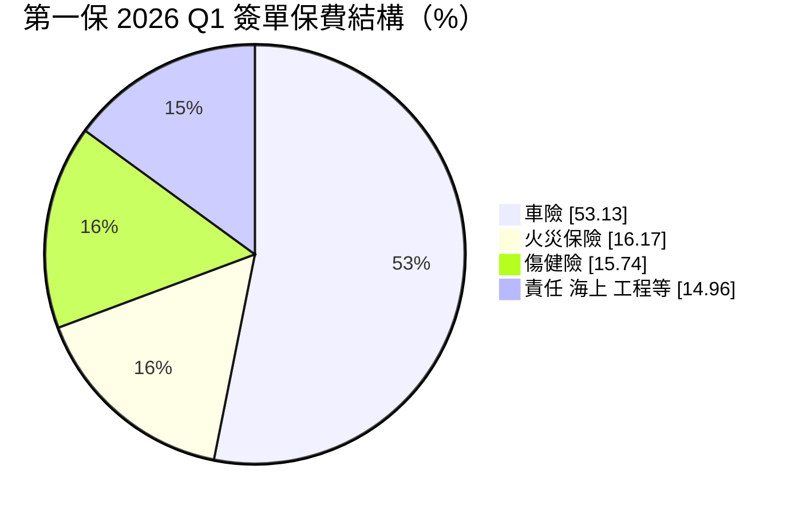
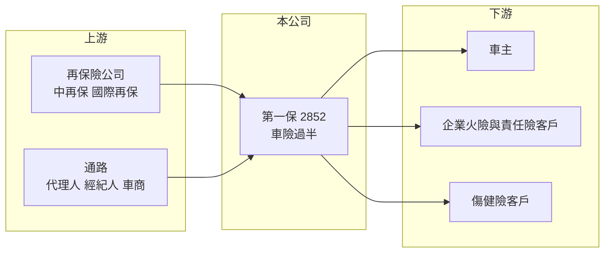

# 2852 第一保

> 上市｜[[產業索引-金融保險業|金融保險業]]｜上市（櫃）日期 2000/11/28

# 第一章：企業模式與商業藍圖

> [!info] 撰寫說明
> 精簡版，由 Claude 依公開資料整理，架構比照 [[2330台積電]] 的四章研究，資料截至 2026-10-08。財務數字來源：Goodinfo 年度經營績效頁、富果研究（第一保 2026 年 6 月法說會備忘錄）、證交所開放資料（基本資料、股利、本益比）；產業描述為整理性內容，尚未逐條比對原始文件。#待校對

本章說明第一產物保險（股票代號：2852，以下簡稱第一保）的商業模式：一家車險占比過半的中小型產險公司，如何以穩定的核保獲利與高配息維持股東報酬。

- **核心業務：** 第一保成立於 1962 年，2000 年上市，是台灣歷史較久的民營產險公司之一，董事長為李正漢。產險公司的獲利來自[[核保損益]]與投資收益；第一保的核保獲利是主要來源，2026 年第一季核保利益 3.64 億元，投資利益只有 3,136 萬元。
- **營收結構：** 2026 年第一季簽單保費中，車險占 53.13%、火災保險 16.17%、傷健險 15.74%，其餘為責任險、海上保險與工程保險，合計約 15%。公司說明第一季傷健險比重偏高屬季節性因素，全年預期回到 2025 年約 7.5% 的水準。車險過半代表第一保的命運和台灣汽車持有量、車險費率與修車成本緊密相連。
- **營運據點：** 總公司位於台北市中正區，全台設有 5 家分公司、27 家服務中心與 3 家通訊處，透過業務員、保險代理人與經紀人等多元通路銷售。
- **長期方向：** 公司提出五大方針：深耕多元通路、推出適銷商品、運用金融科技強化電子商務、落實公司治理，以及追求穩定的核保利潤與投資收益。沒有激進擴張的計畫，經營風格偏向穩健保守。

# 第二章：護城河深度與競爭優勢

本章分析第一保的護城河與競爭位置。車險是台灣產險市場最大、也最標準化的險種，中小型產險公司要在這個市場立足，靠的是通路關係與理賠服務效率。

- **競爭優勢：** 第一是長期經營累積的通路與車商、代理人關係，車險業務來源穩定。第二是資本與資產品質，2025 年底 [[RBC]] 513.55%，遠高於法定 200%，投資組合以存款與債券為主，獲利不容易被金融市場拖累。第三是核保紀律改善，2025 年前三季自留[[綜合率]]從前一年同期的 91.87% 降到 86.7%。整體屬於「窄護城河」，規模小、差異化有限，但經營穩定。
- **主要對手：** 車險市場有背靠金控與車商的富邦產險（[[2881富邦金]]）、國泰產險（[[2882國泰金]]）、和泰產險（[[2207和泰車]] 旗下），以及同屬中型的 [[2850新產]]、[[2832台產]]、[[2816旺旺保]]。大型對手擁有銀行、壽險或新車銷售通路，可以在源頭取得客戶。
- **觀察重點：** 車險損失率與費率調整的速度、通路成本（佣金）是否上升，以及電子商務投保能否降低費用率。

| 對手 | 定位 | 對第一保的影響 |
|---|---|---|
| 金控旗下產險 | 規模大、交叉銷售 | 在個人車險與住宅險取得客源優勢 |
| 車商體系產險 | 新車銷售時承保 | 掌握新車車險源頭 |
| 中型產險同業 | 車險與商業險 | 費率與通路佣金直接競爭 |

# 第三章：財務體質與盈利規模

資料日期：2026-10-08，表格是撰寫當時的快照；最新月營收、累計 EPS 由自動排程寫在本筆記的屬性欄位（月營收、累計EPS 等）。#待校對

產險業不適用毛利率與營業利益率，本章改用營業收入、稅後淨利、[[ROE]]、[[ROA]]、綜合率、RBC 與股利檢視第一保的獲利品質。

| 年度 | 營業收入（新台幣） | 稅後淨利 | EPS（元） | [[ROE]] | [[ROA]] |
|---|---|---|---|---|---|
| 2020 | 58.5 億 | 1.53 億 | 0.51 | 2.25% | 0.96% |
| 2021 | 65.4 億 | 5.53 億 | 1.84 | 7.88% | 3.36% |
| 2022 | 69.3 億 | 5.59 億 | 1.86 | 7.53% | 3.24% |
| 2023 | 73.9 億 | 6.36 億 | 2.11 | 8.11% | 3.45% |
| 2024 | 78.0 億 | 9.03 億 | 3.00 | 10.7% | 4.64% |
| 2025 | 75.6 億 | 8.80 億 | 2.92 | 9.86% | 4.41% |

註：取自 Goodinfo 合併報表，為 IFRS 17 接軌前的會計基礎。2026 年第一季（IFRS 17 基礎）稅後淨利 3.02 億元、EPS 1.00 元、年化 ROE 12.44%，每股淨值 31.25 元。

- **營收規模：** 2020 至 2025 年營業收入從 58.5 億元增至 75.6 億元，年複合成長率約 5.3%（推算），2025 年小幅下滑。
- **獲利：** 2020 年獲利偏低（ROE 2.25%）後逐年改善，2024 年 EPS 達 3 元。2021 至 2025 年平均 ROE 約 8.8%（推算），呈現穩定上升的趨勢，與綜合率改善一致。
- **產業指標：** 2025 年前三季自留[[綜合率]] 86.7%。投資配置以金融機構存款 34.69%、金融債 14.78%、公司債 13.37% 為主，股票約 15.91%，投資收益率未查得。[[RBC]] 513.55%，中華信評 twAA、標準普爾 A-，展望穩定。
- **股利：** 股利政策是提列法定與特別盈餘公積後全數分配，2025 年度配發現金股利 1.66 元，配息率約 57%（推算，1.66 ÷ 2.92）。

**ROE 與權益資金成本：** 保險公司的負債以保險準備金為主，屬於營業負債，[[ROIC]] 與 [[WACC]] 不適用，改以 ROE 對比 [[CAPM]] 推算的權益資金成本。假設台灣 10 年期公債殖利率 1.75%、市場風險溢酬 6%、β 取產險同業常見值 0.7（同業常見值，非來源數字），權益資金成本約 5.95%（推算）。第一保 2021 至 2025 年平均 ROE 約 8.8%，高於權益成本約 3 個百分點，近兩年更擴大到 4 個百分點左右，屬於小幅創造價值。不過證交所資料顯示股價淨值比約 0.89 倍，市場評價低於帳面，推估反映規模小、流動性低與車險集中度高的折價（推估）。

# 第四章：總體風險與地緣政治

本章分析第一保面對的保險週期、車險成本與營運風險。

- **產業週期：** 產險費率有硬市場與軟市場的循環，核保利潤好的時期同業容易降價搶單。第一保近年綜合率改善有一部分來自市場環境，長期平均可能回落（推估）。
- **營運風險：** 車險占比過半是最大的集中風險。修車工資、零件價格上漲，以及電動車與先進駕駛輔助系統帶來的高維修成本，都會推升損失率；若費率調整落後，核保利潤就會被侵蝕。傷健險比重若提高，也需要不同的核保與理賠能力。
- **其他風險：** 颱風與地震等巨災會推高火險理賠，雖可透過[[再保險]]分散，但再保成本也會隨之上升。IFRS 17 接軌改變獲利認列方式；規模較小的公司在資訊系統與法遵上的固定成本負擔相對較重。

# 專有名詞解析

## 金融

- **[[核保損益]]**：保險公司收取的保費扣除理賠、準備金提存與營業費用後的損益，代表承保業務本身是否賺錢。
- **[[綜合率]]**：損失率加費用率，低於 100% 代表核保有利潤，是衡量產險經營效率的核心指標。
- **[[RBC]]**：風險資本適足率，保險公司自有資本除以風險資本，台灣法定最低要求為 200%。
- **[[再保險]]**：保險公司把部分承保風險轉給再保公司，以分散巨災等大額理賠風險。
- **[[ROA]]**：資產報酬率，稅後淨利除以總資產，金融業因槓桿高，ROA 通常偏低。
- **[[CAPM]]**：資本資產定價模型，以無風險利率加上 β 乘以市場風險溢酬，推估股東要求的報酬率。
- **[[ROIC]]**：投入資本報酬率，稅後營業利益除以股東權益加有息負債，衡量本業運用資本的效率；不適用於銀行與保險業。
- **[[WACC]]**：加權平均資金成本，依股權與負債比重加權的資金成本，是判斷 ROIC 是否創造價值的門檻。

# 核心供應鏈

- 上游：再保險公司（國內為 [[2851中再保]]）分擔大額風險；保險代理人、經紀人（例如 [[5878台名]]）與車商通路提供業務來源。
- 下游／客戶：車主、企業火險與責任險客戶、傷害與健康險客戶。
- 同業：[[2850新產]]、[[2832台產]]、[[2816旺旺保]]；金控與車商體系產險 [[2881富邦金]]、[[2882國泰金]]、[[2207和泰車]]。

## 最新新聞
<!-- news:start -->
<!-- news:end -->

## 相關連結
- [公開資訊觀測站](https://mopsov.twse.com.tw/mops/web/t05st03?step=1&firstin=1&co_id=2852)
- [Goodinfo](https://goodinfo.tw/tw/StockDetail.asp?STOCK_ID=2852)
- [Yahoo 股市](https://tw.stock.yahoo.com/quote/2852)
- [鉅亨網新聞](https://www.cnyes.com/twstock/2852/news)
