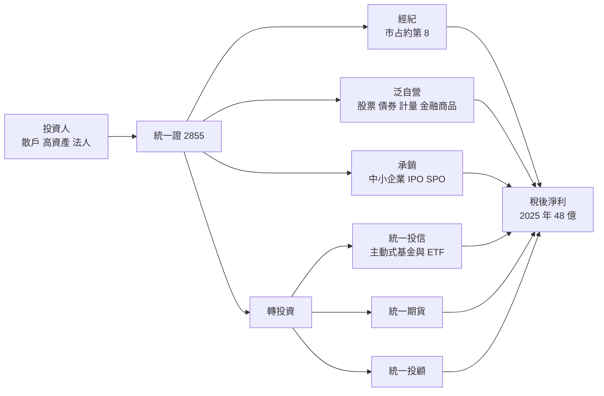
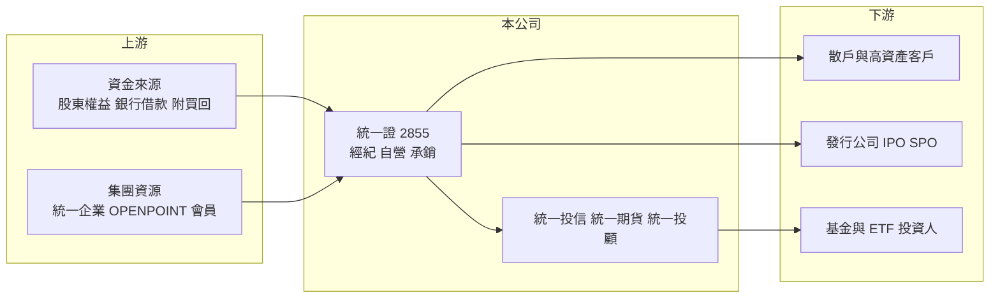

# 2855 統一證

> 上市｜[[產業索引-金融保險業|金融保險業]]｜上市（櫃）日期 2002/09/16

# 第一章：企業模式與商業藍圖

> [!info] 撰寫說明
> 精簡版，由 Claude 依公開資料整理，架構比照 [[2330台積電]] 的四章研究，資料截至 2026-10-08。財務數字來源：Goodinfo 年度經營績效頁、工商時報（2026 年 2 月統一證董事長專訪）、證交所開放資料（基本資料、股利、本益比）；與統一企業集團的股權關係為整理性描述，尚未逐條比對原始文件。#待校對

本章說明統一綜合證券（股票代號：2855，以下簡稱統一證）的商業模式：一家屬於統一企業集團、不隸屬金控的中型券商，如何以自營團隊為最大獲利來源，並透過統一投信參與資產管理的長期成長。

- **核心業務：** 統一證成立於 1988 年，2002 年上市，屬於統一企業集團的金融事業（[[1216統一]] 為集團核心，持股比例待校對）。券商的收入來自[[經紀業務]]手續費與[[融資融券]]利息、[[自營業務]]的投資損益、[[承銷]]費用，以及期貨、投信、投顧等子公司與轉投資。董事長林寬成在 2026 年的專訪中把公司定位為「小而美、利而精」，不盲目追求市占率。
- **營收結構：** 2025 年營收 135.44 億元、稅後淨利 48.04 億元，皆創歷史新高。股票自營、債券自營、計量交易與金融商品四個部門組成的「泛自營」團隊貢獻全年獲利近五成，是最主要的獲利來源；經紀業務市占排名約第 8，其餘來自承銷、期貨與投信等轉投資。
- **營運據點：** 總公司位於台北市松山區，國內設有分公司網路（家數未查得）。重要轉投資包括統一投信（資產管理規模近 7,000 億元，主動式台股基金規模截至 2025 年底 1,213.7 億元、排名業界第 2）與統一期貨（2025 年獲利創新高）。
- **長期方向：** 經紀業務往三個方向轉型：替高頻交易大戶與高資產客戶建置客製化系統與逐筆交易服務；以投顧、財富管理與產品平台發展「存量經營」的穩定收入；以自有 APP 串接集團 uniopen 會員與 OPENPOINT 點數，鎖定 20 至 35 歲年輕族群。承銷採「精準打擊」策略，聚焦中小企業的 IPO 與現金增資。

# 第二章：護城河深度與競爭優勢

本章分析統一證的護城河。券商經紀業務高度同質，手續費折讓普遍，真正的差異化來自資產管理、自營能力與集團客戶基礎。

- **競爭優勢：** 第一是統一投信的主動式基金品牌，旗下統一全天候、統一奔騰、統一黑馬等基金長期績效受到市場認可，定時定額扣款金額、筆數與人數都是業界第一，這種長期累積的投資人信任很難複製。2025 年再推出主動式 [[ETF]]，延伸到 ETF 浪潮。第二是自營團隊的投資能力，在多頭年度貢獻大量獲利。第三是統一集團的零售會員生態，OPENPOINT 與 uniopen 提供其他券商沒有的年輕客群入口。整體屬於「窄護城河」，資產管理是最有價值的一塊。
- **主要對手：** 經紀市場龍頭是 [[2885元大金]] 旗下元大證券，以及 [[2881富邦金]]、[[2883凱基金]]、[[2890永豐金]] 等金控券商；獨立券商中 [[6005群益證]] 規模與結構最接近。投信市場則面對元大投信、國泰投信、群益投信等 ETF 大廠。
- **觀察重點：** 泛自營獲利在空頭年度的波動程度、統一投信規模能否在主動式 ETF 帶動下持續成長，以及「存量經營」的財富管理收入能否提高經常性收入比重。市場曾有併購傳聞，董事長未正面回應，強調公司具獨立運作的經濟規模。

| 對手 | 定位 | 對統一證的影響 |
|---|---|---|
| 金控券商（元大、富邦、凱基、永豐） | 經紀市占高、銀行通路 | 以規模與交割銀行客群壓縮手續費 |
| 獨立券商（群益） | 經紀、自營、投信並重 | 結構相似，在權證、投信、期貨直接競爭 |
| ETF 大型投信 | 被動式 ETF 規模龐大 | 壓縮主動式基金的資金流入 |

# 第三章：財務體質與盈利規模

資料日期：2026-10-08，表格是撰寫當時的快照；最新月營收、累計 EPS 由自動排程寫在本筆記的屬性欄位（月營收、累計EPS 等）。#待校對

券商不適用毛利率，本章以營業收入、稅後淨利、[[ROE]]、[[ROA]] 與股利檢視統一證的獲利品質，並說明獲利與市場週期的連動。

| 年度 | 營業收入（新台幣） | 稅後淨利 | EPS（元） | [[ROE]] | [[ROA]] |
|---|---|---|---|---|---|
| 2020 | 95.8 億 | 36.1 億 | 2.58 | 12.9% | 3.45% |
| 2021 | 116 億 | 40.1 億 | 2.75 | 13.1% | 3.47% |
| 2022 | 62.7 億 | 7.29 億 | 0.50 | 2.39% | 0.69% |
| 2023 | 95.4 億 | 28.8 億 | 1.98 | 9.33% | 2.45% |
| 2024 | 130 億 | 43.7 億 | 3.00 | 13.0% | 2.63% |
| 2025 | 135 億 | 48.0 億 | 3.00 | 12.9% | 2.18% |

註：取自 Goodinfo 合併報表。[[營業利益率]]與[[毛利率]]不適用於券商，未列。

- **營收規模：** 2020 至 2025 年營收從 95.8 億元增至 135 億元，年複合成長率約 7.1%（推算），但中間的 2022 年營收腰斬到 62.7 億元，顯示券商營收跟著台股多空劇烈擺動。
- **獲利：** 2022 年台股下跌時淨利只剩 7.29 億元、ROE 2.39%；多頭年度 ROE 則在 13% 上下。2021 至 2025 年平均 ROE 約 10.1%（推算）。2025 年上半年累計獲利僅 5.2 億元，下半年隨台股大漲快速增加到全年 48.04 億元，說明自營獲利高度依賴市場行情。
- **業務結構：** 2025 年泛自營貢獻獲利近五成，經紀市占約第 8；ROA 從 2021 年的 3.47% 降到 2025 年的 2.18%，推估是資產規模（融資、債券部位）擴大快於獲利（推估）。
- **股利：** 2025 年度配發現金股利 2.11 元，配息率約 70%（推算，2.11 ÷ 3.00）。

**ROE 與權益資金成本：** 券商的負債多為融資、附買回債券與客戶保證金，屬於營業性質，[[ROIC]] 與 [[WACC]] 不適用，改以 ROE 對比 [[CAPM]] 推算的權益資金成本。券商獲利與股市高度連動，假設 β 取 1.1（券商常見值，非來源數字）、台灣 10 年期公債殖利率 1.75%、市場風險溢酬 6%，權益資金成本約 1.75% ＋ 1.1 × 6% ＝ 8.35%（推算）。統一證 2021 至 2025 年平均 ROE 約 10.1%，高於權益成本約 1.8 個百分點，屬於小幅創造價值；但 2022 年的 2.39% 明顯低於門檻，顯示價值創造集中在多頭年度。證交所資料顯示股價淨值比約 1.95 倍，市場對統一投信的資產管理價值給予溢價（推估）。

# 第四章：總體風險與地緣政治

本章分析統一證面對的市場週期、自營波動與營運風險。

- **產業週期：** 券商是典型的順週期產業，台股成交量、指數漲跌與 IPO 熱度同時影響經紀、自營與承銷三大業務。多頭時三者同步放大，空頭時同步縮小，2022 年獲利驟降就是例子。
- **營運風險：** 泛自營貢獻近半獲利，代表自營部位的評價損益會讓獲利大起大落；計量交易與金融商品雖然可以分散，但極端行情下仍可能同時虧損。經紀手續費折讓競爭激烈，年輕族群偏好低手續費的數位券商，轉型投入能否回收仍待觀察。
- **其他風險：** 主管機關對自營、[[權證]]與資本的規範變動會影響業務規模；統一投信的主動式基金若績效落後，資金可能大量流出。集團與經營權若有併購變化，策略方向也可能改變。

# 專有名詞解析

## 金融

- **[[經紀業務]]**：券商替投資人買賣股票並收取手續費的業務，收入與市場成交量高度相關。
- **[[自營業務]]**：券商以自有資金投資股票、債券與衍生性商品，獲利隨市場波動。
- **[[融資融券]]**：券商借錢給投資人買股票（融資）或借股票給投資人賣出（融券），券商可賺取利息與費用。
- **[[承銷]]**：券商協助企業發行新股、債券並銷售給投資人，收取承銷費用。
- **[[ETF]]**：指數股票型基金，追蹤特定指數並在交易所掛牌交易，投資人可像買股票一樣買賣。
- **[[權證]]**：由券商發行、賦予持有人在特定期間以約定價格買賣標的股票權利的商品，發行商需動態避險。
- **[[CAPM]]**：資本資產定價模型，以無風險利率加上 β 乘以市場風險溢酬，推估股東要求的報酬率。
- **[[ROIC]]**：投入資本報酬率，稅後營業利益除以股東權益加有息負債，衡量本業運用資本的效率；不適用於銀行、保險與券商。
- **[[WACC]]**：加權平均資金成本，依股權與負債比重加權的資金成本，是判斷 ROIC 是否創造價值的門檻。

# 核心供應鏈

- 上游：股東權益、銀行借款與附買回交易等資金來源；統一企業集團（[[1216統一]]、[[2912統一超]]）的會員生態提供客源。
- 下游／客戶：散戶與高頻交易大戶、高資產客戶、委託承銷的中小企業、統一投信的基金與 ETF 投資人。
- 同業：[[6005群益證]]、[[2885元大金]]、[[2881富邦金]]、[[2883凱基金]]、[[2890永豐金]]；期貨同業 [[6024群益期]]、[[6023元大期]]。

## 最新新聞
<!-- news:start（自動產生，請勿手動編輯此範圍） -->
- 2026-10-08 📰 媒體 18:21｜營收速報 - 統一證(2855)9月營收29.29億元年增率高達113.17％｜[鉅亨網](https://news.cnyes.com/news/id/6625170)
- 2026-10-06 🏛️ 重訊 14:15｜公告本公司115年9月份損益｜[觀測站](https://mops.twse.com.tw/mops/#/web/t05st01)

完整紀錄：[[2855統一證 新聞]]
<!-- news:end -->

## 相關連結
- [公開資訊觀測站](https://mopsov.twse.com.tw/mops/web/t05st03?step=1&firstin=1&co_id=2855)
- [Goodinfo](https://goodinfo.tw/tw/StockDetail.asp?STOCK_ID=2855)
- [Yahoo 股市](https://tw.stock.yahoo.com/quote/2855)
- [鉅亨網新聞](https://www.cnyes.com/twstock/2855/news)
