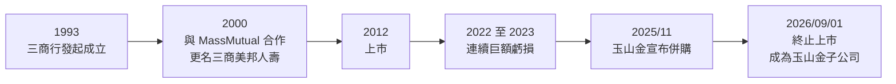
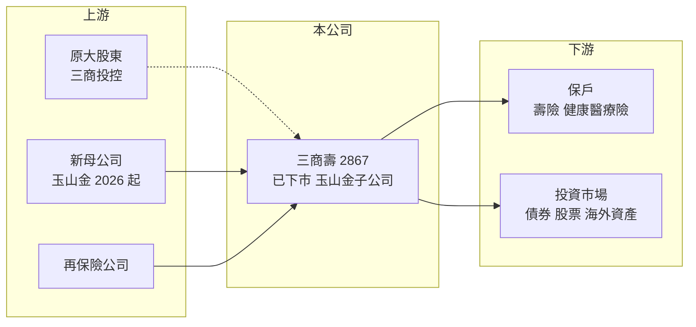

# 2867 三商壽

> 上市｜[[產業索引-金融保險業|金融保險業]]｜上市（櫃）日期 2012/12/18

# 第一章：企業模式與商業藍圖

> [!info] 撰寫說明
> 精簡版，由 Claude 依公開資料整理，架構比照 [[2330台積電]] 的四章研究，資料截至 2026-10-08。財務數字來源：Goodinfo 年度經營績效頁（含終止上市公告）、優分析（玉山金併購三商壽、三商壽下市報導）；三商壽已於 2026 年 9 月 1 日終止上市，證交所開放資料已無其紀錄，本筆記作為歷史研究保存。業務結構與增資過程為整理性描述，公開資料有限。#待校對

本章說明三商美邦人壽（股票代號：2867，以下簡稱三商壽）的商業模式與結局：一家由零售集團創辦、與美國壽險公司合作起家的中型壽險公司，如何在 2022 年的金融市場衝擊中陷入資本困境，最後以[[股份轉換]]方式併入 [[2884玉山金]]。

- **核心業務：** 三商壽由三商行（現 [[2905三商]] 三商投控）於 1993 年發起成立，2000 年與美商 MassMutual 金融集團策略合作，引進產品設計、投資與風險管理觀念並更名為三商美邦人壽，2012 年上市。壽險公司的商業模式是先收保費、多年後才給付，中間把資金拿去投資；獲利來自投資收益扣除保單保證成本的「利差」，以及死差、費差。三商壽以業務員通路與保障型商品（健康、醫療、壽險）為主（商品比重未查得，待校對）。
- **營收結構：** 三商壽總保費排名國內第 7，總資產約 1.6 兆元，員工約 11,000 人。Goodinfo 顯示營業收入從 2019 年的 1,790 億元降到 2025 年的 979 億元，反映新契約保費減少與經營規模收縮（各險種比重未查得）。
- **營運據點：** 總公司位於台北市，透過全台通訊處與業務員體系經營（據點數未查得）。
- **長期方向（併購結局）：** 2025 年 11 月 5 日，玉山金與三商壽董事會同日通過合意併購，以玉山金每 0.2486 股換發三商壽 1 股，100% 以股份轉換進行，三商壽約 9.1 萬名股東合計取得玉山金約 8.31% 股權。2026 年 1 月 23 日玉山金股東臨時會以近 86% 贊成通過，三商壽於 2026 年 8 月 20 日起停止買賣、9 月 1 日終止上市，掛牌逾 13 年走入歷史。併購後玉山金資產突破 5.8 兆元，補足銀行、證券之外的壽險引擎。

# 第二章：護城河深度與競爭優勢

本章分析三商壽的競爭位置，以及為什麼一家排名第 7 的壽險公司最後選擇被併購。壽險業的護城河主要來自規模、通路與資本，三商壽在第三項上明顯不足。

- **競爭優勢：** 三商壽長期經營業務員通路，保戶基礎與保障型商品經驗是主要資產，也是玉山金願意併購的原因：銀行、證券與投信可以結合壽險通路，提供財富管理與保障的整合服務。不過與大型壽險公司相比，三商壽的資本緩衝薄、投資規模小，屬於「無明顯護城河」的中型業者。
- **主要對手：** 國泰人壽（[[2882國泰金]]）、富邦人壽（[[2881富邦金]]）、新光人壽（併入 [[2887台新新光金]]）、凱基人壽（[[2883凱基金]]）等金控壽險，以及南山人壽、台灣人壽（中信金）。這些對手有銀行通路與龐大資本，能在利率與市場劇烈波動時撐住淨值。
- **觀察重點（併入玉山金後）：** 三商壽已不再單獨交易，後續應在 [[2884玉山金]] 的筆記中追蹤：壽險子公司對金控獲利的貢獻、增資需求、[[IFRS 17]] 與 [[ICS]] 接軌後的資本缺口，以及銀行保險通路整合的成效。

| 對手 | 定位 | 與三商壽的差距 |
|---|---|---|
| 金控大型壽險 | 資產規模數兆元、銀行通路 | 資本與通路遠勝，能承受市場衝擊 |
| 外資或獨立大型壽險（南山等） | 業務員通路強 | 在業務員通路與保障型商品直接競爭 |
| 中小型壽險 | 資本有限 | 同樣面臨接軌新制的增資或被併壓力 |

# 第三章：財務體質與盈利規模

資料日期：2026-10-08，表格是撰寫當時的快照；三商壽已於 2026 年 9 月 1 日下市，屬性欄位的自動更新也將停止。#待校對

壽險業不適用毛利率與營業利益率，本章改用營業收入、稅後淨利、[[ROE]] 與 [[ROA]] 檢視三商壽的獲利與資本體質。

| 年度 | 營業收入（新台幣） | 稅後淨利 | EPS（元） | [[ROE]] | [[ROA]] |
|---|---|---|---|---|---|
| 2019 | 1,790 億 | 50.1 億 | 2.12 | 18.2% | 0.44% |
| 2020 | 1,572 億 | 14.4 億 | 0.61 | 4.07% | 0.12% |
| 2021 | 1,431 億 | 10.9 億 | 0.42 | 2.61% | 0.08% |
| 2022 | 1,096 億 | -137 億 | -4.34 | -38.9% | -0.96% |
| 2023 | 1,233 億 | -95.2 億 | -2.11 | -27.7% | -0.64% |
| 2024 | 1,368 億 | 21.8 億 | 0.42 | 5.35% | 0.14% |
| 2025 | 979 億 | 11.8 億 | 0.20 | 2.88% | 0.07% |

註：取自 Goodinfo 合併報表。2023 年以後 EPS 下降幅度大於淨利，推估與增資使股數大增有關（推估）。

- **營收規模：** 2019 至 2025 年營業收入從 1,790 億元降到 979 億元，年複合成長率約 -9.6%（推算）。壽險營收主要是保費收入，持續下滑代表新契約動能不足。
- **獲利：** 2022 年全球股債雙跌，三商壽虧損 137 億元、ROE -38.9%；2023 年再虧 95.2 億元。兩年合計虧損超過 230 億元，侵蝕大量淨值，之後雖轉盈，ROE 只有 3% 至 5%。2021 至 2025 年平均 ROE 約 -11.2%（推算）。
- **財務特色：** ROA 長期只有 0.1% 上下，是壽險業「高槓桿、薄利差」的典型：總資產約 1.6 兆元，只要投資報酬率差 1 個百分點，就相當於 160 億元的損益差異，足以抹去數年獲利。綜合比率、投資收益率與 [[RBC]] 未查得。

**ROE 與權益資金成本：** 壽險公司的負債是保單準備金，屬於營業負債，[[ROIC]] 與 [[WACC]] 不適用，改以 ROE 對比 [[CAPM]] 推算的權益資金成本。假設台灣 10 年期公債殖利率 1.75%、市場風險溢酬 6%、β 取中小型壽險常見值 1.0（同業常見值，非來源數字），權益資金成本約 1.75% ＋ 1.0 × 6% ＝ 7.75%（推算）。三商壽 2020 年以後沒有任何一年 ROE 超過權益成本，2021 至 2025 年平均更是負值，代表這段期間持續毀損股東價值。這也是最終選擇以股份轉換併入金控的根本原因：單靠自身獲利無法補足接軌新制所需的資本。

# 第四章：總體風險與地緣政治

本章整理三商壽曾面對、也是台灣中小型壽險普遍面對的風險，作為理解壽險業的教材。

- **產業週期：** 壽險公司的獲利與資本取決於利率與金融市場。利率長期偏低時，過去賣出的高預定利率保單形成[[利差損]]；利率快速上升或股債同跌時，金融資產評價大幅下跌，2022 年就是這種情境，直接導致三商壽巨額虧損。
- **營運風險：** 資本緩衝薄的壽險公司在市場衝擊後必須增資，增資會稀釋原股東；若大股東無力持續增資，就只能尋求併購。新契約動能下滑則讓公司更依賴既有保單的投資收益，形成惡性循環。
- **其他風險：** 2026 年起台灣保險業接軌 [[IFRS 17]] 與 [[ICS]]，負債改以市價評估，資本要求提高，是中小型壽險整併的重要推力。對原三商壽股東而言，換股後的風險轉為玉山金整體的經營風險，包括壽險子公司增資需求與整合成效。

# 專有名詞解析

## 金融

- **[[股份轉換]]**：以發行新股交換目標公司全部股份的併購方式，目標公司成為百分之百子公司並下市櫃。
- **[[IFRS 17]]**：國際保險合約會計準則，改變保險公司認列保費收入與負債的方式，台灣於 2026 年接軌。
- **[[ICS]]**：保險業新一代清償能力制度，以市值評估資產與負債，衡量壽險公司資本是否足以承擔風險。
- **[[利差損]]**：壽險公司投資報酬率低於保單承諾給保戶的預定利率時產生的虧損，是壽險業最主要的長期風險。
- **[[RBC]]**：風險資本適足率，保險公司自有資本除以風險資本，台灣法定最低要求為 200%。
- **[[ROA]]**：資產報酬率，稅後淨利除以總資產，金融業因槓桿高，ROA 通常偏低。
- **[[CAPM]]**：資本資產定價模型，以無風險利率加上 β 乘以市場風險溢酬，推估股東要求的報酬率。
- **[[ROIC]]**：投入資本報酬率，稅後營業利益除以股東權益加有息負債，衡量本業運用資本的效率；不適用於銀行與保險業。
- **[[WACC]]**：加權平均資金成本，依股權與負債比重加權的資金成本，是判斷 ROIC 是否創造價值的門檻。

# 核心供應鏈

- 上游：原發起股東 [[2905三商]]（三商投控）；2026 年起的母公司 [[2884玉山金]]；再保險公司（如 [[2851中再保]]）。
- 下游／客戶：壽險與健康醫療險保戶，透過業務員與玉山銀行通路銷售；保費資金投入債券、股票與海外資產。
- 同業：[[2882國泰金]]、[[2881富邦金]]、[[2887台新新光金]]、[[2883凱基金]]；南山人壽、台灣人壽（未在本筆記庫單獨建檔或不屬上市公司）。

## 最新新聞
<!-- news:start -->
<!-- news:end -->

## 相關連結
- [公開資訊觀測站](https://mopsov.twse.com.tw/mops/web/t05st03?step=1&firstin=1&co_id=2867)
- [Goodinfo](https://goodinfo.tw/tw/StockDetail.asp?STOCK_ID=2867)
- [Yahoo 股市](https://tw.stock.yahoo.com/quote/2867)
- [鉅亨網新聞](https://www.cnyes.com/twstock/2867/news)
