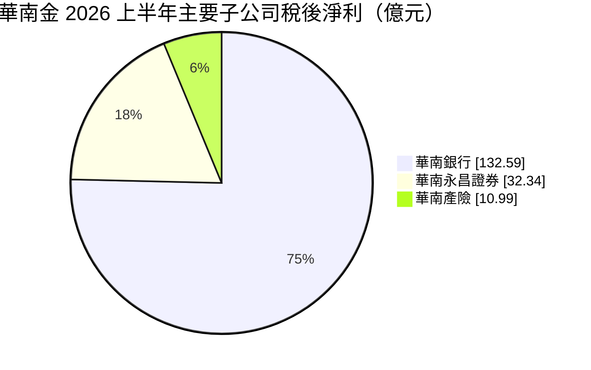
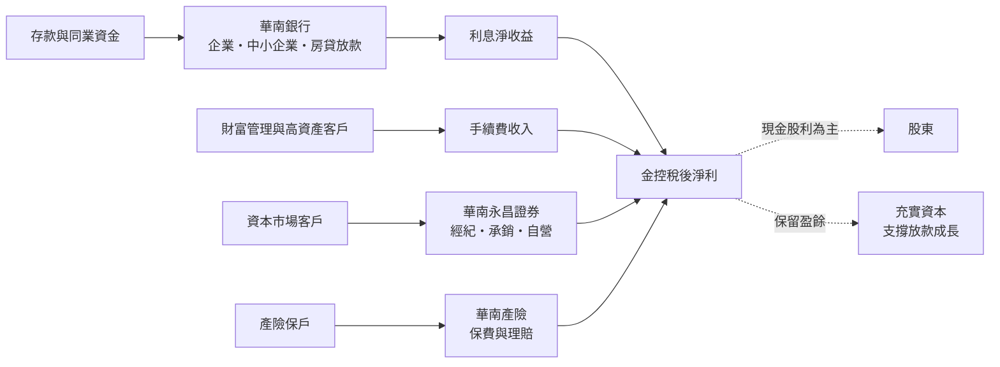
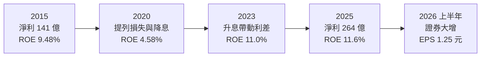
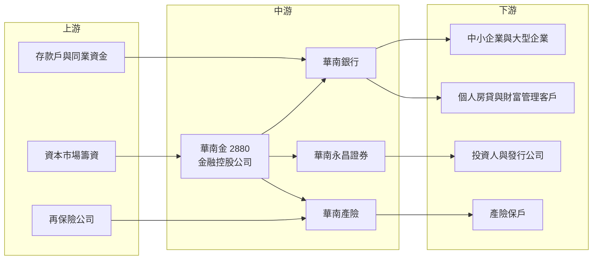

# 2880 華南金

> 上市｜[[產業索引-金融保險業|金融保險業]]｜上市（櫃）日期 2001/12/19

# 第一章：企業模式與商業藍圖

> [!info] 撰寫說明
> 本文由 Claude 依公開資料整理，架構比照 [[2330台積電]] 的四章研究，資料截至 2026-10-08。財務數字來源：證交所開放資料快照（基本資料、股利）、Goodinfo 經營績效頁與股利政策頁（2015 至 2025 年）、工商時報旺得富 2026 年 8 月法說會報導、優分析 2025 年法說會報導（五大策略與子公司獲利）；華南銀行歷史沿革、中小企業放款市占與公股持股結構為整理性內容或憑記憶整理，尚未逐條比對原始文件。#待校對

在評估一家公司的長期投資價值時，第一步是看懂它靠什麼賺錢、為什麼能一直賺下去。本章針對華南金融控股（股票代號：2880，以下簡稱華南金）的商業模式進行定性分析，說明一家以百年銀行為核心的公股金控，如何在利差、手續費與保費三條現金流之間取得平衡，以及它為什麼開始把「資本效率」當作經營的核心指標。

## 一、核心定位：以百年銀行為核心、獲利逐步多元化的公股金控

華南金成立於 2001 年 12 月，是台灣《金融控股公司法》施行後第一批成立的金控之一，實收資本額約 1,406 億元，董事長為陳芬蘭。核心子公司華南商業銀行的歷史可追溯到日治時期（待校對），是台灣歷史最悠久的商業銀行之一，長期以中小企業放款與企業金融見長。其他主要子公司包括華南永昌證券、華南產物保險，以及投信、創投與資產管理公司。華南金屬於公股金控，政府相關股東對董事會與經營階層的人選有重要影響力（持股結構細節待校對）。

理解銀行型金控，要先理解銀行的獲利方式。銀行向存款人借錢（支付存款利息），再借給企業與個人（收取放款利息），兩者之間的差距就是[[利差]]。由於銀行的資產規模通常是股東權益的十幾到二十倍，即使每一塊錢資產只賺 0.5% 至 0.7%（[[ROA]]），乘上財務槓桿後，股東權益報酬率（[[ROE]]）仍能達到一成上下。華南金 2015 至 2025 年的 ROA 除 2020 年外都在 0.47% 至 0.62% 之間，正是典型的台灣銀行業水準。

華南金和其他公股金控（[[2892第一金]]、[[5880合庫金]]、[[2886兆豐金]]）相比，有兩個特色。第一，它擁有一家獲利穩定的產險子公司，這在公股金控中較少見，讓集團多了一條與利率較無關的收入來源。第二，它的財富管理業務起步較早，華南銀行是第一家財富管理手續費收入突破百億元的公股銀行。依工商時報旺得富 2026 年 8 月報導，非銀行子公司已占集團獲利約 27%，在以銀行為主的公股金控中偏高。

## 二、終端應用／產品板塊：子公司的角色分工

金控不適用製造業的產品營收結構，以下以 2026 年上半年主要子公司稅後淨利呈現獲利來源（單一期間，證券獲利受當年台股熱度影響偏高）：

- **華南銀行（集團獲利主體）：** 主要業務是企業與中小企業放款、房貸與消費金融、外匯與國際金融業務（[[OBU]] 與海外分行），以及財富管理。中小企業放款是華南銀行的傳統強項，依 2025 年法說會報導，市占約 7%（待校對）。近年成長最快的是財富管理與高資產客戶業務，依旺得富報導，2026 年 7 月底高資產客戶超過 3,200 戶、資產管理規模（[[AUM]]）逾 2,600 億元。
- **華南永昌證券：** 經營經紀、[[承銷]]、自營與財富管理業務，是公股券商中規模較大的一家。證券獲利高度依賴台股成交量與資本市場活動，好年份與壞年份的差距可以達數倍，因此應視為集團獲利的「週期性加分項」，而不是基本盤。
- **華南產險：** 經營車險、火險、工程險等產物保險。產險業的獲利來自保費收入扣除理賠與費用，以及保費資金的投資收益；與銀行的房貸與企業客戶有交叉銷售機會。
- **其他子公司：** 投信、創投與資產管理公司規模較小，主要功能是補足產品線與處理不良資產。

## 三、資本轉化邏輯（營運模式）：利差、手續費與保費三條現金流

- **利差是基本盤：** 銀行的利息淨收益占集團收入最大比重，水準取決於央行利率、存放款結構與放款定價能力。依旺得富報導，華南銀行 2026 年 1 至 7 月[[NIM]]較前一年提高約 6 個基點，原因是存放款結構調整，代表公司正在把資源從低利差業務移向較高利差的業務。
- **手續費是第二支柱：** 財富管理、信託、外匯與聯貸等收費業務，不需要像放款一樣占用大量資本，能直接提高 ROE。這也是近年台灣各家金控都把財富管理當成成長重心的原因。
- **資本是約束條件：** 銀行每增加一筆放款，都要依風險權數提列資本。華南金導入「風險性資產報酬率（[[RORWA]]）」作為業務指引，要求每一筆業務都計算占用多少資本、賺回多少收益，避免為了衝放款量而犧牲獲利率。

## 四、企業長期藍圖：資本效率、財富管理與海外布局

- **提高資本效率：** 2025 年法說會提出的五大策略，第一項就是以 RORWA 為指引提升利差與資本使用效率。這代表華南金的經營重心，正在從「做大放款規模」轉向「提高每一塊資本的報酬」。
- **深化財富管理與高資產客群：** 高資產客戶數與 AUM 在 2024 至 2026 年間大幅成長，若能持續，收費收入占比提高，會讓集團獲利對利率週期的敏感度下降。
- **海外與供應鏈移轉商機：** 華南銀行透過 OBU 與海外分行服務台商在東南亞與美國的布局，外幣放款成長明顯。這是台灣銀行業共同的長期機會，但也伴隨海外授信風險。
- **數位化與集團共銷：** 以 AI 與流程自動化降低營運成本，並透過子公司之間的[[共同行銷]]提高每位客戶的貢獻。

# 第二章：護城河深度與競爭優勢

在長期價值投資中，「護城河」指企業抵禦競爭、長期維持超額利潤的保護機制。銀行業的護城河主要來自低成本資金、長期客戶關係與監管門檻。本章分析華南金的護城河構成、公股與民營兩類主要對手，以及它的優勢在不同業務中能守住多少。

## 一、華南金護城河的核心組成要素

- **1. 公股信用與穩定的存款基礎：** 公股銀行在民眾與企業心中的信用接近政府，存款來源穩定，資金成本相對較低。銀行的原料就是資金，資金成本較低的銀行，在放款定價上就有空間。這是華南金最根本、也最持久的優勢。
- **2. 中小企業與企業客戶的長期關係：** 中小企業與銀行往來多年後，帳戶、授信額度、外匯與薪轉都集中在同一家銀行，更換銀行的成本與麻煩很高。華南銀行數十年經營中小企業市場，累積的客戶關係是不易被複製的資產。
- **3. 監管門檻：** 銀行、證券與保險都是特許行業，新進者需要取得執照並符合資本要求，台灣多年來幾乎沒有新銀行設立（純網銀除外）。這讓既有業者的市場結構相對穩定。
- **4. 產險與證券帶來的多元化：** 產險與證券讓華南金不必完全依賴利差。在利率下行期，證券與財富管理的收入通常會上升，部分抵銷利差收窄的影響。

整體而言，華南金的護城河屬於「穩定但不寬」的類型：公股信用與客戶關係讓它很難被打敗，但也很難賺到明顯高於同業的報酬。

## 二、主要競爭對手格局

| 對手 | 定位 | 對華南金的影響 |
|---|---|---|
| [[2892第一金]]、[[5880合庫金]]、[[2886兆豐金]] | 公股金控 | 在中小企業放款、企業金融與政府相關業務直接競爭 |
| [[2801彰銀]]、[[2834臺企銀]] | 公股銀行 | 同樣以低資金成本爭取企業放款 |
| [[2891中信金]]、[[2884玉山金]]、[[2882國泰金]]、[[2881富邦金]] | 民營金控 | 在財富管理、信用卡與數位金融上具優勢，搶高資產客戶 |
| [[2885元大金]]、[[2883凱基金]] | 證券型金控 | 在經紀與承銷規模上領先華南永昌證券 |

## 三、優勢轉化：守得住／守不住／觀察重點

- **守得住：** 中小企業放款、傳統企業金融與存款基礎。這些業務仰賴長期關係與公股信用，民營銀行難以快速取代，能提供穩定的利息收入。
- **守不住：** 財富管理與數位金融的領先地位。華南金在公股銀行中財管起步較早，但與民營金控相比，產品線、行銷資源與數位體驗仍有差距；證券獲利則高度依賴台股熱度，好年份的高獲利無法視為常態。
- **觀察重點：** 長期而言，可以追蹤三件事。第一是 ROE 能否穩定維持在一成以上，而不只是在證券大好的年份達標；第二是收費收入占比是否持續提高；第三是逾期放款比率與備抵呆帳覆蓋率在景氣下行時的表現，這決定銀行的長期信用品質。

# 第三章：財務體質與盈利規模

資料日期：2026-10-08。數字取自 Goodinfo 經營績效頁與股利政策頁、證交所股利資料與旺得富法說會報導，表格是撰寫當時的快照；最新月營收與累計 EPS 由自動排程寫在本筆記的屬性欄位。#待校對

財務報表是檢驗護城河是否真實存在的最終標準。金控不適用製造業的毛利率與營業利益率，本章改以淨收益、稅後淨利、ROE 與 ROA 的多年度變化，搭配股利與股東權益成本，檢視華南金的獲利品質。

## 一、獲利能力的基石：淨收益、淨利與資產報酬

| 年度 | 營業收入（億元） | 稅後淨利（億元） | EPS（元） | [[ROE]] | [[ROA]] |
|---|---|---|---|---|---|
| 2015 | 396 | 141 | 1.42 | 9.48% | 0.61% |
| 2017 | 422 | 120 | 1.09 | 7.43% | 0.47% |
| 2019 | 467 | 160 | 1.31 | 8.79% | 0.59% |
| 2020 | 400 | 86.5 | 0.67 | 4.58% | 0.30% |
| 2021 | 511 | 172 | 1.30 | 8.82% | 0.52% |
| 2022 | 537 | 173 | 1.27 | 8.98% | 0.49% |
| 2023 | 595 | 216 | 1.58 | 11.0% | 0.58% |
| 2024 | 668 | 231 | 1.68 | 10.8% | 0.57% |
| 2025 | 695 | 264 | 1.90 | 11.6% | 0.62% |

（來源：Goodinfo 經營績效頁，合併報表；金控的營業收入為淨收益口徑。2026 年上半年依旺得富報導，稅後淨利 173.64 億元、EPS 1.25 元，年增約 58%，其中證券獲利大增屬景氣性成分。）

- **十年穩健成長，2020 年是例外：** 2015 至 2025 年營業收入由 396 億元增至 695 億元，年複合成長率約 5.8%（推算）；稅後淨利由 141 億元增至 264 億元，年複合成長率約 6.5%（推算）。2020 年淨利腰斬至 86.5 億元，主要與降息及個別授信案件的損失有關（原因細節待校對），是十年中唯一明顯的低谷。
- **2023 年後 ROE 站上一成：** 2022 至 2023 年的升息讓銀行利差改善，加上財富管理與證券收入增加，華南金 ROE 從過去長期的 8% 至 9% 提高到 11% 上下。這是近十年來華南金獲利能力最好的階段，但也有一部分來自利率環境，而非純粹的競爭力提升。
- **ROA 反映業務本質：** ROA 除 2020 年外大致在 0.5% 至 0.6% 之間，代表華南金每一塊錢資產能賺的錢有限，ROE 主要靠財務槓桿放大。這是銀行業的共同特性，也說明資本適足與資產品質管理的重要性。

## 二、[[ROE]]：資本效率與財務槓桿

2021 至 2025 年華南金平均 ROE 約 10.2%（推算），2015 至 2025 年的長期平均則約 9% 上下（推算），在台灣金控中屬於中段。以 2025 年 ROE 11.6% 與 ROA 0.62% 推算，股東權益約占總資產的 5% 多一點，財務槓桿約 18 至 19 倍（推算）。每股淨值由 2020 年的 14.73 元增加到 2025 年的 16.98 元，成長速度不快，主因是盈餘大部分以現金與股票股利發放，加上股票股利使股本持續增加。

## 三、資本適足、股利與盈餘保留

- **資本適足：** 華南銀行最新的[[資本適足率]]、[[逾放比]]與[[備抵呆帳覆蓋率]]本次未查得具體數字。公司在 2026 年股東會表示會保留更多盈餘強化資本結構，顯示資本仍是放款與投資擴張的約束條件。
- **股利穩定度：** 依 Goodinfo，2015 至 2025 年度華南金每年都有配發股利，合計每股約 0.53 元至 1.45 元。2021 年度以前多採「現金與股票股利各半」的方式，用股票股利保留資本；2022 年度起以現金為主，2023 至 2025 年度現金股利分別為 1.20、1.25、1.35 元，另各配 0.1 元股票股利。以 EPS 計算，2023 至 2025 年度的現金配發率約 71% 至 76%（推算），總配發率約 76% 至 82%。
- **股票股利的稀釋效果：** 股本由 2015 年約 991 億元增加到 2025 年約 1,392 億元，十年增加約四成。股票股利讓銀行在不增資的情況下保留資本，但也使 EPS 的成長率低於淨利成長率。

## 四、ROE 與 CAPM 股東權益成本：價值創造利差

金控的資金來源主要是存款與負債，負債本身就是營業的原料，因此不適用一般產業的 ROIC 與 WACC。本節改以 ROE 與 [[CAPM]] 估算的股東權益成本比較，判斷華南金是否替股東創造超額報酬。

- **股東權益成本（推算）：** 無風險利率取台灣 10 年期公債約 1.75%，市場風險溢酬 6%，β 假設 0.6（台灣公股銀行股常見區間約 0.5 至 0.7，未查得華南金實際數字），股東權益成本約 1.75% + 0.6 × 6% = 5.35%（推算）。若 β 取 0.8，成本約 6.55%。
- **ROE 與成本的比較：** 2021 至 2025 年平均 ROE 約 10.2%，比 5.35% 至 6.55% 的股東權益成本高出約 4 至 5 個百分點；2015 至 2019 年 ROE 在 7.4% 至 9.5% 之間，利差約 1 至 4 個百分點；2020 年 ROE 4.58%，則低於股東權益成本。
- **價值創造判斷：** 以長期平均來看，華南金的 ROE 大致高於股東權益成本，代表它是一家能小幅但穩定創造價值的金控。不過 ROE 高於成本的幅度，有一部分來自低利率環境下偏低的無風險利率；若台灣長期利率明顯上升，股東權益成本也會跟著提高。華南金要擴大這個利差，關鍵在於提高收費收入占比、維持資產品質，並落實 RORWA 的資本紀律。

# 第四章：總體風險與地緣政治

任何企業都無法脫離宏觀環境獨立存在。本章分析華南金未來必須面對的地緣政治、利率與景氣週期、授信與營運風險，以及金融法規與科技演進帶來的挑戰。

## 一、地緣政治風險

- **兩岸與區域衝突：** 華南銀行在海外有分支機構，台商客戶分布於中國與東南亞。兩岸關係緊張或區域衝突，可能影響台商的營運與還款能力，也可能引發國際資金撤出，影響金融市場與金控的投資部位。
- **供應鏈移轉的雙面性：** 台商把產能移往東南亞與美國，創造海外授信與外匯業務機會；但海外授信的徵信資訊較少、法律環境不同，風險也較高。
- **美國關稅與出口景氣：** 中小企業多數與出口相關，關稅與全球需求變化會直接影響它們的營運資金與還款能力。

## 二、利率與景氣週期

- **利差的利率敏感度：** 銀行利息淨收益與央行利率高度相關。升息期間，放款利率調整較快，利差擴大；降息期間則相反。華南金 2020 年的獲利低谷與 2023 年後的回升，都和利率環境有關。
- **證券獲利的週期性：** 證券的經紀、承銷與自營收入隨台股熱度大幅波動。台股熱絡時，非銀行占比會明顯提高，但這部分獲利在空頭市場可能快速縮水，甚至轉為虧損。
- **產險巨災風險：** 颱風、地震等天災會造成理賠暴增。產險公司透過[[再保險]]分散部分風險，但重大災害仍可能讓單年獲利大幅下滑。

## 三、營運環境的隱性風險

- **授信集中與景氣下行：** 中小企業放款占比高，景氣衰退時違約率通常較大企業上升得快。銀行必須在景氣好時提足備抵呆帳，才能在景氣差時避免獲利大幅波動。
- **財富管理的銷售合規：** 高資產業務快速成長時，商品適合度、銷售揭露與客戶糾紛的風險也會上升。台灣過去曾發生多起金融商品銷售爭議，主管機關的裁罰會影響商譽與獲利。
- **公股治理：** 公股金控的董事長與總經理人選受政府影響，經營階層更替可能影響策略的連續性；政策性任務（如配合政府融資計畫）也可能與股東報酬最大化有所衝突。

## 四、法規與科技演進

- **資本規範趨嚴：** 國際資本規範與國內主管機關對系統性重要銀行的要求逐步提高，銀行需要保留更多資本，可能限制配息與放款成長。
- **保險業新會計制度：** 國際財務報導準則 IFRS 17 與新一代清償能力制度上路後，保險子公司的資本要求與獲利認列方式改變，產險子公司也需要因應（影響程度待校對）。
- **數位金融與新進者：** 純網銀、電子支付與金融科技業者在支付、消費金融與小額投資上與傳統銀行競爭。華南金若在數位體驗上落後，年輕客群與小額業務可能逐步流失。

# 專有名詞解析

## 金融

- **[[利差]]**：銀行放款利率與存款利率之間的差距，是銀行最主要的獲利來源。
- **[[NIM]]**：淨利息收益率，利息淨收益除以生息資產，衡量銀行運用資金的利差水準。
- **[[ROA]]**：資產報酬率，稅後淨利除以總資產，銀行業通常在 0.5% 至 1% 之間。
- **[[RORWA]]**：風險性資產報酬率，稅後淨利除以風險加權資產，衡量每單位資本占用能賺多少錢。
- **[[資本適足率]]**：銀行自有資本除以風險加權資產的比率，主管機關設有最低要求，用來確保銀行承受損失的能力。
- **[[逾放比]]**：逾期放款占總放款的比例，數字越低代表授信品質越好。
- **[[備抵呆帳覆蓋率]]**：備抵呆帳除以逾期放款的比例，代表銀行為可能的壞帳預先準備了多少緩衝。
- **[[AUM]]**：資產管理規模，金融機構替客戶管理或保管的資產總額，常用來衡量財富管理業務的大小。
- **[[OBU]]**：國際金融業務分行，以外幣服務境外客戶的銀行單位，是台灣銀行服務海外台商的重要管道。
- **[[承銷]]**：證券商協助企業發行股票或債券並銷售給投資人，收取承銷費用的業務。
- **[[共同行銷]]**：金控旗下銀行、證券、保險等子公司互相介紹客戶與交叉銷售商品的做法。
- **[[再保險]]**：保險公司把部分承保風險轉移給再保險公司，以降低單一重大理賠對自身的衝擊。
- **[[CAPM]]**：資本資產定價模型，以無風險利率加上 β 乘以市場風險溢酬估算股東要求報酬率。
- **[[ROE]]**：股東權益報酬率，稅後淨利除以股東權益，衡量公司運用股東資金賺錢的效率。

# 核心供應鏈

## 1. 上游：資金來源
- 個人與企業存款、同業拆借與債券發行
- 再保險公司（分擔產險承保風險）

## 2. 中游：華南金本身與子公司
- 華南商業銀行、華南永昌證券、華南產物保險、華南投信、華南創投、華南金資產管理

## 3. 下游：客戶
- 中小企業、大型企業與海外台商（授信、外匯、OBU）
- 個人客戶（房貸、信用卡、財富管理、高資產業務）
- 證券投資人與承銷發行公司、產險保戶

## 4. 同業
- 公股金控與銀行：[[2892第一金]]、[[5880合庫金]]、[[2886兆豐金]]、[[2801彰銀]]、[[2834臺企銀]]
- 民營金控：[[2891中信金]]、[[2884玉山金]]、[[2882國泰金]]、[[2881富邦金]]、[[2885元大金]]、[[2883凱基金]]

## 最新新聞
<!-- news:start（自動產生，請勿手動編輯此範圍） -->
- 2026-10-15 🏛️ 重訊 17:23｜代子公司華南國際租賃股份有限公司公告董事會決議 其子公司華南國際租賃有限公司解散清算及成立清算組事宜｜[觀測站](https://mops.twse.com.tw/mops/#/web/t05st01)
- 2026-10-14 🏛️ 重訊 16:55｜代子公司華南產險公告公司治理主管異動｜[觀測站](https://mops.twse.com.tw/mops/#/web/t05st01)
- 2026-10-13 📰 媒體 20:04｜華南金前3季賺263億元直逼去年全年 EPS 1.88元同創新高｜[鉅亨網](https://news.cnyes.com/news/id/6629604)
- 2026-10-13 🏛️ 重訊 17:49｜公告本公司115年9月份自結盈餘｜[觀測站](https://mops.twse.com.tw/mops/#/web/t05st01)

完整紀錄：[[2880華南金 新聞]]
<!-- news:end -->

## 相關連結
- [公開資訊觀測站](https://mopsov.twse.com.tw/mops/web/t05st03?step=1&firstin=1&co_id=2880)
- [Goodinfo](https://goodinfo.tw/tw/StockDetail.asp?STOCK_ID=2880)
- [Yahoo 股市](https://tw.stock.yahoo.com/quote/2880)
- [鉅亨網新聞](https://www.cnyes.com/twstock/2880/news)
