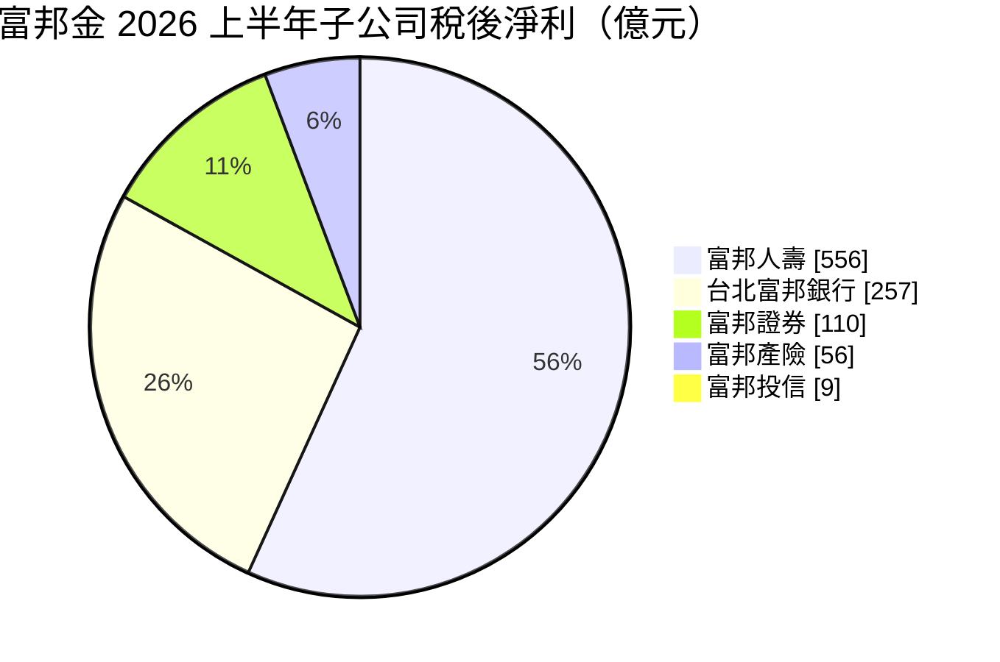
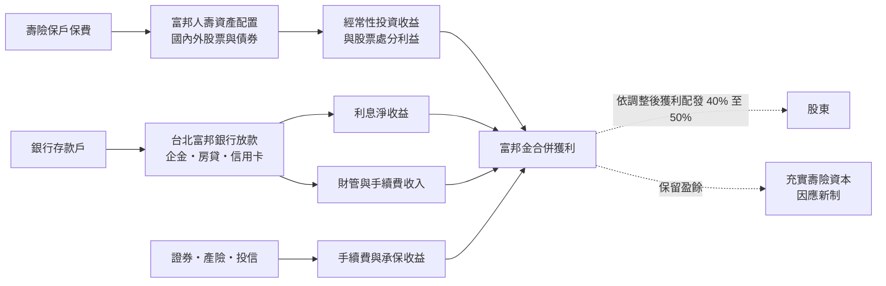
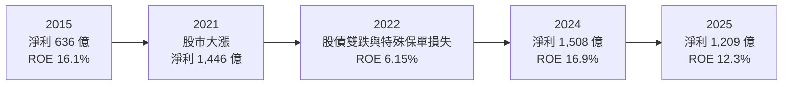
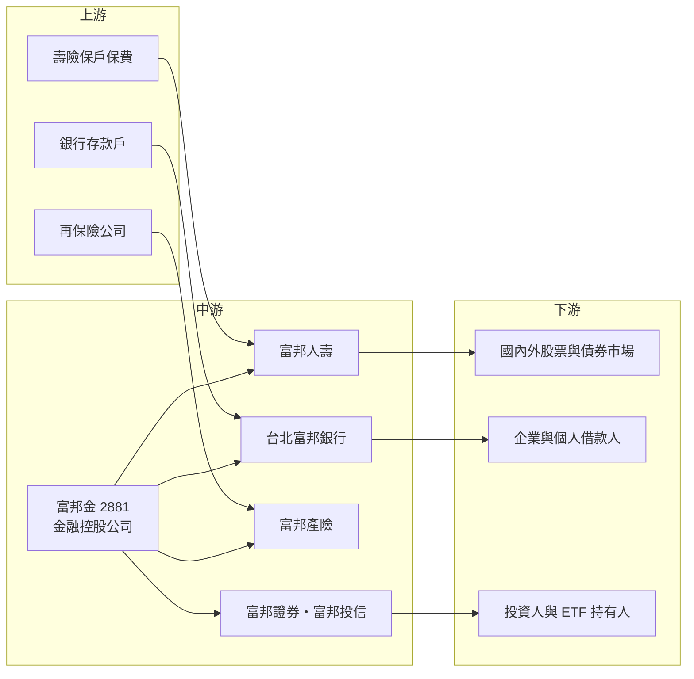

# 2881 富邦金

> 上市｜[[產業索引-金融保險業|金融保險業]]｜上市（櫃）日期 2001/12/19

# 第一章：企業模式與商業藍圖

> [!info] 撰寫說明
> 本文由 Claude 依公開資料整理，架構比照 [[2330台積電]] 的四章研究，資料截至 2026-10-08。財務數字來源：證交所開放資料快照（基本資料、股利）、Goodinfo 經營績效頁與股利政策頁（2015 至 2025 年）、富邦金控 2026 年股東會新聞稿、優分析與經濟日報 2025 至 2026 年法說會報導（子公司獲利、股利政策、資本指標）；台北銀行、安泰人壽與日盛金等併購年份係憑記憶整理，尚未逐條比對原始文件。#待校對

在評估金融股的長期投資價值時，第一步是看清楚獲利從哪一家子公司、哪一種業務而來。本章針對富邦金融控股（股票代號：2881，以下簡稱富邦金）的商業模式進行定性分析，說明它如何以富邦人壽為獲利主引擎、台北富邦銀行為穩定器，長期維持國內[[金控]]獲利規模領先的地位，以及壽險型金控為什麼在股市大好時獲利驚人、在股市轉弱時又波動劇烈。

## 一、核心定位：國內獲利規模最大的壽險型金控

富邦金成立於 2001 年 12 月，是國內第一批成立的金控之一，董事長為蔡明興，實收資本額約 1,561 億元（含特別股）。旗下主要子公司包括富邦人壽、台北富邦銀行、富邦產險、富邦證券、富邦投信，海外則有富邦銀行（香港）與上海的富邦華一銀行。依公司 2026 年股東會新聞稿，富邦金已連續 17 年位居國內金控每股獲利第一。

富邦金今天的規模，是一連串併購累積而來的。重要的里程碑包括：併購台北銀行並與富邦銀行合併為台北富邦銀行、併購安泰人壽擴大壽險規模、取得香港與中國大陸的銀行據點，以及 2023 年合併日盛金控（以上年份與細節待校對）。這些併購讓富邦金在壽險、銀行、證券、產險各領域都成為國內前段班，也讓它成為台灣少數能與 [[2882國泰金]] 在規模上正面競爭的金控。

理解富邦金，關鍵在於理解「壽險型金控」的獲利結構。壽險公司向保戶收取保費，承諾未來給付保險金，中間長達數十年的期間，保費會被投資在國內外的股票與債券上。由於壽險公司持有的投資部位非常龐大，股市與債市的漲跌會直接放大反映在獲利上。因此富邦金的獲利有兩個基本特徵：壽險決定獲利的高度，銀行決定獲利的下限。

## 二、終端應用／產品板塊：壽險與銀行雙引擎，證券、產險與投信加分

以 2026 年上半年各子公司稅後淨利來看（單一期間，不含直接進入保留盈餘的股票處分利益，台股大漲使壽險與證券偏高）：

- **富邦人壽（獲利主引擎）：** 國內規模最大的壽險公司之一，主要獲利來自投資收益扣除對保戶的負債成本。壽險的長期價值取決於兩件事：新保單能創造多少未來利潤（[[VNB]]），以及龐大投資部位的報酬率。股市大好時，壽險可以實現大額資本利得；股市與匯率不利時，則可能出現大額評價損失與避險成本。
- **台北富邦銀行（獲利穩定器）：** 經營企業金融、房貸、信用卡與財富管理，獲利主要來自[[利差]]與手續費，受股市影響較小。依法說會報導，2025 年稅後淨利約 363 億元，是集團最可預期的收益來源。
- **富邦產險：** 國內產險龍頭，市占率約兩成以上，車險與商業保險規模大，具有定價與理賠數據的優勢。產險獲利通常穩定，但遇到巨災或特殊保單時可能出現大額損失。
- **富邦證券與富邦投信：** 證券業務隨台股成交量起伏；投信受惠於 [[ETF]] 的普及，資產管理規模在 2026 年突破 1.6 兆元，是集團手續費收入的成長來源。
- **海外銀行：** 富邦銀行（香港）與富邦華一銀行讓富邦金擁有兩岸三地的銀行網路，但獲利規模仍明顯小於國內業務。

## 三、資本轉化邏輯（營運模式）：保費與存款如何變成獲利

- **壽險獲利的兩條入帳路徑：** 在現行會計準則下，壽險持有的股票多分類為 [[FVOCI]]，賣股利益不經過損益表，而是直接轉入保留盈餘。因此富邦金除了公布一般 EPS，也公布加計這類處分利益的「調整後 EPS」。依法說會報導，2026 年上半年一般 EPS 為 6.67 元，調整後 EPS 為 13.17 元，兩者差距很大。投資人評估富邦金的實際賺錢能力與配息能力，必須同時看這兩個數字。
- **銀行端的利差與手續費：** 台北富邦銀行靠放款利差與財富管理手續費賺錢，獲利隨利率週期與放款成長穩定變化，是集團獲利波動的緩衝。
- **集團綜效：** 銀行、證券、投信與壽險共用客群，透過[[交叉銷售]]把基金、ETF 與保險商品賣給同一批客戶，提高每位客戶的貢獻。

## 四、企業長期藍圖：資本累積、穩定配息與海外延伸

- **資本累積因應新制：** 台灣壽險業在 2026 年起接軌 [[IFRS 17]] 與新一代清償能力制度 [[ICS]]，對壽險資本的要求更嚴格。富邦金近年保留大量盈餘、累積淨值，依法說會報導，2026 年 6 月底富邦人壽淨值比超過 15%。資本是否充足，決定了壽險未來能否穩定配息給金控、金控能否穩定配息給股東。
- **穩定的配息政策：** 管理層表示以「調整後獲利」為基準，維持 40% 至 50% 的配發率，以現金股利為主。這個政策讓股東能分享股市好年份的資本利得，同時保留資本因應股市反轉。
- **資產管理與財富管理：** 以投信 ETF 與銀行財管為核心，擴大手續費收入，降低集團對壽險投資收益的依賴。
- **海外延伸：** 透過香港與中國大陸的銀行據點，以及亞洲其他市場的布局，服務兩岸三地與東南亞的客戶，但海外布局的速度受到地緣政治與監管限制。

# 第二章：護城河深度與競爭優勢

在長期價值投資中，「護城河」指企業抵禦競爭、長期維持超額利潤的保護機制。金融業產品同質性高，護城河多半來自規模、資本與通路。本章分析富邦金的護城河構成、國內主要競爭對手，以及這些優勢在利率與股市循環中能守住多少。

## 一、護城河的核心組成要素

富邦金的護城河在國內金融業中屬於較寬的一類，主要由以下四個要素構成：

- **1. 資本與投資規模：** 富邦人壽是國內最大的機構投資人之一，集團淨值在 2026 年上半年超過 1.2 兆元。龐大的資本讓它在股市大漲時能實現大額資本利得，也能承受較大的評價波動，在資本規範趨嚴的時代，資本本身就是競爭力。
- **2. 多元而均衡的獲利來源：** 壽險、銀行、證券、產險、投信都位居國內前段班，任何一個子公司表現不佳時，其他子公司可以部分抵銷。例如 2022 年產險受特殊保單損失衝擊、壽險受股債雙跌影響時，銀行仍維持穩定獲利。
- **3. 產險龍頭地位：** 富邦產險規模最大，擁有最多的理賠與定價數據，在車險與商業保險上具有成本與定價優勢。
- **4. 保單存量與客戶黏著度：** 長年期壽險保單一旦售出，客戶解約的成本很高，形成數十年穩定的負債端資金。這批資金讓壽險公司能以長期視角投資，是短期內無法複製的資產。

## 二、全球主要競爭對手格局

| 對手 | 定位 | 對富邦金的影響 |
|---|---|---|
| [[2882國泰金]] | 壽險規模最大、銀行信用卡強 | 在壽險、銀行、證券、投信全面正面競爭 |
| [[2887台新新光金]]、[[2883凱基金]] | 合併後的壽險加銀行或證券型金控 | 在壽險新契約與財富管理客群直接競爭 |
| [[2891中信金]]、[[2884玉山金]] | 銀行實力強的民營金控 | 在信用卡、財富管理、企業金融與海外分行競爭 |
| [[2885元大金]] | 證券與 ETF 龍頭 | 在證券經紀與 ETF 市占直接競爭 |
| 公股金控 | 存款成本低、企業金融強 | 在企業放款與存款業務上競爭 |

## 三、優勢轉化：守得住／守不住／觀察重點

- **守得住：** 集團資本規模、產險龍頭地位與多元化的獲利結構。這些優勢需要數十年與多次併購才能建立，其他金控短期內很難追上。富邦金 2015 至 2025 年的 ROE 只有 2022 年低於 9%，在壽險型金控中屬於波動較小的一家。
- **守不住：** 壽險獲利對股市與匯率的敏感度。富邦人壽的投資部位龐大，股市大跌、新台幣急升或避險成本上升時，獲利可能在一年內大幅下滑，2022 年 ROE 降到 6.15% 就是例子。這種波動是壽險型金控的本質，無法靠經營能力完全消除。
- **觀察重點：** 長期而言，可以追蹤三件事。第一是富邦人壽在新會計制度下的資本與配息能力；第二是銀行與投信等經常性收入能否持續成長，降低對資本利得的依賴；第三是管理層在股市好年份是否保留足夠資本，而不是全部以股利發放。

# 第三章：財務體質與盈利規模

資料日期：2026-10-08。數字取自 Goodinfo 經營績效頁與股利政策頁、證交所股利資料與法說會報導，表格是撰寫當時的快照；最新月營收與累計 EPS 由自動排程寫在本筆記的屬性欄位。#待校對

財務報表是檢驗護城河是否真實存在的最終標準。金控不適用一般產業的毛利率與營業利益率，本章改以營業收入、稅後淨利、ROE、ROA 與每股淨值的多年度變化，搭配股利與股東權益成本，檢視富邦金的獲利品質。

## 一、獲利能力的基石：淨利、ROE 與資產報酬

| 年度 | 營業收入（億元） | 稅後淨利（億元） | EPS（元） | [[ROE]] | [[ROA]] | [[每股淨值]]（元） |
|---|---|---|---|---|---|---|
| 2015 | 4,302 | 636 | 6.21 | 16.1% | 1.12% | 35.92 |
| 2017 | 4,061 | 541 | 5.19 | 11.8% | 0.81% | 45.08 |
| 2019 | 4,480 | 585 | 5.46 | 10.9% | 0.73% | 52.85 |
| 2020 | 4,765 | 903 | 8.54 | 13.0% | 1.02% | 66.33 |
| 2021 | 4,858 | 1,446 | 12.49 | 16.7% | 1.49% | 70.84 |
| 2022 | 2,595 | 469 | 3.54 | 6.15% | 0.45% | 40.42 |
| 2023 | 1,678 | 660 | 4.80 | 9.36% | 0.60% | 54.91 |
| 2024 | 3,475 | 1,508 | 10.77 | 16.9% | 1.30% | 62.30 |
| 2025 | 3,813 | 1,209 | 8.37 | 12.3% | 0.97% | 62.96 |

（來源：Goodinfo 經營績效頁，合併報表；金控營業收入包含保費與投資損益，年度間波動大，不宜直接比較。2026 年上半年依法說會報導，稅後淨利 973.9 億元、EPS 6.67 元，加計 FVOCI 處分利益的調整後 EPS 為 13.17 元。）

- **獲利長期成長、短期大幅波動：** 2015 至 2025 年稅後淨利由 636 億元增至 1,209 億元，年複合成長率約 6.6%（推算）。但中間的波動非常大：2021 年淨利 1,446 億元，2022 年降到 469 億元，2024 年又回升到 1,508 億元。這種「階梯式成長、劇烈震盪」的走勢，是壽險型金控的典型樣貌。
- **2022 年的教訓：** 2022 年全球升息造成股債雙跌，壽險投資部位評價大幅下降，加上產險受特殊保單理賠衝擊（細節待校對），富邦金 ROE 降到 6.15%，每股淨值從 70.84 元降到 40.42 元。這一年說明，壽險型金控的淨值與獲利都可能在單一年度內大幅縮水。
- **營業收入不是好的觀察指標：** 金控的營業收入包含保費收入與投資損益，股債市的漲跌會讓營收大幅波動，因此營收的變化不能直接代表業務規模的變化。觀察富邦金，稅後淨利、ROE 與每股淨值比營業收入更有意義。

## 二、[[ROE]]：資本效率與財務槓桿

2015 至 2025 年富邦金平均 ROE 約 12.3%（推算），2021 至 2025 年平均也約 12.3%（推算），在國內金控中屬於前段。ROA 長期在 0.45% 至 1.49% 之間，股東權益約占總資產的 6% 至 8%（以 ROA 除以 ROE 推算），財務槓桿約 13 至 16 倍，低於純銀行型金控，這是壽險業資本要求較高的結果。每股淨值由 2015 年的 35.92 元成長到 2025 年的 62.96 元，十年增加約 75%，代表公司在配息之外，仍持續累積股東價值。

## 三、資本適足、股利與盈餘保留

- **資本指標：** 依法說會報導，富邦人壽 2026 年 6 月底淨值比超過 15%，新制資本適足水準遠高於公司內部目標；金控層級的[[資本適足率]]與[[雙重槓桿比率]]本次未查得具體數字。
- **股利穩定度：** 依 Goodinfo，2015 至 2019 年度富邦金每年配發 2 至 2.3 元現金股利；2020 至 2023 年度改為現金加股票股利，現金部分在 1.5 至 3.5 元之間（2022 年度因獲利下滑降為 1.5 元）；2024 與 2025 年度現金股利皆為 4.25 元。以 EPS 計算，2025 年度現金配發率約 50.8%（4.25 元除以 8.37 元）。股利隨獲利波動，但十年間每年都有配發，且現金股利水準長期往上墊高。
- **政策邏輯：** 以調整後獲利為基準、配發率 40% 至 50%，代表公司在股市好年份會保留約一半的資本利得作為緩衝。這種做法在 2022 年這類壞年份證明有其必要。

## 四、ROE 與 CAPM 股東權益成本：價值創造利差

金控的資金來源主要是保費、存款等負債，負債本身就是營業的原料，因此不適用一般產業的 ROIC 與 WACC。本節改以 ROE 與 [[CAPM]] 估算的股東權益成本比較。

- **股東權益成本（推算）：** 無風險利率取台灣 10 年期公債約 1.75%，市場風險溢酬 6%，β 假設 1.0（壽險型金控與股市連動高，未查得富邦金實際數字），股東權益成本約 1.75% + 1.0 × 6% = 7.75%（推算）。若 β 取 0.9 至 1.1，成本約 7.15% 至 8.35%。
- **ROE 與成本的比較：** 2015 至 2025 年平均 ROE 約 12.3%，比約 7.75% 的股東權益成本高出約 4.5 個百分點。十一個年度中，只有 2022 年（6.15%）明顯低於股東權益成本，2023 年（9.36%）略高於成本，其餘年份都有明顯的超額報酬。
- **價值創造判斷：** 以長期平均來看，富邦金能穩定替股東創造超額報酬，這也反映在每股淨值的長期成長上。但壽險型金控的超額報酬波動很大，股東承擔的風險也高於銀行型金控，因此適用較高的股東權益成本。富邦金要維持價值創造，關鍵在於壽險在新制下的資本效率，以及經常性收入占比能否提高。

# 第四章：總體風險與地緣政治

任何企業都無法脫離宏觀環境獨立存在。本章分析富邦金未來必須面對的地緣政治、利率與金融市場週期、營運風險，以及保險會計與資本新制等法規演進。

## 一、地緣政治風險

- **兩岸與海外據點：** 富邦金是少數在中國大陸擁有銀行子公司（富邦華一）的台灣金控，也在香港設有銀行。兩岸關係變化、中國經濟放緩與監管政策，都會影響海外子公司的獲利與資本安全。
- **全球金融市場的地緣衝擊：** 壽險持有大量海外債券與股票，任何引發全球股債市劇烈波動的地緣事件，例如戰爭、制裁或金融危機，都會直接影響投資收益與淨值。
- **美元資產與匯率政策：** 台灣壽險業普遍持有大量美元資產，美國利率政策與美元走勢，會影響避險成本與匯兌損益。

## 二、利率與金融市場週期

- **股市週期：** 壽險與證券的獲利高度依賴股市。股市大漲時，富邦金的獲利與淨值會大幅上升；股市反轉時則相反。這是富邦金最主要的週期風險。
- **利率週期：** 利率上升對壽險的新投資收益率有利，但會讓既有債券部位出現評價損失；對銀行而言，升息通常擴大利差。利率快速變化時，壽險與銀行的影響方向可能相反，增加集團獲利的不確定性。
- **新台幣匯率：** 新台幣快速升值時，壽險的美元資產換算回台幣會產生匯損，避險成本也可能上升。壽險業雖可透過外匯價格變動準備金平滑影響，但大幅升值仍會侵蝕淨值。

## 三、營運環境的隱性風險

- **特殊保單與巨災理賠：** 2022 年防疫保單理賠對國內產險業造成重大損失（富邦產險影響金額待校對），說明產險商品設計與風險定價的失誤，可能在短時間內造成巨額虧損。地震、颱風等巨災則是產險的長期風險。
- **財富管理與保險銷售合規：** 投資型保單、境外基金與結構型商品的銷售爭議，可能導致主管機關裁罰與商譽損失。
- **併購整合：** 富邦金透過多次併購成長，整合不同企業文化、系統與人員需要時間，整合不順可能影響營運效率。

## 四、法規與科技演進

- **IFRS 17 與 ICS 新制：** 新保險會計準則改變了壽險獲利認列的方式，新一代清償能力制度則提高了資本要求。壽險公司可能需要保留更多盈餘，影響對金控的配息能力。
- **金控資本規範：** 主管機關對金控的雙重槓桿比率與集團資本適足有明確要求，大型金控被視為系統性重要機構，可能面對更高的資本要求。
- **數位金融與資產管理變革：** 被動投資與 ETF 的普及有利富邦投信，但也壓低主動型基金的費率；數位銀行與保險科技則改變年輕客群的取得方式。

# 專有名詞解析

## 金融

- **[[金控]]**：金融控股公司，以控股方式同時經營銀行、保險、證券等多種金融業務的集團。
- **[[FVOCI]]**：透過其他綜合損益按公允價值衡量的金融資產，這類股票的處分損益不進損益表，直接轉入保留盈餘。
- **[[VNB]]**：新契約價值，衡量壽險公司當期新賣出保單未來可創造的利潤現值。
- **[[IFRS 17]]**：國際財務報導準則第 17 號，保險合約的新會計準則，改變保險公司獲利認列的方式。
- **[[ICS]]**：保險資本標準，台灣接軌的新一代保險業清償能力制度，資本計算方式比舊制更嚴格。
- **[[利差]]**：銀行放款利率與存款利率之間的差距，或壽險投資報酬率與保單負債成本之間的差距。
- **[[ROA]]**：資產報酬率，稅後淨利除以總資產，金融業通常在 0.5% 至 1.5% 之間。
- **[[每股淨值]]**：股東權益除以流通股數，壽險型金控的每股淨值會隨股債市評價大幅波動。
- **[[資本適足率]]**：自有資本除以風險加權資產的比率，主管機關設有最低要求，用來確保承受損失的能力。
- **[[雙重槓桿比率]]**：金控對子公司的長期投資除以金控自身淨值的比率，用來避免金控以借款充當子公司資本。
- **[[ETF]]**：指數股票型基金，追蹤特定指數、在交易所買賣的基金，近年成為投信的主要成長來源。
- **[[交叉銷售]]**：同一金融集團把不同子公司的商品賣給同一位客戶，例如銀行客戶購買保險或基金。
- **[[CAPM]]**：資本資產定價模型，以無風險利率加上 β 乘以市場風險溢酬估算股東要求報酬率。
- **[[ROE]]**：股東權益報酬率，稅後淨利除以股東權益，衡量公司運用股東資金賺錢的效率。

# 核心供應鏈

## 1. 上游：資金與風險分散來源
- 壽險保戶保費、銀行存款與資本市場籌資
- 再保險公司（分擔產險與壽險的承保風險）

## 2. 中游：富邦金本身與子公司
- 富邦人壽、台北富邦銀行、富邦產險、富邦證券、富邦投信
- 海外：富邦銀行（香港）、富邦華一銀行
- 關係企業：[[3045台灣大]]、[[8454富邦媒]]（同屬富邦集團，非金控子公司）

## 3. 下游：資金去處與客戶
- 國內外股票、債券與另類投資
- 企業放款、房貸、信用卡與財富管理客戶
- 證券投資人、ETF 持有人與產險保戶

## 4. 同業
- 壽險型金控：[[2882國泰金]]、[[2887台新新光金]]、[[2883凱基金]]
- 銀行型與證券型金控：[[2891中信金]]、[[2884玉山金]]、[[2885元大金]]、[[2880華南金]]

## 最新新聞
<!-- news:start（自動產生，請勿手動編輯此範圍） -->
- 2026-10-21 🏛️ 重訊 18:54｜富邦金控代子公司富邦人壽公告取得GTCR Fund XV/C LP｜[觀測站](https://mops.twse.com.tw/mops/#/web/t05st01)
- 2026-10-21 🏛️ 重訊 18:44｜富邦金控代子公司富邦科技保代公告取得「富邦人壽保險股份有限公司」使用權資產｜[觀測站](https://mops.twse.com.tw/mops/#/web/t05st01)
- 2026-10-21 🏛️ 重訊 18:38｜富邦金控代富邦華一銀行有限公司公告受監理機關 裁罰之說明｜[觀測站](https://mops.twse.com.tw/mops/#/web/t05st01)
- 2026-10-21 🏛️ 重訊 18:10｜富邦金控代富邦保險經紀人(菲律賓)股份有限公司公告 股東臨時會召開事宜｜[觀測站](https://mops.twse.com.tw/mops/#/web/t05st01)
- 2026-10-20 🏛️ 重訊 15:58｜富邦金控代富邦期貨公告決議辦理現金增資｜[觀測站](https://mops.twse.com.tw/mops/#/web/t05st01)

完整紀錄：[[2881富邦金 新聞]]
<!-- news:end -->

## 相關連結
- [公開資訊觀測站](https://mopsov.twse.com.tw/mops/web/t05st03?step=1&firstin=1&co_id=2881)
- [Goodinfo](https://goodinfo.tw/tw/StockDetail.asp?STOCK_ID=2881)
- [Yahoo 股市](https://tw.stock.yahoo.com/quote/2881)
- [鉅亨網新聞](https://www.cnyes.com/twstock/2881/news)
