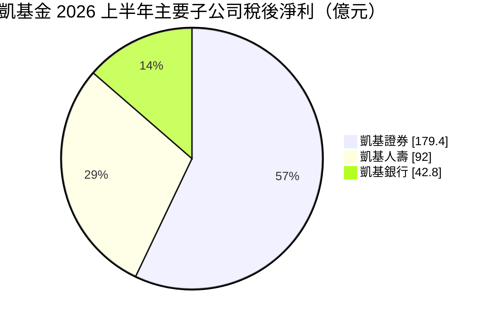
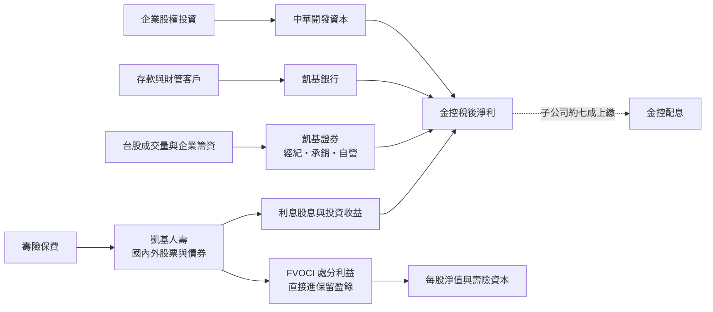
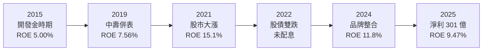
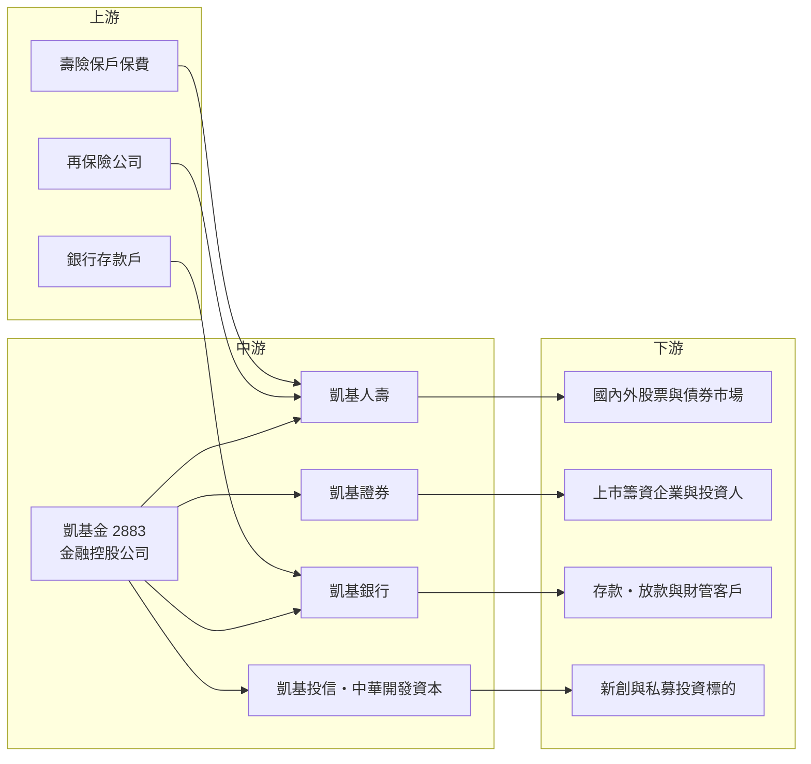

# 2883 凱基金

> 上市｜[[產業索引-金融保險業|金融保險業]]｜上市（櫃）日期 2001/12/28

# 第一章：企業模式與商業藍圖

> [!info] 撰寫說明
> 本文由 Claude 依公開資料整理，架構比照 [[2330台積電]] 的四章研究，資料截至 2026-10-08。財務數字來源：證交所開放資料快照（基本資料、股利）、Goodinfo 經營績效頁與股利政策頁（2015 至 2025 年）、工商時報、優分析與 NOWnews 2025 至 2026 年法說會報導（子公司獲利、承銷市占、雙重槓桿比率、股利機制）；中華開發併購凱基證券、萬泰銀行與中國人壽的年份係憑記憶整理，尚未逐條比對原始文件。#待校對

在評估一家公司的長期投資價值時，第一步是看懂它靠什麼賺錢、為什麼能一直賺下去。本章針對凱基金融控股（股票代號：2883，以下簡稱凱基金）的商業模式進行定性分析，說明一家由工業銀行與直接投資起家的[[金控]]，如何透過一連串併購轉型為「壽險加證券」雙引擎，以及為什麼它的損益表數字必須搭配淨值變化一起看。

## 一、核心定位：由中華開發金轉型的壽險加證券金控

凱基金的前身是中華開發金融控股，成立於 2001 年 12 月，實收資本額約 1,856 億元，董事長為王銘陽。中華開發的起點是 1959 年成立的中華開發信託，長期以工業銀行與創投、直接投資聞名，是台灣產業發展初期重要的長期資金提供者（年份待校對）。這段歷史讓凱基金至今仍保有其他金控少見的私募股權與創投業務。

凱基金今天的樣貌，主要由三次關鍵整併形成：與凱基證券合併、收購萬泰銀行並改名為凱基銀行，以及分階段取得中國人壽並在 2021 年前後納為百分之百持股的子公司（以上年份待校對）。之後集團逐步統一品牌，金控更名為凱基金，壽險子公司也整合為凱基人壽。經過這些整併，凱基金從一家以投資收益為主、獲利起伏大的開發金控，變成以壽險與證券為核心的綜合金控。

這個結構有兩個重要的商業意義。第一，凱基人壽的資產規模最大，決定了集團淨值與資本的波動；凱基證券是國內主要券商之一，在台股熱絡時貢獻大量獲利。兩者都與股市高度連動，使凱基金成為國內金控中對股市最敏感的類型之一。第二，壽險持有的部分股票依會計準則列為 [[FVOCI]]，處分利益不進損益表而直接轉入保留盈餘，因此凱基金的獲利有「兩本帳」：損益表上的 EPS，以及加計處分利益的調整後獲利。

## 二、終端應用／產品板塊：證券、壽險、銀行與資產管理

以 2026 年上半年主要子公司稅後淨利呈現獲利來源（單一期間，不含凱基人壽直接進入保留盈餘的處分利益；台股熱絡使證券獲利偏高）：

- **凱基證券（投資銀行與經紀）：** 國內主要券商之一，依法說會報導，2025 年經紀市占約 11%，2026 年上半年股權[[承銷]]市占約四成。承銷與投資銀行業務需要長期的企業客戶關係、研究能力與資本，是凱基金最具特色的業務。證券獲利隨台股成交量與企業籌資活動大幅起伏。
- **凱基人壽（資本與淨值的核心）：** 擁有大量長年期保單與龐大的投資部位，主要獲利來自投資收益扣除保單負債成本。依報導，2026 年上半年保險合約服務邊際（[[CSM]]）餘額約 2,436 億元，代表未來可逐年認列的保單利潤存量。
- **凱基銀行：** 規模在國內銀行中偏小，但財富管理手續費連續數年成長，獲利相對穩定，2025 年稅後淨利約 68 億元。銀行的角色是提供存款客群與穩定收益，補足壽險與證券的高波動。
- **凱基投信與中華開發資本：** 投信經營公募基金與 ETF，規模在 2026 年上半年明顯擴大；中華開發資本延續創投、私募股權與資產管理業務，屬於集團的歷史資產與差異化來源。

## 三、資本轉化邏輯（營運模式）：保費與交易量的雙引擎

- **證券的獲利彈性：** 證券業的成本以人員與系統為主，相對固定；當台股成交量放大、企業積極上市籌資時，經紀手續費與承銷收入會大幅增加，獲利成長遠快於營收。依報導，凱基證券 2026 年上半年年化 ROE 約 48%，2025 年全年約 17%，可見證券獲利的週期幅度。
- **壽險的淨值效果：** 凱基人壽的股票評價與處分利益，多數直接反映在淨值而不是 EPS。依報導，2026 年上半年凱基金每股淨值由年初約 18.6 元升至約 26.71 元，增幅遠大於同期 EPS。評估凱基金時，每股淨值的長期變化與 EPS 一樣重要。
- **透明的上繳機制：** 依法說會說明，銀行與證券子公司在正常營運下約以七成獲利上繳金控，作為金控配息的基礎；壽險的上繳能力則取決於新制下的資本水準。

## 四、企業長期藍圖：One KGI 與財務韌性

- **One KGI 綜效：** 品牌統一之後，集團推動壽險、證券、銀行客戶的整合，以跨子公司財富管理提高每位客戶的貢獻。過去各子公司各自為政的情況，正是整合要解決的問題。
- **財務韌性：** 降低[[雙重槓桿比率]]、強化壽險資本是管理層的優先目標。依報導，雙重槓桿比率由 2024 年約 122% 降到 2025 年約 118%。雙重槓桿比率越低，金控用借款支撐子公司資本的程度越低，財務結構越穩健。
- **資產管理與亞洲布局：** 擴大投信與中華開發資本的管理資產規模，並以香港、新加坡等亞洲據點發展跨境財富管理與投資銀行業務，讓凱基證券的投行能力延伸到台灣以外。

# 第二章：護城河深度與競爭優勢

在長期價值投資中，「護城河」指企業抵禦競爭、長期維持超額利潤的保護機制。凱基金的護城河分散在投資銀行、壽險負債端與直接投資三個領域。本章分析這些優勢的構成、壽險與證券兩個戰場的主要對手，以及凱基金的資本韌性能否支撐它與大型壽險金控競爭。

## 一、凱基金護城河的核心組成要素

- **1. 證券的投資銀行能力：** 承銷業務需要長期的企業客戶關係、產業研究團隊與承擔包銷風險的資本。凱基證券在股權承銷上長期居於前段，企業準備上市或增資時，往往優先找有過往成功案例的承銷商，這種聲譽與經驗累積需要多年，新進者難以短期追上。
- **2. 壽險的負債端規模：** 凱基人壽擁有大量長年期保單，保戶轉換成本高，CSM 餘額代表未來多年可逐步認列的利潤。這批長期資金也讓凱基人壽能以長期視角配置資產。
- **3. 直接投資與創投的歷史經驗：** 中華開發體系累積數十年的創投與私募股權經驗，對台灣產業與企業的了解深入，能與證券的投資銀行業務形成「從早期投資到上市承銷」的完整鏈條，這在國內金控中較少見。

整體而言，凱基金的護城河在證券投行領域較明顯，在壽險與銀行領域則規模不如龍頭，屬於「局部強、整體中等」的類型。

## 二、主要競爭對手格局

| 對手 | 定位 | 對凱基金的影響 |
|---|---|---|
| [[2882國泰金]]、[[2881富邦金]] | 大型壽險金控 | 壽險規模、資本韌性與通路明顯較大 |
| [[2887台新新光金]]、南山人壽 | 壽險同業 | 在保費市場與高資產客群直接競爭 |
| [[2885元大金]] | 證券龍頭 | 經紀市占與 ETF 規模領先凱基證券 |
| [[2890永豐金]]、[[6005群益證]]、富邦證券 | 主要券商 | 在經紀、承銷與數位券商市場競爭 |
| [[2891中信金]]、[[2884玉山金]]、[[2892第一金]] | 大型銀行 | 存放款與財富管理規模遠大於凱基銀行 |

## 三、優勢轉化：守得住／守不住／觀察重點

- **守得住：** 承銷與投資銀行業務的專業團隊與客戶關係，以及壽險既有保單的長期收益。這兩塊業務都有較高的進入門檻，能在台股熱絡期帶來明顯的超額獲利。
- **守不住：** 經紀業務的龍頭地位仍屬元大；壽險規模與國泰、富邦相比仍有差距，資本韌性較弱，在股市下跌時淨值壓力較大；銀行規模偏小，無法像銀行型金控一樣提供穩定的利差收入作為獲利下限。凱基金 2022 年完全沒有配發股利，就是資本韌性不足時的結果。
- **觀察重點：** 長期而言，可以追蹤三件事。第一是凱基人壽在 [[IFRS 17]] 與 [[ICS]] 新制下的資本水準與上繳能力；第二是證券獲利在台股降溫後的基本盤落在哪裡；第三是雙重槓桿比率能否持續下降，讓金控有更穩定的配息能力。

# 第三章：財務體質與盈利規模

資料日期：2026-10-08。數字取自 Goodinfo 經營績效頁與股利政策頁、證交所股利資料與法說會報導，表格是撰寫當時的快照；最新月營收與累計 EPS 由自動排程寫在本筆記的屬性欄位。#待校對

財務報表是檢驗護城河是否真實存在的最終標準。金控不適用製造業的毛利率與營業利益率，本章改以營業收入、稅後淨利、ROE、ROA 與每股淨值的多年度變化，搭配股利與股東權益成本，檢視凱基金轉型前後的獲利品質。

## 一、獲利能力的基石：淨利、ROE 與資產報酬

| 年度 | 營業收入（億元） | 稅後淨利（億元） | EPS（元） | [[ROE]] | [[ROA]] | [[每股淨值]]（元） |
|---|---|---|---|---|---|---|
| 2015 | 297 | 85.3 | 0.58 | 5.00% | 0.96% | 11.17 |
| 2017 | 854 | 117 | 0.80 | 5.94% | 0.75% | 11.60 |
| 2019 | 2,393 | 128 | 0.88 | 7.56% | 0.68% | 12.85 |
| 2020 | 2,248 | 127 | 0.87 | 6.57% | 0.64% | 13.66 |
| 2021 | 1,923 | 350 | 2.34 | 15.1% | 1.37% | 15.88 |
| 2022 | 953 | 164 | 0.98 | 6.53% | 0.47% | 11.32 |
| 2023 | 396 | 189 | 1.13 | 8.03% | 0.53% | 14.27 |
| 2024 | 733 | 336 | 1.97 | 11.8% | 0.88% | 16.70 |
| 2025 | 643 | 301 | 1.74 | 9.47% | 0.75% | 17.64 |

（來源：Goodinfo 經營績效頁，合併報表；2017 年起陸續併入中國人壽，營業收入因保費與投資損益計入而大幅變動，前後年度不宜直接比較。2026 年上半年依法說會報導，稅後淨利 284.4 億元、EPS 1.64 元，加計 FVOCI 處分利益的調整後獲利約 677.8 億元。）

- **轉型帶來獲利規模的躍升：** 2015 至 2025 年稅後淨利由 85.3 億元增至 301 億元，年複合成長率約 13.4%（推算），EPS 由 0.58 元增至 1.74 元。主要原因是併入中國人壽後，集團多了一個大型的獲利引擎，加上證券業務在台股多頭期間的貢獻。
- **ROE 提升但仍偏低：** 2015 至 2020 年 ROE 在 3.6% 至 7.6% 之間，屬於金控業的後段；2021 年之後，除 2022 年外，ROE 大致在 8% 至 15% 之間，明顯改善。這代表整併後的凱基金確實提升了資本效率，但距離富邦金這類龍頭仍有一段距離。
- **淨值波動大：** 每股淨值在 2021 年為 15.88 元，2022 年降到 11.32 元，2025 年回到 17.64 元，2026 年上半年又因股市大漲升至約 26.71 元（法說會報導）。壽險投資部位讓凱基金的淨值隨股債市大幅擺盪，這是投資人必須承擔的特性。

## 二、[[ROE]]：資本效率與財務槓桿

2021 至 2025 年凱基金平均 ROE 約 10.2%（推算），2015 至 2025 年長期平均約 7.7%（推算）。以 2025 年 ROA 0.75% 與 ROE 9.47% 推算，股東權益約占總資產 8%，財務槓桿約 12.6 倍（推算）。ROE 改善的來源，一是壽險帶來的資產規模，二是證券在多頭期間的高報酬；銀行貢獻相對穩定但比重不高。要讓 ROE 長期穩定在一成以上，凱基金需要壽險在新制下維持穩定的資本與獲利，而不是只在股市好年份達標。

## 三、資本適足、股利與盈餘保留

- **資本指標：** 依法說會報導，金控雙重槓桿比率由 2024 年約 122% 降至 2025 年約 118%；凱基人壽在新制下的資本適足水準與金控層級的[[資本適足率]]本次未查得具體數字。
- **股利穩定度：** 依 Goodinfo，2015 至 2021 年度凱基金每年配發 0.3 至 1 元現金股利；2022 年度因壽險淨值大幅下降而未配發股利；2023 年度約 0.5 元，2024 年度 0.85 元現金加 0.1 元股票，2025 年度 1 元現金。以 EPS 計算，2023 至 2025 年度現金配發率約 43% 至 57%（推算）。股利的穩定度明顯低於銀行型金控，2022 年的停發說明了資本韌性對股利的影響。
- **政策方向：** 管理層以銀行與證券子公司約七成獲利上繳作為配息基礎，並在雙重槓桿比率改善後改以現金配發為主。這讓股利的來源更透明，但壽險上繳能力仍是最大變數。

## 四、ROE 與 CAPM 股東權益成本：價值創造利差

金控的資金來源主要是保費、存款等負債，負債本身就是營業的原料，因此不適用一般產業的 ROIC 與 WACC。本節改以 ROE 與 [[CAPM]] 估算的股東權益成本比較。

- **股東權益成本（推算）：** 無風險利率取台灣 10 年期公債約 1.75%，市場風險溢酬 6%，β 假設 1.1（壽險加證券型金控與股市連動高，未查得凱基金實際數字），股東權益成本約 1.75% + 1.1 × 6% = 8.35%（推算）。若 β 取 1.0 至 1.2，成本約 7.75% 至 8.95%。
- **ROE 與成本的比較：** 2015 至 2020 年 ROE 在 3.6% 至 7.6% 之間，全部低於股東權益成本，代表開發金時期並未替股東創造超額報酬。2021 至 2025 年平均 ROE 約 10.2%，高於約 8.35% 的成本約 2 個百分點；其中 2021 與 2024 年明顯高於成本，2022 與 2023 年則低於成本，2025 年略高。
- **價值創造判斷：** 凱基金在整併為壽險加證券金控之後，ROE 從長期低於資金成本，改善到平均略高於資金成本，代表轉型方向正確，但超額報酬的幅度不大、波動很大。凱基金能否成為穩定創造價值的金控，取決於壽險資本在新制下的穩定性，以及證券投行優勢能否在不同市場環境下都轉化為高於成本的報酬。

# 第四章：總體風險與地緣政治

任何企業都無法脫離宏觀環境獨立存在。本章分析凱基金未來必須面對的地緣政治、利率與金融市場週期、營運風險，以及保險會計與資本新制等法規演進。

## 一、地緣政治風險

- **全球金融市場的地緣衝擊：** 凱基人壽持有大量海外債券與股票，任何引發全球股債市劇烈波動的地緣事件，例如戰爭、制裁或金融危機，都會直接影響投資收益與淨值。
- **兩岸關係與台股資金：** 證券業務高度依賴台股成交量與外資動向。兩岸關係緊張時，外資可能撤出台股，成交量與企業籌資活動都會降溫，直接影響凱基證券的獲利。
- **亞洲布局的監管差異：** 凱基證券在香港與新加坡等地設有據點，各地的金融監管與政治環境不同，跨境業務需要承擔額外的合規與政策風險。

## 二、利率與金融市場週期

- **股市週期的雙重曝險：** 凱基金同時透過壽險投資部位與證券業務曝險於股市。股市大漲時，兩者同時貢獻獲利與淨值；股市大跌時，兩者也會同時受傷。這種雙重曝險讓凱基金的獲利波動高於多數金控。
- **利率與匯率：** 利率上升會讓壽險既有債券部位出現評價損失，新台幣急升則會讓美元資產產生匯損。2025 年凱基人壽因[[外匯價格變動準備金]]提存影響獲利（依法說會報導），就是匯率風險的例子。
- **[[長鞭效應]]式的市場情緒：** 台股成交量在多頭末期往往放大，空頭時則急遽萎縮，證券獲利的高峰與低谷差距可以達數倍。

## 三、營運環境的隱性風險

- **整併後的文化與系統整合：** 凱基金由開發、凱基證券、萬泰銀行、中國人壽等多家機構整併而成，企業文化與系統差異大。One KGI 綜效能否真正實現，需要時間驗證。
- **公司治理的歷史議題：** 中華開發金控過去曾發生經營權爭議與相關司法案件（細節待校對），雖然已成過去，但提醒投資人關注董事會結構與治理品質。
- **承銷與自營的市場風險：** 承銷業務需要承擔包銷風險，自營部位則直接曝險於市場波動，市場急跌時可能產生損失。

## 四、法規與科技演進

- **IFRS 17 與 ICS 新制：** 台灣保險業接軌新會計準則與新一代清償能力制度後，壽險的資本要求與獲利認列方式改變。凱基人壽的資本韌性弱於大型同業，新制下可能需要保留更多盈餘，影響上繳金控與配息的能力。
- **雙重槓桿與金控資本規範：** 主管機關對金控雙重槓桿比率設有上限，凱基金必須持續降低比率，才能保留配息與投資彈性。
- **數位券商與費率競爭：** 數位券商與低手續費競爭壓縮經紀業務的利潤，凱基證券需要靠財富管理與投資銀行業務提高附加價值。

# 專有名詞解析

## 金融

- **[[金控]]**：金融控股公司，以控股方式同時經營銀行、保險、證券等多種金融業務的集團。
- **[[FVOCI]]**：透過其他綜合損益按公允價值衡量的金融資產，這類股票的處分損益不進損益表，直接轉入保留盈餘。
- **[[CSM]]**：合約服務邊際，新保險會計準則下代表保單未來尚未認列的利潤，會隨時間逐步轉為獲利。
- **[[IFRS 17]]**：國際財務報導準則第 17 號，保險合約的新會計準則，改變保險公司獲利認列的方式。
- **[[ICS]]**：保險資本標準，台灣接軌的新一代保險業清償能力制度，資本計算方式比舊制更嚴格。
- **[[承銷]]**：證券商協助企業發行股票或債券並銷售給投資人，收取承銷費用的業務。
- **[[雙重槓桿比率]]**：金控對子公司的長期投資除以金控自身淨值的比率，用來避免金控以借款充當子公司資本。
- **[[外匯價格變動準備金]]**：台灣壽險業特有的準備金，用來平滑新台幣匯率波動對美元資產造成的損益衝擊。
- **[[ROA]]**：資產報酬率，稅後淨利除以總資產，金融業通常在 0.5% 至 1.5% 之間。
- **[[每股淨值]]**：股東權益除以流通股數，壽險型金控的每股淨值會隨股債市評價大幅波動。
- **[[資本適足率]]**：自有資本除以風險加權資產的比率，主管機關設有最低要求，用來確保承受損失的能力。
- **[[長鞭效應]]**：需求的小幅變動沿供應鏈或市場傳遞時被逐級放大的現象，這裡借指證券業成交量的放大波動。
- **[[CAPM]]**：資本資產定價模型，以無風險利率加上 β 乘以市場風險溢酬估算股東要求報酬率。
- **[[ROE]]**：股東權益報酬率，稅後淨利除以股東權益，衡量公司運用股東資金賺錢的效率。

# 核心供應鏈

## 1. 上游：資金與風險分散來源
- 壽險保戶保費、銀行存款與資本市場籌資
- 再保險公司（分擔壽險承保風險）

## 2. 中游：凱基金本身與子公司
- 凱基人壽、凱基證券、凱基銀行、凱基投信、中華開發資本

## 3. 下游：資金去處與客戶
- 國內外股票、債券與另類投資
- 準備上市或增資的企業、證券投資人
- 存款、放款與財富管理客戶，創投與私募股權投資標的

## 4. 同業
- 壽險型金控：[[2882國泰金]]、[[2881富邦金]]、[[2887台新新光金]]
- 證券型金控與券商：[[2885元大金]]、[[2890永豐金]]、[[6005群益證]]
- 銀行型金控：[[2891中信金]]、[[2884玉山金]]、[[2892第一金]]

## 最新新聞
<!-- news:start（自動產生，請勿手動編輯此範圍） -->
- 2026-10-21 🏛️ 重訊 17:36｜代子公司凱基人壽公告投管會決議取得Strategic Partners Offshore X L.P.｜[觀測站](https://mops.twse.com.tw/mops/#/web/t05st01)
- 2026-10-19 🏛️ 重訊 17:04｜代子公司凱基銀行公告資訊安全長異動｜[觀測站](https://mops.twse.com.tw/mops/#/web/t05st01)
- 2026-10-15 🏛️ 重訊 16:32｜代子公司開發資本所屬之CI II公告原董事會決議投資暨轉讓 Artisan Holdings及Artisan Partners發行之可轉換公司 債案不予執行｜[觀測站](https://mops.twse.com.tw/mops/#/web/t05st01)
- 2026-10-14 🏛️ 重訊 18:10｜公告本公司暨主要子公司115年9月份自結合併盈餘｜[觀測站](https://mops.twse.com.tw/mops/#/web/t05st01)

完整紀錄：[[2883凱基金 新聞]]
<!-- news:end -->

## 相關連結
- [公開資訊觀測站](https://mopsov.twse.com.tw/mops/web/t05st03?step=1&firstin=1&co_id=2883)
- [Goodinfo](https://goodinfo.tw/tw/StockDetail.asp?STOCK_ID=2883)
- [Yahoo 股市](https://tw.stock.yahoo.com/quote/2883)
- [鉅亨網新聞](https://www.cnyes.com/twstock/2883/news)
