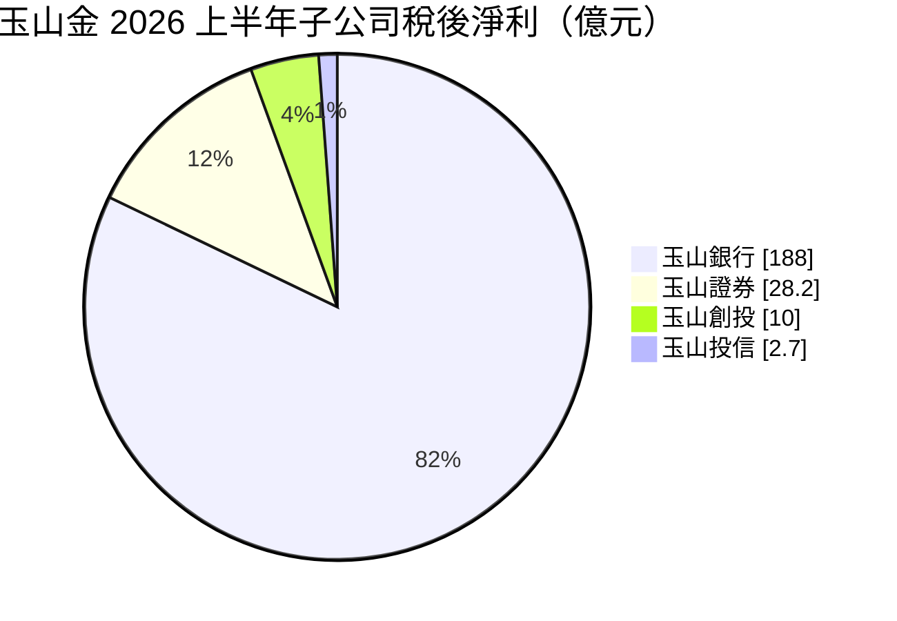
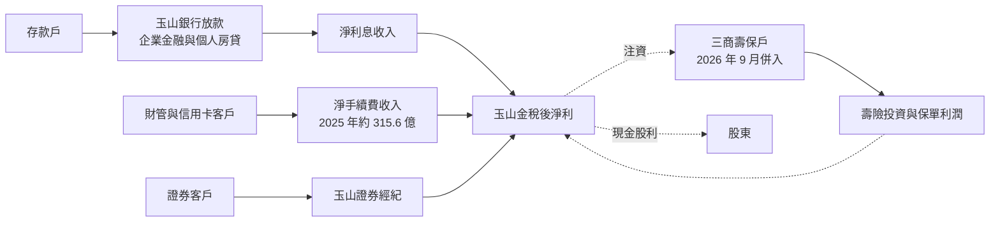
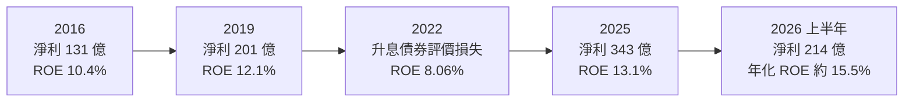
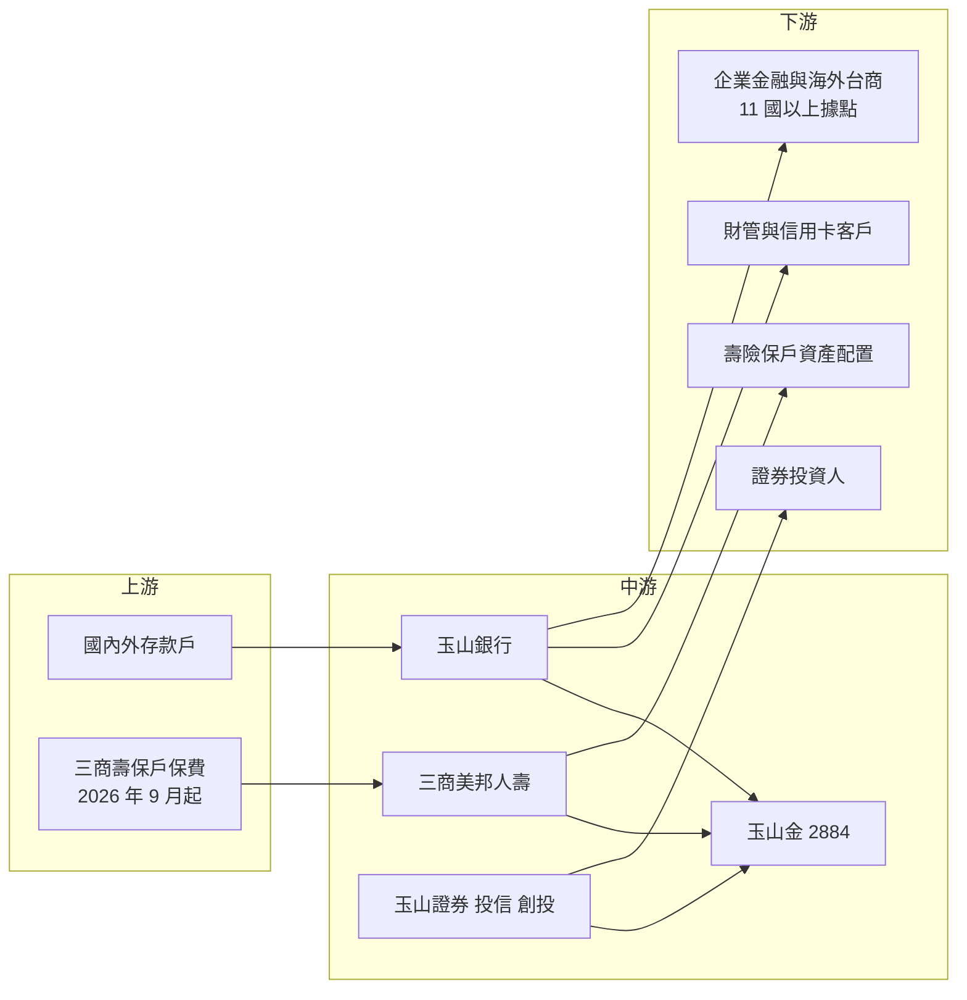

# 2884 玉山金

> 上市｜[[產業索引-金融保險業|金融保險業]]｜上市（櫃）日期 2002/01/28

# 第一章：企業模式與商業藍圖

> [!info] 撰寫說明
> 本文由 Claude 依公開資料整理，架構比照 [[2330台積電]] 的四章研究，資料截至 2026-10-08。財務數字來源：Goodinfo 年度經營績效頁與股利政策頁（合併報表）、證交所開放資料快照（基本資料、股利）、優分析與科技新報的法說會報導（2025 年第四季、2026 年上半年、三商壽併購）；產業描述為整理性內容，尚未逐條比對原始文件。#待校對

在評估金融股的長期投資價值時，首要步驟是看清楚獲利從哪一家子公司、哪一種業務而來。本章針對玉山金融控股（股票代號：2884，以下簡稱玉山金）的商業模式進行定性分析，說明這家以服務品質、財富管理與信用卡聞名的民營銀行型[[金控]]，如何靠「手續費導向」的銀行模式長期維持兩位數的 [[ROE]]，以及 2026 年併入三商美邦人壽後，它的風險屬性會出現什麼變化。

## 一、核心定位：沒有財團背景的專業經理人銀行

玉山銀行在 1992 年由一群專業銀行家創立，沒有企業集團或家族財團作為大股東，2002 年 1 月 28 日成立玉山金控並同日上市，核心子公司是玉山商業銀行，另有玉山證券、玉山投信與玉山創投（銀行創立年份為憑記憶整理，待校對）。依證交所 2026 年 10 月的基本資料，玉山金實收資本額約 1,772 億元，董事長為黃男州。

「沒有財團」是理解玉山的第一把鑰匙。台灣多數民營金控背後都有家族或企業集團，經營決策難免與大股東的其他事業交織；玉山則以專業經理人為主體，股權分散，管理層的延續性高，經營目標比較單純地放在銀行本身的長期績效。這種文化讓玉山在服務品質、財富管理與數位金融上建立了鮮明的品牌形象，也讓它在資本配置上偏向保守：過去多以盈餘轉增資與小規模海外布局擴張，很少進行大型併購。

2026 年 9 月，三商美邦人壽（[[2867三商壽]]）正式交割併入玉山金，這是玉山成立以來最大的一筆併購。玉山從此由純銀行型金控，轉為「銀行加壽險」的結構。對長期投資人而言，這代表兩件事：

* **過去二十年的玉山是一家「好銀行」：** 獲利主要來自放款利差與手續費，波動低、可預測性高，ROE 長期落在 10% 至 13% 之間。這段歷史是評估它經營能力的主要依據。
* **未來的玉山要證明自己能經營壽險：** 壽險的獲利邏輯和銀行完全不同，必須承擔利率、匯率與股市的波動，資本需求也大。2026 年之後的玉山，風險屬性會比過去高，評估方法也要跟著改變。

## 二、業務板塊：銀行為主，證券與壽險為輔

金控不適用製造業的「營收結構」分析，比較有意義的是各子公司的獲利貢獻。以 2026 年上半年各子公司稅後淨利來看（三商壽 9 月才併入，不在此期間），獲利結構如下：

圖中合計約 229 億元，略高於金控合併稅後淨利 214 億元，差額來自金控層級費用與合併調整（推估）；創投數字依報導，口徑待校對。

* **玉山銀行：** 集團獲利的主體，長期占金控獲利八成以上。它的特色是手續費收入比重高，2025 年淨手續費收入約 315.6 億元，其中財富管理約 154.4 億元、信用卡約 84.8 億元。手續費收入不需要像放款那樣占用大量資本，這是玉山 ROE 能在銀行型金控中維持前段的根本原因。
* **玉山證券：** 規模不大，主要服務銀行財管客戶的證券需求，獲利高度依賴台股成交量。2026 年上半年稅後淨利約 28.2 億元，屬於台股熱絡期間的高點，不宜外推為常態。
* **三商美邦人壽（2026 年 9 月起）：** 以業務員通路為主（報導指約 98%），投資型保單比重高（約 89%），淨值比偏低，併入後需要玉山分階段注資。
* **玉山投信與創投：** 規模小，屬於財管產品與產業投資的輔助角色。

## 三、資本轉化邏輯：手續費導向的銀行模式

金控的「生產線」不是工廠，而是把存款與保費轉成放款與投資，賺取利差與手續費。玉山的特別之處在於，它刻意把相當比例的獲利建立在手續費上。

* **手續費降低資本消耗：** 一般銀行每增加一元放款，就要依[[資本適足率]]規定準備相應的資本；財富管理與信用卡手續費則不太需要額外資本。因此同樣的淨值，玉山可以創造比放款型銀行更高的獲利，這是「資本輕」的商業模式。
* **企業金融跟隨台商：** 近年企業放款與海外放款成長快於個人放款，主要跟隨科技業與台商的海外布局，這讓玉山從過去以消費金融與財管見長，逐步走向「消金、法金並重」。
* **銀行保險綜效：** 併入三商壽後，玉山銀行的財管客群可以直接銷售自家保單，三商壽的業務員則帶來新的客群，形成[[交叉銷售]]與[[銀行保險]]通路，這是這筆併購最主要的商業理由。

## 四、企業長期藍圖：海外三成與壽險轉型

* **海外獲利占比三成以上：** 依法說會報導，2025 年海外獲利占比約 26.4%，據點約 35 個、分布 11 個國家，管理層目標是超過三成，長期朝 33% 至 40% 邁進，並陸續在日本、加拿大、印度與美國增設據點。海外布局的意義在於分散台灣單一市場的利差壓力，並跟隨台商客戶的資金需求。
* **三商壽 Back to Health：** 玉山規劃在 2026 至 2027 年分階段注資三商壽合計約 220 億元，改革方向包括通路雙軌（業務員加銀行通路）、商品結構調整（傳統型與投資型保單逐步平衡）、數位流程優化與資產管理綜效，目標是讓三商壽的 [[TIS]] 資本指標回到健康水準。
* **規模目標：** 管理層以總資產 5 兆元作為中期規模目標。對投資人而言，規模本身不是重點，重點是擴張之後 ROE 能否維持在 10% 以上。

# 第二章：護城河深度與競爭優勢

在長期價值投資中，「護城河」指企業抵禦競爭、維持超額利潤的保護機制。金融業產品高度同質、價格透明，又受到嚴格監理，護城河多半不是來自技術，而是來自品牌、客戶關係、資金成本與經營效率。本章分析玉山金的護城河構成、國內主要競爭對手，以及這些優勢在併入壽險後能守住多少。

## 一、護城河的核心組成要素

玉山金的護城河屬於「窄護城河」，主要來自軟實力，由四個要素組成：

* **1. 服務品牌與客戶黏著度：** 玉山長期以服務品質建立品牌，在財富管理客群中的口碑使客戶不輕易轉換。金融服務的轉換成本主要來自信任與習慣，一旦客戶把薪轉、房貸、信用卡與理財都放在同一家銀行，搬家的麻煩就構成了隱性的護城河。
* **2. 財富管理與信用卡的規模：** 財管與信用卡手續費在民營銀行中屬前段。這兩項業務需要長期累積的客群、理專團隊與商戶網絡，新進者很難在短時間內複製，也是玉山能以較少資本創造較高 ROE 的關鍵。
* **3. 授信紀律與資產品質：** 依法說會報導，2026 年上半年[[逾放比]]約 0.15%、[[備抵呆帳覆蓋率]]約 770%。銀行業最致命的風險是放款變成呆帳，長期維持低逾放代表授信文化穩健，在景氣反轉時不會一次吐回多年獲利。
* **4. 專業經理人文化：** 沒有財團大股東，決策以銀行本身的績效為主，較少出現關係人交易或為集團其他事業輸血的問題。這種治理結構本身就是長期投資人重視的品質。

## 二、全球主要競爭對手格局

玉山的競爭主要在台灣國內，以及台商密集的亞洲市場。

| 對手 | 定位 | 對玉山金的威脅 |
|---|---|---|
| [[2891中信金]] | 海外布局最廣、信用卡與財管規模最大的民營金控 | 在財管、信用卡與海外台商業務全面競爭，規模優勢明顯 |
| [[2881富邦金]]、[[2882國泰金]] | 壽險規模最大的兩家金控，銀行也完整 | 在財管與保險銷售競爭，資本規模遠大於玉山 |
| [[2887台新新光金]] | 合併新光金後的銀行加壽險金控 | 與玉山同樣走「銀行加壽險」路線，消金與財管客群重疊 |
| [[2890永豐金]] | 銀行與證券並重，數位業務積極 | 在數位銀行與年輕客群競爭 |
| [[2886兆豐金]]、[[5880合庫金]] 等公股金控 | 存放款規模大、資金成本低 | 在企業授信價格上具成本優勢，壓縮法金利差 |

## 三、優勢轉化：哪些守得住、哪些守不住

* **守得住：** 財富管理、信用卡與服務品牌。這些是玉山二十多年累積的核心能力，從 2016 至 2025 年 ROE 多數年份落在 10% 至 13% 可以看出，它在不同利率與股市環境下都能維持穩定的資本報酬。
* **守不住：** 「純銀行型金控的低波動」這個特質。併入三商壽後，玉山首次承擔壽險的利率、匯率與股市風險，且三商壽需要大額注資，短期內會拉低金控的 ROE 與股利成長空間（推估）。另外，公股銀行的低資金成本也讓玉山在大型企業放款上很難取得高利差。
* **觀察重點：** 第一，三商壽注資後資本指標能否回到健康水準、是否還需要第二輪增資。第二，銀行保險通路能否帶動新契約，真正產生交叉銷售綜效。第三，海外獲利占比能否穩定突破三成。這三點決定玉山金能否從「好銀行」變成「好金控」。

# 第二章：護城河深度與競爭優勢

在長期價值投資中，「護城河」指企業抵禦競爭、維持超額利潤的保護機制。金融業產品高度同質、價格透明，又受到嚴格監理，護城河多半不是來自技術，而是來自品牌、客戶關係、資金成本與經營效率。本章分析玉山金的護城河構成、國內主要競爭對手，以及這些優勢在併入壽險後能守住多少。

## 一、護城河的核心組成要素

玉山金的護城河屬於「窄護城河」，主要來自軟實力，由四個要素組成：

* **1. 服務品牌與客戶黏著度：** 玉山長期以服務品質建立品牌，在財富管理客群中的口碑使客戶不輕易轉換。金融服務的轉換成本主要來自信任與習慣，一旦客戶把薪轉、房貸、信用卡與理財都放在同一家銀行，搬家的麻煩就構成了隱性的護城河。
* **2. 財富管理與信用卡的規模：** 財管與信用卡手續費在民營銀行中屬前段。這兩項業務需要長期累積的客群、理專團隊與商戶網絡，新進者很難在短時間內複製，也是玉山能以較少資本創造較高 ROE 的關鍵。
* **3. 授信紀律與資產品質：** 依法說會報導，2026 年上半年[[逾放比]]約 0.15%、[[備抵呆帳覆蓋率]]約 770%。銀行業最致命的風險是放款變成呆帳，長期維持低逾放代表授信文化穩健，在景氣反轉時不會一次吐回多年獲利。
* **4. 專業經理人文化：** 沒有財團大股東，決策以銀行本身的績效為主，較少出現關係人交易或為集團其他事業輸血的問題。這種治理結構本身就是長期投資人重視的品質。

## 二、全球主要競爭對手格局

玉山的競爭主要在台灣國內，以及台商密集的亞洲市場。

| 對手 | 定位 | 對玉山金的威脅 |
|---|---|---|
| [[2891中信金]] | 海外布局最廣、信用卡與財管規模最大的民營金控 | 在財管、信用卡與海外台商業務全面競爭，規模優勢明顯 |
| [[2881富邦金]]、[[2882國泰金]] | 壽險規模最大的兩家金控，銀行也完整 | 在財管與保險銷售競爭，資本規模遠大於玉山 |
| [[2887台新新光金]] | 合併新光金後的銀行加壽險金控 | 與玉山同樣走「銀行加壽險」路線，消金與財管客群重疊 |
| [[2890永豐金]] | 銀行與證券並重，數位業務積極 | 在數位銀行與年輕客群競爭 |
| [[2886兆豐金]]、[[5880合庫金]] 等公股金控 | 存放款規模大、資金成本低 | 在企業授信價格上具成本優勢，壓縮法金利差 |

## 三、優勢轉化：哪些守得住、哪些守不住

* **守得住：** 財富管理、信用卡與服務品牌。這些是玉山二十多年累積的核心能力，從 2016 至 2025 年 ROE 多數年份落在 10% 至 13% 可以看出，它在不同利率與股市環境下都能維持穩定的資本報酬。
* **守不住：** 「純銀行型金控的低波動」這個特質。併入三商壽後，玉山首次承擔壽險的利率、匯率與股市風險，且三商壽需要大額注資，短期內會拉低金控的 ROE 與股利成長空間（推估）。另外，公股銀行的低資金成本也讓玉山在大型企業放款上很難取得高利差。
* **觀察重點：** 第一，三商壽注資後資本指標能否回到健康水準、是否還需要第二輪增資。第二，銀行保險通路能否帶動新契約，真正產生交叉銷售綜效。第三，海外獲利占比能否穩定突破三成。這三點決定玉山金能否從「好銀行」變成「好金控」。

# 第三章：財務體質與盈利規模

資料日期：2026-10-08。數字取自 Goodinfo 年度經營績效頁與股利政策頁（合併報表）、證交所開放資料快照與法說會報導，表格是撰寫當時的快照；最新月營收、毛利率、累計 EPS 由自動排程寫在本筆記的屬性欄位（月營收、毛利率、累計EPS 等）。#待校對

財務報表是檢驗護城河是否真實存在的最終標準。金控沒有製造業的「銷貨成本」，[[毛利率]]與[[營業利益率]]並不適用；金融業的核心指標是稅後淨利、[[ROE]]、[[ROA]]、[[每股淨值]]與股利。本章用近十年的資料，檢視玉山金的獲利品質與資本效率。

## 一、獲利能力的基石：淨收益、淨利與 ROE

| 年度 | 營業收入（億元） | 稅後淨利（億元） | EPS（元） | [[ROE]] | [[ROA]] | [[每股淨值]]（元） |
|---|---|---|---|---|---|---|
| 2016 | 411 | 131 | 1.50 | 10.4% | 0.71% | 14.66 |
| 2017 | 461 | 148 | 1.49 | 10.5% | 0.74% | 14.61 |
| 2018 | 494 | 171 | 1.58 | 11.1% | 0.78% | 14.78 |
| 2019 | 545 | 201 | 1.73 | 12.1% | 0.84% | 14.89 |
| 2020 | 562 | 180 | 1.43 | 10.2% | 0.66% | 14.44 |
| 2021 | 579 | 206 | 1.54 | 11.0% | 0.66% | 14.54 |
| 2022 | 548 | 158 | 1.10 | 8.06% | 0.47% | 13.80 |
| 2023 | 667 | 217 | 1.41 | 10.0% | 0.61% | 15.08 |
| 2024 | 761 | 261 | 1.63 | 10.7% | 0.68% | 15.83 |
| 2025 | 917 | 343 | 2.12 | 13.1% | 0.80% | 16.86 |

（來源：Goodinfo 年度經營績效，合併報表。營業收入為 Goodinfo 口徑，金融業約等於淨收益。[[毛利率]]與[[營業利益率]]不適用於金控，未列出。2026 年上半年稅後淨利約 214 億元、EPS 1.32 元、年化 ROE 約 15.5%。）

* **十年淨利成長約 2.6 倍：** 稅後淨利由 2016 年的 131 億元成長到 2025 年的 343 億元，2020 至 2025 年稅後淨利年複合成長率約 13.8%、營業收入年複合成長率約 10.3%（推算）。這個成長速度在銀行型金控中屬於前段，主要來自放款擴張、手續費成長與海外布局。
* **EPS 成長遠低於淨利成長：** 同一期間 EPS 只從 1.50 元增加到 2.12 元，原因是玉山長年配發大量[[股票股利]]，股本持續膨脹。淨利成長了 2.6 倍，但每股盈餘只成長約四成，這是理解玉山股東報酬時最重要的一點：公司在成長，但每一股分到的成長被稀釋了。
* **2022 年是唯一明顯低點：** 美國快速升息使債券評價與財管業務同步受壓，ROE 降到 8.06%。即使在這種環境下，玉山仍維持獲利，沒有出現虧損，顯示銀行本業的韌性。

## 二、[[ROE]]：資本效率

玉山金 2016 至 2025 年的 ROE 十年平均約 10.7%，2021 至 2025 年平均約 10.6%（推算），在國內金控中屬於中前段。高 ROE 主要來自手續費比重高、資產品質佳，ROA 長期維持在 0.6% 至 0.8%。

金控的 ROE 可以拆成「ROA 乘以財務槓桿」。玉山的 ROA 不算特別高，但銀行業天生槓桿大（資產約是淨值的十幾倍），所以只要 ROA 穩定在 0.7% 上下，ROE 就能維持在一成左右。要提高 ROE，玉山的路徑是提高手續費比重（提升 ROA），而不是無限擴大槓桿，這也是它財管與信用卡策略背後的財務邏輯。

需要注意的是，併入三商壽並注資後，金控淨值與股本都會擴大，壽險的獲利又較不穩定，2027 年後的 ROE 很可能比過去更起伏（推估）。

## 三、資本與股利政策：取代資本支出與自由現金流

金控沒有工廠與機台，「資本支出」的概念改由「資本適足與股利」取代：每年賺到的錢，一部分要留下來支撐放款成長與法定資本要求，其餘才能發給股東。

| 股利所屬年度 | 現金股利（元） | 股票股利（元） |
|---|---|---|
| 2019 | 0.791 | 0.797 |
| 2020 | 0.61 | 0.611 |
| 2021 | 0.67 | 0.674 |
| 2022 | 0.189 | 0.379 |
| 2023 | 1.2 | 0.2 |
| 2024 | 1.2 | 0.1 |
| 2025 | 1.4 | 0 |

（來源：Goodinfo 股利政策頁；2025 年度現金股利 1.4 元與證交所股利資料一致。）

* **由「半現金半股票」轉向「以現金為主」：** 2022 年度以前，玉山大約一半發現金、一半發股票，股票股利用來留住資本、支撐放款成長。2023 年度起轉為以現金為主，2025 年度完全發放現金股利 1.4 元，以 2025 年 EPS 2.12 元計算現金[[配息率]]約 66%（推算）。這個轉變代表管理層認為資本已足以支撐成長，開始把更多獲利直接還給股東。
* **股利穩定度：** 玉山每年都有配發股利，但金額隨獲利起伏，2022 年度現金股利只有 0.189 元，顯示景氣差時會優先保留資本。
* **三商壽注資的影響：** 約 220 億元的注資由金控現金支應，未另向股東募資。這筆錢會占用金控可用資本，未來幾年配息率能否維持六成以上，取決於銀行獲利成長與三商壽是否需要追加資本（推估）。

## 四、[[ROE]] 與 [[CAPM]] 股東權益成本：價值創造利差

金融業的負債（存款、保單）是營業的原料而不是融資工具，所以一般產業用的 [[ROIC]] 與 [[WACC]] 不適用。比較合理的做法是拿 ROE 和股東要求的報酬率（股東權益成本）比較：ROE 長期高於股東權益成本，代表公司每保留一塊錢盈餘，都能替股東創造超過機會成本的價值。

* **股東權益成本（推算）：** 以 CAPM 估算，無風險利率取台灣 10 年期公債約 1.75%（1.5% 至 2% 區間中值），市場風險溢酬 6%，β 假設 0.7（銀行型金控同業常見值，未查得玉山金實際數字），股東權益成本約 1.75% ＋ 0.7 × 6% ＝ 5.95%。無風險利率在 1.5% 至 2% 之間變動時，結果約落在 5.7% 至 6.2%。
* **ROE（實際）：** 2021 至 2025 年平均約 10.6%，2025 年為 13.1%。
* **價值創造判斷：** 玉山金的 ROE 長期比股東權益成本高約 4 至 5 個百分點（推算），屬於持續創造價值的金控。這個利差主要來自手續費業務與資產品質，而不是高槓桿。未來的關鍵是三商壽：若三商壽的 ROE 長期低於 6%，等於把一部分資本放在不創造價值的地方，會拉低整體利差；若銀行保險綜效成形，三商壽反而可能成為新的利差來源。

# 第四章：總體風險與地緣政治

任何金融機構都無法脫離宏觀環境獨立存在。銀行的資產是放款與債券，負債是存款，兩者都直接受到利率、景氣與匯率影響。本章分析玉山金未來必須面對的地緣政治、利率與股市週期、併購整合風險，以及法規與科技演進。

## 一、地緣政治風險

* **海外據點的國家風險：** 海外獲利占比約四分之一，分布在美國、日本、香港、柬埔寨、越南、印度、加拿大等地。每個市場的利率、匯率、監理與政治環境各不相同，新設分行初期還要負擔人力與系統成本，海外布局在分散風險的同時，也帶來新的風險來源。
* **台商供應鏈移轉：** 玉山的企業金融大量跟隨台商海外設廠，若美國關稅、出口管制或地緣衝突改變台商的投資方向，海外放款的成長路徑就需要重新調整。
* **兩岸風險：** 兩岸緊張升高時，台股下跌、新台幣波動與資金外流會同時影響財管手續費、證券獲利與新併入壽險的資產評價，屬於無法分散的系統性風險。

## 二、產業週期與市場結構風險

* **利率週期：** 降息會壓縮銀行的放款利差（[[NIM]]），升息則讓持有的債券評價下跌。2022 年玉山 ROE 降到 8.06%，就是快速升息環境下債券與財管同時受壓的結果。併入壽險後，利率變化還會影響保單負債與再投資收益，敏感度更高。
* **股市週期：** 財管手續費、證券經紀與投資型保單規模都和股市高度相關。多頭時三者同時成長，空頭時也會同時下滑，這會放大玉山獲利的週期性。
* **同業競爭：** 財富管理與信用卡是所有民營銀行都在搶的市場，費率與回饋競爭可能長期壓縮手續費率；公股銀行的低資金成本則讓企業放款利差難以擴大。

## 三、營運環境的隱性風險

* **三商壽整合：** 三商壽以業務員通路為主，和玉山銀行的企業文化、銷售方式與考核制度差異很大。業務員留任、通路整合與合規管理，都是併購後最容易出問題的地方。
* **資本消耗與股本稀釋：** 注資若不足以讓三商壽達到健康資本水準，未來可能需要再增資，影響配息能力；併購換股與過去的股票股利也讓股本持續擴大，每股盈餘成長會低於淨利成長。
* **管理層傳承：** 專業經理人文化的優點是延續性，缺點是高度依賴少數核心管理層的判斷。關鍵人物交棒時，策略延續性需要觀察。

## 四、法規與科技演進風險

* **[[IFRS 17]] 與 [[ICS]] 新制：** 台灣壽險業 2026 年起接軌新會計準則與新資本標準，保險負債改以現值衡量，資本要求提高。玉山首次承擔壽險資本監理，三商壽能上繳多少盈餘給金控，將受到新制的直接限制。
* **數位金融競爭：** 玉山以數位銀行與行動支付見長，但純網銀、電子支付與大型科技平台持續切入支付、小額信貸與理財，手續費收入面臨長期被壓縮的壓力。
* **海外法遵與洗錢防制：** 新設的美國、加拿大、印度分行都需符合當地嚴格的洗錢防制與資本要求，國內同業曾因海外法遵缺失遭重罰，法遵投入只會增加不會減少。

# 專有名詞解析

## 金融

- **[[金控]]**：金融控股公司，旗下同時持有銀行、保險、證券等子公司，透過集團整合交叉銷售金融商品。
- **[[ROA]]**：資產報酬率，稅後淨利除以總資產，衡量金融機構運用資產創造獲利的效率，銀行業通常落在 0.5% 至 1% 之間。
- **[[每股淨值]]**：股東權益除以流通股數，代表每一股在帳面上對應的資產淨額，是評估金融股的重要基準。
- **[[CAPM]]**：資本資產定價模型，以無風險利率加上 β 乘以市場風險溢酬，估算股東要求的報酬率，也就是股東權益成本。
- **[[NIM]]**：淨利差，銀行放款與投資的收益率扣除存款等資金成本後的利差，是銀行獲利能力的核心指標。
- **[[逾放比]]**：逾期放款占總放款的比率，數字越低代表銀行資產品質越好。
- **[[備抵呆帳覆蓋率]]**：銀行提列的備抵呆帳除以逾期放款，比率越高代表吸收壞帳損失的緩衝越厚。
- **[[資本適足率]]**：銀行自有資本除以風險性資產的比率，監理機關以此限制銀行能承作多少放款與投資。
- **[[交叉銷售]]**：把集團內不同子公司的商品賣給同一批客戶，例如向銀行客戶銷售保險與基金。
- **[[銀行保險]]**：透過銀行通路銷售保險商品，簡稱銀保，是金控整合銀行與壽險的主要綜效來源。
- **[[投資型保單]]**：保費中有一部分投入保戶自選的基金或帳戶，投資盈虧主要由保戶承擔，壽險公司賺取管理費。
- **[[TIS]]**：台灣保險業新一代清償能力制度的資本適足指標，配合 ICS 接軌使用，比率越高代表資本越充足。
- **[[IFRS 17]]**：國際保險合約會計準則，改以現值方式衡量保險負債，讓壽險獲利認列更貼近保單實際經濟價值。
- **[[ICS]]**：保險資本標準，國際保險監理官協會制定的壽險資本規範，台灣接軌後壽險需準備更多資本。
- **[[股票股利]]**：公司以發放新股代替現金分配盈餘，可把資本留在公司內，但會使股本膨脹、稀釋每股盈餘。
- **[[配息率]]**：現金股利占每股盈餘的比例，反映公司把多少獲利以現金還給股東。

# 核心供應鏈

## 1. 上游：資金與保費來源
- 國內外存款戶：玉山銀行的存款是放款與投資的主要資金來源。
- 壽險保費：2026 年 9 月起併入的三商美邦人壽，原上市公司為 [[2867三商壽]]。

## 2. 中游：玉山金與子公司
- 玉山銀行：集團獲利主體，財管、信用卡與企業金融並重。
- 三商美邦人壽：以業務員通路與投資型保單為主的壽險公司。
- 玉山證券、玉山投信、玉山創投：證券經紀、基金與產業投資。

## 3. 下游：主要客群
- 財富管理與信用卡客戶：手續費收入的主要來源。
- 企業金融與海外台商：美國、日本、香港、東南亞、印度、加拿大等據點。
- 證券經紀客戶與壽險保戶。

## 4. 同業比較
- 民營銀行型金控：[[2891中信金]]、[[2890永豐金]]、[[2887台新新光金]]
- 壽險型金控：[[2881富邦金]]、[[2882國泰金]]、[[2883凱基金]]
- 公股金控：[[2886兆豐金]]、[[5880合庫金]]、[[2892第一金]]、[[2880華南金]]

## 最新新聞
<!-- news:start（自動產生，請勿手動編輯此範圍） -->
- 2026-10-15 🏛️ 重訊 18:23｜玉山金控代子公司三商美邦人壽公告擬發行十年期累積 次順位普通公司債，發行總額上限新台幣壹佰貳拾伍億 元整。｜[觀測站](https://mops.twse.com.tw/mops/#/web/t05st01)
- 2026-10-15 🏛️ 重訊 16:03｜公告本公司暨子公司115年9月自結盈餘｜[觀測站](https://mops.twse.com.tw/mops/#/web/t05st01)
- 2026-10-15 📰 媒體 12:48｜〈焦點股〉資金狂湧金融股 玉山金逼近50元 中信金、元大金齊刷新天價｜[鉅亨網](https://news.cnyes.com/news/id/6631058)

完整紀錄：[[2884玉山金 新聞]]
<!-- news:end -->

## 相關連結
- [公開資訊觀測站](https://mopsov.twse.com.tw/mops/web/t05st03?step=1&firstin=1&co_id=2884)
- [Goodinfo](https://goodinfo.tw/tw/StockDetail.asp?STOCK_ID=2884)
- [Yahoo 股市](https://tw.stock.yahoo.com/quote/2884)
- [鉅亨網新聞](https://www.cnyes.com/twstock/2884/news)
