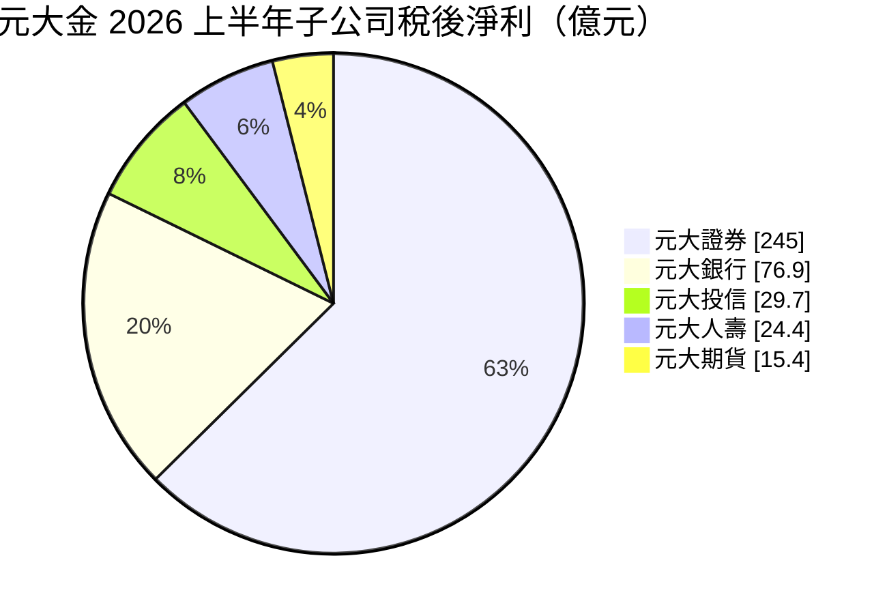
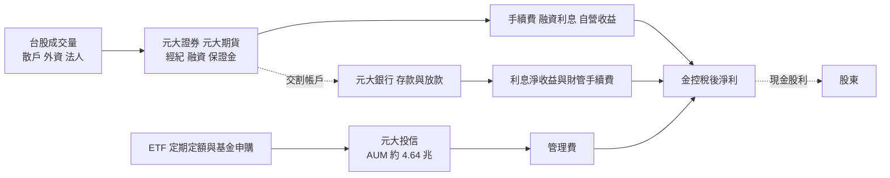
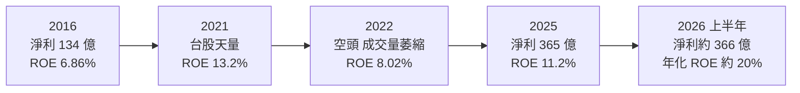
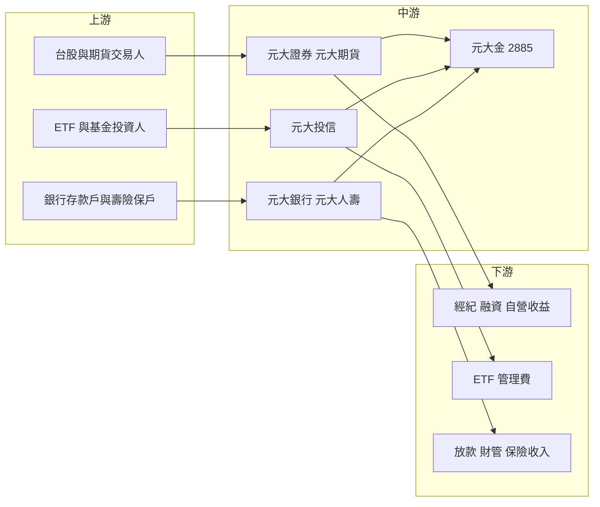

# 2885 元大金

> 上市｜[[產業索引-金融保險業|金融保險業]]｜上市（櫃）日期 2002/02/04

# 第一章：企業模式與商業藍圖

> [!info] 撰寫說明
> 本文由 Claude 依公開資料整理，架構比照 [[2330台積電]] 的四章研究，資料截至 2026-10-08。財務數字來源：Goodinfo 年度經營績效頁與股利政策頁（合併報表）、證交所開放資料快照（基本資料、股利）、富果研究法說會整理（2025 年第三季、2026 年上半年）、優分析、ETtoday 財經雲（2026 年股東常會）；產業描述為整理性內容，尚未逐條比對原始文件。#待校對

在評估單一個股的長期投資價值時，首要步驟是拆解企業的底層獲利邏輯。本章針對元大金融控股（股票代號：2885，以下簡稱元大金）的商業模式進行定性分析，說明台灣最大的證券型[[金控]]如何以「券商通路加自家 [[ETF]]」形成閉環，以及為什麼它的獲利會隨台股成交量放大或縮小。

## 一、核心定位：台灣最大的證券型金控

元大金前身為 2002 年 2 月 4 日成立並上市的復華金控，之後與元大證券體系整併並更名為元大金控；2012 年元大證券與寶來證券合併，2013 年併購國際紐約人壽（今元大人壽），2016 年元大銀行與大眾銀行合併，透過一連串併購形成今天的規模（併購年份為憑記憶整理，待校對）。依證交所 2026 年 10 月的基本資料，元大金實收資本額約 1,386 億元。

和台灣多數以銀行為主體的金控不同，元大金的獲利引擎是證券：元大證券是國內經紀業務龍頭，元大投信是國內最大的 ETF 發行商，元大期貨在期貨保證金市場也居首位；銀行（元大銀行）與壽險（元大人壽）則扮演提供穩定存款、放款與保險收入的角色。這種結構有兩個長期的商業意義：

* **台股景氣的槓桿：** 證券經紀、[[融資融券]]與自營的收入都和成交量、股價直接連動。成交量放大時，元大金的獲利成長速度遠快於銀行型金控；成交量萎縮時，也會比銀行型金控更早受影響。因此評估元大金不能只看單一年度，而要看完整的多空循環。
* **資產管理的長期年金：** ETF 規模一旦累積，管理費會隨市值與定期定額扣款持續流入，波動低於經紀手續費。台灣投資人從個股轉向指數化投資是長期趨勢，元大投信站在這個趨勢的最前端，這是元大金最接近「長期複利」的資產。

## 二、業務板塊：子公司獲利貢獻

金控不適用製造業的營收結構分析，以下以 2026 年上半年各子公司稅後淨利呈現獲利來源（各子公司合計高於金控淨利，差額推估為金控費用、持股比例與合併沖銷）：

2026 年上半年台股成交量處於歷史高檔，證券獲利占比因此偏高；在一般年份，證券與銀行合計約貢獻集團八至九成獲利（依 2025 年第三季法說會，兩者合計約 87%）。

* **元大證券：** 經紀、融資融券、自營、[[承銷]]與海外業務。國內營業據點與電子下單客戶基礎都居業界之首，外資經紀市占也在提升。海外布局韓國、泰國、越南、香港等市場，其中韓國子公司是 2014 年前後併購而來（待校對），海外獲利約占證券淨利一成。
* **元大銀行：** 整併大眾銀行後規模擴大，主要功能是提供證券交割帳戶的低成本存款、承接財富管理與房貸、企業放款。銀行獲利穩定但規模不及大型銀行，[[NIM]] 約在 1.1% 上下，近年提高外幣放款比重以改善利差。
* **元大投信：** 台灣 ETF 市場的領導者，旗下元大台灣 50（0050）是國內最具代表性的指數 ETF。依法說會報導，ETF 定期定額市占接近一半，[[AUM]] 在 2026 年上半年約 4.64 兆元。
* **元大期貨：** 期貨保證金市占近三成，與證券經紀形成交叉銷售。
* **元大人壽：** 規模在壽險業中屬中小型，外幣資產比重使它對匯率敏感，獲利起伏較大。

## 三、資本轉化邏輯：成交量與 AUM 的雙引擎

* **通路與產品閉環：** 元大證券擁有業界最多的營業據點與電子下單客戶，元大投信提供 ETF 與基金產品，兩者結合後，「在元大開戶、買元大的 ETF」成為許多散戶的預設選擇。銀行分行也能銷售自家基金與 ETF，讓集團賺到通路與產品兩層收入。
* **交割帳戶帶來低成本存款：** 證券客戶的交割帳戶多開在元大銀行，這些活期存款的利率很低，是銀行的便宜資金來源，也是證券與銀行綜效最具體的地方。
* **獲利的乘數效應：** 成交量增加時，經紀手續費、融資利息、借券收入與自營收益會同時上升，而系統與人力成本大多固定，因此獲利成長幅度會大於成交量成長幅度，反之亦然。

## 四、企業長期藍圖：資產管理整合與銀行轉型

* **資產管理整合：** 2026 年股東會說明，元大金擬以股份轉換方式把元大投信納為 100% 持股子公司，目的在整合集團資源，配合主管機關推動「亞洲資產管理中心」的政策方向。對股東而言，這代表能分到更多 ETF 長期管理費。
* **銀行財富管理與外幣放款：** 提高財管手續費與外幣放款比重，讓銀行在證券景氣低迷時能撐住集團獲利。
* **長期 ROE 目標：** 公司設定未來五年 [[ROE]] 目標區間約 9% 至 11%。這個目標比多頭年份的實際 ROE 低，說明管理層自己也把高成交量年份視為週期高點，長期評價應以一成左右為中樞。

# 第二章：護城河深度與競爭優勢

在長期價值投資中，「護城河」指企業抵禦競爭、維持超額利潤的保護機制。證券經紀是高度同質化、價格透明的業務，元大金的護城河主要不是來自產品，而是來自規模、通路與品牌慣性。本章分析這些優勢的構成、券商與投信兩個戰場的主要對手，以及哪些優勢能在手續費競爭中守住。

## 一、元大金護城河的核心組成要素

元大金的護城河屬於「中等寬度」，由四個要素組成：

* **1. 經紀規模與成本優勢：** 元大證券是國內經紀業務龍頭，大量的交易量能攤薄系統、合規與人力成本，也讓融資融券、借券等衍生業務有足夠的客戶基礎。在手續費普遍折讓的市場，規模最大的業者通常也是單位成本最低的業者。
* **2. ETF 品牌與先行者優勢：** 0050 等早期發行的 ETF 累積了多年規模與流動性，ETF 有「越大越好賣」的特性：規模大、成交量大、折溢價小，投資人就越願意買。元大投信的 ETF 定期定額市占接近一半，代表散戶長期扣款的黏著度很高。
* **3. 期貨保證金與交易基礎設施：** 期貨保證金市占近三成，與證券經紀共享客戶與系統，形成交易基礎設施的整體優勢。
* **4. 集團共銷：** 銀行、證券、投信可以互相導客，例如銀行財管銷售自家基金、證券客戶的交割帳戶留在元大銀行，讓每一位客戶在集團內貢獻多層收入。

## 二、主要競爭對手格局

| 對手 | 定位 | 對元大金的威脅 |
|---|---|---|
| [[2883凱基金]]、[[2890永豐金]] | 證券實力強的金控 | 凱基承銷與財管能力強，永豐數位券商吸引年輕客群 |
| [[2881富邦金]]、國泰證券、[[6005群益證]] | 大型券商 | 以手續費折讓與數位平台搶經紀市占 |
| 國泰投信、群益投信、復華投信、富邦投信 | ETF 發行商 | 高股息與主題型 ETF 推陳出新，部分產品線規模已超越元大 |
| [[2891中信金]]、[[2884玉山金]]、[[2892第一金]] | 大型銀行 | 存放款與財富管理規模遠大於元大銀行 |

## 三、優勢轉化：哪些市場守得住、哪些守不住

* **守得住：** 指數型 ETF 的規模與流動性具有「贏者全拿」的特性，新進者很難在相同指數上追趕；經紀龍頭地位與期貨保證金市占也很難在短時間內被撼動。這些優勢讓元大在每一次多頭循環中，都能拿到最大的一份。
* **守不住：** 手續費折讓是全業界的長期趨勢，經紀業務很難靠價格取得超額報酬；高股息與主題型 ETF 的創新速度，其他投信並不落後，元大在新產品上已不再是唯一的領先者。銀行與壽險規模偏小，也讓元大在證券空頭時缺乏足夠的穩定獲利來源。
* **觀察重點：** 第一，證券獲利對成交量的依賴程度是否下降。第二，元大投信整併後的資產管理規模與管理費成長。第三，銀行外幣放款與財管手續費能否在台股降溫時撐住集團獲利。

# 第三章：財務體質與盈利規模

資料日期：2026-10-08。數字取自 Goodinfo 年度經營績效頁與股利政策頁（合併報表）、證交所開放資料快照與法說會整理，表格是撰寫當時的快照；最新月營收、毛利率、累計 EPS 由自動排程寫在本筆記的屬性欄位（月營收、毛利率、累計EPS 等）。#待校對

財務報表是檢驗護城河是否真實存在的最終標準。金控沒有製造業的銷貨成本，[[毛利率]]與[[營業利益率]]並不適用；本章改用稅後淨利、[[ROE]]、[[ROA]]、[[每股淨值]]與股利，檢視元大金在台股多空循環中的獲利品質。

## 一、獲利能力的基石：淨收益、淨利與 ROE

| 年度 | 營業收入（億元） | 稅後淨利（億元） | EPS（元） | [[ROE]] | [[ROA]] | [[每股淨值]]（元） |
|---|---|---|---|---|---|---|
| 2016 | 844 | 134 | 1.16 | 6.86% | 0.77% | 16.96 |
| 2017 | 938 | 162 | 1.37 | 7.82% | 0.79% | 17.89 |
| 2018 | 1,013 | 187 | 1.59 | 8.82% | 0.90% | 18.76 |
| 2019 | 1,076 | 204 | 1.75 | 9.09% | 0.94% | 19.90 |
| 2020 | 1,156 | 241 | 1.99 | 9.92% | 1.00% | 20.87 |
| 2021 | 1,192 | 349 | 2.87 | 13.2% | 1.29% | 22.17 |
| 2022 | 915 | 215 | 1.72 | 8.02% | 0.75% | 20.51 |
| 2023 | 981 | 266 | 2.09 | 9.74% | 0.90% | 22.62 |
| 2024 | 1,207 | 358 | 2.77 | 11.9% | 1.09% | 24.28 |
| 2025 | 1,284 | 365 | 2.74 | 11.2% | 0.98% | 25.54 |

（來源：Goodinfo 年度經營績效，合併報表。營業收入為 Goodinfo 口徑，含壽險保費等收入，不等於法說會的淨收益。[[毛利率]]與[[營業利益率]]不適用於金控，未列出。2026 年上半年稅後淨利約 366 億元、EPS 2.64 元、年化 ROE 約 20%，已接近 2025 年全年。）

* **十年淨利成長約 2.7 倍：** 稅後淨利由 2016 年的 134 億元成長到 2025 年的 365 億元，2020 至 2025 年年複合成長率約 8.7%（推算）。成長來自三個層次：併購整合後的成本綜效、ETF 規模的長期累積，以及台股成交量的結構性提升。
* **週期性一目了然：** 2021 年台股天量時 ROE 13.2%，2022 年空頭時降到 8.02%，淨利一年內減少約四成；2026 年上半年台股再創天量，年化 ROE 衝上約 20%。這種起伏就是證券型金控的本質，投資人應該看整個循環的平均值，而不是高峰或低谷。
* **ROA 高於銀行型金控：** 元大金的 ROA 多數年份在 0.8% 至 1.1% 之間，高於銀行型金控常見的 0.6% 至 0.8%。原因是證券與資產管理業務占用的資產較少、收入以手續費為主，屬於較「輕資產」的金融業務。

## 二、[[ROE]]：資本效率

元大金 2016 至 2025 年的 ROE 十年平均約 9.7%，2021 至 2025 年平均約 10.8%（推算）。ROE 呈現緩步上升的趨勢：2016 年前後在 7% 至 8%，2023 年後多在 10% 以上，代表併購整合的效益逐步顯現，ETF 管理費等經常性收入的比重也在提高。

公司自己設定的長期 ROE 目標為 9% 至 11%，與近五年的實際平均相符。這個中樞水準高於多數公股金控，但低於中信金等頂尖銀行型金控。元大金的 ROE 要再往上提升，關鍵在於降低對成交量的依賴、提高資產管理與財管等經常性收入的比重。

## 三、資本與股利政策：取代資本支出與自由現金流

金控沒有工廠與機台，「資本支出」的概念改由「資本適足與股利」取代。證券業的資本主要用於融資融券、自營部位與承銷，銀行與壽險則受[[資本適足率]]與保險資本規範約束。

| 股利所屬年度 | 現金股利（元） | 股票股利（元） |
|---|---|---|
| 2019 | 0.65 | 0.4 |
| 2020 | 1.2 | 0 |
| 2021 | 1.5 | 0.3 |
| 2022 | 0.8 | 0.15 |
| 2023 | 1.1 | 0.2 |
| 2024 | 1.55 | 0.3 |
| 2025 | 1.8 | 0.4 |

（來源：Goodinfo 股利政策頁；2025 年度現金 1.8 元、股票 0.4 元與證交所股利資料一致。）

* **股利跟著循環走：** 2021 年度台股天量後現金股利 1.5 元，2022 年度空頭後降到 0.8 元，2025 年度再升到 1.8 元。元大金每年都有配息，但金額隨證券景氣起伏，不適合用單一年度的高股利推估長期收入。
* **配息率：** 公司設定現金股利發放率 50% 至 60%，以 2025 年 EPS 2.74 元計算，現金配息率約 66%（推算），另加 0.4 元股票股利。股票股利讓股本每年小幅擴大，用來支撐證券資本需求，但也稀釋每股盈餘。
* **資本指標：** 依 2026 年上半年法說會報導，金控資本適足率約 123%、元大證券約 347%、元大銀行約 13.9%、元大人壽約 141%，各子公司資本都高於法定門檻（待校對）。

## 四、[[ROE]] 與 [[CAPM]] 股東權益成本：價值創造利差

金融業的負債是營業的原料，[[ROIC]] 與 [[WACC]] 的框架不適用，改以 ROE 和股東權益成本比較。

* **股東權益成本（推算）：** 以 CAPM 估算，無風險利率取台灣 10 年期公債約 1.75%，市場風險溢酬 6%。證券型金控的股價與大盤連動性高於銀行型金控，β 假設 1.0（證券型金控常見值，未查得元大金實際數字），股東權益成本約 1.75% ＋ 1.0 × 6% ＝ 7.75%。無風險利率在 1.5% 至 2% 之間時，約落在 7.5% 至 8.0%。
* **ROE（實際）：** 2021 至 2025 年平均約 10.8%，十年平均約 9.7%。
* **價值創造判斷：** 元大金近五年 ROE 比股東權益成本高約 3 個百分點，十年平均則高約 2 個百分點（推算），屬於溫和創造價值。由於證券業的高 β 讓股東要求的報酬率較高，元大金的利差並不如表面 ROE 看起來那麼寬；空頭年份（如 2022 年 ROE 8.02%）幾乎只賺到資金成本。真正能擴大長期利差的是 ETF 管理費這類低波動收入，因為它同時提高 ROE、又降低獲利的波動。

# 第四章：總體風險與地緣政治

任何企業都無法脫離宏觀環境獨立存在。證券型金控是台股的「放大器」，總體環境的變化會比銀行型金控更快反映在獲利上。本章分析元大金未來必須面對的地緣政治與資金流向、成交量與利率週期、子公司營運風險，以及監理與科技演進。

## 一、地緣政治風險

* **兩岸風險與資金外流：** 作為台股成交量的主要受益者，兩岸緊張升高引發外資撤出、成交量萎縮時，元大的證券、期貨與投信獲利會同時受到衝擊，這是無法靠分散業務避開的系統性風險。
* **海外子公司：** 韓國、東南亞等海外證券業務受當地監理、政治與市場環境影響。海外獲利貢獻約一成，規模不大，但在當地市場劇烈波動時會帶來額外損益。
* **台股集中於科技業：** 台股市值與成交量高度集中在半導體與電子產業，全球科技景氣或美中科技管制一旦轉向，會透過成交量與 ETF 規模影響元大金。

## 二、產業週期與市場結構風險

* **成交量循環：** 證券經紀、融資利息與自營收益都和成交量同步，2022 年 ROE 降到 8.02% 就是成交量萎縮的結果。台股成交量長期雖有成長趨勢，但每三到五年通常會經歷一次明顯的修正。
* **ETF 資金流向：** ETF 規模具有黏著度，但市場轉空時投資人贖回、淨值下跌，管理費收入會同步減少；高股息 ETF 的熱潮若退燒，也會影響規模成長。
* **利率環境：** 銀行淨利差受央行利率政策影響，降息會壓縮 NIM；融資利率與債券自營部位也受利率變化影響。

## 三、營運環境的隱性風險

* **壽險匯率風險：** 元大人壽持有外幣資產，新台幣大幅升值時需提存[[外匯價格變動準備金]]，可能出現單季或單月虧損。
* **自營與承銷部位：** 證券自營在多頭時貢獻大，在急跌時也可能出現評價損失；承銷案件若遇市場轉弱，也可能需要認購未售出的部位。
* **投信整併執行：** 元大投信股份轉換案需經主管機關核准，整合過程與少數股東權益處理都有不確定性。

## 四、法規與科技演進風險

* **手續費競爭與數位化：** 網路券商、純網銀與手續費折讓持續壓縮經紀收入，券商必須投入大量資金在交易系統、App 與資安，規模小的業者壓力更大，但龍頭也不能停止投資。
* **ETF 監理：** 主管機關對 ETF 行銷、配息來源揭露與流動性管理的要求趨嚴，可能影響新產品推出速度與行銷方式。
* **保險新制：** [[IFRS 17]] 與 [[ICS]] 新制上路後，壽險獲利認列與資本要求改變，可能影響元大人壽上繳金控的盈餘。

# 專有名詞解析

## 金融

- **[[金控]]**：金融控股公司，旗下同時持有銀行、保險、證券等子公司，透過集團整合交叉銷售金融商品。
- **[[ETF]]**：指數股票型基金，追蹤特定指數並在交易所掛牌買賣，投資人可以像買股票一樣買進一籃子股票。
- **[[AUM]]**：資產管理規模，投信或銀行替客戶管理的資產總額，管理費收入大致與它成正比。
- **[[融資融券]]**：投資人向券商借錢買股（融資）或借股票賣出（融券），券商賺取利息與借券費用。
- **[[承銷]]**：券商協助企業發行股票或債券並負責銷售，賺取承銷手續費，有時須認購未售出的部分。
- **[[ROA]]**：資產報酬率，稅後淨利除以總資產，衡量金融機構運用資產創造獲利的效率。
- **[[每股淨值]]**：股東權益除以流通股數，代表每一股在帳面上對應的資產淨額，是評估金融股的重要基準。
- **[[CAPM]]**：資本資產定價模型，以無風險利率加上 β 乘以市場風險溢酬，估算股東要求的報酬率，也就是股東權益成本。
- **[[NIM]]**：淨利差，銀行放款與投資的收益率扣除存款等資金成本後的利差，是銀行獲利能力的核心指標。
- **[[資本適足率]]**：自有資本除以風險性資產的比率，監理機關以此限制金融機構能承擔多少風險。
- **[[外匯價格變動準備金]]**：台灣壽險業特有的準備金，用來緩衝外幣資產的匯率波動，新台幣大幅升值時需提存。
- **[[IFRS 17]]**：國際保險合約會計準則，改以現值方式衡量保險負債，讓壽險獲利認列更貼近保單實際經濟價值。
- **[[ICS]]**：保險資本標準，國際保險監理官協會制定的壽險資本規範，台灣接軌後壽險需準備更多資本。
- **[[股票股利]]**：公司以發放新股代替現金分配盈餘，可把資本留在公司內，但會使股本膨脹、稀釋每股盈餘。

# 核心供應鏈

## 1. 上游：資金與交易來源
- 台股與期貨交易人：散戶、外資與法人的成交量是證券與期貨收入的源頭。
- ETF 與基金投資人：定期定額扣款與申購是投信規模成長的來源。
- 銀行存款戶與壽險保戶：提供銀行與壽險的負債端資金。

## 2. 中游：元大金與子公司
- 元大證券、元大期貨：經紀、融資融券、自營、承銷與期貨保證金。
- 元大投信：國內最大的 ETF 發行商。
- 元大銀行、元大人壽：存放款、財管與保險。

## 3. 下游：收入型態
- 經紀手續費、融資利息與自營收益：隨成交量與股價起伏。
- ETF 與基金管理費：隨資產規模累積，波動較低。
- 利息淨收益、財管手續費與保險收入。

## 4. 同業比較
- 證券實力強的金控：[[2883凱基金]]、[[2890永豐金]]、[[2881富邦金]]
- 獨立券商與期貨商：[[6005群益證]]、[[2855統一證]]、[[6024群益期]]
- 銀行型金控：[[2891中信金]]、[[2884玉山金]]、[[2886兆豐金]]

## 最新新聞
<!-- news:start（自動產生，請勿手動編輯此範圍） -->
- 2026-10-22 🏛️ 重訊 17:53｜元大金控代子公司元大銀行公告取得不動產｜[觀測站](https://mops.twse.com.tw/mops/#/web/t05st01)
- 2026-10-22 🏛️ 重訊 16:47｜元大金控代子公司元大人壽公告向元大證金取得使用權資產｜[觀測站](https://mops.twse.com.tw/mops/#/web/t05st01)
- 2026-10-19 🏛️ 重訊 16:52｜元大金控代子公司元大銀行公告與元大證金之租賃關係消滅｜[觀測站](https://mops.twse.com.tw/mops/#/web/t05st01)
- 2026-10-19 🏛️ 重訊 16:34｜元大金控代子公司元大人壽公告變更與元大證金之租賃契約｜[觀測站](https://mops.twse.com.tw/mops/#/web/t05st01)
- 2026-10-19 🏛️ 重訊 16:34｜元大金控代子公司元大投信公告變更與元大證金之租賃契約｜[觀測站](https://mops.twse.com.tw/mops/#/web/t05st01)

完整紀錄：[[2885元大金 新聞]]
<!-- news:end -->

## 相關連結
- [公開資訊觀測站](https://mopsov.twse.com.tw/mops/web/t05st03?step=1&firstin=1&co_id=2885)
- [Goodinfo](https://goodinfo.tw/tw/StockDetail.asp?STOCK_ID=2885)
- [Yahoo 股市](https://tw.stock.yahoo.com/quote/2885)
- [鉅亨網新聞](https://www.cnyes.com/twstock/2885/news)
