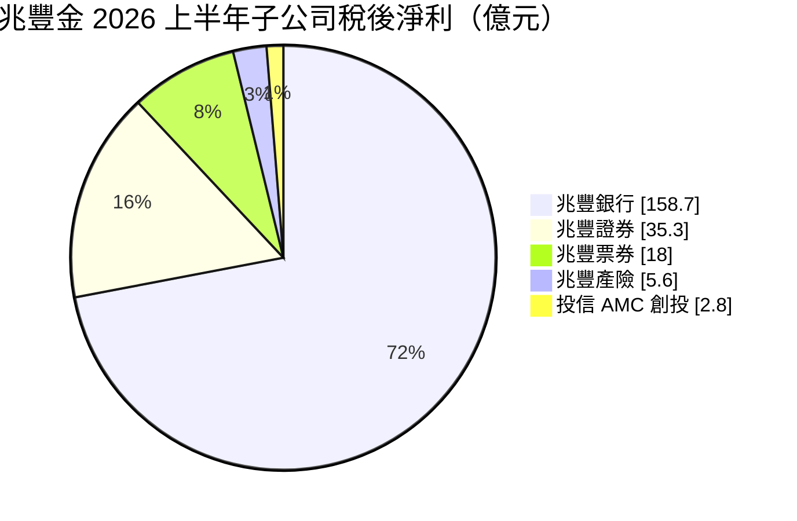
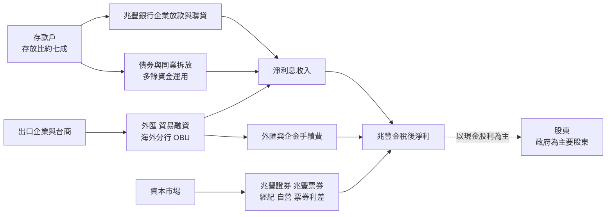
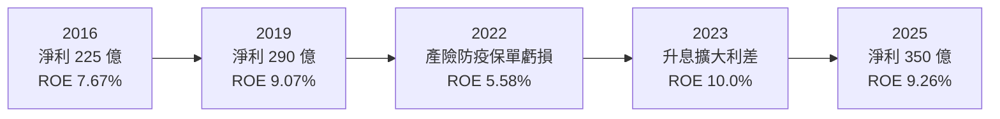
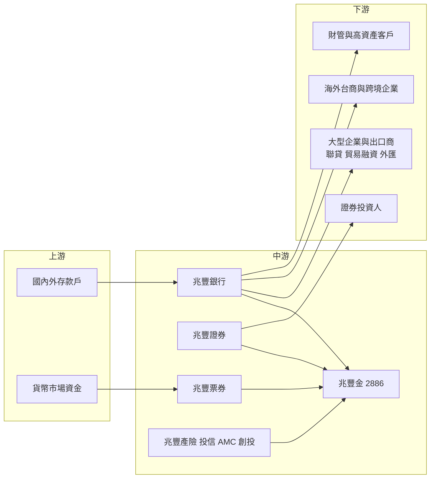

# 2886 兆豐金

> 上市｜[[產業索引-金融保險業|金融保險業]]｜上市（櫃）日期 2002/02/04

# 第一章：企業模式與商業藍圖

> [!info] 撰寫說明
> 本文由 Claude 依公開資料整理，架構比照 [[2330台積電]] 的四章研究，資料截至 2026-10-08。財務數字來源：Goodinfo 年度經營績效頁與股利政策頁（合併報表）、證交所開放資料快照（基本資料、股利）、優分析（2025 年全年、2026 年上半年法說會）、方格子 vocus（2026 年法說會整理）；產業描述為整理性內容，尚未逐條比對原始文件。#待校對

在評估金融股的長期投資價值時，首要步驟是看清楚獲利從哪一家子公司、哪一種業務而來。本章針對兆豐金融控股（股票代號：2886，以下簡稱兆豐金）的商業模式進行定性分析，說明這家以企業金融與外匯見長的公股[[金控]]，為什麼長期被視為「穩健配息股」，以及它在銀行獲利成長放緩時，如何尋找第二條成長曲線。

## 一、核心定位：企業金融與外匯見長的公股金控

兆豐金控在 2002 年 2 月 4 日以交銀金控之名成立並上市，同年納入中國國際商業銀行，2006 年交通銀行與中國國際商業銀行合併為兆豐國際商業銀行，金控也更名為兆豐金控（整併年份為憑記憶整理，待校對）。這兩家前身銀行，一家長期承擔國家工業與中長期授信任務，一家以國際匯兌與貿易融資見長，因此兆豐銀行天生就帶有「企業金融加外匯」的基因。

依證交所 2026 年 10 月的基本資料，兆豐金實收資本額約 1,483 億元。旗下子公司除兆豐銀行外，還有兆豐證券、兆豐票券、兆豐產險、兆豐投信、兆豐資產管理與兆豐創投。政府透過財政部與公股機構持有相當比例股權，是典型的公股金控。

公股身分塑造了兆豐的經營性格，對投資人有兩個長期意義：

* **穩健優先於成長：** 公股金控的經營目標除了獲利，還包括配合政策、維持金融穩定。因此兆豐的存放比偏低、資本偏厚、資產品質好，代價是 [[ROE]] 長期落在一成以下，成長也相對溫和。
* **高現金配息：** 政府股東需要穩定的股利收入，兆豐長期以現金股利為主、配息率偏高，股本膨脹的程度遠低於民營金控，這讓它成為台灣存股族的代表性標的之一。

## 二、業務板塊：銀行為主，證券與票券加速

以 2026 年上半年各子公司稅後淨利來看，獲利結構如下：

一般年份兆豐銀行占金控獲利八成以上；2026 年上半年台股熱絡，非銀行子公司的貢獻度依法說會報導升到約 28%，前一年同期約 13.5%，這個比重的變化正說明了銀行以外的業務波動較大。

* **兆豐銀行：** 集團核心，強項是大型企業授信、[[聯貸]]、[[貿易融資]]與外匯業務。存款規模大於放款規模，2025 年底存放比約 72%，多出來的資金放在債券與同業拆放，流動性非常充足，但也讓 [[NIM]] 偏低。
* **兆豐證券：** 經紀與自營為主，規模在券商中屬中段，獲利隨台股景氣起伏，是非銀行獲利波動最大的來源。
* **兆豐票券：** 國內主要的票券公司之一，以短期票券的保證、簽證、承銷與買賣賺取利差，獲利對短期利率變化敏感。
* **兆豐產險：** 規模小，過去在特殊事件（如 2022 年防疫保單理賠）中曾出現大額虧損（待校對），顯示保險業務的尾端風險。
* **投信、資產管理與創投：** 規模小，屬輔助性業務。

## 三、資本轉化邏輯：存款與資本如何變成獲利

* **保守的資產負債表：** 存放比約七成，代表兆豐沒有把存款盡可能放貸出去，而是保留大量流動性。好處是景氣反轉時不必被迫緊縮放款、也不怕擠兌；代價是資金運用收益偏低，依法說會報導 2025 年第四季台幣 NIM 約 0.87%，低於民營銀行。
* **企業金融與外匯：** 兆豐銀行與台灣出口導向企業關係深厚，在大型聯貸、貿易融資與外匯市場具傳統優勢。台灣企業海外設廠越多，兆豐的跨境金融需求也越多。
* **非銀行補足收益：** 證券與票券在股市與利率環境有利時能明顯提升獲利，在環境不利時則回到較小的貢獻。

## 四、企業長期藍圖：第二成長曲線

2026 年法說會首度提出「第二成長曲線」，三大方向如下：

* **收益結構多元化：** 強化財富管理與手續費收入。依法說會報導，2025 年淨手續費收入約 88.8 億元，其中財管約占一半；高資產客戶 [[AUM]] 在 2026 年上半年約 2,640 億元，已超過全年目標。財管是公股銀行過去較弱的一環，若能補強，就能降低對利差的依賴。
* **AI、半導體與跨境業務：** 深化對科技產業鏈的企業金融服務，跟隨客戶到美國、日本、東南亞布局，把傳統的企業金融優勢延伸到新的產業循環。
* **靈活資產配置：** 在利率環境改變時調整債券與放款配置，提高資金運用收益，逐步改善偏低的 NIM。

# 第二章：護城河深度與競爭優勢

在長期價值投資中，「護城河」指企業抵禦競爭、維持超額利潤的保護機制。金融業產品同質性高，護城河多半來自規模、資本、資金成本與客戶關係。兆豐的護城河不在於賺得特別多，而在於不容易出事。本章分析兆豐金的護城河構成、主要競爭對手，以及這些優勢能守住多少。

## 一、護城河的核心組成要素

兆豐金的護城河屬於「窄而穩」的類型，主要由四個要素組成：

* **1. 公股背景與資本實力：** 依法說會報導，2025 年金控[[資本適足率]]約 132%、[[雙重槓桿比率]]約 17.6%，銀行資本適足率約 16.4%，資本厚度在國內金控中屬前段。資本厚代表能承受較大的信用損失，也代表在危機時客戶與同業更信任它。
* **2. 企業金融與外匯專業：** 長年經營大型企業客戶與國際貿易融資，與台灣出口企業的往來關係往往跨越數十年。企業金融的轉換成本來自授信額度、帳戶整合與長期信任，客戶不會只因為利率差一點就換銀行。
* **3. 資產品質：** 2025 年底[[逾放比]]約 0.19%、[[備抵呆帳覆蓋率]]約 866%，屬國內銀行中的優等生。銀行最大的價值毀滅來自呆帳，長期低逾放就是最實在的護城河。
* **4. 充足的流動性：** 存放比只有七成左右，景氣反轉時不必被迫緊縮放款，利率上升時也能把閒置資金轉往收益較高的資產，具有「等待機會」的彈性。

## 二、全球主要競爭對手格局

| 對手 | 定位 | 對兆豐金的威脅 |
|---|---|---|
| [[5880合庫金]]、[[2892第一金]]、[[2880華南金]] | 同為公股金控，存放款規模大 | 在企業授信、政策性放款與公股客群直接競爭 |
| [[5876上海商銀]]、[[2834臺企銀]] | 企業金融為主的銀行 | 在中小企業與跨境企業金融競爭 |
| [[2891中信金]] | 海外布局最廣的民營金控 | 在台商跨境金融、聯貸與財管競爭 |
| [[2884玉山金]] | 財管與海外積極的民營金控 | 在財管、企業金融與海外布局競爭 |
| [[2881富邦金]]、[[2882國泰金]] | 規模最大的壽險型金控 | 在財管、證券與企業金融全面競爭 |

## 三、優勢轉化：哪些守得住、哪些守不住

* **守得住：** 資本實力、資產品質與企業金融客戶關係。從 2016 至 2025 年的財報可以看到，兆豐每年都維持獲利，ROE 除了 2022 年外都在 7.5% 以上，穩定度是多數金控難以複製的。
* **守不住：** 獲利成長性與利差。公股體系的低存放比、偏低的 NIM 與較弱的財管能力，讓兆豐在利率下行或企業放款競爭激烈時，很難擴大獲利；民營銀行在財管與消費金融的獲利能力明顯較強。
* **觀察重點：** 第一，非銀行獲利貢獻能否在台股降溫後仍維持兩成左右。第二，高資產 AUM 與財管手續費能否持續成長。第三，AI 與半導體企業授信能否提升銀行利差。這三點決定第二成長曲線是否真的成形。

# 第三章：財務體質與盈利規模

資料日期：2026-10-08。數字取自 Goodinfo 年度經營績效頁與股利政策頁（合併報表）、證交所開放資料快照與法說會報導，表格是撰寫當時的快照；最新月營收、毛利率、累計 EPS 由自動排程寫在本筆記的屬性欄位（月營收、毛利率、累計EPS 等）。#待校對

財務報表是檢驗護城河是否真實存在的最終標準。金控沒有製造業的銷貨成本，[[毛利率]]與[[營業利益率]]並不適用；本章改用稅後淨利、[[ROE]]、[[ROA]]、[[每股淨值]]與股利，檢視兆豐金的獲利品質與穩定度。

## 一、獲利能力的基石：淨收益、淨利與 ROE

| 年度 | 營業收入（億元） | 稅後淨利（億元） | EPS（元） | [[ROE]] | [[ROA]] | [[每股淨值]]（元） |
|---|---|---|---|---|---|---|
| 2016 | 551 | 225 | 1.65 | 7.67% | 0.67% | 21.47 |
| 2017 | 597 | 257 | 1.89 | 8.72% | 0.75% | 21.92 |
| 2018 | 616 | 281 | 2.07 | 9.18% | 0.79% | 23.11 |
| 2019 | 653 | 290 | 2.13 | 9.07% | 0.80% | 23.83 |
| 2020 | 608 | 250 | 1.84 | 7.69% | 0.66% | 24.01 |
| 2021 | 602 | 257 | 1.89 | 7.86% | 0.64% | 24.15 |
| 2022 | 560 | 183 | 1.32 | 5.58% | 0.44% | 21.51 |
| 2023 | 773 | 332 | 2.37 | 10.0% | 0.78% | 23.83 |
| 2024 | 835 | 348 | 2.35 | 9.94% | 0.77% | 24.54 |
| 2025 | 820 | 350 | 2.36 | 9.26% | 0.72% | 26.45 |

（來源：Goodinfo 年度經營績效，合併報表。營業收入為 Goodinfo 口徑。[[毛利率]]與[[營業利益率]]不適用於金控，未列出。2026 年上半年稅後淨利約 213 億元、EPS 1.44 元、年化 ROE 約 10.7%。）

* **利率決定獲利水位：** 兆豐的獲利與利率環境高度相關。2020 至 2021 年全球低利率時，淨利停在 250 億元上下；2023 年後利率維持高檔，存款大於放款的資產負債表讓多餘資金能賺到較高收益，淨利跳升到 330 億元以上。2020 至 2025 年淨利年複合成長率約 7.0%（推算）。
* **2022 年的低點：** 2022 年 ROE 降到 5.58%，主因推估是兆豐產險防疫保單的大額理賠與升息初期的債券評價壓力（待校對）。這說明即使是以銀行為主的公股金控，小型子公司的尾端風險也可能在單一年度造成明顯衝擊。
* **EPS 與淨利同步：** 兆豐很少配發股票股利，股本穩定，因此 EPS 由 1.65 元成長到 2.36 元，和淨利的成長幅度大致相當。這是公股金控與大量配股的民營金控最大的差別之一。

## 二、[[ROE]]：資本效率

兆豐金 2016 至 2025 年的 ROE 十年平均約 8.5%，2021 至 2025 年平均也約 8.5%（推算），在國內金控中屬於中後段。ROA 長期在 0.65% 至 0.8% 之間。

ROE 偏低的原因主要有三個：資本過度充足（分母大）、存放比低使資金運用收益偏低、財管與消費金融等高收益業務比重小。這是公股金控「穩健優先」策略的代價，也是一種有意識的選擇。對追求穩定股息的投資人而言，低波動與高配息可以部分彌補 ROE 偏低的缺點；但對追求長期複利的投資人而言，兆豐每保留一塊錢盈餘能創造的價值相對有限。

## 三、資本與股利政策：取代資本支出與自由現金流

金控沒有工廠與機台，「資本支出」的概念改由「資本適足與股利」取代。兆豐的資本已經很充足，因此每年賺到的錢，大部分可以直接發給股東。

| 股利所屬年度 | 現金股利（元） | 股票股利（元） |
|---|---|---|
| 2016 | 1.42 | 0 |
| 2017 | 1.5 | 0 |
| 2018 | 1.7 | 0 |
| 2019 | 1.7 | 0 |
| 2020 | 1.58 | 0 |
| 2021 | 1.4 | 0.25 |
| 2022 | 1.24 | 0.08 |
| 2023 | 1.5 | 0.3 |
| 2024 | 1.6 | 0 |
| 2025 | 1.75 | 0 |

（來源：Goodinfo 股利政策頁；2025 年度現金股利 1.75 元與證交所股利資料一致。）

* **十年現金股利都在 1.2 元以上：** 兆豐連續十年每年配發 1.24 至 1.75 元現金股利，是金控股中股利最穩定的之一。公司章程規定股東股利中現金股利不低於五成，實際上多數年份幾乎全數發放現金。
* **高配息率：** 以 2025 年 EPS 2.36 元計算，現金[[配息率]]約 74%（推算），高於多數民營金控。高配息率之所以可行，是因為資本已經充足，不需要保留太多盈餘支撐成長。
* **獲利低點時仍維持股利：** 2022 年 EPS 只有 1.32 元，但 2022 年度仍配發 1.24 元現金，配息率接近九成，顯示管理層與政府股東都重視股利的延續性。

## 四、[[ROE]] 與 [[CAPM]] 股東權益成本：價值創造利差

金融業的負債是營業的原料，[[ROIC]] 與 [[WACC]] 的框架不適用，改以 ROE 和股東權益成本比較。

* **股東權益成本（推算）：** 以 CAPM 估算，無風險利率取台灣 10 年期公債約 1.75%，市場風險溢酬 6%。公股金控股價波動低於大盤，β 假設 0.6（公股銀行型金控常見值，未查得兆豐金實際數字），股東權益成本約 1.75% ＋ 0.6 × 6% ＝ 5.35%。無風險利率在 1.5% 至 2% 之間時，約落在 5.1% 至 5.6%。
* **ROE（實際）：** 2021 至 2025 年平均約 8.5%，十年平均約 8.5%。
* **價值創造判斷：** 兆豐金的 ROE 比股東權益成本高約 3 個百分點（推算），屬於溫和創造價值。它的利差不是來自高 ROE，而是來自低風險帶來的低資金成本：股東願意接受較低的報酬，因為兆豐的獲利波動小、資本厚、配息穩。要注意的是，若利率環境回到 2020 年的低檔，ROE 可能回到 7% 至 8%，利差就會明顯縮小；這也說明財管與手續費等「不依賴利率」的收入，對兆豐長期價值的重要性。

# 第四章：總體風險與地緣政治

任何金融機構都無法脫離宏觀環境獨立存在。兆豐以企業金融與外匯為核心，國際貿易與台商動向對它的影響，比對一般以國內消費金融為主的銀行更直接。本章分析兆豐金未來必須面對的地緣政治、利率週期、營運風險與法規變化。

## 一、地緣政治風險

* **企業客戶的全球曝險：** 兆豐銀行大量承作出口企業授信與國際聯貸，美國關稅、出口管制、供應鏈移轉與地緣衝突，都會直接影響客戶的營運與還款能力。
* **海外分行監理：** 兆豐銀行紐約分行曾在 2016 年因洗錢防制缺失遭美國紐約州金融服務署重罰約 1.8 億美元（待校對），這是台灣金融業海外法遵最具代表性的案例，也顯示海外據點的監理風險不能忽視。
* **兩岸風險：** 兩岸緊張升高時，台股下跌會壓縮證券獲利，企業授信品質與外匯市場也可能受到衝擊。

## 二、產業週期與市場結構風險

* **利率週期：** 兆豐的資產負債表存款大於放款，對利率特別敏感。降息會壓縮本已偏低的利差，2020 至 2021 年低利率時期淨利就停滯不前；升息則有利再投資收益，但會壓低既有債券的評價。
* **股市週期：** 非銀行獲利貢獻在台股熱絡時可接近三成，台股降溫後可能回落到一成多，金控獲利成長會明顯放緩。
* **同業競爭：** 民營銀行在財管與消費金融更積極，公股銀行在手續費收入上較難追趕；大型企業授信的利率競爭也長期壓縮法金利差。

## 三、營運環境的隱性風險

* **公股治理：** 董事長與總經理人選受政府影響，經營策略可能隨政策調整，例如配合政策性放款、紓困方案或公股整併討論，股東利益不一定總是優先。
* **授信集中：** 大型企業授信金額大，若單一大型客戶或特定產業出現違約，損失金額可能較大。
* **子公司尾端風險：** 兆豐產險規模雖小，但在特殊理賠事件中可能造成大額虧損，2022 年就是例子。
* **人才與薪酬：** 第二成長曲線需要財管與資本市場人才，公股體系在薪酬彈性上不如民營金融機構，人才競爭處於劣勢。

## 四、法規與科技演進風險

* **洗錢防制與資本監理：** 國際洗錢防制要求持續提高，海外據點的法遵成本只會上升；銀行資本規範若趨嚴，也會影響股利空間。
* **數位轉型：** 公股銀行在數位通路、行動支付與 AI 應用上起步較晚，若無法追上民營銀行，年輕客群與財管業務的成長會受限。
* **公股整併議題：** 市場不時討論公股金控整併，若真的發生，股權結構、經營策略與股利政策都可能改變，對既有股東是不確定因素。

# 專有名詞解析

## 金融

- **[[金控]]**：金融控股公司，旗下同時持有銀行、保險、證券等子公司，透過集團整合交叉銷售金融商品。
- **[[聯貸]]**：多家銀行共同承作同一筆大額企業放款，由主辦銀行負責籌組與管理，分散單一銀行的授信風險。
- **[[貿易融資]]**：銀行為進出口企業提供的信用狀、押匯、應收帳款融資等服務，是外匯銀行的核心業務。
- **[[NIM]]**：淨利差，銀行放款與投資的收益率扣除存款等資金成本後的利差，是銀行獲利能力的核心指標。
- **[[ROA]]**：資產報酬率，稅後淨利除以總資產，衡量金融機構運用資產創造獲利的效率。
- **[[每股淨值]]**：股東權益除以流通股數，代表每一股在帳面上對應的資產淨額，是評估金融股的重要基準。
- **[[CAPM]]**：資本資產定價模型，以無風險利率加上 β 乘以市場風險溢酬，估算股東要求的報酬率，也就是股東權益成本。
- **[[資本適足率]]**：自有資本除以風險性資產的比率，監理機關以此限制金融機構能承擔多少風險。
- **[[雙重槓桿比率]]**：金控對子公司的長期股權投資除以金控淨值，比率過高代表金控借錢投資子公司，資本品質較差。
- **[[逾放比]]**：逾期放款占總放款的比率，數字越低代表銀行資產品質越好。
- **[[備抵呆帳覆蓋率]]**：銀行提列的備抵呆帳除以逾期放款，比率越高代表吸收壞帳損失的緩衝越厚。
- **[[AUM]]**：資產管理規模，銀行或投信替客戶管理的資產總額，是財富管理業務規模的指標。
- **[[配息率]]**：現金股利占每股盈餘的比例，反映公司把多少獲利以現金還給股東。

# 核心供應鏈

## 1. 上游：資金來源
- 國內外存款戶：兆豐銀行存款規模大於放款，資金來源充裕。
- 貨幣市場資金：兆豐票券透過票券買賣與附買回交易取得短期資金。

## 2. 中游：兆豐金與子公司
- 兆豐銀行：企業金融、外匯、國際聯貸與財富管理。
- 兆豐證券、兆豐票券：證券經紀、自營與短期票券業務。
- 兆豐產險、兆豐投信、兆豐資產管理、兆豐創投。

## 3. 下游：主要客群
- 大型企業與出口商：聯貸、貿易融資、外匯與現金管理。
- 海外台商：透過海外分行與國際金融業務分行提供跨境服務。
- 財管與高資產客戶、證券投資人。

## 4. 同業比較
- 公股金控與銀行：[[5880合庫金]]、[[2892第一金]]、[[2880華南金]]、[[2801彰銀]]、[[2834臺企銀]]
- 民營銀行型金控：[[2891中信金]]、[[2884玉山金]]
- 票券同業：[[2820華票]]、[[2889國票金]]

## 最新新聞
<!-- news:start（自動產生，請勿手動編輯此範圍） -->
- 2026-10-16 🏛️ 重訊 17:22｜代本公司之子公司兆豐國際商業銀行公告董事會決議， 申請次順位金融債券發行額度新臺幣壹佰伍拾億元整。｜[觀測站](https://mops.twse.com.tw/mops/#/web/t05st01)
- 2026-10-16 🏛️ 重訊 16:50｜代本公司之子公司兆豐國際商業銀行股份有限公司公告擬出售不 良債權｜[觀測站](https://mops.twse.com.tw/mops/#/web/t05st01)
- 2026-10-14 🏛️ 重訊 15:00｜公告本公司暨主要子公司115年9月份自結合併盈餘｜[觀測站](https://mops.twse.com.tw/mops/#/web/t05st01)
- 2026-10-05 📰 媒體 20:10｜鉅亨速報 - Factset 最新調查：兆豐金(2886-TW)目標價調升至49元，幅度約5.15%｜[鉅亨網](https://news.cnyes.com/news/id/6622000)

完整紀錄：[[2886兆豐金 新聞]]
<!-- news:end -->

## 相關連結
- [公開資訊觀測站](https://mopsov.twse.com.tw/mops/web/t05st03?step=1&firstin=1&co_id=2886)
- [Goodinfo](https://goodinfo.tw/tw/StockDetail.asp?STOCK_ID=2886)
- [Yahoo 股市](https://tw.stock.yahoo.com/quote/2886)
- [鉅亨網新聞](https://www.cnyes.com/twstock/2886/news)
