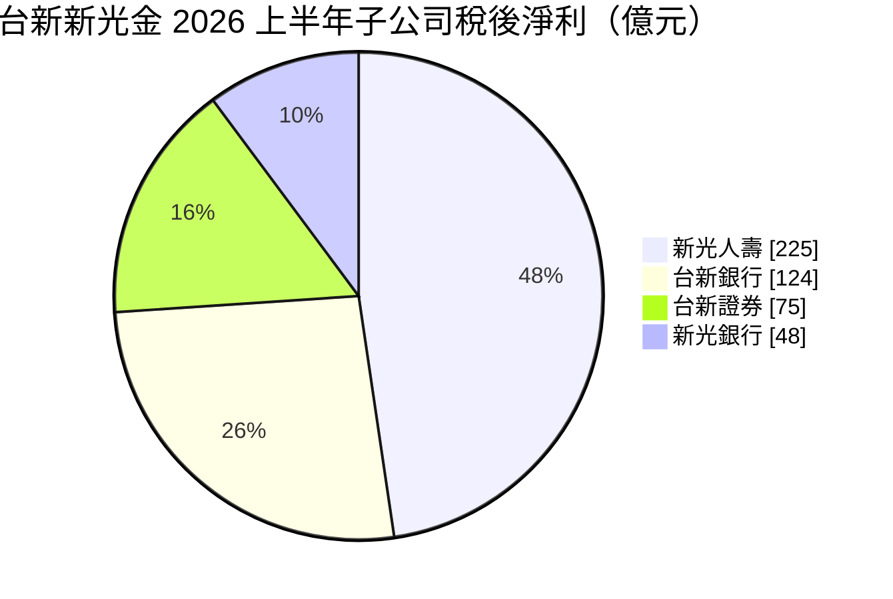
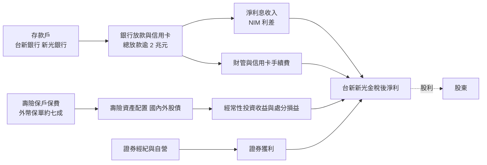
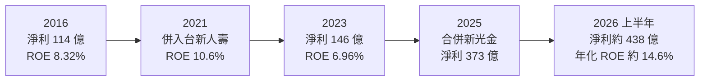
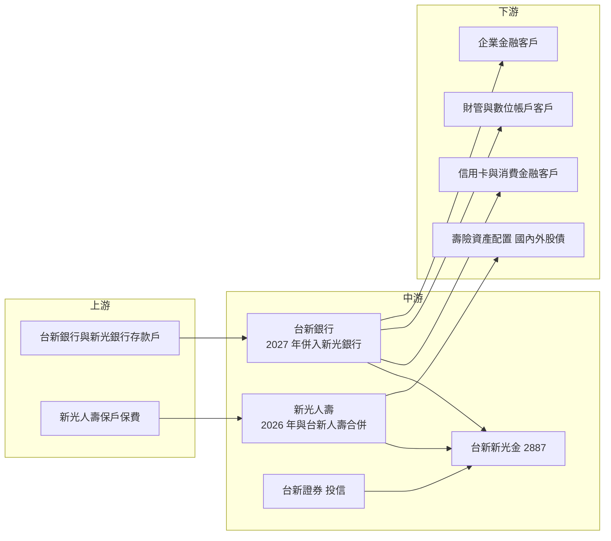

# 2887 台新新光金

> 上市｜[[產業索引-金融保險業|金融保險業]]｜上市（櫃）日期 2002/02/18

# 第一章：企業模式與商業藍圖

> [!info] 撰寫說明
> 本文由 Claude 依公開資料整理，架構比照 [[2330台積電]] 的四章研究，資料截至 2026-10-08。財務數字來源：Goodinfo 年度經營績效頁與股利政策頁（合併報表）、證交所開放資料快照（基本資料、股利）、優分析（壽險合併、2026 年上半年法說會）、科技新報（合併 QA、2026 年上半年法說會）、ETtoday 財經雲；產業描述為整理性內容，尚未逐條比對原始文件。#待校對

在評估金融股的長期投資價值時，首要步驟是看清楚獲利從哪一家子公司、哪一種業務而來。本章針對台新新光金融控股（股票代號：2887，以下簡稱台新新光金）的商業模式進行定性分析，說明它如何透過 2025 年合併新光金，從以消費金融見長的中型銀行型[[金控]]，轉變為銀行與壽險並重的大型綜合金控，以及這個轉變帶來的機會與代價。

## 一、核心定位：合併新光金後躋身大型金控

台新銀行在 1992 年成立，是政府開放新銀行設立後的第一批民營銀行之一，2002 年 2 月 18 日成立台新金控並上市（銀行成立年份為憑記憶整理，待校對）。台新長期以信用卡、消費金融與財富管理見長，數位銀行品牌 Richart 在年輕客群中有一定知名度。2021 年前後台新金併購保德信人壽並更名為台新人壽，開始建立小規模的壽險業務（待校對）。

真正改變公司體質的是 2025 年的合併。台新金與新光金在 2025 年 7 月 24 日完成合併，更名為台新新光金控，一舉納入新光人壽與新光銀行；2026 年 1 月 1 日台新人壽與新光人壽合併，台新人壽為存續公司並更名為新光人壽，依 2025 年 9 月底資料合計總資產約 3.96 兆元、居壽險業第四；兩家銀行則規劃在 2027 年 1 月 1 日合併，台新銀行為存續公司。依證交所 2026 年 10 月的基本資料，台新新光金實收資本額約 2,961 億元，董事長為吳東亮。

合併對長期投資人的意義可以從兩個角度理解：

* **規模躍升：** 合併後總資產接近 9.4 兆元（2026 年上半年），獲利規模已和國內前段班金控處在同一量級，不再只是中型民營金控。
* **風險屬性改變：** 新光人壽是台灣歷史悠久的大型壽險公司，貢獻集團約一半獲利，也帶來壽險常見的利率、匯率與股市風險，以及過去高預定利率保單的[[利差損]]包袱。集團獲利的穩定度不再像純銀行型結構那樣高。

## 二、業務板塊：壽險與銀行雙引擎

以 2026 年上半年各子公司稅後淨利來看，獲利結構如下：

圖中各子公司合計約 472 億元，高於金控合併稅後淨利約 438 億元，差額主要來自金控層級費用與合併調整（推估）。

* **新光人壽：** 集團最大的資產與獲利來源，也是最大的風險來源。依法說會報導，[[外幣保單]]占比約七成，避險前經常性投資收益率約 4.2%，新契約 [[CSM]] 持續累積。壽險的獲利主要來自投資收益與保單負債成本之間的利差，受匯率與[[避險成本]]影響很大。
* **台新銀行：** 集團經營能力的核心。信用卡、消費金融、財富管理與數位帳戶是強項，近年企業金融與放款規模也持續擴大，依報導總放款已突破 2 兆元。
* **台新證券：** 經紀與自營為主，2026 年上半年受惠台股成交熱絡，獲利明顯偏高，不宜視為常態。
* **新光銀行：** 以北部傳統客群與房貸為主，將在 2027 年併入台新銀行。

## 三、資本轉化邏輯：負債端資金如何變成獲利

金控的「生產線」不是工廠，而是把存款與保費轉成放款與投資，賺取兩者之間的利差與手續費。台新新光金同時經營銀行與壽險，兩條生產線的邏輯不同。

* **銀行端：** 靠[[淨利差]]（[[NIM]]）與手續費賺錢，消費金融的利差高於企業金融，但信用風險也較高，需要好的風控模型。
* **壽險端：** 靠投資收益與保單利差賺錢。保費是長期資金，必須在數十年間持續賺到高於保單預定利率的收益，否則就會形成利差損。新光人壽過去賣出大量高預定利率保單，這是它長年資本吃緊的根源。
* **交叉銷售：** 合併後台新銀行的財管與信用卡產品，可以賣給新光人壽與新光銀行的既有客群；新光人壽的保單也能透過台新銀行的[[銀行保險]]通路銷售，這是合併綜效的主要來源。

## 四、企業長期藍圖：整併、轉型與股利成長

* **整併節奏：** 金控合併（2025 年 7 月）、壽險合併（2026 年 1 月）、投信合併（2025 年 11 月）、銀行合併（規劃 2027 年 1 月），台新新光金正逐步把兩個集團的子公司一一整合。整合後可共用系統、裁併重疊分行，若執行順利，[[成本收益比]]可望下降（推估）。
* **壽險轉型：** 新光人壽合併後提高保障型與外幣保單比重，以新契約 CSM 作為核心經營指標，目的是用新保單的利潤逐步稀釋舊保單的利差損。這是一個需要十年以上才能完成的轉型。
* **財富管理與數位：** 以台新銀行的財管能力與 Richart 數位平台，向新光體系的龐大客群交叉銷售，把新光的「客戶數」轉換成台新的「手續費」。
* **股利穩定成長：** 管理層表示股利以現金為主，原則是評估整體獲利、維持競爭力並保持長期穩定成長。

# 第二章：護城河深度與競爭優勢

在長期價值投資中，「護城河」指企業抵禦競爭、維持超額利潤的保護機制。金融業產品同質性高，護城河多半來自規模、客群與資金成本。本章分析台新新光金的護城河構成、國內主要競爭對手，以及合併後的優勢能守住多少。

## 一、護城河的核心組成要素

台新新光金的護城河屬於「窄護城河」，合併讓規模大幅提升，但整合尚未完成，綜效仍待驗證。主要由四個要素組成：

* **1. 規模經濟：** 合併後總資產近 9.4 兆元，躋身國內前段金控。金融業的資訊系統、法遵與品牌投入大多是固定成本，規模越大，單位成本越低；規模也帶來在聯貸、財管商品與保險通路上的議價能力。
* **2. 消費金融與數位銀行能力：** 台新銀行在信用卡、消費貸款與數位帳戶具先行優勢，客群偏年輕。年輕客群今天的貢獻不大，但隨著收入與資產成長，會成為未來財管與保險的主要客源。
* **3. 壽險保單存量與通路：** 新光人壽擁有大量長年期保單與保戶，形成穩定的負債端資金與龐大的業務員通路。保單一旦售出，客戶轉換成本很高，這部分具有黏著度。
* **4. 合併綜效的潛力：** 銀行合併後可裁併重疊分行、統一系統，壽險合併後可統一投資管理與商品設計。綜效能否實現取決於執行力，目前屬於「潛在」護城河。

## 二、全球主要競爭對手格局

台新新光金的競爭主要在國內，對手可依業務重心分為三群：

| 對手 | 定位 | 對台新新光金的威脅 |
|---|---|---|
| [[2882國泰金]]、[[2881富邦金]] | 壽險規模最大的兩家金控，銀行與證券也完整 | 壽險資本與投資規模遠大，可承受較大波動 |
| [[2883凱基金]] | 壽險加證券型金控 | 在壽險與證券業務同時競爭 |
| [[2891中信金]]、[[2884玉山金]] | 銀行實力強的民營金控 | 在信用卡、財管與企業金融直接競爭，玉山也剛併入三商壽 |
| [[2890永豐金]] | 銀行與證券並重，數位業務積極 | 在數位銀行與年輕客群重疊 |
| [[2885元大金]] | 證券龍頭金控 | 在證券經紀與財管通路具規模優勢 |

## 三、優勢轉化：哪些守得住、哪些守不住

* **守得住：** 合併後的規模與分行通路、台新銀行的消費金融與財管能力，在大型金控中已具差異化。台新過去十年 ROE 多在 7% 至 10% 之間，雖不突出，但銀行本業的經營能力相對穩定。
* **守不住：** 壽險規模與資本韌性仍不及國泰、富邦；新光人壽的高成本保單與資本缺口需要時間消化，在利率或股市逆風時，集團獲利與淨值的波動會明顯大於純銀行型金控。
* **觀察重點：** 第一，2027 年銀行合併能否如期順利。第二，新光人壽在 [[ICS]] 新制下的資本狀況與盈餘上繳能力。第三，合併後營運成本是否真的下降、ROE 能否穩定在一成以上。這三點決定合併到底是「一加一大於二」還是「大而不強」。

# 第三章：財務體質與盈利規模

資料日期：2026-10-08。數字取自 Goodinfo 年度經營績效頁與股利政策頁（合併報表）、證交所開放資料快照與法說會報導，表格是撰寫當時的快照；最新月營收、毛利率、累計 EPS 由自動排程寫在本筆記的屬性欄位（月營收、毛利率、累計EPS 等）。#待校對

財務報表是檢驗護城河是否真實存在的最終標準。金控沒有製造業的銷貨成本，[[毛利率]]與[[營業利益率]]並不適用；本章改用稅後淨利、[[ROE]]、[[ROA]]、[[每股淨值]]與股利，檢視台新新光金合併前後的獲利品質。

## 一、獲利能力的基石：淨收益、淨利與 ROE

| 年度 | 營業收入（億元） | 稅後淨利（億元） | EPS（元） | [[ROE]] | [[ROA]] | [[每股淨值]]（元） |
|---|---|---|---|---|---|---|
| 2016 | 362 | 114 | 1.14 | 8.32% | 0.74% | 14.33 |
| 2017 | 378 | 131 | 1.15 | 8.59% | 0.80% | 14.40 |
| 2018 | 397 | 129 | 1.09 | 7.84% | 0.75% | 15.22 |
| 2019 | 436 | 145 | 1.19 | 8.19% | 0.76% | 15.61 |
| 2020 | 441 | 145 | 1.17 | 7.94% | 0.69% | 15.88 |
| 2021 | 638 | 203 | 1.63 | 10.6% | 0.86% | 16.22 |
| 2022 | 664 | 149 | 1.09 | 7.41% | 0.56% | 15.52 |
| 2023 | 699 | 146 | 1.01 | 6.96% | 0.50% | 15.95 |
| 2024 | 866 | 201 | 1.39 | 9.01% | 0.63% | 16.26 |
| 2025 | 1,506 | 373 | 1.91 | 10.5% | 0.62% | 18.42 |

（來源：Goodinfo 年度經營績效，合併報表。營業收入為 Goodinfo 口徑，2021 年起含台新人壽保費等收入，2025 年起含新光金下半年併表。[[毛利率]]與[[營業利益率]]不適用於金控，未列出。2026 年上半年稅後淨利約 438 億元、EPS 1.69 元、年化 ROE 約 14.6%、每股淨值約 27.16 元。）

* **合併前的台新：穩定但不突出。** 2016 至 2024 年稅後淨利由 114 億元成長到 201 億元，年複合成長率約 7.3%（推算），ROE 多在 7% 至 10% 之間，ROA 約 0.5% 至 0.86%，屬於中等水準的民營銀行型金控。
* **2025 年後的數字不可直接比較：** 2025 年淨利 373 億元、2026 年上半年約 438 億元，成長主要來自合併新光金的規模效果，並非同口徑的有機成長。2020 至 2025 年淨利年複合成長率約 20.8%（推算），這個數字大部分是併購造成的。
* **2026 年的高獲利含景氣成分：** 2026 年上半年新光人壽與台新證券的獲利有相當部分來自台股大漲帶動的處分利益與成交量，屬於景氣敏感、可持續性較低的成分；台新銀行的淨利息收入與手續費成長則較具經常性。

## 二、[[ROE]]：資本效率

台新 2016 至 2025 年 ROE 十年平均約 8.5%，2021 至 2025 年平均約 8.9%（推算），在國內金控中屬中段。每股淨值長期停在 14 至 16 元，主要原因是長年配發股票股利，股本膨脹抵銷了淨值成長。

合併後的 ROE 會呈現兩種力量拉扯：一方面新光人壽的資產規模很大，若投資收益穩定，能拉高集團獲利；另一方面壽險的淨值受股債市評價影響很大，市場上漲時淨值暴增、ROE 分母變大，市場下跌時淨值縮水甚至需要增資。2026 年 6 月底每股淨值約 27 元，較 2025 年底大幅增加，推估主要反映壽險接軌新制與金融資產評價上升，這部分淨值在市場反轉時可能快速回落。

## 三、資本與股利政策：取代資本支出與自由現金流

金控沒有工廠與機台，「資本支出」的概念改由「資本適足與股利」取代。對台新新光金而言，最大的資本需求來自新光人壽：壽險新制提高資本要求，新光人壽能上繳金控的盈餘，直接決定金控的配息能力。

| 股利所屬年度 | 現金股利（元） | 股票股利（元） |
|---|---|---|
| 2019 | 0.566 | 0.231 |
| 2020 | 0.555 | 0.454 |
| 2021 | 0.605 | 0.495 |
| 2022 | 0.51 | 0.42 |
| 2023 | 0.6 | 0.4 |
| 2024 | 0.9 | 0 |
| 2025 | 1.0 | 0.1 |

（來源：Goodinfo 股利政策頁；2025 年度現金 1.0 元、股票 0.1 元與證交所股利資料一致。）

* **長年「半現金半股票」：** 2016 至 2023 年度，台新每年配發約 0.5 至 0.6 元現金加上 0.2 至 0.5 元股票股利，用股票股利保留資本支撐成長。2024 年度起轉向以現金為主。
* **配息率：** 以 2025 年 EPS 1.91 元計算，現金[[配息率]]約 52%（推算），加上股票股利後合計配發率約 58%。
* **股利延續性的關鍵：** 新光人壽在 [[IFRS 17]] 與 ICS 新制下的資本狀況，以及主管機關對壽險盈餘上繳的規定，是判斷未來配息能否穩定成長的最大變數。

## 四、[[ROE]] 與 [[CAPM]] 股東權益成本：價值創造利差

金融業的負債是營業的原料，[[ROIC]] 與 [[WACC]] 的框架不適用，改以 ROE 和股東權益成本比較。

* **股東權益成本（推算）：** 以 CAPM 估算，無風險利率取台灣 10 年期公債約 1.75%，市場風險溢酬 6%。合併後壽險占比高，股價對股市與利率的敏感度高於純銀行型金控，β 假設 0.9（壽險型金控同業常見值，未查得台新新光金實際數字），股東權益成本約 1.75% ＋ 0.9 × 6% ＝ 7.15%。無風險利率在 1.5% 至 2% 之間時，約落在 6.9% 至 7.4%。
* **ROE（實際）：** 2021 至 2025 年平均約 8.9%，十年平均約 8.5%；2026 年上半年年化約 14.6%。
* **價值創造判斷：** 過去十年台新的 ROE 只比股東權益成本高約 1 至 2 個百分點（推算），屬於勉強創造價值，2022 至 2023 年 ROE 約 7% 時甚至只賺到資金成本。合併新光金後，風險提高使股東要求的報酬率也提高，因此合併能否創造價值，關鍵在於 ROE 能否「穩定」維持在 10% 以上，而不是只在股市大好的年份衝高。2026 年上半年的高 ROE 是好的開始，但需要經歷一次完整的利率與股市循環才能驗證。

# 第四章：總體風險與地緣政治

任何金融機構都無法脫離宏觀環境獨立存在，壽險型金控尤其如此。壽險的資產大量配置在海外債券與股票，負債則是長達數十年的保單，任何利率、匯率與股市的劇烈變動，都會直接反映在淨值上。本章分析台新新光金未來必須面對的地緣政治、利率週期、整合風險與法規變化。

## 一、地緣政治風險

* **匯率與海外資產曝險：** 新光人壽外幣保單約占七成，資產端也大量配置美元債券。新台幣快速升值時，外幣資產換算回台幣的價值下降，必須提存[[外匯價格變動準備金]]或負擔更高的避險成本，獲利與淨值都會受衝擊。
* **全球金融市場連動：** 美國利率、信用利差與股市的變化，透過壽險的海外投資直接影響集團損益，台新新光金的獲利因此比純銀行型金控更「國際化」，也更難預測。
* **兩岸風險：** 兩岸緊張升高時，台股下跌會同時影響壽險資產評價與證券獲利，屬於無法分散的系統性風險。

## 二、產業週期與市場結構風險

* **利率週期：** 升息有利銀行利差與壽險再投資收益，但會使持有的債券評價下降；降息則相反，且會加重舊保單的利差損壓力。台新新光金同時擁有銀行與壽險，兩種效果部分抵銷，但方向與幅度很難精準預測。
* **股市週期：** 2026 年上半年證券與壽險處分利益都受惠於台股大漲，市場反轉時獲利會明顯回落，壽險淨值也會縮水。
* **同業競爭：** 信用卡、房貸與財管市場競爭激烈，價格戰可能壓縮手續費與利差；壽險市場則面臨國泰、富邦的規模競爭。

## 三、營運環境的隱性風險

* **合併整合：** 兩個集團的企業文化、資訊系統與人員差異很大，銀行合併期間的系統轉換、人員安置與客戶流失都是風險。金融業的系統整合一旦出錯，影響的是數百萬名客戶的帳戶與交易。
* **新光人壽的歷史包袱：** 過去高預定利率保單造成的利差損，需要靠新保單利潤與投資收益長期消化，期間若遇到市場逆風，可能需要金控再注資。
* **股本膨脹：** 合併換股與過去大量配發的股票股利使股本大幅增加，未來 EPS 成長會低於淨利成長。

## 四、法規與技術演進風險

* **[[IFRS 17]] 與 [[ICS]] 新制：** 台灣壽險業 2026 年起接軌新會計準則與新資本標準，保險負債改以現值衡量，資本要求提高。主管機關可能限制壽險上繳金控的盈餘，間接影響金控股利。
* **合併監理條件：** 主管機關核准合併時可能附帶資本、治理或股利限制，這些條件會影響合併後數年的資本配置。
* **數位與資安：** 銀行系統整合需確保資安與服務不中斷，數位銀行與純網銀的競爭也持續升溫，台新在數位領域的先行優勢需要持續投資才能維持。

# 專有名詞解析

## 金融

- **[[金控]]**：金融控股公司，旗下同時持有銀行、保險、證券等子公司，透過集團整合交叉銷售金融商品。
- **[[利差損]]**：壽險公司的投資收益率低於過去賣出保單承諾的預定利率，差額形成的虧損，是台灣老牌壽險的長期包袱。
- **[[外幣保單]]**：以美元等外幣計價的保單，保費與給付都以外幣進行，壽險公司藉此配置海外資產，但也承擔匯率風險。
- **[[CSM]]**：合約服務邊際，IFRS 17 下保單未來預期利潤的現值，會隨保單期間逐年認列為獲利，是壽險新制的核心經營指標。
- **[[避險成本]]**：壽險公司為降低外幣資產的匯率風險而承作換匯或遠期外匯交易所付出的成本，會侵蝕投資收益。
- **[[淨利差]]**：放款等生息資產的收益率減去存款等付息負債的成本率，反映銀行賺取利差的能力。
- **[[NIM]]**：淨利差，銀行放款與投資的收益率扣除存款等資金成本後的利差，是銀行獲利能力的核心指標。
- **[[銀行保險]]**：透過銀行通路銷售保險商品，簡稱銀保，是金控整合銀行與壽險的主要綜效來源。
- **[[成本收益比]]**：營運費用除以淨收益，比率越低代表經營效率越高，是銀行合併後衡量綜效的常用指標。
- **[[ROA]]**：資產報酬率，稅後淨利除以總資產，衡量金融機構運用資產創造獲利的效率。
- **[[每股淨值]]**：股東權益除以流通股數，代表每一股在帳面上對應的資產淨額，是評估金融股的重要基準。
- **[[CAPM]]**：資本資產定價模型，以無風險利率加上 β 乘以市場風險溢酬，估算股東要求的報酬率，也就是股東權益成本。
- **[[外匯價格變動準備金]]**：台灣壽險業特有的準備金，用來緩衝外幣資產的匯率波動，新台幣大幅升值時需提存。
- **[[IFRS 17]]**：國際保險合約會計準則，改以現值方式衡量保險負債，讓壽險獲利認列更貼近保單實際經濟價值。
- **[[ICS]]**：保險資本標準，國際保險監理官協會制定的壽險資本規範，台灣接軌後壽險需準備更多資本。
- **[[配息率]]**：現金股利占每股盈餘的比例，反映公司把多少獲利以現金還給股東。

# 核心供應鏈

## 1. 上游：資金與保費來源
- 銀行存款戶：台新銀行與新光銀行的存款是放款與投資的資金來源。
- 壽險保戶：新光人壽的保費形成長期負債資金，外幣保單比重高。

## 2. 中游：台新新光金與子公司
- 台新銀行、新光銀行：消費金融、財富管理、數位銀行與企業金融。
- 新光人壽：2026 年 1 月 1 日由台新人壽與新光人壽合併而成。
- 台新證券、台新投信：證券經紀、自營與基金。

## 3. 下游：主要客群與資金去向
- 信用卡、消費貸款與數位帳戶客戶。
- 財富管理與企業金融客戶。
- 壽險資產配置：國內外股票、債券與不動產。

## 4. 同業比較
- 壽險型金控：[[2882國泰金]]、[[2881富邦金]]、[[2883凱基金]]
- 銀行型民營金控：[[2891中信金]]、[[2884玉山金]]、[[2890永豐金]]
- 證券型金控：[[2885元大金]]

## 最新新聞
<!-- news:start（自動產生，請勿手動編輯此範圍） -->
- 2026-10-20 🏛️ 重訊 15:26｜本公司代子公司台新證券公告投資銀行總處執行長、 金融交易總處執行長、通路總處執行長異動｜[觀測站](https://mops.twse.com.tw/mops/#/web/t05st01)
- 2026-10-20 🏛️ 重訊 15:21｜本公司代子公司台新證券公告董事會代行股東臨時會 重要決議事項｜[觀測站](https://mops.twse.com.tw/mops/#/web/t05st01)
- 2026-10-20 🏛️ 重訊 15:17｜本公司代子公司台新證券公告董事會決議私募發行普通股 現金增資案｜[觀測站](https://mops.twse.com.tw/mops/#/web/t05st01)
- 2026-10-16 🏛️ 重訊 18:38｜本公司代子公司台新銀行公告授信資產之轉讓｜[觀測站](https://mops.twse.com.tw/mops/#/web/t05st01)
- 2026-10-15 🏛️ 重訊 15:39｜本公司代子公司台新投顧公告新任策略長｜[觀測站](https://mops.twse.com.tw/mops/#/web/t05st01)

完整紀錄：[[2887台新新光金 新聞]]
<!-- news:end -->

## 相關連結
- [公開資訊觀測站](https://mopsov.twse.com.tw/mops/web/t05st03?step=1&firstin=1&co_id=2887)
- [Goodinfo](https://goodinfo.tw/tw/StockDetail.asp?STOCK_ID=2887)
- [Yahoo 股市](https://tw.stock.yahoo.com/quote/2887)
- [鉅亨網新聞](https://www.cnyes.com/twstock/2887/news)
