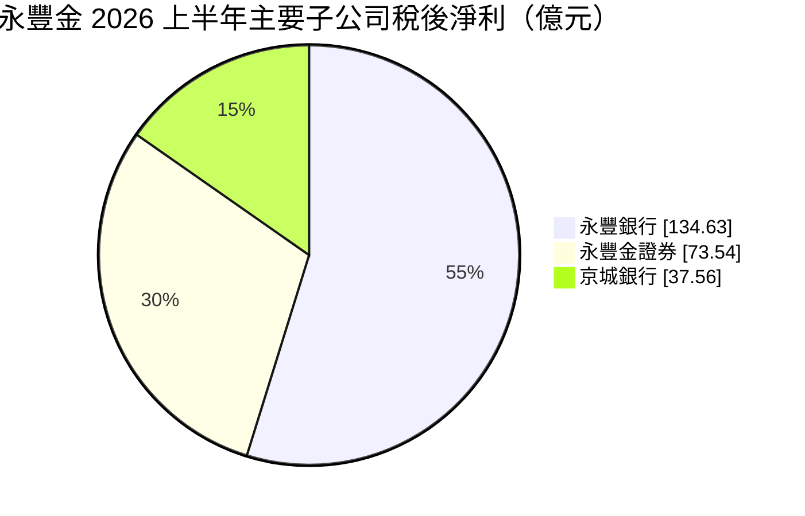
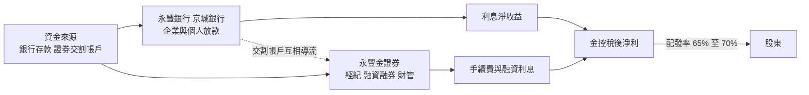
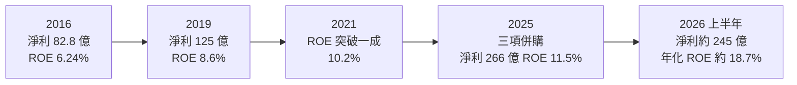
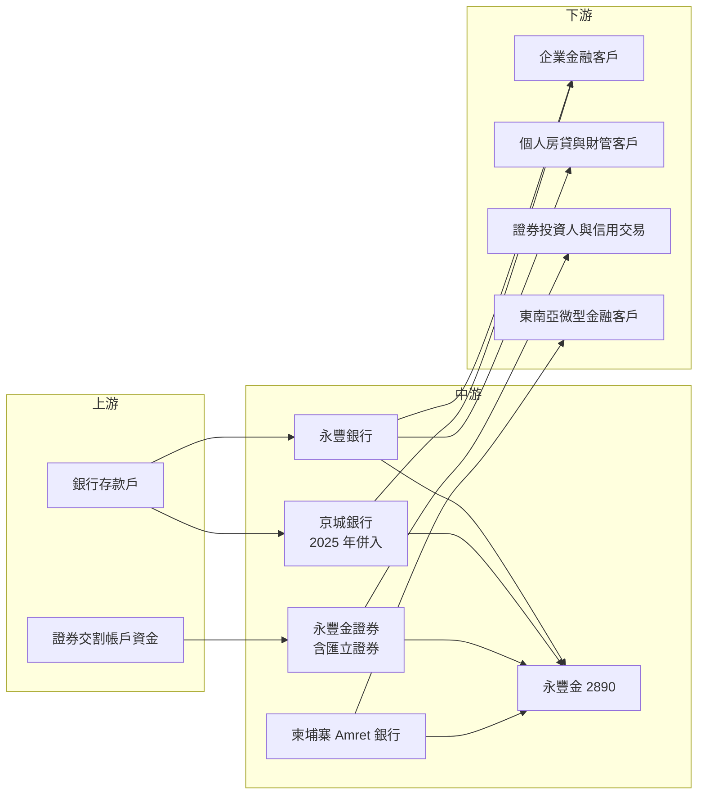

# 2890 永豐金

> 上市｜[[產業索引-金融保險業|金融保險業]]｜上市（櫃）日期 2002/05/09

# 第一章：企業模式與商業藍圖

> [!info] 撰寫說明
> 本文由 Claude 依公開資料整理，架構比照 [[2330台積電]] 的四章研究，資料截至 2026-10-08。財務數字來源：Goodinfo 年度經營績效頁與股利政策頁（合併報表）、證交所開放資料快照（基本資料、股利）、優分析（2025 年法說會與股利）、NOWnews（2026 年上半年法說會）；產業描述為整理性內容，尚未逐條比對原始文件。#待校對

在評估單一個股的長期投資價值時，首要步驟是拆解企業的底層獲利邏輯。本章針對永豐金融控股（股票代號：2890，以下簡稱永豐金）的商業模式進行定性分析，說明一家沒有大型壽險子公司的民營[[金控]]，如何以銀行與證券雙核心賺錢、在十年間把 [[ROE]] 從 6% 提升到 11% 以上，以及 2025 年連續三項併購如何改變它的規模與獲利結構。

## 一、核心定位：銀行與證券雙核心、近年積極併購

永豐金前身為 2002 年 5 月 9 日成立並上市的建華金控，2006 年前後與台北國際商業銀行體系整併，更名為永豐金控，形成今天以永豐銀行與永豐金證券為兩大支柱的結構（整併年份為憑記憶整理，待校對）。依證交所 2026 年 10 月的基本資料，永豐金實收資本額約 1,479 億元，董事長為陳思寬。

和多數台灣大型金控不同，永豐金沒有大型壽險子公司，這有兩個長期的商業意義：

* **獲利來源較單純：** 獲利主要來自銀行利差、手續費與證券經紀，不必承擔壽險的匯率避險、[[利差損]]與新會計制度的資本壓力。它的波動程度介於銀行型金控與證券型金控之間：比玉山、兆豐更受台股影響，但比元大穩定。
* **資本可以用在併購：** 沒有壽險這個「資本黑洞」，永豐可以把資本用在銀行與證券的併購擴張上。2025 年是永豐的「併購年」：1 月納入柬埔寨 Amret 銀行、10 月 1 日納入京城銀行、10 月 20 日納入台灣匯立證券，同時擴張海外[[微型金融]]、南台灣企業金融與證券業務。

## 二、業務板塊：子公司獲利貢獻

金控不適用製造業的營收結構分析，以下以 2026 年上半年主要子公司稅後淨利呈現獲利來源（三家合計略高於金控淨利，差額為金控本身費用與其他子公司損益）：

2026 年上半年台股熱絡，證券獲利占比偏高；以 2025 年全年看，永豐銀行稅後淨利約 194.6 億元、永豐金證券約 64.7 億元，銀行約占集團獲利七成以上，這比較接近常態結構。

* **永豐銀行：** 集團最大的獲利來源，企業金融與消費金融並重。依法說會報導，2025 年 ROE 約 10.1%，調整後 [[NIM]] 約 1.41%，[[逾放比]]約 0.19%；2026 年上半年利息淨收益年增約 26%，淨利差較前一年擴大約 21 個基點，部分來自美元資金成本下降。
* **永豐金證券：** 經紀、[[融資融券]]與財管為主。依報導，2026 年上半年經紀市占約 5%、融資餘額市占約 7.8%，信用交易業務的市占高於經紀市占，代表客戶的交易活躍度與槓桿使用較高。證券 ROE 在多頭年份可超過三成，空頭年份則明顯回落。
* **京城銀行：** 以南台灣企業金融與不動產相關授信為主，資產品質一向良好，併入後補強永豐在南台灣的布局。2026 年上半年稅後淨利中含處分利益，排除後年增約三成。
* **海外子行：** 柬埔寨 Amret 銀行以微型金融為主，另有越南、香港等海外據點，規模相對集團仍小。

## 三、資本轉化邏輯：存款與交割資金的雙循環

* **銀行與證券互相導流：** 證券客戶的交割帳戶開在銀行，帶來低成本的活期存款；銀行的財富管理客戶也會使用證券下單與融資服務。這個雙循環讓永豐的每一位客戶能同時貢獻利差與手續費，是單純銀行或單純券商難以複製的組合。
* **數位通路：** 永豐較早投入數位帳戶與證券 App（例如大戶 DAWHO、豐存股等），降低獲客成本，也讓證券經紀在台股熱絡時能快速放大。
* **併購補齊版圖：** 京城銀行補強南台灣企業金融，匯立證券補強證券業務，Amret 則提供東南亞成長性較高的微型金融市場。

## 四、企業長期藍圖：併購整合與證券擴張

* **併購整合：** 把三項併購案的效益真正落實到利息收入與手續費，並控制整合成本。依法說會報導，2025 年利息淨收益年增約 48.5% 至 383 億元，部分來自併購貢獻與美元資金成本下降。
* **證券增資擴張：** 永豐金證券規劃辦理約 200 億元現金增資，用於擴大資本與信用交易、自營等業務規模。這代表管理層把證券視為下一階段的成長主軸。
* **數位金融：** 以數位帳戶與證券 App 吸引年輕客群，帶動經紀與財管業務的長期成長。
* **股利穩定：** 公司表示配發率維持 65% 至 70%，以現金為主，並逐步降低股票股利比重。

# 第二章：護城河深度與競爭優勢

在長期價值投資中，「護城河」指企業抵禦競爭、維持超額利潤的保護機制。金融業的產品同質性高、監理嚴格，護城河主要來自資金成本、客戶黏著度與通路。本章分析永豐金的護城河構成、銀行與證券兩個戰場的主要對手，以及這些優勢在台股降溫後能守住多少。

## 一、永豐金護城河的核心組成要素

永豐金的護城河屬於「窄護城河」，由四個要素組成：

* **1. 銀行與證券的協同：** 銀行交割帳戶、證券經紀、融資融券與財富管理可以互相導流。客戶在同一集團內完成存款、交易、借款與理財，轉換成本隨著使用的服務增加而提高。
* **2. 數位通路：** 數位品牌在年輕客群中具知名度（定性描述），讓永豐以較低成本取得新客戶。數位通路的優勢在於可以快速擴張，但也容易被同業模仿，需要持續投資才能維持。
* **3. 資產品質：** 銀行逾放比長期維持在 0.2% 左右，京城銀行的資產品質也佳，信用風險緩衝足夠，這讓永豐在擴張放款時不必擔心一次吐回獲利。
* **4. 併購整合經驗：** 一年內完成三項併購並開始貢獻獲利，顯示管理層具備整合執行力。在台灣金融業逐步走向大型化的過程中，懂得併購、整合的金控更有機會擴大規模。

## 二、主要競爭對手格局

| 對手 | 定位 | 對永豐金的威脅 |
|---|---|---|
| [[2891中信金]]、[[2884玉山金]]、[[2887台新新光金]] | 大型民營銀行型金控 | 財管、信用卡與數位金融規模較大 |
| [[2892第一金]]、[[2880華南金]]、[[5880合庫金]] | 公股銀行型金控 | 中小企業放款與低資金成本 |
| [[2885元大金]]、[[2883凱基金]] | 證券型金控 | 經紀與承銷市占明顯領先 |
| [[6005群益證]]、[[2855統一證]] 等券商 | 獨立券商 | 以手續費折讓與交易平台搶經紀客戶 |
| 數位券商與純網銀 | 低手續費、數位體驗 | 搶年輕客群，壓低手續費率 |

## 三、優勢轉化：哪些市場守得住、哪些守不住

* **守得住：** 銀行與證券的協同、信用交易業務與數位客群。2016 至 2025 年永豐 ROE 由約 6% 穩定提升到 11.5%，代表這套經營模式不只是景氣好時的偶然，而是持續改善的結構。
* **守不住：** 經紀市占約 5%，與元大、凱基仍有明顯差距；沒有大型壽險，財富管理產品線較依賴外部保險公司，在銀行保險通路的收益上不如擁有自家壽險的金控。
* **觀察重點：** 第一，京城銀行與匯立證券整合後的成本與獲利能否達到預期。第二，證券增資後的市占與 ROE 變化。第三，銀行淨利差在利率反轉時能否守住。

# 第三章：財務體質與盈利規模

資料日期：2026-10-08。數字取自 Goodinfo 年度經營績效頁與股利政策頁（合併報表）、證交所開放資料快照與法說會報導，表格是撰寫當時的快照；最新月營收、毛利率、累計 EPS 由自動排程寫在本筆記的屬性欄位（月營收、毛利率、累計EPS 等）。#待校對

財務報表是檢驗護城河是否真實存在的最終標準。金控沒有製造業的銷貨成本，[[毛利率]]與[[營業利益率]]並不適用；本章改用稅後淨利、[[ROE]]、[[ROA]]、[[每股淨值]]與股利，檢視永豐金十年來的獲利改善是否具有持續性。

## 一、獲利能力的基石：淨收益、淨利與 ROE

| 年度 | 營業收入（億元） | 稅後淨利（億元） | EPS（元） | [[ROE]] | [[ROA]] | [[每股淨值]]（元） |
|---|---|---|---|---|---|---|
| 2016 | 308 | 82.8 | 0.78 | 6.24% | 0.51% | 12.54 |
| 2017 | 325 | 90.9 | 0.82 | 6.68% | 0.55% | 12.51 |
| 2018 | 321 | 94.3 | 0.84 | 6.73% | 0.59% | 12.58 |
| 2019 | 363 | 125 | 1.11 | 8.60% | 0.73% | 13.16 |
| 2020 | 390 | 122 | 1.09 | 8.05% | 0.62% | 13.83 |
| 2021 | 457 | 162 | 1.44 | 10.2% | 0.72% | 14.44 |
| 2022 | 472 | 160 | 1.40 | 10.1% | 0.64% | 13.53 |
| 2023 | 539 | 198 | 1.62 | 11.5% | 0.74% | 15.22 |
| 2024 | 644 | 222 | 1.75 | 11.3% | 0.76% | 16.19 |
| 2025 | 744 | 266 | 1.97 | 11.5% | 0.79% | 17.63 |

（來源：Goodinfo 年度經營績效，合併報表。營業收入為 Goodinfo 口徑，約等於淨收益。[[毛利率]]與[[營業利益率]]不適用於金控，未列出。2026 年上半年淨收益約 553 億元、稅後淨利約 245 億元、EPS 1.66 元、年化 ROE 約 18.7%。）

* **十年淨利成長約 3.2 倍：** 稅後淨利由 2016 年的 82.8 億元成長到 2025 年的 266 億元，2020 至 2025 年淨利年複合成長率約 16.9%、營業收入年複合成長率約 13.8%（推算），在國內金控中屬於成長最快的一群。
* **ROE 階梯式提升：** 2016 至 2018 年 ROE 約 6% 至 7%，2019 至 2020 年約 8%，2021 年後穩定在 10% 以上。值得注意的是，2022 年多數金控 ROE 明顯下滑，永豐仍維持 10.1%，顯示它的獲利改善不只是靠台股多頭，而有銀行本業與經營效率的支撐。
* **2026 年的高點需打折：** 2026 年上半年獲利倍增，主要來自證券經紀暴增與京城銀行併入。證券獲利屬於景氣循環成分，長期評估應以 2023 至 2025 年 11% 上下的 ROE 為基準。

## 二、[[ROE]]：資本效率

永豐金 2016 至 2025 年 ROE 十年平均約 9.1%，2021 至 2025 年平均約 10.9%（推算），近五年屬國內金控中上水準。ROA 由約 0.5% 提升到約 0.8%，代表 ROE 的提升主要來自資產運用效率的改善，而不是靠提高槓桿。

ROE 改善的來源可以拆成三部分：銀行利差與手續費提升、證券業務比重增加（證券 ROE 普遍高於銀行），以及資產品質穩定讓信用成本維持低檔。永豐要讓 ROE 再往上走，關鍵是併購整合的效益與證券增資後的資本效率；若證券增資後業務成長不如預期，反而可能稀釋 ROE。

## 三、資本與股利政策：取代資本支出與自由現金流

金控沒有工廠與機台，「資本支出」的概念改由「資本適足與股利」取代。永豐的資本主要用在三個地方：支撐銀行放款成長、證券信用交易與自營部位，以及併購。

| 股利所屬年度 | 現金股利（元） | 股票股利（元） |
|---|---|---|
| 2019 | 0.7 | 0 |
| 2020 | 0.7 | 0 |
| 2021 | 0.8 | 0.1 |
| 2022 | 0.6 | 0.2 |
| 2023 | 0.75 | 0.25 |
| 2024 | 0.91 | 0.34 |
| 2025 | 1.1 | 0.2 |

（來源：Goodinfo 股利政策頁；2025 年度現金 1.1 元、股票 0.2 元與證交所股利資料一致。）

* **股利隨獲利穩定成長：** 現金股利由 2016 年度的 0.344 元成長到 2025 年度的 1.1 元，十年間約成長三倍，與淨利的成長幅度相當。
* **配息率：** 以 2025 年 EPS 1.97 元計算，現金[[配息率]]約 56%，加上股票股利後合計約 66%（推算），符合公司「65% 至 70%」的政策。公司章程採[[剩餘股利政策]]，當年度盈餘提撥不低於 30% 為普通股股利。
* **股本擴張：** 股票股利與併購換股持續增加股本，未來 EPS 成長幅度會低於淨利成長幅度，評估時應同時看淨利與 EPS。

## 四、[[ROE]] 與 [[CAPM]] 股東權益成本：價值創造利差

金融業的負債是營業的原料，[[ROIC]] 與 [[WACC]] 的框架不適用，改以 ROE 和股東權益成本比較。

* **股東權益成本（推算）：** 以 CAPM 估算，無風險利率取台灣 10 年期公債約 1.75%，市場風險溢酬 6%。永豐證券比重高於一般銀行型金控，β 假設 0.8（銀行加證券型金控同業常見值，未查得永豐金實際數字），股東權益成本約 1.75% ＋ 0.8 × 6% ＝ 6.55%。無風險利率在 1.5% 至 2% 之間時，約落在 6.3% 至 6.8%。
* **ROE（實際）：** 2021 至 2025 年平均約 10.9%，十年平均約 9.1%。
* **價值創造判斷：** 永豐金近五年 ROE 比股東權益成本高約 4 個百分點（推算），十年前則幾乎只賺到資金成本。這是國內金控中「價值創造能力明顯改善」的代表案例。未來的關鍵在於 2025 年的三項併購：併購投入的資本若能維持 10% 以上的報酬，利差就能維持；若整合不順或支付了過高的溢價，ROE 就會被稀釋，利差也會縮小。

# 第四章：總體風險與地緣政治

任何企業都無法脫離宏觀環境獨立存在。永豐金同時經營銀行與證券，利率與台股兩大週期都會直接影響它的獲利。本章分析永豐金未來必須面對的地緣政治與海外風險、利率與台股週期、併購整合的營運風險，以及金融監理與數位化帶來的挑戰。

## 一、地緣政治與海外風險

* **東南亞子行：** 柬埔寨 Amret 銀行以微型金融為主，客戶多為小型商家與農戶，受當地經濟、匯率與政治環境影響，信用風險高於台灣市場。微型金融的利差高，但一旦當地經濟轉弱，壞帳也可能快速上升。
* **兩岸風險：** 台股成交量與外資動向受兩岸情勢影響，會直接反映在證券經紀與融資業務上。
* **企業客戶的海外曝險：** 企業金融客戶的海外布局受關稅與地緣政治影響，間接影響授信品質。

## 二、利率與景氣週期

* **利差：** 2025 年至 2026 年利息淨收益大幅成長，部分來自美元資金成本下降。若利率環境反轉，例如台灣降息或美元利率回升，淨利差可能收斂。
* **台股熱度：** 證券經紀與融資業務在台股熱絡時大幅成長，成交量回落時會明顯下降。永豐的證券比重比過去高，獲利的週期性也跟著提高。
* **房市週期：** 京城銀行過去以不動產相關授信為主，若房市降溫或政策緊縮，相關放款的成長與資產品質需要重新檢視（推估）。

## 三、營運環境的隱性風險

* **併購整合：** 京城銀行與匯立證券的系統、人員與企業文化整合需時間，整合不順可能侵蝕綜效。京城銀行原本以高效率與低逾放著稱，併入後能否維持原有的經營特色也是觀察點。
* **證券業務的風險控管：** 融資融券與自營部位在市場急跌時可能產生損失，證券增資後業務規模擴大，風險控管的重要性也隨之提高。
* **股本稀釋：** 股票股利、併購換股與證券增資都會使集團資本與股本擴大，影響 EPS 與 ROE 的成長。

## 四、法規與科技演進

* **證券監理：** 融資融券、借券與自營業務受主管機關風險控管要求影響，監理趨嚴時業務擴張會受限。
* **銀行資本規範：** 若資本要求提高，需保留更多盈餘或增資，影響配息空間。
* **數位競爭與資安：** 數位帳戶是永豐的強項，也代表資安事件的衝擊較大；純網銀與數位券商持續壓低手續費率，數位優勢需要持續投資才能維持。

# 專有名詞解析

## 金融

- **[[金控]]**：金融控股公司，旗下同時持有銀行、保險、證券等子公司，透過集團整合交叉銷售金融商品。
- **[[微型金融]]**：提供小額放款、存款等服務給傳統銀行不易服務的小商家與低收入族群，利差高但信用風險也高。
- **[[融資融券]]**：投資人向券商借錢買股（融資）或借股票賣出（融券），券商賺取利息與借券費用。
- **[[利差損]]**：壽險公司的投資收益率低於過去賣出保單承諾的預定利率，差額形成的虧損。
- **[[NIM]]**：淨利差，銀行放款與投資的收益率扣除存款等資金成本後的利差，是銀行獲利能力的核心指標。
- **[[逾放比]]**：逾期放款占總放款的比率，數字越低代表銀行資產品質越好。
- **[[ROA]]**：資產報酬率，稅後淨利除以總資產，衡量金融機構運用資產創造獲利的效率。
- **[[每股淨值]]**：股東權益除以流通股數，代表每一股在帳面上對應的資產淨額，是評估金融股的重要基準。
- **[[CAPM]]**：資本資產定價模型，以無風險利率加上 β 乘以市場風險溢酬，估算股東要求的報酬率，也就是股東權益成本。
- **[[剩餘股利政策]]**：公司先保留足夠支應投資與成長所需的盈餘，剩下的部分再分配給股東的股利政策。
- **[[配息率]]**：現金股利占每股盈餘的比例，反映公司把多少獲利以現金還給股東。
- **[[現金增資]]**：公司發行新股向投資人收取現金以擴充資本，金控常用來注資子公司。

# 核心供應鏈

## 1. 上游：資金來源
- 銀行存款戶：永豐銀行與京城銀行的存款。
- 證券交割帳戶資金：證券客戶帶來的低成本活期存款。

## 2. 中游：永豐金與子公司
- 永豐銀行：企業金融、消費金融與財富管理。
- 京城銀行：2025 年 10 月併入，以南台灣企業金融為主。
- 永豐金證券：經紀、融資融券與財管，2025 年 10 月納入匯立證券。
- 柬埔寨 Amret 銀行：2025 年 1 月納入，以微型金融為主。

## 3. 下游：主要客群
- 企業金融與南台灣中小企業客戶。
- 個人房貸、信用卡與財富管理客戶。
- 證券投資人與信用交易客戶、東南亞微型金融客戶。

## 4. 同業比較
- 民營銀行型金控：[[2891中信金]]、[[2884玉山金]]、[[2887台新新光金]]
- 證券實力強的金控與券商：[[2885元大金]]、[[2883凱基金]]、[[6005群益證]]
- 公股金控：[[2892第一金]]、[[2880華南金]]、[[5880合庫金]]

## 最新新聞
<!-- news:start（自動產生，請勿手動編輯此範圍） -->
- 2026-10-16 🏛️ 重訊 15:17｜永豐金控代子公司永豐商業銀行公告聯合授信資產之轉讓｜[觀測站](https://mops.twse.com.tw/mops/#/web/t05st01)
- 2026-10-14 🏛️ 重訊 14:47｜永豐金控代子公司京城銀行公告訂定與永豐銀行合併基準日｜[觀測站](https://mops.twse.com.tw/mops/#/web/t05st01)
- 2026-10-14 🏛️ 重訊 14:46｜永豐金控代子公司永豐銀行公告訂定與京城銀行合併基準日 暨合併增資發行新股基準日｜[觀測站](https://mops.twse.com.tw/mops/#/web/t05st01)
- 2026-10-12 🏛️ 重訊 15:52｜永豐金控代子公司京城證券公告向關係人京城商業銀行 處分使用權資產（提前終止租約）｜[觀測站](https://mops.twse.com.tw/mops/#/web/t05st01)
- 2026-10-12 🏛️ 重訊 15:51｜永豐金控代子公司京城銀行公告與關係人京城證券之不動產租約提前終止｜[觀測站](https://mops.twse.com.tw/mops/#/web/t05st01)

完整紀錄：[[2890永豐金 新聞]]
<!-- news:end -->

## 相關連結
- [公開資訊觀測站](https://mopsov.twse.com.tw/mops/web/t05st03?step=1&firstin=1&co_id=2890)
- [Goodinfo](https://goodinfo.tw/tw/StockDetail.asp?STOCK_ID=2890)
- [Yahoo 股市](https://tw.stock.yahoo.com/quote/2890)
- [鉅亨網新聞](https://www.cnyes.com/twstock/2890/news)
