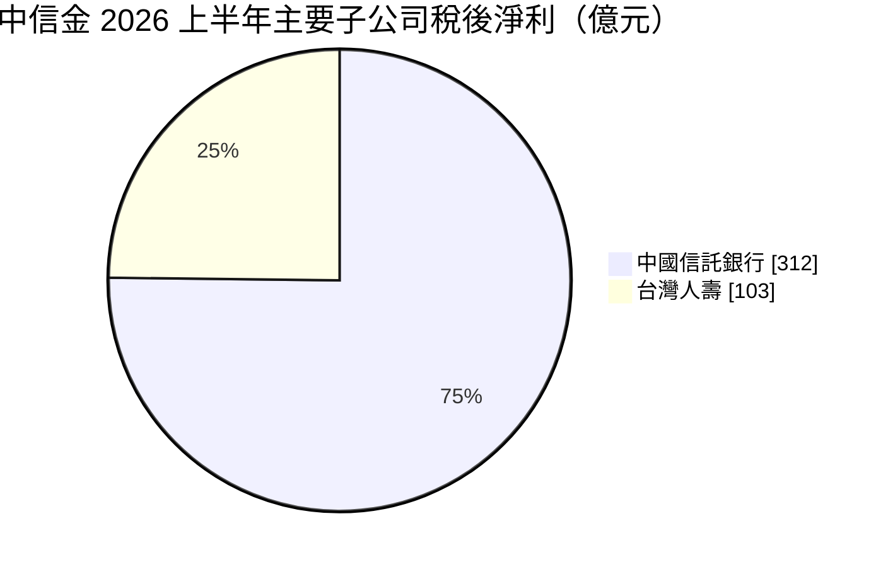
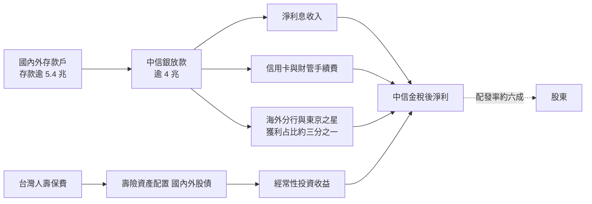
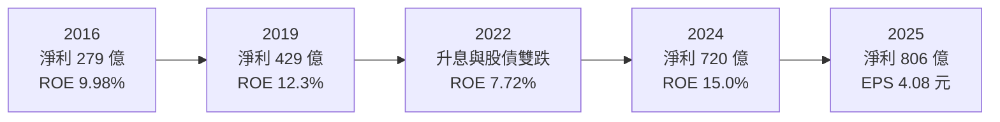
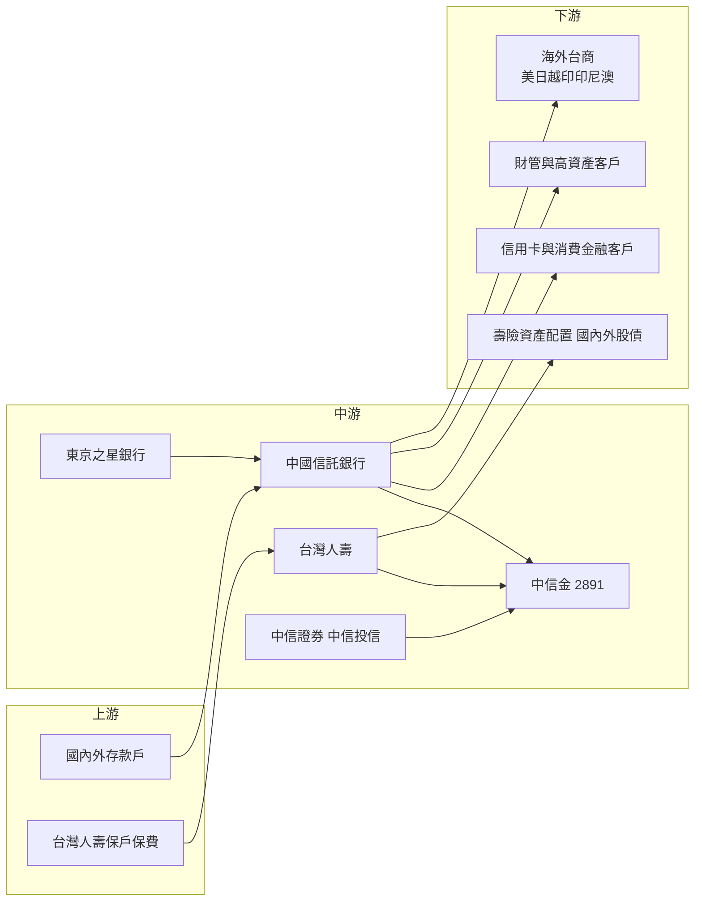

# 2891 中信金

> 上市｜[[產業索引-金融保險業|金融保險業]]｜上市（櫃）日期 2002/05/17

# 第一章：企業模式與商業藍圖

> [!info] 撰寫說明
> 本文由 Claude 依公開資料整理，架構比照 [[2330台積電]] 的四章研究，資料截至 2026-10-08。財務數字來源：Goodinfo 年度經營績效頁與股利政策頁（合併報表）、證交所開放資料快照（基本資料、股利）、優分析（2025 年全年、2025 年第四季與 2026 年上半年法說會、海外布局報導）、ETtoday 財經雲（2026 年上半年法說會）；產業描述為整理性內容，尚未逐條比對原始文件。#待校對

在評估金融股的長期投資價值時，首要步驟是看清楚獲利從哪一家子公司、哪一種業務而來。本章針對中國信託金融控股（股票代號：2891，以下簡稱中信金）的商業模式進行定性分析，說明它如何以中國信託商業銀行為核心、跟隨台商布局海外，並以台灣人壽補足保險版圖，成為國內獲利規模與 [[ROE]] 都名列前茅的銀行型[[金控]]。

## 一、核心定位：以銀行為核心、海外布局最廣的民營金控

中國信託體系源自 1966 年成立的中華證券投資公司，1992 年改制為中國信託商業銀行，2002 年 5 月 17 日成立中信金控並上市；2014 年前後透過中信銀併購日本東京之星銀行，2015 年前後併購台灣人壽，逐步形成「銀行為主、壽險為輔」的結構（年份為憑記憶整理，待校對）。依證交所 2026 年 10 月的基本資料，中信金實收資本額約 2,018 億元，董事長為顏文隆、總經理為高麗雪。

旗下主要子公司為中國信託商業銀行（中信銀）、台灣人壽、中國信託證券與中國信託投信。中信銀是國內規模最大的民營銀行之一，2026 年報導指其放款突破 4 兆元、存款超過 5.4 兆元。對長期投資人而言，中信金有兩個基本特徵：

* **銀行決定獲利主體：** 中信銀長期占金控獲利七成左右，獲利結構比壽險型金控穩定得多。信用卡、消費金融、財富管理與企業金融都具規模，是一家「什麼都做、而且多數都做得好」的銀行。
* **海外是成長引擎：** 依法說會報導，中信銀海外獲利占比約三分之一，管理層目標是維持在這個水準。台灣銀行業的國內市場飽和、利差偏低，能把三分之一獲利放在海外，代表中信金比多數同業多了一條成長路徑。

## 二、業務板塊：銀行為主、壽險為輔

以 2026 年上半年主要子公司稅後淨利來看，獲利結構如下：

兩家子公司合計約 415 億元，高於金控合併稅後淨利約 395 億元，差額來自金控層級費用、其他子公司與合併調整（推估）；證券與投信的個別獲利本次未查得。

* **中國信託銀行：** 依法說會報導，2025 年稅後淨利約 573 億元，淨利息收入年增近兩成、放款成長約一成，信用卡簽帳金額突破 1 兆元；2026 年上半年財富管理手續費收入年增四成以上。中信銀的特色是消費金融與企業金融都具規模，並擁有國內銀行中最廣的海外網絡。
* **台灣人壽：** 2025 年稅後淨利約 208.5 億元。依法說會報導，2026 年上半年新契約保費（[[FYP]]）大幅成長，[[CSM]] 餘額約 1,770 億元。台灣人壽的角色是補足集團的保險產品線，並透過中信銀的[[銀行保險]]通路銷售保單。
* **證券與投信：** 中國信託證券與投信規模相對小，主要扮演財管商品與經紀通路的角色。

## 三、資本轉化邏輯：存款、保費如何變成獲利

* **銀行端：** 中信銀靠放款利差、信用卡與財富管理手續費賺錢；企業金融跟隨台商赴海外設廠，提供跨境放款、[[聯貸]]與現金管理服務。消費金融與財管帶來高利差與高手續費，企業金融與海外業務帶來規模與成長，兩者形成互補。
* **壽險端：** 台灣人壽以保費投資國內外股債。依法說會報導，2026 年上半年避險前經常性收益率約 3.39%、避險後投資報酬率約 2.96%，扣除負債成本約 2.47% 後仍有正利差，代表台灣人壽沒有嚴重的[[利差損]]包袱。
* **集團綜效：** 中信銀龐大的信用卡與財管客群，是台灣人壽與投信基金最主要的銷售對象，屬於典型的[[交叉銷售]]。

## 四、企業長期藍圖：跟隨台商深耕海外

依 2026 年法說會報導，中信銀海外布局可分為五個區域，策略是「跟隨台商投資腳步」：

* **越南：** 既有胡志明市分行與河內辦事處，並新獲准設立海防與平陽辦事處，服務在越南設廠的電子與製造業台商。
* **東南亞與印度：** 規劃印尼新分行，印度 GIFT City 分行籌設中，並評估孟買設點，跟隨電子供應鏈移往印度的趨勢。
* **日本：** 子行東京之星銀行熊本支行升格為分行，東京分行在福岡設立出張所，主要服務赴九州投資的半導體供應鏈台商。
* **北美：** 美國洛杉磯分行之外，德州休士頓辦事處已獲核准，對應台商在美國南部的投資。
* **澳洲：** 規劃雪梨辦事處升格為分行。

管理層表示沒有裁撤海外據點的計畫。這套策略的長期邏輯是：台灣企業的產能分散到全球，金融需求也會跟著分散，誰先在台商的新據點設立分行，誰就能拿下這些客戶的跨境金流。

# 第二章：護城河深度與競爭優勢

在長期價值投資中，「護城河」指企業抵禦競爭、維持超額利潤的保護機制。金融業產品同質性高，護城河多半來自規模、資金成本、客戶基礎與海外網絡。本章分析中信金的護城河構成、主要競爭對手，以及這些優勢能守住多少。

## 一、護城河的核心組成要素

中信金的護城河屬於國內銀行業中較寬的一類，主要由四個要素組成：

* **1. 最廣的海外網絡：** 中信銀在美國、日本、東南亞、印度、澳洲都有據點，並持有東京之星銀行，能提供台商跨國現金管理與融資。海外分行需要多年申請、當地監理核准與人才培養，競爭者短期內無法複製。
* **2. 信用卡與消費金融規模：** 信用卡簽帳金額突破 1 兆元，大量的消費數據與客群是財管與保險銷售的基礎。規模帶來更精準的風控模型與更低的獲客成本，形成「越大越好做」的循環。
* **3. 財富管理能力：** 高資產客群經營具規模優勢，財管手續費是不太需要占用資本的收入，有助於維持高 ROE。
* **4. 銀行型獲利結構：** 銀行占獲利主體，使中信金對股市與匯率的敏感度低於壽險型金控。從 2016 至 2025 年的財報可以看到，中信金 ROE 除了 2022 年外都在 10% 以上，是國內金控中長期最穩定的高 ROE 之一。

## 二、全球主要競爭對手格局

| 對手 | 定位 | 對中信金的威脅 |
|---|---|---|
| [[2881富邦金]]、[[2882國泰金]] | 壽險規模最大的兩家金控，銀行也完整 | 在信用卡、財管與企業金融全面競爭，壽險規模遠大於台灣人壽 |
| [[2884玉山金]] | 財管與信用卡見長，海外也積極 | 在財管客群、數位銀行與東南亞布局競爭 |
| [[2886兆豐金]] | 外匯與企業金融強的公股金控 | 在台商跨境金融與聯貸競爭，資金成本較低 |
| [[2887台新新光金]] | 合併後的銀行加壽險金控 | 在消費金融與財管客群重疊 |
| [[2890永豐金]] | 銀行與證券並重的民營金控 | 在數位與中小企業客群競爭 |
| [[5876上海商銀]] | 以香港與海外業務見長的銀行 | 在海外華人與台商金融競爭 |

## 三、優勢轉化：哪些守得住、哪些守不住

* **守得住：** 海外網絡與台商客群、信用卡規模、財管能力。這些需要多年投資與監理核准才能建立，競爭者短期難以複製，也是中信金 ROE 長期高於同業的根本原因。
* **守不住：** 壽險規模仍明顯小於國泰、富邦，台灣人壽新契約大幅成長能否轉化為長期利潤，仍需時間驗證；房貸與消費信用規模大，在房市與景氣轉弱時，信用成本上升的風險也較高。
* **觀察重點：** 第一，海外獲利占比能否穩定維持在三分之一。第二，台灣人壽新契約成長能否帶動 CSM 穩定累積，而不是只帶來更高的負債成本。第三，降息循環中銀行利差能否守住。

# 第三章：財務體質與盈利規模

資料日期：2026-10-08。數字取自 Goodinfo 年度經營績效頁與股利政策頁（合併報表）、證交所開放資料快照與法說會報導，表格是撰寫當時的快照；最新月營收、毛利率、累計 EPS 由自動排程寫在本筆記的屬性欄位（月營收、毛利率、累計EPS 等）。#待校對

財務報表是檢驗護城河是否真實存在的最終標準。金控沒有製造業的銷貨成本，[[毛利率]]與[[營業利益率]]並不適用；本章改用稅後淨利、[[ROE]]、[[ROA]]、[[每股淨值]]與股利，檢視中信金的獲利品質與資本效率。

## 一、獲利能力的基石：淨收益、淨利與 ROE

| 年度 | 營業收入（億元） | 稅後淨利（億元） | EPS（元） | [[ROE]] | [[ROA]] | [[每股淨值]]（元） |
|---|---|---|---|---|---|---|
| 2016 | 3,197 | 279 | 1.43 | 9.98% | 0.59% | 14.49 |
| 2017 | 3,498 | 372 | 1.91 | 12.3% | 0.73% | 16.20 |
| 2018 | 3,144 | 360 | 1.85 | 11.3% | 0.65% | 15.89 |
| 2019 | 2,647 | 429 | 2.16 | 12.3% | 0.72% | 19.06 |
| 2020 | 1,944 | 429 | 2.15 | 10.9% | 0.67% | 20.26 |
| 2021 | 1,861 | 542 | 2.73 | 12.6% | 0.79% | 21.53 |
| 2022 | 1,393 | 313 | 1.55 | 7.72% | 0.44% | 18.40 |
| 2023 | 1,366 | 561 | 2.82 | 13.4% | 0.72% | 21.95 |
| 2024 | 1,894 | 720 | 3.64 | 15.0% | 0.86% | 24.05 |
| 2025 | 2,449 | 806 | 4.08 | 15.5% | 0.91% | 25.69 |

（來源：Goodinfo 年度經營績效，合併報表。營業收入為 Goodinfo 口徑，含台灣人壽保費收入，會隨保費與投資損益大幅變動，不代表銀行本業規模，評估時應以稅後淨利與 ROE 為主。[[毛利率]]與[[營業利益率]]不適用於金控，未列出。2026 年上半年稅後淨利約 395 億元、EPS 1.96 元、年化 ROE 約 12.6%、每股淨值約 35 元。）

* **十年淨利成長約 2.9 倍：** 稅後淨利由 2016 年的 279 億元成長到 2025 年的 806 億元，2020 至 2025 年年複合成長率約 13.5%（推算）。中信金很少配發股票股利，因此 EPS 由 1.43 元成長到 4.08 元，幾乎與淨利同步成長，股東真正分到了公司成長的果實。
* **2022 年是壓力測試：** 2022 年全球快速升息、股債雙跌，台灣人壽的投資部位與銀行的債券評價同時受壓，ROE 降到 7.72%（推估原因，待校對）。但隔年就回到 13.4%，顯示銀行本業的獲利能力並未受損。
* **2023 年後的高峰：** 2023 至 2025 年 ROE 由 13.4% 升到 15.5%，主要來自高利率環境下的利差擴大、信用卡與財管手續費成長，以及海外分行的貢獻。

## 二、[[ROE]]：資本效率

中信金 2016 至 2025 年 ROE 十年平均約 12.1%，2021 至 2025 年平均約 12.8%（推算），屬國內金控前段班。ROA 由約 0.6% 提升到約 0.9%，同樣位居銀行型金控前段。

中信金能長期維持高 ROE，可以拆成三個原因：一是消費金融與信用卡的高利差，二是財管手續費這類不占資本的收入，三是海外業務提供了國內市場以外的成長空間。需要注意的是，2026 年上半年每股淨值由 2025 年底約 25.7 元升到約 35 元，淨值快速擴大主要來自壽險持股評價上升與會計新制的影響（推估），這會使 ROE 的分母變大，未來 ROE 即使獲利持續成長，數字上也可能下降。

## 三、資本與股利政策：取代資本支出與自由現金流

金控沒有工廠與機台，「資本支出」的概念改由「資本適足與股利」取代。中信金每年賺到的錢，一部分留下來支撐放款與海外擴張，其餘以現金發給股東。

| 股利所屬年度 | 現金股利（元） | 股票股利（元） |
|---|---|---|
| 2016 | 1.0 | 0 |
| 2017 | 1.08 | 0 |
| 2018 | 1.0 | 0 |
| 2019 | 1.0 | 0 |
| 2020 | 1.05 | 0 |
| 2021 | 1.25 | 0 |
| 2022 | 1.0 | 0 |
| 2023 | 1.8 | 0 |
| 2024 | 2.3 | 0 |
| 2025 | 2.5 | 0 |

（來源：Goodinfo 股利政策頁，2016 年度含資本公積發放的部分；2025 年度現金股利 2.5 元與證交所股利資料一致。）

* **十年全數發放現金：** 中信金 2016 至 2025 年度全數配發現金股利，沒有配發股票股利，股本長期穩定，這也是它 EPS 能和淨利同步成長的原因。
* **配息率：** 以 2025 年 EPS 4.08 元計算，現金[[配息率]]約 61%（推算），與管理層「配發率約六成」的說法一致。公司章程採[[剩餘股利政策]]，普通股股利以不低於當年度可分配盈餘的 20% 為原則。
* **股利成長：** 現金股利由 2016 年度的 1.0 元成長到 2025 年度的 2.5 元，2022 年獲利低點時仍維持 1.0 元，顯示管理層重視股利的穩定與延續。

## 四、[[ROE]] 與 [[CAPM]] 股東權益成本：價值創造利差

金融業的負債是營業的原料，[[ROIC]] 與 [[WACC]] 的框架不適用，改以 ROE 和股東權益成本比較。

* **股東權益成本（推算）：** 以 CAPM 估算，無風險利率取台灣 10 年期公債約 1.75%，市場風險溢酬 6%。中信金以銀行為主但含壽險，β 假設 0.8（大型銀行型金控同業常見值，未查得中信金實際數字），股東權益成本約 1.75% ＋ 0.8 × 6% ＝ 6.55%。無風險利率在 1.5% 至 2% 之間時，約落在 6.3% 至 6.8%。
* **ROE（實際）：** 2021 至 2025 年平均約 12.8%，十年平均約 12.1%。
* **價值創造判斷：** 中信金的 ROE 長期比股東權益成本高約 5 至 6 個百分點（推算），是國內金控中價值創造利差最寬的之一。即使在 2022 年的壓力年份，ROE 也仍高於推算的資金成本。這個利差主要來自信用卡、財管與海外業務等高附加價值業務，而不是靠高槓桿或景氣循環。未來要維持利差，關鍵是淨值快速擴大後，獲利能否同步成長，以及台灣人壽的新契約能否帶來高於資金成本的報酬。

# 第四章：總體風險與地緣政治

任何金融機構都無法脫離宏觀環境獨立存在。中信金的海外布局最廣，這是它的成長來源，也是它比國內同業多承擔的風險。本章分析中信金未來必須面對的地緣政治、利率週期、營運風險與法規變化。

## 一、地緣政治風險

* **海外據點曝險：** 海外獲利占比約三分之一，美國、日本、越南、印度、印尼等地的經濟、匯率與監理變化，都會直接影響中信銀獲利。新興市場的信用風險與匯率波動通常高於台灣。
* **台商供應鏈移轉：** 中信銀的海外策略跟隨台商投資，若關稅、出口管制或地緣衝突使台商投資方向改變，海外布局就需要跟著調整，已設立的據點可能面臨獲利不如預期的問題。
* **兩岸風險：** 兩岸緊張升高時，台股與台幣波動會影響台灣人壽資產評價與財管業務，屬於無法分散的系統性風險。

## 二、產業週期與市場結構風險

* **利率週期：** 降息會壓縮銀行利差，2023 至 2025 年的高 ROE 部分受惠於高利率環境；升息則壓低壽險與銀行持有債券的評價，2022 年就是例子。
* **房市與消費信用：** 信用卡與房貸規模大，若經濟轉弱、失業率上升或房價修正，消費金融與房貸的信用成本會上升，侵蝕銀行獲利。
* **同業競爭：** 財管、信用卡與海外台商業務競爭激烈，費率與利差可能被壓縮；玉山、富邦等同業也在積極擴張海外據點。

## 三、營運環境的隱性風險

* **海外營運成本：** 新設分行初期需要負擔人力與系統成本，獲利貢獻有時間落差；海外分行規模小，單一授信案件出問題的影響相對大。
* **壽險新契約大幅成長：** 新契約快速成長帶來規模，但也提高未來負債成本與資本需求，商品利率設計若過於積極，可能在利率下行時形成新的利差損。
* **淨值快速擴張：** 若淨值增加主要來自股市評價，市場反轉時淨值可能回落，影響資本指標與股利空間。

## 四、法規與技術演進風險

* **[[IFRS 17]] 與 [[ICS]] 新制：** 台灣壽險業 2026 年起接軌新制，壽險資本要求提高，可能影響台灣人壽上繳金控的盈餘。
* **海外監理：** 美國、日本等地對洗錢防制與資本的監理要求嚴格，國內同業曾因海外法遵缺失遭重罰，中信銀海外據點最多，法遵投入只會增加。
* **數位與資安：** 數位銀行、行動支付與大型科技平台持續切入支付與消費信貸，信用卡與消費金融的長期利潤可能被壓縮；資安事件的衝擊也隨著數位交易量增加而放大。

# 專有名詞解析

## 金融

- **[[金控]]**：金融控股公司，旗下同時持有銀行、保險、證券等子公司，透過集團整合交叉銷售金融商品。
- **[[FYP]]**：初年度保費，壽險公司新賣出保單第一年收到的保費，是衡量新契約業務量的指標。
- **[[CSM]]**：合約服務邊際，IFRS 17 下保單未來預期利潤的現值，會隨保單期間逐年認列為獲利，是壽險新制的核心經營指標。
- **[[銀行保險]]**：透過銀行通路銷售保險商品，簡稱銀保，是金控整合銀行與壽險的主要綜效來源。
- **[[交叉銷售]]**：把集團內不同子公司的商品賣給同一批客戶，例如向銀行客戶銷售保險與基金。
- **[[聯貸]]**：多家銀行共同承作同一筆大額企業放款，由主辦銀行負責籌組與管理，分散單一銀行的授信風險。
- **[[利差損]]**：壽險公司的投資收益率低於過去賣出保單承諾的預定利率，差額形成的虧損。
- **[[ROA]]**：資產報酬率，稅後淨利除以總資產，衡量金融機構運用資產創造獲利的效率。
- **[[每股淨值]]**：股東權益除以流通股數，代表每一股在帳面上對應的資產淨額，是評估金融股的重要基準。
- **[[CAPM]]**：資本資產定價模型，以無風險利率加上 β 乘以市場風險溢酬，估算股東要求的報酬率，也就是股東權益成本。
- **[[剩餘股利政策]]**：公司先保留足夠支應投資與成長所需的盈餘，剩下的部分再分配給股東的股利政策。
- **[[配息率]]**：現金股利占每股盈餘的比例，反映公司把多少獲利以現金還給股東。
- **[[IFRS 17]]**：國際保險合約會計準則，改以現值方式衡量保險負債，讓壽險獲利認列更貼近保單實際經濟價值。
- **[[ICS]]**：保險資本標準，國際保險監理官協會制定的壽險資本規範，台灣接軌後壽險需準備更多資本。

# 核心供應鏈

## 1. 上游：資金與保費來源
- 國內外存款戶：中信銀存款超過 5.4 兆元，是放款與投資的資金來源。
- 壽險保戶：台灣人壽的保費形成長期負債資金。

## 2. 中游：中信金與子公司
- 中國信託銀行：消費金融、信用卡、財富管理、企業金融與海外分行。
- 東京之星銀行：中信銀在日本的子行，服務日本當地與赴日台商。
- 台灣人壽：集團的壽險子公司，透過銀行保險通路銷售保單。
- 中國信託證券、中國信託投信：證券經紀與基金。

## 3. 下游：主要客群
- 信用卡與消費金融客戶、財富管理與高資產客戶。
- 海外台商：美國、日本、越南、印度、印尼、澳洲等地的跨境金融需求。
- 壽險資產配置：國內外股票與債券。

## 4. 同業比較
- 壽險型金控：[[2881富邦金]]、[[2882國泰金]]、[[2883凱基金]]
- 民營銀行型金控：[[2884玉山金]]、[[2887台新新光金]]、[[2890永豐金]]
- 公股與海外型銀行：[[2886兆豐金]]、[[5876上海商銀]]

## 最新新聞
<!-- news:start（自動產生，請勿手動編輯此範圍） -->
- 2026-10-23 📰 媒體 12:10｜鉅亨速報 - Factset 最新調查：中信金(2891-TW)EPS預估下修至4.28元，預估目標價為74元｜[鉅亨網](https://news.cnyes.com/news/id/6636530)
- 2026-10-22 📰 媒體 18:29｜中信金控榮獲「2026財訊金融獎」三大獎 AI智能金融服務生態系提升客戶體驗｜[鉅亨網](https://news.cnyes.com/news/id/6636002)
- 2026-10-19 🏛️ 重訊 18:03｜代子公司Land and Houses Bank Public Company Limited 公告115年第二次股東臨時會重要決議事項｜[觀測站](https://mops.twse.com.tw/mops/#/web/t05st01)
- 2026-10-16 🏛️ 重訊 14:44｜代子公司中國信託資融股份有限公司 公告向關係人取得使用權資產｜[觀測站](https://mops.twse.com.tw/mops/#/web/t05st01)
- 2026-10-15 🏛️ 重訊 18:11｜代子公司中國信託商業銀行公告授信資產之轉讓｜[觀測站](https://mops.twse.com.tw/mops/#/web/t05st01)

完整紀錄：[[2891中信金 新聞]]
<!-- news:end -->

## 相關連結
- [公開資訊觀測站](https://mopsov.twse.com.tw/mops/web/t05st03?step=1&firstin=1&co_id=2891)
- [Goodinfo](https://goodinfo.tw/tw/StockDetail.asp?STOCK_ID=2891)
- [Yahoo 股市](https://tw.stock.yahoo.com/quote/2891)
- [鉅亨網新聞](https://www.cnyes.com/twstock/2891/news)
