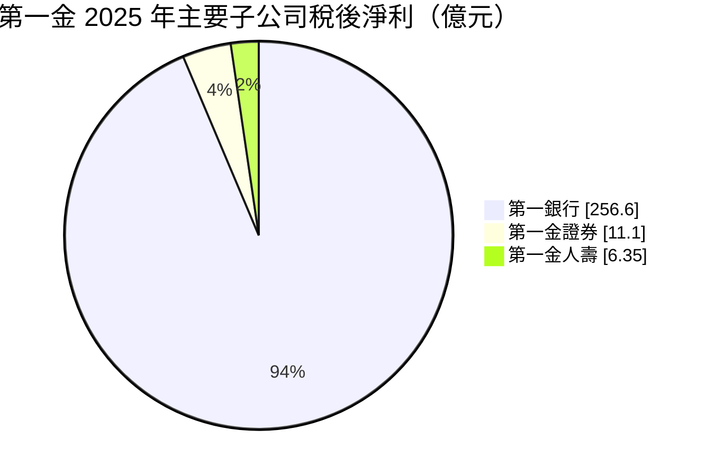
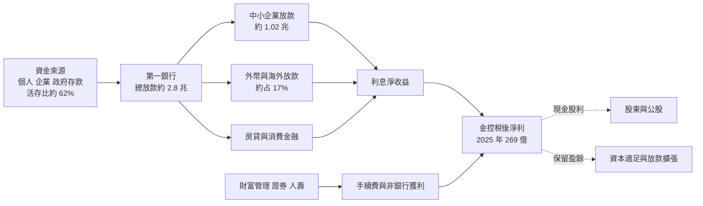
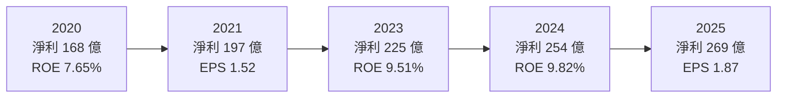
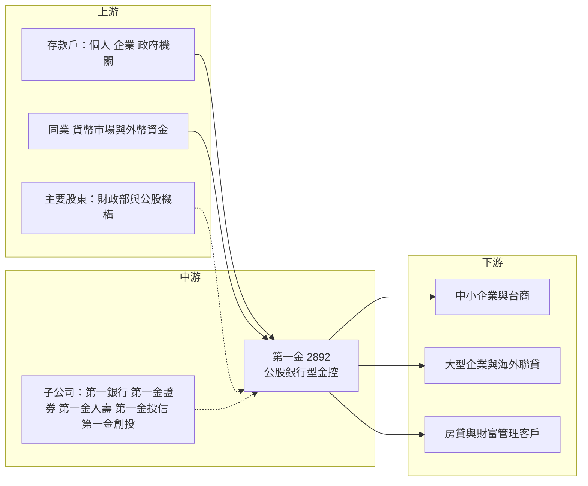

# 2892 第一金

> 上市｜[[產業索引-金融保險業|金融保險業]]｜上市（櫃）日期 2003/01/02

# 第一章：企業模式與商業藍圖

> [!info] 撰寫說明
> 本文由 Claude 依公開資料整理，架構比照 [[2330台積電]] 的四章研究，資料截至 2026-10-08。財務數字來源：證交所開放資料快照（基本資料、2025 年度股利）、Goodinfo 經營績效頁與股利政策頁（2016 至 2025 年）、富果研究第一金法說會整理（2025 年 8 月、2026 年 3 月、2026 年 6 月）；第一銀行的歷史沿革與部分產業描述係憑舊版筆記與記憶整理，尚未逐條比對原始文件。#待校對

在評估一家金融機構的長期投資價值時，第一步是看懂它的錢從哪裡來、借給了誰、以及每一塊錢的資本能賺回多少。本章針對第一金融控股（股票代號：2892，以下簡稱第一金）的商業模式進行定性分析，說明一家九成以上獲利來自銀行的公股金控，如何靠低成本存款、企業與中小企業放款以及海外分行賺取利差，又為什麼它的獲利成長穩定、但很難大幅跳升。

## 一、核心定位：以第一銀行為核心的公股銀行型金控

第一金成立於 2003 年 1 月 2 日，同日上市，核心子公司是第一商業銀行。第一銀行的歷史可以追溯到日治時期，是台灣歷史最悠久的商業銀行之一（沿革細節待校對）。第一金屬於公股金控，財政部與相關公股機構是主要股東，董事長與總經理的人選和政策方向都與政府密切相關；依證交所資料，目前董事長為邱月琴、總經理為方螢基，實收資本額約 1,437.9 億元。

理解第一金，關鍵是認清它本質上是一家「放大版的商業銀行」。依富果研究整理的 2025 年法說會資料，第一銀行約占金控總營收 91%，2025 年稅後淨利 256.6 億元，占金控 269.3 億元的九成以上；證券、人壽、投信等其他子公司合計只有約 24 億元。因此，第一金的長期價值幾乎完全取決於三件事：存放款之間的[[利差]]、放款規模的成長，以及放款的資產品質。

公股背景帶來兩個長期特性。第一是信用與存款基礎：民眾、企業與政府機關對公股銀行的信任度高，存款來源穩定，2025 年底總存款約 3.94 兆元、新台幣活期存款比率約 62%，活存比高代表資金成本低，這是銀行最根本的競爭力。第二是經營風格偏保守：公股銀行通常承擔一定的政策性任務，例如配合政府的中小企業融資或產業政策，風險偏好較低，獲利成長穩定，但很少出現民營金控那種大幅擴張的時期。

## 二、業務板塊：銀行為主、非銀行為輔

金控不適用製造業的產品營收結構，以下用 2025 年主要子公司稅後淨利呈現獲利來源（富果研究與舊版筆記整理的法說會數字）：

- **企業金融與中小企業放款：** 這是第一銀行的核心業務。2025 年底總放款約 2.8 兆元，其中中小企業放款約 1.02 兆元，占比超過三分之一。中小企業放款的利率高於大型企業放款，但風險也較高，第一銀行長年經營這個客群，累積了大量企業的金流與往來紀錄，這是放款定價與風險控管的基礎。
- **外幣與海外放款：** 2025 年外幣放款約 4,832 億元，約占總放款 17%，公司目標提升到 20% 以上；海外分行 2025 年稅前淨利約 93 億元，約占銀行整體稅前獲利 29.5%。海外業務讓第一銀行能跟著台商客戶到東南亞、北美與東亞承作聯貸與貿易融資，是國內放款成長有限之下的主要擴張方向。
- **消費金融與房貸：** 房貸是穩定但利差較薄的業務，成長速度受央行信用管制與房市景氣影響。第一銀行的房貸策略偏向大型建商與優良地段案件，並降低貸款成數，以控制風險。
- **財富管理與手續費：** 2025 年財富管理淨手續費年增 21.5%，基金銷售與銀行保險（銀保）是主要動能。手續費收入不占用太多資本，若比重提高，可以改善金控的 [[ROE]]。
- **非銀行子公司：** 包括第一金證券、第一金人壽、第一金投信與第一金創投。這些子公司規模都不大，獲利容易隨股市與利率波動，目前的角色是補充，而非支柱。

## 三、資本轉化邏輯：存款變放款、利差變股利

銀行的資本循環和製造業完全不同，可以從三個面向理解。

- **槓桿是銀行的本質：** 銀行用少量股東資本，加上大量存款，去承作放款與投資。2025 年第一金的資產報酬率（[[ROA]]）只有 0.55%，也就是每 100 元資產一年賺 0.55 元；但因為資產約為股東權益的 17 倍左右（推算，以 ROE 9.61% 除以 ROA 0.55%），ROE 就被放大到接近一成。這也說明為什麼主管機關要嚴格規範[[資本適足率]]：槓桿越高，賺得越多，承受損失的能力卻越低。
- **利差決定獲利的天花板：** 第一銀行 2025 年原始淨利息收益率（[[NIM]]）約 0.72%，若加計[[換匯交易]]收益約為 1.04%。台灣銀行業長期處於低利率、高存款的環境，利差在國際上屬於偏低水準，這是台灣銀行股 ROE 難以超過一成多的結構性原因。換匯收益則取決於美台利差，美國降息時這部分收益會縮小。
- **盈餘的分配：** 每年的淨利一部分以現金股利發給股東（公股股東也仰賴這筆收入挹注國庫），一部分保留下來，用於支撐放款成長所需的資本。放款成長越快，需要保留的盈餘越多，這是第一金在配息與成長之間的長期取捨。

## 四、企業長期藍圖：海外、財富管理與多元獲利

依近年法說會，第一金的長期策略集中在四個方向。

- **提高海外與外幣放款比重：** 國內放款市場成熟、利差薄，海外分行與外幣放款是擴大規模的主要管道，公司目標把外幣放款比重從約 17% 提高到 20% 以上。前幾年海外商業不動產（CRE）出現呆帳，公司表示已處理完畢，之後的海外擴張會更重視風險控管。
- **財富管理與高資產客群：** 以南部亞洲新灣區的財富管理中心為據點，鎖定中小企業主與中高資產客群，提供資產傳承、財富管理與投融資整合服務，提高手續費收入比重。
- **分行整併與數位轉型：** 國內分行由 188 家整併到 182 家，並規劃再減少一成以上，以降低固定成本；同時導入 AI 與數位服務。分行整併是公股銀行改善成本收益比的長期工作。
- **強化非銀行子公司：** 提升證券、人壽與投信的獲利能力，降低集團對單一銀行利差的依賴。不過以目前規模來看，這是十年以上的長期工程。

# 第二章：護城河深度與競爭優勢

在長期價值投資中，「護城河」指企業抵禦競爭、長期維持超額利潤的保護機制。銀行業的產品高度同質，護城河主要來自低成本資金、客戶關係、監管門檻與風險控管能力。本章分析第一金的護城河構成、公股與民營兩類主要對手，以及這些優勢在不同業務中能守住多少。

## 一、第一金護城河的核心組成要素

- **1. 公股信用與低成本存款：** 公股銀行的信用形象讓第一銀行擁有穩定而低成本的存款，新台幣活存比約 62%。銀行賣的是資金，資金成本越低，放款定價就越有彈性，這是最難被新進者複製的優勢。
- **2. 中小企業客戶關係：** 第一銀行長期深耕中小企業放款，掌握企業的帳戶往來、應收應付與擔保品資訊。企業一旦把主要往來銀行設在第一銀行，轉換的成本與麻煩都不小，這讓放款業務有一定的黏著度。
- **3. 海外據點網路：** 第一銀行在北美、東亞、東南亞與大洋洲設有海外分行與據點，在公股銀行中屬於前段（據點數各報導口徑不同，待校對）。海外據點的設立需要各國監管核准，時間長、門檻高，是跟著台商出海的重要基礎設施。
- **4. 資產品質與風險文化：** 2025 年底第一銀行[[逾放比]]約 0.17%、[[備抵呆帳覆蓋率]]超過 862%，代表壞帳少、緩衝厚。保守的授信文化讓第一金在景氣反轉時通常比積極擴張的同業更穩。
- **5. 監管門檻：** 銀行執照、資本要求與法令遵循成本極高，新進者難以進入。第一銀行同時被列為國內系統性重要銀行（[[D-SIB]]），須額外提列資本，但也代表它在金融體系中的地位穩固。

## 二、主要競爭對手格局

| 對手 | 定位 | 對第一金的影響 |
|---|---|---|
| [[2880華南金]]、[[5880合庫金]]、[[2886兆豐金]] | 公股金控 | 在企業與中小企業放款直接競爭，兆豐在外匯與海外業務特別強 |
| [[2801彰銀]]、[[2834臺企銀]]、臺灣銀行、土地銀行 | 公股銀行 | 同樣以低資金成本爭取企業放款，臺企銀專攻中小企業 |
| [[2891中信金]]、[[2881富邦金]]、[[2882國泰金]]、[[2884玉山金]] | 民營大型金控 | 財富管理、信用卡、數位金融與跨售能力較強，ROE 普遍較高 |
| 外商銀行與純網銀 | 跨國金融、數位服務 | 外銀在大型企業跨境金融具優勢，純網銀在年輕客群與數位體驗上競爭 |

## 三、優勢轉化：哪些守得住、哪些守不住

- **守得住：** 企業金融與中小企業放款。這塊業務需要長期累積的客戶資料、分行網路與低成本資金，公股銀行在這裡有結構性優勢，也是第一金獲利的主體。資產品質穩定，則讓這塊利差業務在景氣循環中不至於大起大落。
- **守不住：** 收費型業務與零售金融。財富管理、信用卡與數位銀行需要產品設計、行銷與科技投資，民營金控的反應速度與激勵制度通常優於公股體系，第一金在這些領域多半是追趕者。非銀行子公司的規模也明顯小於以壽險或證券起家的金控，難以成為第二支柱。
- **觀察重點：** 長期可以追蹤三件事。第一是外幣放款比重能否穩定提高，同時不再出現海外不動產呆帳；第二是手續費收入占淨收益的比重能否持續上升，改善 ROE；第三是分行整併與數位化能否讓成本收益比持續下降。

# 第三章：財務體質與盈利規模

資料日期：2026-10-08。數字取自 Goodinfo 經營績效頁與股利政策頁、證交所開放資料快照與富果研究法說會整理，表格是撰寫當時的快照；最新月營收、毛利率、累計 EPS 由自動排程寫在本筆記的屬性欄位（月營收、毛利率、累計EPS 等）。#待校對

財務報表是檢驗護城河是否真實存在的最終標準。金控沒有製造業意義上的毛利率與營業利益率，本章改以淨收益、稅後淨利、EPS、ROE 與 ROA 檢視獲利能力，並以 ROE 對比 [[CAPM]] 股東權益成本，取代製造業的 ROIC 與 WACC 分析。

## 一、獲利能力的基石：淨收益與稅後淨利

| 年度 | 淨收益（億元） | 稅後淨利（億元） | EPS（元） | [[ROE]] | [[ROA]] | 每股淨值（元） |
|---|---|---|---|---|---|---|
| 2021 | 626 | 197 | 1.52 | 8.89% | 0.57% | 17.32 |
| 2022 | 678 | 206 | 1.56 | 9.18% | 0.52% | 16.95 |
| 2023 | 673 | 225 | 1.65 | 9.51% | 0.52% | 18.24 |
| 2024 | 721 | 254 | 1.81 | 9.82% | 0.56% | 19.10 |
| 2025 | 776 | 269 | 1.87 | 9.61% | 0.55% | 20.33 |

（來源：Goodinfo 經營績效頁，合併報表；淨收益即金控的營業收入淨額。[[毛利率]]與[[營業利益率]]不適用於金控，故以淨收益與 ROA 取代。2026 年第一季年化 ROE 約 11.16%，依富果研究法說會整理。）

- **穩定成長的獲利：** 2020 至 2025 年稅後淨利由 168 億元成長到 269 億元，年複合成長率約 9.9%（推算）；同期淨收益由 596 億元成長到 776 億元，年複合成長率約 5.4%（推算）。淨利成長快於收入，主要來自升息後的利差改善、換匯收益與信用成本下降。
- **EPS 成長被股票股利稀釋：** 同期 EPS 只從 1.31 元成長到 1.87 元，成長幅度明顯低於淨利，因為第一金過去多年同時配發股票股利，股本持續擴大。投資人評估長期報酬時，要把股本膨脹納入考慮。
- **2020 年的低點：** 2020 年 ROE 7.65%，是近十年低點，反映全球降息與疫情期間的保守提存。這提醒我們，銀行獲利對利率環境高度敏感。

## 二、ROE 與銀行經營指標

近 5 年（2021 至 2025 年）平均 ROE 約 9.4%（推算），每一年都落在 8.9% 到 9.8% 之間，波動極小；2016 至 2020 年則在 7.65% 到 9.11% 之間。這種穩定度是公股銀行型金控最大的財務特徵：不會大好，也很少大壞。

ROE 可以拆成 ROA 乘以財務槓桿。第一金 ROA 長期在 0.52% 到 0.69% 之間，槓桿約 17 倍。要提高 ROE，只有三條路：提高利差、提高手續費等不占資本的收入、或提高槓桿。第三條路受資本適足率規範限制，因此長期的 ROE 改善主要要靠前兩者。2025 年原始 NIM 約 0.72%、加計換匯後約 1.04%，2026 年第一季年化 ROE 回升到約 11%，顯示放款成長與手續費收入增加確實有幫助，但能否長期維持在一成以上，仍需觀察利率環境。

## 三、資產品質、資本與股利

- **資產品質：** 2025 年底逾放比約 0.17%、備抵呆帳覆蓋率超過 862%，全年淨[[信用成本]]約 22 個基點，第四季並策略性增提約 10 億元呆帳準備。資產品質處於歷史良好水準，代表目前獲利沒有靠少提呆帳來美化。
- **資本適足：** 2025 年底第一銀行資本適足率約 15.46%、第一類資本比率約 13.22%，集團資本適足率約 130.73%，皆符合 D-SIB 規範。資本充足是銀行能持續放款擴張與配息的前提。
- **股利穩定度：** 依 Goodinfo，2016 至 2025 年度每年都有配發現金股利，金額在 0.8 到 1.3 元之間，並在多數年度另配 0.1 到 0.3 元股票股利。2025 年度依證交所資料配發現金股利 1.3 元、不配股票股利，以 EPS 1.87 元計算配息率約 69.5%（推算），高於 2022 至 2024 年度約 51% 至 53% 的現金配息率（推算）。管理層表示配息率將朝 65% 看齊，但也提到放款擴張需要保留盈餘，未來股利會滾動調整。

## 四、[[ROE]] 與 [[CAPM]] 股東權益成本：價值創造利差

金融業的負債（存款）是營運的原料而不是單純的融資，因此不適用製造業的 [[ROIC]] 與 [[WACC]]，改以 ROE 對比股東要求報酬率（股東權益成本）來判斷是否創造價值。

- **ROE：** 近 5 年平均約 9.4%（推算，依 Goodinfo 2021 至 2025 年 ROE 平均），2025 年為 9.61%。
- **股東權益成本（推算）：** 以 CAPM 估算，無風險利率取台灣 10 年期公債約 1.75%（1.5% 至 2% 區間中值），市場風險溢酬 6%，β 假設 0.6（未查得第一金實際 β 值，取公股銀行型金控常見的 0.5 至 0.7 區間），股東權益成本約為 1.75% ＋ 0.6 × 6% ＝ 5.35%。若保守把 β 提高到 0.8，股東權益成本約 6.55%。
- **價值創造判斷：** 第一金的 ROE 約 9.4%，高於 5.35% 至 6.55% 的股東權益成本約 3 到 4 個百分點（推算），代表它長期能為股東創造溫和的超額報酬。這個利差不大，但非常穩定，這正是公股金控的典型樣貌。風險在於：利率長期下行會壓縮利差與換匯收益，使 ROE 回到 8% 以下；而若市場要求的風險溢酬上升，股東權益成本也會提高，利差會進一步收窄。長期而言，提高手續費收入比重、維持資產品質，是第一金把 ROE 穩定在資金成本之上的關鍵。

# 第四章：總體風險與地緣政治

任何企業都無法脫離宏觀環境獨立存在。對銀行而言，風險的本質是「借出去的錢能不能收回來」以及「利率環境能讓它賺多少」。本章分析第一金必須面對的地緣政治、利率與景氣週期、營運與法規科技風險。

## 一、地緣政治與海外曝險

- **兩岸與區域風險：** 第一銀行在中國與東南亞設有據點，放款客戶中也有大量台商。若兩岸關係緊張或區域衝突升高，客戶營運受影響，還款能力會下降，海外與台商相關放款的品質會首先承壓。
- **關稅與供應鏈移轉：** 台商把產能移往東南亞與美國，帶動海外放款需求，這是第一銀行外幣放款成長的主要動力。但如果關稅政策反覆、客戶延後投資，海外放款成長就會放緩；而在新興市場的放款，也伴隨當地法規、匯率與政治風險。
- **海外商業不動產：** 第一銀行過去曾因海外商業不動產放款出現呆帳，這類資產在利率上升或辦公室需求轉弱時特別容易出問題，雖然公司表示已處理完畢，仍是海外擴張時必須持續管控的風險。

## 二、利率與景氣週期

- **利差風險：** 銀行獲利主要來自利差。央行降息時，放款利率通常比存款利率更快下降，NIM 會被壓縮；美國降息則會減少換匯交易收益。2020 年第一金 ROE 降到 7.65%，就是低利率環境的例證。
- **企業景氣循環：** 中小企業放款占比高，景氣反轉時中小企業通常最先出現違約，信用成本會跟著上升。目前逾放比處於歷史低點，代表下一次景氣下行時，信用成本「回到正常」的空間反而較大。
- **房市與信用管制：** 房貸與建築融資受央行選擇性信用管制影響，房市降溫時放款成長與擔保品價值都會受到衝擊。

## 三、營運環境的隱性風險

- **授信集中：** 若為了追求成長而集中承作特定產業（例如 AI 與科技供應鏈擴廠融資），一旦該產業景氣反轉，風險會同時爆發。分散授信是銀行長期穩健的基本功。
- **非銀行子公司波動：** 證券與壽險獲利受股市與利率影響大，股市轉弱時證券獲利會明顯下滑；壽險則面臨利率與資產負債配置的風險。
- **股利與資本的取捨：** 放款擴張需要資本支撐。若配息率拉高、同時放款快速成長，資本適足率可能下降，最後只能以減少配息或增資因應。
- **公股治理：** 經營層與董事會受政府政策影響，可能承擔政策性融資任務，或在人事與策略上偏向保守，對追求報酬最大化的股東而言是一種隱性成本。

## 四、法規與科技演進

- **資本規範趨嚴：** 國際資本規範與 D-SIB 加碼要求若進一步提高，銀行需要保留更多盈餘，ROE 與配息都會受到壓抑。
- **數位金融與支付：** 純網銀、電子支付與民營銀行的數位服務持續進步，年輕客群的存款與消費金融業務可能逐步流失。第一銀行需要持續投入系統、資料與 AI 能力，這些都是長期費用。
- **資安與法令遵循：** 銀行是網路攻擊與洗錢防制的重點對象，一次重大資安事件或裁罰，都可能造成財務損失與信譽傷害。

# 專有名詞解析

## 金融

- **[[利差]]**：銀行放款利率與存款利率之間的差距，是銀行最主要的獲利來源。
- **[[NIM]]**：淨利息收益率，利息淨收益除以生息資產，衡量銀行整體資產賺取利息的效率。
- **[[換匯交易]]**：銀行以即期買入、遠期賣出外幣的方式調度資金，在兩國利差大時可賺取額外收益。
- **[[逾放比]]**：逾期放款占總放款的比例，數字越低代表放款的資產品質越好。
- **[[備抵呆帳覆蓋率]]**：備抵呆帳除以逾期放款，衡量銀行為可能的壞帳預先準備了多少緩衝。
- **[[信用成本]]**：一段期間提列的呆帳費用占放款的比例，通常以基點表示，數字越低代表壞帳損失越少。
- **[[資本適足率]]**：自有資本除以風險性資產，主管機關用來確保金融機構有足夠資本承擔損失。
- **[[ROA]]**：資產報酬率，稅後淨利除以總資產，衡量銀行運用全部資產賺錢的效率。
- **[[ROE]]**：股東權益報酬率，稅後淨利除以股東權益，衡量公司運用股東資本賺錢的效率。
- **[[D-SIB]]**：國內系統性重要銀行，倒閉時會衝擊整體金融體系的銀行，須額外提列資本。
- **[[CAPM]]**：資本資產定價模型，以無風險利率加上 β 乘以市場風險溢酬，估算股東要求的報酬率。
- **[[聯貸]]**：由多家銀行共同承作同一筆大額企業貸款以分攤風險，常用於擴廠與併購融資。

# 核心供應鏈

## 1. 上游：資金來源
- 存款戶：個人、企業與政府機關存款，是成本最低、最穩定的資金來源
- 同業拆借、貨幣市場與換匯取得的外幣資金
- 主要股東：財政部與相關公股機構

## 2. 中游：第一金與子公司
- 第一商業銀行（核心，獲利占九成以上）、第一金證券、第一金人壽、第一金投信、第一金創投

## 3. 下游：主要客群
- 中小企業與台商（國內與海外放款、貿易融資）
- 大型企業與科技供應鏈的聯貸、擴廠融資
- 個人房貸、消費金融與財富管理客戶

## 4. 同業比較
- 公股金控與銀行：[[2880華南金]]、[[5880合庫金]]、[[2886兆豐金]]、[[2801彰銀]]、[[2834臺企銀]]
- 民營金控：[[2891中信金]]、[[2884玉山金]]、[[2881富邦金]]、[[2882國泰金]]

## 最新新聞
<!-- news:start（自動產生，請勿手動編輯此範圍） -->
- 2026-10-22 📰 媒體 16:42｜4大公股投信整併案拍板！第一金控持股50.3% 第一金投信存續｜[鉅亨網](https://news.cnyes.com/news/id/6635867)
- 2026-10-21 🏛️ 重訊 14:44｜公告本公司召開2026年第三季法人說明會｜[觀測站](https://mops.twse.com.tw/mops/#/web/t05st01)
- 2026-10-15 🏛️ 重訊 14:32｜代子公司第一商業銀行公告常務董事會審議 通過紐約分行近期將轉讓聯貸案債權 金額不逾USD13.7佰萬元｜[觀測站](https://mops.twse.com.tw/mops/#/web/t05st01)
- 2026-10-14 📰 媒體 12:37｜第一金前3季大賺262億元年增逾2成創歷史新高 EPS達1.82元｜[鉅亨網](https://news.cnyes.com/news/id/6630088)
- 2026-10-13 🏛️ 重訊 17:03｜公告本公司暨主要子公司115年9月份自結合併盈餘數｜[觀測站](https://mops.twse.com.tw/mops/#/web/t05st01)

完整紀錄：[[2892第一金 新聞]]
<!-- news:end -->

## 相關連結
- [公開資訊觀測站](https://mopsov.twse.com.tw/mops/web/t05st03?step=1&firstin=1&co_id=2892)
- [Goodinfo](https://goodinfo.tw/tw/StockDetail.asp?STOCK_ID=2892)
- [Yahoo 股市](https://tw.stock.yahoo.com/quote/2892)
- [鉅亨網新聞](https://www.cnyes.com/twstock/2892/news)
