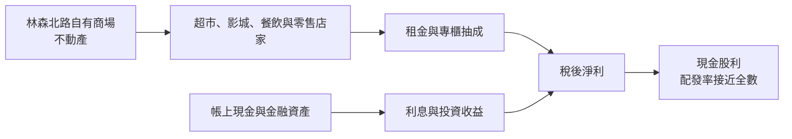
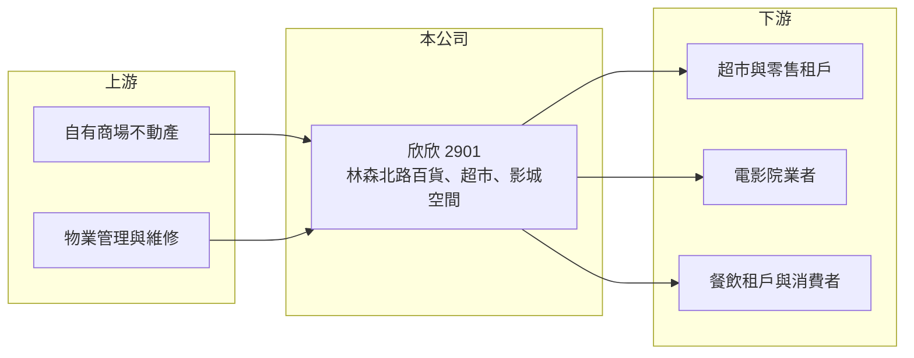

# 2901 欣欣

> 上市｜[[產業索引-貿易百貨業|貿易百貨業]]｜上市（櫃）日期 1976/05/07

# 第一章：企業模式與商業藍圖

> [!info] 撰寫說明
> 精簡版，由 Claude 依公開資料整理，架構比照 [[2330台積電]] 的四章研究，資料截至 2026-10-08。來源：MoneyDJ 年度財務比率頁、Yahoo 股市公司基本資料、證交所開放資料（基本資料、2026 年第二季資產負債與綜合損益、營益分析、股利、每月營收）。公司規模小，公開資料有限，各業務營收比重、租戶名單與經營沿革未查得，相關描述多為依財務結構推估。#待校對

欣欣大眾市場是台北林森北路上的老牌百貨公司，如今營收規模很小，獲利型態接近收租型的資產公司。本章說明它的業務與收入特性。

## 一、核心定位：台北市區的小型百貨與商場

欣欣成立於 1971 年，1976 年上市，總部位於台北市林森北路，董事長為李文英、總經理為周國健，實收資本額約 7.3 億元（證交所開放資料）。依 Yahoo 股市公司資料，主要經營業務為百貨業、超市與電影院。

* **小規模、高毛利：** 公司年營收只有約 1.3 億元，但毛利率高達 81% 至 88%（MoneyDJ）。這種毛利率不像自營商品的百貨或超市，而像以[[不動產租賃]]租金、[[專櫃抽成]]為主的收入結構（推估），也就是把商場空間出租給超市、電影院與店家經營。
* **營收長期停滯：** 2018 年營收約 1.41 億元，2025 年約 1.31 億元（依 MoneyDJ 淨利率與證交所淨利推算），規模多年沒有成長。

## 二、商業模式：以商場空間換取租金與抽成

這類公司的經營重點不在擴張，而在維持商場出租率與租戶品質，並管理好帳上的現金。2026 年上半年營業利益約 0.12 億元、營業外收入約 0.08 億元（證交所綜合損益），業外收益占稅前淨利約四成，顯示帳上資金的利息與投資收益是另一個重要的獲利來源。

## 三、長期方向

公開資料未查得公司的擴張、改建或轉型計畫。台北林森北路與南京東路周邊是成熟的商業區，地段價值穩定；但百貨與超市業態面臨大型購物中心與電商的長期競爭。老舊商場未來是否進行[[資產活化]]，是影響長期價值的關鍵。

# 第二章：護城河深度與競爭優勢

小型收租型百貨的競爭優勢來自地段，限制則來自規模。本章分析欣欣的優勢與弱點。

## 一、護城河的核心組成要素

* **市區地段：** 商場位於台北市中心的林森北路，交通便利、周邊住商混合，對超市、影城與餐飲租戶有基本的吸引力。持有數十年的不動產帳面成本低（推估）。
* **財務非常保守：** 2026 年第二季底總負債約 2.25 億元、權益約 8.73 億元，流動資產約 5.2 億元（證交所資產負債），幾乎沒有財務槓桿，能承受景氣波動。
* **限制：** 只有單一據點、營收約 1 億多元，沒有規模經濟，也沒有品牌延伸的能力。

## 二、主要競爭與比較對象

| 比較對象 | 定位 | 與欣欣的比較 |
|---|---|---|
| [[2903遠百]] | 全台大型百貨與購物中心 | 規模與商品力遠大於欣欣，搶相同的百貨消費 |
| [[2701萬企]] | 台北西門町收租型資產公司 | 同屬收入以租金為主的老牌上市公司 |
| [[2706第一店]] | 台北南京東路收租型公司 | 同區域、同類型的資產型公司 |
| 新光三越、SOGO 等百貨 | 台北大型百貨 | 吸引周邊消費人潮 |

## 三、守得住與守不住

* **守得住：** 地段帶來的穩定租金，以及低負債的財務安全性。
* **守不住：** 成長性。單一老舊商場難以吸引新型態租戶，營收長期停滯。
* **觀察重點：** 主要租戶的續約狀況、帳上資金的運用方式，以及是否有改建或活化計畫。

# 第三章：財務體質與盈利規模

資料日期：2026-10-08，表格是撰寫當時的快照；最新月營收、毛利率、累計 EPS 由自動排程寫在本筆記的屬性欄位（月營收、毛利率、累計EPS 等）。#待校對

本章用多年度數據檢視欣欣的利潤率、股利與資本報酬。

## 一、多年度三率與 ROE

| 年度 | 營收（新台幣） | [[毛利率]] | [[營業利益率]] | EPS（元） | [[ROE]] |
|---|---|---|---|---|---|
| 2019 | 約 1.38 億（推算） | 88.16% | 23.96% | 0.45 | 3.75% |
| 2020 | 約 1.09 億（推算） | 84.85% | 7.76% | 0.19 | 1.62% |
| 2021 | 約 0.93 億（推算） | 80.76% | -5.89% | 0.07 | 0.57% |
| 2022 | 約 1.13 億（推算） | 81.28% | 6.56% | 0.23 | 1.95% |
| 2023 | 約 1.33 億（推算） | 84.45% | 19.86% | 0.41 | 3.39% |
| 2024 | 約 1.34 億（推算） | 85.85% | 18.80% | 0.41 | 3.39% |
| 2025 | 約 1.31 億（推算） | 85.21% | 16.20% | 0.38 | 3.14% |
| 2026 上半年 | 0.67 億 | 87.00% | 17.88% | 0.22 | 未查得 |

註：2019 至 2025 年的三率、EPS 與 ROE 取自 MoneyDJ 年度財務比率；營收為依稅後淨利與淨利率推算的近似值。2026 上半年取自證交所營益分析與綜合損益。

* **高毛利、低成長：** 毛利率長期在 80% 以上，2019 至 2025 年營收年複合成長率約 -1%（推算）。2026 年 1 至 8 月累計營收約 0.89 億元、年增約 3.7%（證交所每月營收）。
* **疫情影響明顯：** 2021 年營業利益率轉為 -5.89%，說明電影院與商場人流對疫情敏感。
* **ROE 偏低：** 2021 至 2025 年平均 ROE 約 2.5%（推算），原因是權益中有大量現金與不動產，而每年淨利只有約 0.3 億元。

## 二、股利與財務結構

2025 年度每股配發現金股利約 0.373 元，以 2025 年本期淨利約 0.28 億元、EPS 0.38 元計算，配發率接近 98%（證交所股利資料，推算），屬於幾乎全數發放的政策。收租型公司資本支出低，自由現金流長期為正（推估）。股價淨值比約 2.07 倍、本益比約 56 倍（證交所本益比殖利率），市場評價明顯高於獲利水準，可能反映對不動產價值的期待（推估）。

## 三、[[ROIC]] 與 [[WACC]]

**ROIC 推算：** 2025 年營業利益約 1.31 億 × 16.2% ≈ 0.21 億元，以 20% 稅率計算稅後約 0.17 億元。以權益約 8.73 億元作為投入資本（幾乎無有息負債），ROIC 約 2%；若扣除流動資產中推估約 5 億元的現金與金融資產，本業投入資本約 3.7 億元，ROIC 約 4.6%（推算）。

**WACC 推算：** 台灣 10 年期公債 1.75%、市場風險溢酬 6%、β 取資產型公司常見值 0.5，權益成本約 4.75%；幾乎無負債，WACC 約 4.7%（推算）。

**結論：** 以帳面資本計算，欣欣的 ROIC 低於 WACC；即使扣除現金，本業報酬也只和資金成本相當。這類公司的價值主要在於地段資產與穩定配息，而不是獲利成長。

# 第四章：總體風險與地緣政治

本章整理欣欣長期面對的商圈、資產與治理風險。

## 一、商圈與業態

* **百貨業態老化：** 大型購物中心、電商與外送改變了消費習慣，小型老牌百貨的來客數長期承壓。
* **租戶集中：** 超市與電影院等主力租戶若退租，單一據點的公司缺乏分散風險的能力。

## 二、資產風險

* **建物老化：** 老舊商場的消防、耐震與設備更新成本增加，若未來改建，改建期間將失去租金收入。
* **疫情與人流：** 2021 年營業虧損的經驗顯示，電影院與商場對群聚管制非常敏感。

## 三、其他風險

* **成長性有限：** 公司缺乏明確的擴張或活化計畫，股東報酬主要依賴金額不高的股利。
* **法規與稅負：** 房屋稅、地價稅與都市更新法規的調整，會影響持有成本與改建可行性。

# 專有名詞解析

## 金融

- **[[ROIC]]**：投入資本報酬率，衡量企業用股東與債權人投入的資本，每年能產生多少稅後營業利益。
- **[[WACC]]**：加權平均資金成本，股東要求報酬與負債利息依資本結構加權後的平均值，是判斷是否創造價值的門檻。

## 產業

- **[[不動產租賃]]**：企業持有房地產出租給他人使用，以租金作為主要收入來源的商業模式。
- **[[資產活化]]**：企業將閒置或低度使用的土地、建物，透過改建、出租、合建或出售等方式提高收益。
- **[[專櫃抽成]]**：百貨公司不自己進貨，而是依專櫃銷售額收取一定比例作為收入，因此帳上營收較小、毛利率較高。

# 核心供應鏈

- 上游：自有商場不動產、物業管理與維修服務。
- 下游／客戶：超市、電影院、餐飲與零售租戶，以及商場周邊的消費者（具體租戶名稱未查得）。
- 同業與比較對象：[[2903遠百]]、[[2701萬企]]、[[2706第一店]]。

## 最新新聞
<!-- news:start -->
<!-- news:end -->

## 相關連結
- [公開資訊觀測站](https://mopsov.twse.com.tw/mops/web/t05st03?step=1&firstin=1&co_id=2901)
- [Goodinfo](https://goodinfo.tw/tw/StockDetail.asp?STOCK_ID=2901)
- [Yahoo 股市](https://tw.stock.yahoo.com/quote/2901)
- [鉅亨網新聞](https://www.cnyes.com/twstock/2901/news)
