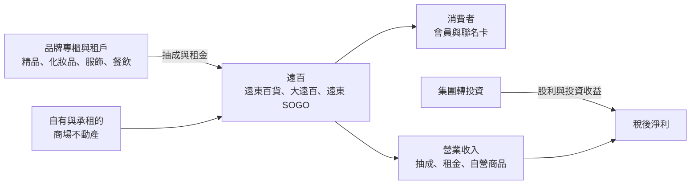
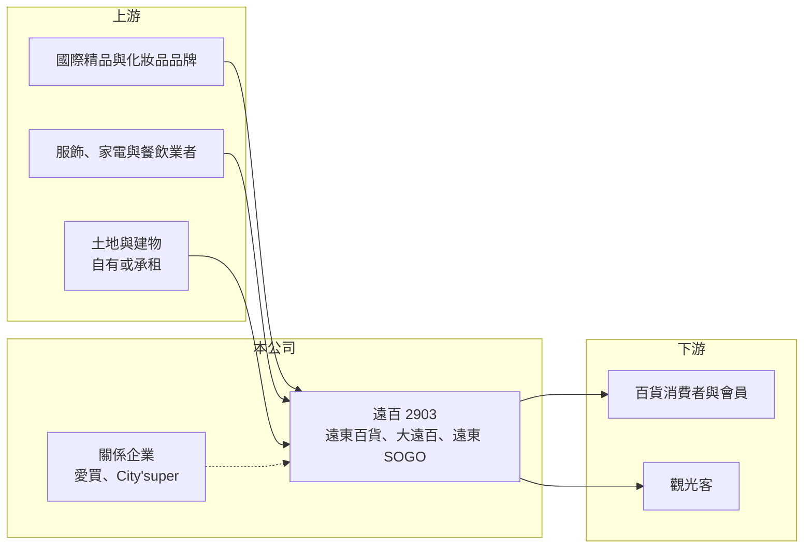

# 2903 遠百

> 上市｜[[產業索引-貿易百貨業|貿易百貨業]]｜上市（櫃）日期 1978/10/11

# 第一章：企業模式與商業藍圖

> [!info] 撰寫說明
> 精簡版，由 Claude 依公開資料整理，架構比照 [[2330台積電]] 的四章研究，資料截至 2026-10-08。來源：Goodinfo 年度經營績效頁、工商時報 2025 年 11 月報導、證交所開放資料（基本資料、2026 年第二季資產負債與綜合損益、營益分析、股利、每月營收）。據點名稱、SOGO 持股結構與集團轉投資部分憑記憶整理，已標示待校對；各事業營收比重與門市總數未查得。#待校對

遠東百貨（以下簡稱遠百）是遠東集團旗下的百貨零售事業，經營遠東百貨、大遠百與遠東 SOGO，也是台灣最大的百貨集團之一。本章說明它的事業版圖與商業模式。

## 一、核心定位：遠東集團的百貨與量販平台

遠百成立於 1967 年，1978 年上市，董事長為徐旭東、總經理為徐雪芳，實收資本額約 141.7 億元（證交所開放資料）。依工商時報 2025 年 11 月報導，集團百貨品牌為遠東百貨與遠東 SOGO 百貨，關係企業另有愛買量販與 City'super；中國大陸的百貨據點多數已關閉，只保留重慶遠東城。

* **百貨據點：** 遠東百貨在全台主要城市經營大型「大遠百」[[購物中心]]（如台中、高雄、板橋、新竹、桃園等）以及台北信義 A13 等據點；遠東 SOGO 則以台北忠孝、復興、天母等商圈為主（據點清單待校對）。
* **量販與超市：** 愛買量販與 City'super 屬於關係企業，與百貨形成不同價格帶的零售組合（持股結構待校對）。

## 二、商業模式：專櫃抽成加上不動產

台灣百貨業的主流是[[專櫃抽成]]：品牌在百貨內設櫃，由百貨依銷售額抽取一定比例。遠百的毛利率從 2019 年的 51.8% 升到 2025 年的 57.8%（Goodinfo），反映營收結構逐漸從自營商品轉向抽成與租金，以及關閉低毛利的量販與海外據點。大型購物中心也越來越多以餐飲、娛樂與體驗業態吸引人潮，再帶動精品與化妝品的銷售。

## 三、長期方向與據點策略

遠百近年的策略是「關閉虧損據點、集中資源在大型旗艦店」：關閉中國大陸百貨與部分愛買據點，雖然使營收下滑，但淨利得以改善（工商時報）。營收從 2019 年的 379 億元降到 2025 年的 341 億元，同期毛利率與營業利益率則維持或提升（Goodinfo）。長期成長取決於大型購物中心的[[坪效]]、新據點開發，以及與遠東集團（電信、銀行、零售）的會員整合。

# 第二章：護城河深度與競爭優勢

百貨業的護城河來自地段、規模與品牌招商能力。本章分析遠百的優勢與限制。

## 一、護城河的核心組成要素

* **核心地段與大型商場：** 大遠百與 SOGO 多位於各城市的核心商圈或捷運站周邊，大型商場用地取得困難、開發期長，新進業者難以在相同地段複製。
* **招商與品牌談判能力：** 全台多據點的規模，讓遠百在與國際精品、化妝品品牌談判設櫃條件時具有議價力，品牌也傾向進駐多據點的百貨集團。
* **集團生態圈：** 與遠東集團的 [[4904遠傳]]、[[2845遠東銀]] 等事業在會員、支付與聯名卡上有協同（具體合作內容待校對），提高會員黏著度。

## 二、主要競爭對手

| 對手 | 定位 | 對遠百的威脅 |
|---|---|---|
| 新光三越 | 台灣最大百貨集團之一 | 在台北信義、台中、台南、高雄等核心商圈直接競爭 |
| 微風、漢神、中友 | 區域型百貨與購物中心 | 在台北、高雄、台中分食高端消費 |
| [[1216統一]]（統一時代、夢時代） | 購物中心與百貨 | 在台北與高雄競爭購物中心客群 |
| [[8454富邦媒]] 等電商 | 線上購物 | 長期分食服飾、家電等百貨品類 |

## 三、守得住與守不住

* **守得住：** 精品、化妝品與餐飲等需要實體體驗的品類，以及核心商圈旗艦店的人潮。
* **守不住：** 營收規模。出國旅遊消費與電商分流，使百貨業整體成長緩慢，遠百營收近年呈小幅下滑。
* **觀察重點：** 旗艦店的坪效、新據點開發進度，以及關閉虧損據點後利潤率能否持續改善。

# 第三章：財務體質與盈利規模

資料日期：2026-10-08，表格是撰寫當時的快照；最新月營收、毛利率、累計 EPS 由自動排程寫在本筆記的屬性欄位（月營收、毛利率、累計EPS 等）。#待校對

本章用多年度數據檢視遠百的利潤率、資本結構與資本報酬，並說明大量不動產對 ROE 的影響。

## 一、多年度三率與 ROE

| 年度 | 營收（新台幣） | [[毛利率]] | [[營業利益率]] | EPS（元） | [[ROE]] |
|---|---|---|---|---|---|
| 2019 | 379 億 | 51.8% | 12.0% | 1.26 | 5.62% |
| 2020 | 373 億 | 50.2% | 11.0% | 1.38 | 6.47% |
| 2021 | 353 億 | 49.3% | 10.3% | 0.86 | 4.79% |
| 2022 | 359 億 | 53.9% | 12.4% | 1.37 | 6.73% |
| 2023 | 367 億 | 55.9% | 15.0% | 1.95 | 10.20% |
| 2024 | 350 億 | 56.7% | 11.6% | 1.65 | 7.67% |
| 2025 | 341 億 | 57.8% | 12.3% | 1.56 | 6.97% |
| 2026 上半年 | 159.6 億 | 59.14% | 14.05% | 0.55 | 未查得 |

註：2019 至 2025 年取自 Goodinfo；2026 上半年取自證交所營益分析與綜合損益。

* **營收緩降、利潤率穩定：** 2019 至 2025 年營收年複合成長率約 -1.7%（推算），主要來自關閉海外與量販據點；營業利益率則穩定在 10% 至 15%。2026 年 1 至 8 月累計營收約 210 億元、年減約 0.5%（證交所每月營收）。
* **營業利益高、淨利低：** 2026 年上半年營業利益約 22.4 億元，但營業外損失約 8.1 億元、所得稅約 6.1 億元，稅後純益率只有 5.17%（證交所營益分析）。營業外損失主要應為大量借款與[[租賃負債]]的利息費用（推估）。
* **ROE 偏低：** 2021 至 2025 年平均 ROE 約 7.3%（推算）。

## 二、不動產與財務結構對 ROE 的影響

2026 年第二季底總資產約 1,297 億元，其中非流動資產約 1,079 億元；總負債約 947 億元、權益約 350 億元（歸屬母公司約 300 億元），負債比約 73%（證交所資產負債）。大型百貨的土地、建物與長期租約讓資產規模龐大，但百貨每年的稅後淨利只有約 20 億元出頭，因此即使營業利益率不低，ROE 仍長期停留在個位數。換句話說，遠百同時是零售商與不動產持有者，帳上資產的市場價值與其帶來的租金報酬，比 EPS 更能說明公司的價值。

2025 年度每股配發現金股利 1.25 元（證交所股利資料），以 EPS 1.56 元計算配發率約 80%（推算），本期淨利約 22.0 億元。

## 三、[[ROIC]] 與 [[WACC]]

**ROIC 推算：** 2025 年營業利益約 341 億 × 12.3% ≈ 41.9 億元，以 20% 稅率計算稅後約 33.6 億元。有息負債金額未查得，以權益約 350 億元加上推估的借款與租賃負債約 350 億元、合計約 700 億元作為投入資本，ROIC 約 4.8%（推算）。

**WACC 推算：** 台灣 10 年期公債 1.75%、市場風險溢酬 6%、β 取百貨零售同業常見值 0.6，權益成本約 5.4%；負債成本約 2%、稅後約 1.6%，以權益 50%、負債 50% 加權，WACC 約 3.5%（推算）。

**結論：** ROIC 略高於 WACC，代表遠百能創造價值，但利差不大。重資產的百貨模式在低利率環境下仍可獲利，若利率上升，財務槓桿會明顯壓縮淨利與 ROE；關閉低效據點、提高旗艦店坪效，是改善資本效率的主要途徑。

# 第四章：總體風險與地緣政治

本章整理遠百長期面對的消費、利率與營運風險。

## 一、產業結構

* **消費外流與電商：** 國人出國旅遊增加、跨境電商與網購普及，使百貨的服飾與一般商品銷售長期承壓，假期出國旅遊旺季時，國內百貨的來客與業績常受到排擠。
* **商場供給增加：** 各縣市持續有新的購物中心與 Outlet 開幕，商圈內競爭加劇，品牌櫃位與人潮被分散。

## 二、財務與資產風險

* **利率與槓桿：** 負債比約 73%，利率上升會直接增加利息費用，侵蝕本已不高的淨利。
* **租約與開發：** 承租的商場面臨續約與租金調整，新據點開發則需要大量資本支出與較長的回收期。

## 三、其他風險

* **大型商場公共安全：** 百貨公司屬於公共安全重點場所，事故會帶來營業中斷與商譽損失。
* **中國大陸資產：** 重慶遠東城仍在營運，中國消費與政策環境變化可能造成處分或減損損失。
* **集團治理：** 遠東集團旗下公司交叉持股與關係人交易多，資本配置的透明度是長期觀察重點。

# 專有名詞解析

## 金融

- **[[租賃負債]]**：依 IFRS 16，企業把長期租約未來應付的租金折現後認列在資產負債表上的負債，連鎖餐飲與零售業金額通常很大。
- **[[ROIC]]**：投入資本報酬率，衡量企業用股東與債權人投入的資本，每年能產生多少稅後營業利益。
- **[[WACC]]**：加權平均資金成本，股東要求報酬與負債利息依資本結構加權後的平均值，是判斷是否創造價值的門檻。

## 產業

- **[[專櫃抽成]]**：百貨公司不自己進貨，而是依專櫃銷售額收取一定比例作為收入，因此帳上營收較小、毛利率較高。
- **[[購物中心]]**：結合百貨、餐飲、娛樂與休閒設施的大型商場，強調停留時間與體驗，以吸引人潮帶動消費。
- **[[坪效]]**：每坪賣場面積在一定期間內創造的營業額，是衡量零售與百貨據點經營效率的指標。

# 核心供應鏈

- 上游：國際精品、化妝品、服飾與家電品牌，餐飲租戶，商場土地與建物（自有或承租）。
- 下游／客戶：百貨消費者與會員、國內外觀光客。
- 集團關係企業：[[1402遠東新]]、[[4904遠傳]]、[[2845遠東銀]]、[[1102亞泥]]。
- 同業：新光三越、微風、漢神、[[1216統一]]（統一時代、夢時代）、[[8454富邦媒]]（電商）。

## 最新新聞
<!-- news:start（自動產生，請勿手動編輯此範圍） -->
- 2026-10-08 🏛️ 重訊 15:04｜代子公司太平洋崇光百貨股份有限公司公告 取得使用權資產｜[觀測站](https://mops.twse.com.tw/mops/#/web/t05st01)

完整紀錄：[[2903遠百 新聞]]
<!-- news:end -->

## 相關連結
- [公開資訊觀測站](https://mopsov.twse.com.tw/mops/web/t05st03?step=1&firstin=1&co_id=2903)
- [Goodinfo](https://goodinfo.tw/tw/StockDetail.asp?STOCK_ID=2903)
- [Yahoo 股市](https://tw.stock.yahoo.com/quote/2903)
- [鉅亨網新聞](https://www.cnyes.com/twstock/2903/news)
