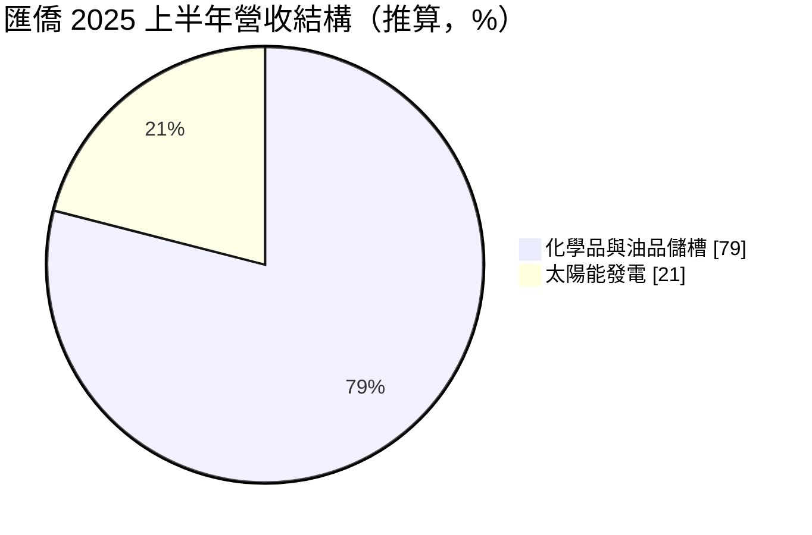
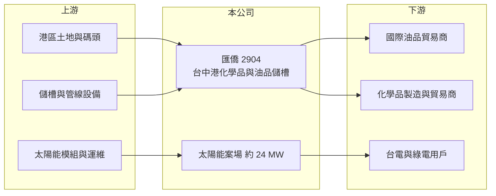

# 2904 匯僑

> 上市｜[[產業索引-其他業|其他業]]｜上市（櫃）日期 1983/01/05

# 第一章：企業模式與商業藍圖

> [!info] 撰寫說明
> 精簡版，由 Claude 依公開資料整理，架構比照 [[2330台積電]] 的四章研究，資料截至 2026-10-08。來源：證交所開放資料快照（基本資料、2026 年上半年綜合損益與資產負債、股利、每月營收）、Goodinfo 經營績效頁（2019 至 2025 年）、富果研究匯僑 2025 年 8 月法說會筆記（儲槽規模、太陽能案場、營收結構）。有息負債未查得，ROIC 與 WACC 為推算。#待校對

匯僑（股票代號：2904）是一家以台中港化學品與油品儲槽出租為核心、並以太陽能發電作為第二支柱的收租型公司。本章說明儲槽業務為什麼像基礎設施，以及匯僑如何用太陽能分散收入來源。

- **核心業務：** 匯僑成立於 1978 年，1983 年上市，總部位於台北市民生東路。核心是[[儲槽]]事業：在台中港西 2 與西 5 碼頭擁有 2 座儲槽區、約 11 公頃土地、51 座儲槽，總容量約 30 萬公秉，年吞吐量超過 300 萬公噸。服務包括船舶裝卸、儲槽管理、管線輸送、槽車裝載與桶裝充填，客戶是國際油品貿易商與國內外化學品製造商、貿易商。
- **營收結構：** 依 2025 年 8 月法說會資料，2025 年上半年儲槽事業營收約 2.01 億元，能源事業約 0.52 億元，儲槽約占八成、能源約占兩成（推算）。

- **第二支柱：太陽能：** 截至 2025 年法說會，匯僑擁有 52 個[[太陽光電]]案場、總裝置容量約 24.31 MW，其中國內 51 場約 19.11 MW（以中南部為主），柬埔寨 1 場約 5.2 MW。案場由子公司持有、委外運維，售電收入穩定，但柬埔寨案場曾在 2024 年 11 月遭竊而減少發電。
- **長期方向：** 儲槽事業的成長取決於油品市場與出租率，公司沒有明確擴建計畫；能源事業則以收購 5 MW 以下的國內既有案場、透過[[綠電轉供]]平台售電為方向，並決定不再擴大東南亞布局。整體定位是穩健收租、穩定配息。

# 第二章：護城河深度與競爭優勢

匯僑的護城河來自港區儲槽的稀缺性，這是一種「地點型」的護城河。

- **競爭優勢：** 港區儲槽需要港務用地、環評、消防與工安許可，加上碼頭與管線設施，新進者很難在同一港區取得同樣的條件。化學品業者一旦把儲運流程建立在某個儲槽區，更換的成本與風險都不低，這讓既有業者能維持穩定的出租率與租金。
- **主要對手：** 台中港與其他港區的化學品及油品儲運業者，以及石化集團的自有儲槽。具體上市同業本次未查得；大型石化廠如 [[6505台塑化]] 擁有自有港區與儲運系統，是潛在的替代選擇。
- **守得住與守不住：** 港區位置與既有客戶關係相對守得住；守不住的是需求總量，油品與化學品進出口量隨石化景氣起伏，出租率下降時營收會跟著減少，2026 年月營收就持續年減約一到兩成。
- **觀察重點：** 長期可以追蹤儲槽出租率、太陽能案場規模是否持續擴大，以及能源轉型對油品儲存需求的長期影響。

# 第三章：財務體質與盈利規模

資料日期：2026-10-08，表格是撰寫當時的快照；最新月營收、毛利率、累計 EPS 由自動排程寫在本筆記的屬性欄位（月營收、毛利率、累計EPS 等）。#待校對

財務數字顯示，匯僑是一家規模小、負債低、利潤率會隨出租率變動的收租型公司。

| 年度 | 營收（億元） | [[毛利率]] | [[營業利益率]] | EPS（元） | [[ROE]] |
|---|---|---|---|---|---|
| 2019 | 5.05 | 46.2% | 32.6% | 1.96 | 13.6% |
| 2020 | 5.41 | 47.1% | 33.6% | 2.31 | 15.6% |
| 2021 | 4.66 | 33.3% | 19.0% | 1.03 | 7.14% |
| 2022 | 4.76 | 35.8% | 21.4% | 1.50 | 9.95% |
| 2023 | 4.42 | 28.8% | 14.0% | 0.84 | 5.44% |
| 2024 | 4.92 | 36.6% | 22.9% | 1.38 | 8.58% |
| 2025 | 4.74 | 31.3% | 16.3% | 0.98 | 5.95% |

（來源：Goodinfo 經營績效頁，合併報表。2026 年上半年依證交所資料，營收 2.08 億元、毛利率 25.12%、營業利益率 4.17%、EPS 0.14 元。）

- **固定成本型的利潤結構：** 儲槽的折舊、港區租金與人員多為固定成本，出租率變動會放大到利潤上。2019 至 2020 年營業利益率超過 30%，之後降到 14% 至 23%，2026 年上半年營收年減後更降到約 4%，典型的[[營運槓桿]]效果。
- **長期指標：** 2021 至 2025 年平均 ROE 約 7.4%（推算），2020 至 2025 年營收年複合成長率約 -2.6%（推算）。2025 年度配發現金股利 0.7 元，對照 EPS 0.98 元，配息率約 71%（推算）；2024 年度配發 1 元，配息政策穩定但金額跟著獲利調整。
- **資產負債表：** 2026 年第二季資產總計約 17.26 億元，其中非流動資產約 15.0 億元（儲槽與太陽能設備）；負債約 4.73 億元，負債比約 27%；權益總計約 12.53 億元，每股淨值 16.09 元。資產以長期設施為主，財務結構保守。
- **[[ROIC]] 與 [[WACC]]：** 以 2025 年營收 4.74 億元乘營業利益率 16.3%，營業利益約 0.77 億元，稅後約 0.62 億元；投入資本以 2026 年第二季權益 12.53 億元加上有息負債推估約 3 億元（未查得，以非流動負債推估，含太陽能融資與租賃負債），合計約 15.5 億元，ROIC 約 4.0%（推算）。WACC 以 [[CAPM]] 估算：無風險利率 1.75%、市場風險溢酬 6%、β 假設 0.6（收租型基礎設施常見值，未查得實際數字），權益成本約 5.4%；稅後負債成本 2.0%，權益與負債約 81：19，WACC 約 4.7%（推算）。ROIC 與 WACC 大致相當、略低，代表匯僑近年只是勉強賺回資金成本；2019 至 2020 年營業利益約 1.7 至 1.8 億元時，ROIC 推估接近 9%，明顯高於資金成本，出租率是決定價值創造的關鍵。

# 第四章：總體風險與地緣政治

匯僑的風險在於石化景氣、能源轉型與工安。

- **產業週期：** 化學品與油品的進出口量隨石化景氣、油價與兩岸貿易波動，影響儲槽出租率。公司在法說會中也表示，儲槽事業的成長取決於油品市場、地緣政治與兩岸關係等外部條件。
- **能源轉型：** 長期而言，電動車普及與減碳政策可能降低油品需求，進而減少儲存需求；但化學品儲運需求與石化產業的連動更高，影響程度需要長期觀察。太陽能事業是匯僑對沖這個風險的方式。
- **工安與環保：** 儲槽存放易燃與有害液體，一旦發生洩漏或火災，可能造成重大損失與營運中斷，維護與安全管理成本也會隨法規趨嚴而上升。
- **其他風險：** 港區土地多為向港務公司承租，租約條件與港區規劃變動會影響營運；部分儲槽收入以美元計價，新台幣升值會減少認列營收；海外太陽能案場面臨當地政策與治安風險。

# 專有名詞解析

## 金融

- **[[營運槓桿]]**：固定費用占比高時，營收小幅變動就會造成營業利益大幅變動的現象。
- **[[ROIC]]**：投入資本報酬率，稅後營業利益除以股東權益加有息負債，衡量本業運用資本的效率。
- **[[WACC]]**：加權平均資金成本，依股東權益與負債的比重，加權計算公司取得資金的平均成本。

## 產業

- **[[儲槽]]**：存放液體化學品或油品的大型槽體，多設於港區，以出租容量收取租金。
- **[[太陽光電]]**：利用太陽能電池將陽光轉成電力，可售電給台電或企業用戶取得穩定收入。
- **[[綠電轉供]]**：再生能源發電業者透過電網把電力賣給企業用戶，用於企業的減碳與綠電目標。

# 核心供應鏈

- 上游：台中港港區土地與碼頭、儲槽與管線設備、太陽能模組與委外運維廠商
- 下游／客戶：國際油品貿易商、國內外化學品製造商與貿易商、台電與綠電轉供用戶
- 同業：港區化學品與油品儲運業者（本次未查得上市同業），石化集團自有儲運如 [[6505台塑化]]

## 最新新聞
<!-- news:start（自動產生，請勿手動編輯此範圍） -->
- 2026-10-20 🏛️ 重訊 15:10｜本公司內部稽核主管異動｜[觀測站](https://mops.twse.com.tw/mops/#/web/t05st01)
- 2026-10-20 🏛️ 重訊 15:09｜公告本公司新任會計主管｜[觀測站](https://mops.twse.com.tw/mops/#/web/t05st01)
- 2026-10-12 🏛️ 重訊 17:07｜公告本公司會計主管異動｜[觀測站](https://mops.twse.com.tw/mops/#/web/t05st01)

完整紀錄：[[2904匯僑 新聞]]
<!-- news:end -->

## 相關連結
- [公開資訊觀測站](https://mopsov.twse.com.tw/mops/web/t05st03?step=1&firstin=1&co_id=2904)
- [Goodinfo](https://goodinfo.tw/tw/StockDetail.asp?STOCK_ID=2904)
- [Yahoo 股市](https://tw.stock.yahoo.com/quote/2904)
- [鉅亨網新聞](https://www.cnyes.com/twstock/2904/news)
