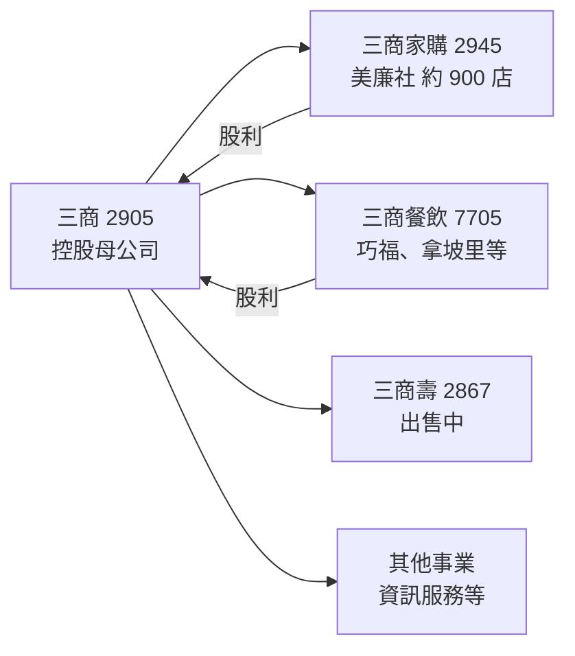
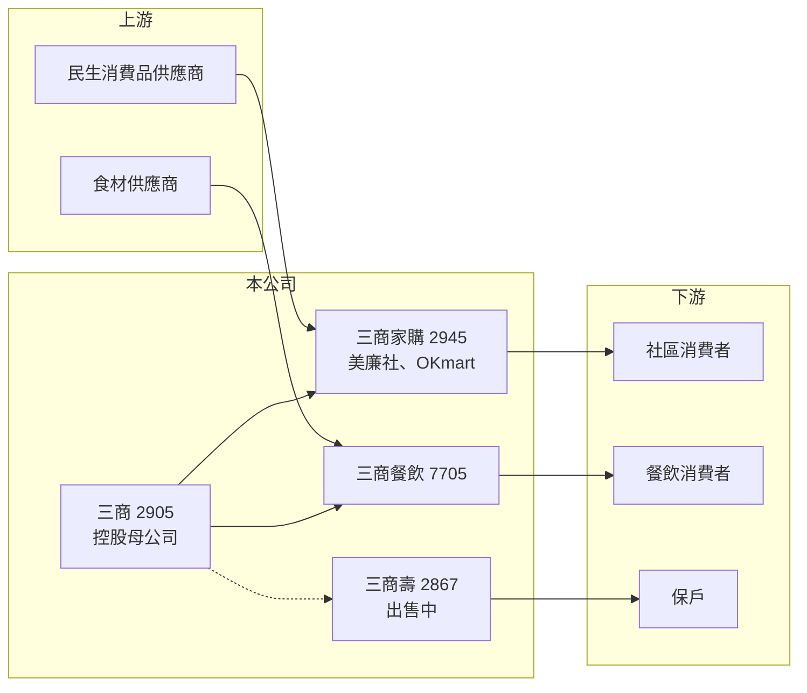

# 2905 三商

> 上市｜[[產業索引-貿易百貨業|貿易百貨業]]｜上市（櫃）日期 1988/09/19

# 第一章：企業模式與商業藍圖

> [!info] 撰寫說明
> 精簡版，由 Claude 依公開資料整理，架構比照 [[2330台積電]] 的四章研究，資料截至 2026-10-08。來源：Goodinfo 年度經營績效頁、工商時報 2026 年 3 月報導、證交所開放資料（基本資料、股利、每月營收、本益比殖利率）。三商合併報表包含壽險子公司，不在證交所「一般業」財報資料中，資產負債數字未查得；三商壽出售交易的對象、價格與完成日期未查得；集團其他事業（如資訊服務）憑記憶整理，已標示待校對。#待校對

三商（三商行）是三商集團的控股母公司，旗下有美廉社（三商家購）、三商餐飲，以及長年虧損、已決定出售的三商美邦人壽。本章說明它的事業組成，以及出售壽險後的結構轉變。

## 一、核心定位：民生消費與壽險的控股集團

三商成立於 1965 年，1988 年上市，董事長兼總經理為陳翔立，實收資本額約 111.0 億元（證交所開放資料）。三商本身是[[控股公司]]，獲利主要來自子公司：

* **[[2945三商家購]]（美廉社）：** 社區型平價超市，2025 年營收約 148 億元、稅後淨利約 1.4 億元，美廉社預計 2026 年達到 900 家門市；收購來來超商（OKmart）一案已獲公平會核准（工商時報）。
* **[[7705三商餐飲]]：** 經營三商巧福、拿坡里披薩等連鎖餐飲，2025 年營收約 65.3 億元、稅後淨利約 1.27 億元（工商時報）。
* **[[2867三商壽]]（三商美邦人壽）：** 長期虧損的壽險子公司，工商時報 2026 年 3 月報導指出三商已在 2025 年決定出售（交易細節未查得）。
* **其他：** 集團另有資訊服務等事業（例如三商電腦，待校對）。

## 二、商業模式：控股公司的資本配置

控股公司的價值取決於兩件事：子公司能否穩定賺錢並上繳股利，以及母公司如何把資金重新分配到報酬較高的事業。過去三商的合併報表被三商壽主導，2019 年合併營收達 2,267 億元，絕大部分是保費收入（Goodinfo），壽險的[[利差損]]與資本需求讓三商的獲利大起大落。出售三商壽後，三商將回到以民生零售與餐飲為主的集團結構。

## 三、長期方向

出售壽險之後，三商的長期方向是集中發展美廉社與連鎖餐飲：美廉社持續展店並透過收購 OKmart 擴大便利商店據點，三商餐飲則維持多品牌展店。這兩個事業規模雖然遠小於壽險，但現金流穩定、資本需求低，對控股公司來說是較可預測的獲利來源。

# 第二章：護城河深度與競爭優勢

控股公司的護城河來自旗下事業。本章分析三商主要子公司的競爭位置。

## 一、競爭優勢

* **[[社區型超市]]的密度：** 美廉社以小坪數、社區型門市為主，門市數接近 900 家，在巷弄與住宅區的據點密度，是大型量販店難以複製的便利性。
* **餐飲品牌的認知度：** 三商巧福等品牌經營數十年，在平價日常餐市場有穩定的熟客。
* **集團協同：** 三商餐飲的冷凍調理包在美廉社獨家販售，零售與餐飲之間可以共享採購與通路資源。

## 二、主要競爭對手

| 對手 | 定位 | 對三商的威脅 |
|---|---|---|
| 全聯 | 台灣最大超市 | 與美廉社在社區超市市場正面競爭，規模更大 |
| [[2912統一超]]、[[5903全家]] | 便利商店 | 與美廉社、OKmart 爭奪社區即時消費 |
| [[2753八方雲集]]、[[2727王品]] | 連鎖餐飲 | 與三商餐飲在平價餐飲市場競爭 |

## 三、守得住與守不住

* **守得住：** 美廉社的社區據點網絡與三商餐飲的老品牌客群。
* **守不住：** 合併層級的獲利穩定度。在三商壽出售完成前，壽險的損益與處分影響仍會讓三商的 EPS 大幅波動。
* **觀察重點：** 三商壽出售的完成與處分損益、OKmart 收購後的整合效益，以及母公司是否恢復以盈餘配發股利。

# 第三章：財務體質與盈利規模

資料日期：2026-10-08，表格是撰寫當時的快照；最新月營收、毛利率、累計 EPS 由自動排程寫在本筆記的屬性欄位（月營收、毛利率、累計EPS 等）。#待校對

本章用多年度數據檢視三商在壽險主導下的獲利波動，並說明出售壽險後的財務意義。

## 一、多年度三率與 ROE

| 年度 | 營收（新台幣） | [[毛利率]] | [[營業利益率]] | EPS（元） | [[ROE]] |
|---|---|---|---|---|---|
| 2019 | 2,267 億 | 17.3% | 11.8% | 4.42 | 21.2% |
| 2020 | 2,051 億 | 17.2% | 11.1% | 1.63 | 6.32% |
| 2021 | 1,844 億 | 13.7% | 6.72% | 2.19 | 5.56% |
| 2022 | 1,495 億 | -39.3% | -48.1% | -5.82 | -31.9% |
| 2023 | 1,600 億 | 4.26% | -4.27% | -3.09 | -21.3% |
| 2024 | 1,634 億 | -13.5% | -22.4% | 1.42 | 7.14% |
| 2025 | 1,800 億 | 35.5% | 27.1% | 0.71 | 3.68% |

註：取自 Goodinfo。數字包含三商壽的保費收入與損益，三率反映的是壽險會計而非零售本業，跨年比較的意義有限。2026 年財報不在證交所一般業資料中，未查得。

* **壽險主導的劇烈波動：** 2022 年 EPS 為 -5.82 元、ROE -31.9%，主要反映壽險子公司在升息與金融市場下跌時的投資損失（推估）。2021 至 2025 年平均 ROE 約 -7.4%（推算）。
* **2025 年獲利：** 稅後淨利約 7.55 億元、EPS 0.71 元，約為前一年的一半（工商時報、證交所股利資料）。
* **月營收不具比較性：** 2026 年起的合併月營收因三商壽出售的會計處理而大幅波動，年增率與實際營運規模對不上，比較基礎未查得。

## 二、股利與財務結構

2025 年度每股配發 0.30 元，來源是[[資本公積]]而非盈餘（證交所股利資料），顯示母公司的可分配盈餘仍受過去壽險虧損影響。股價淨值比約 0.42 倍（證交所本益比殖利率），市場對控股公司的帳面淨值給予大幅折價，反映對壽險資產價值與處分結果的疑慮（推估）。合併資產負債表包含壽險資產，有息負債與權益金額未查得。

## 三、[[ROIC]] 與 [[WACC]]

**ROIC：** 合併報表包含壽險的保單負債與投資資產，傳統「稅後營業利益 ÷（權益＋有息負債）」的算法不適用，因此不推算合併 ROIC。若只看未來的核心事業：三商家購 2025 年稅後淨利約 1.4 億元、三商餐飲約 1.27 億元，兩者合計約 2.7 億元，相對於三商約 111 億元的股本規模，報酬率明顯偏低（推算）。

**WACC 推算：** 台灣 10 年期公債 1.75%、市場風險溢酬 6%、β 取控股與零售同業常見值 0.8，權益成本約 6.6%；有息負債比重未查得，WACC 推估約 5% 至 6.5%（推算）。

**結論：** 過去十年，三商的資本長期被壽險占用，ROE 多數年度低於資金成本，未能為股東創造價值。出售三商壽之後，若處分所得能用於降低負債、發展零售與餐飲或回饋股東，資本效率才有改善的空間；否則以目前零售與餐飲的獲利規模，仍不足以支撐控股公司的帳面淨值。

# 第四章：總體風險與地緣政治

本章整理三商長期面對的轉型、零售競爭與治理風險。

## 一、轉型風險

* **壽險處分：** 三商壽出售的價格、時程與交割條件，會決定三商一次性處分損益與未來淨值，交易若生變，壽險虧損與增資壓力可能延續。
* **事業規模縮小：** 出售壽險後營收規模將大幅縮小，控股公司需要證明零售與餐飲事業能撐起集團的價值。

## 二、零售與餐飲競爭

* **超市與便利商店競爭：** 全聯、統一超、全家都在持續展店，美廉社與 OKmart 的整合若不順利，可能拖累獲利。
* **成本上升：** 薪資、租金與食材成本上漲，壓縮零售與餐飲的薄利。

## 三、其他風險

* **家族治理與資本配置：** 三商集團由陳家經營，子公司之間的資金往來與交叉持股，影響小股東權益與資本配置透明度。
* **利率與金融市場：** 在壽險出售完成前，利率與股債市場的波動仍會透過壽險子公司影響合併損益。

# 專有名詞解析

## 金融

- **[[資本公積]]**：公司發行股票溢價等非營業來源累積的權益，可依法發放現金，但不代表當年度有盈餘。
- **[[利差損]]**：壽險公司過去賣出的保單保證利率高於現在的投資報酬率，造成長期虧損的現象。
- **[[ROIC]]**：投入資本報酬率，衡量企業用股東與債權人投入的資本，每年能產生多少稅後營業利益。
- **[[WACC]]**：加權平均資金成本，股東要求報酬與負債利息依資本結構加權後的平均值，是判斷是否創造價值的門檻。

## 產業

- **[[控股公司]]**：主要業務是持有其他公司股權、透過子公司經營事業的公司，獲利多來自子公司的股利與投資收益。
- **[[社區型超市]]**：開在住宅區巷弄、坪數較小的超市，強調便利與日常必需品，介於便利商店與大型超市之間。

# 核心供應鏈

- 上游：民生消費品與食品供應商（供應美廉社）、肉品與麵粉等食材供應商（供應三商餐飲）。
- 下游／客戶：社區型超市與便利商店消費者、連鎖餐飲消費者、三商壽保戶。
- 集團子公司：[[2945三商家購]]、[[7705三商餐飲]]、[[2867三商壽]]。
- 同業：全聯、[[2912統一超]]、[[5903全家]]、[[2753八方雲集]]、[[2727王品]]。

## 最新新聞
<!-- news:start -->
<!-- news:end -->

## 相關連結
- [公開資訊觀測站](https://mopsov.twse.com.tw/mops/web/t05st03?step=1&firstin=1&co_id=2905)
- [Goodinfo](https://goodinfo.tw/tw/StockDetail.asp?STOCK_ID=2905)
- [Yahoo 股市](https://tw.stock.yahoo.com/quote/2905)
- [鉅亨網新聞](https://www.cnyes.com/twstock/2905/news)
