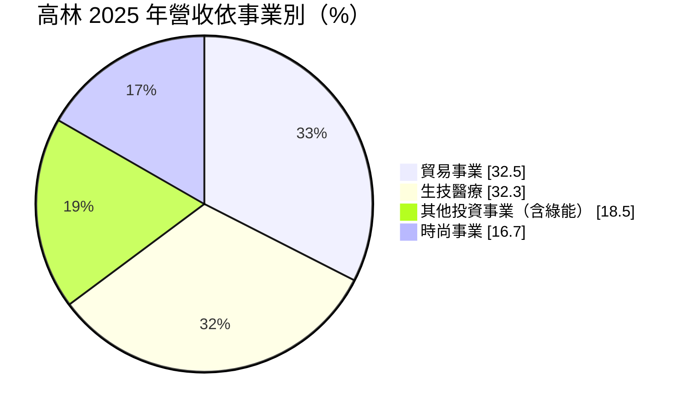
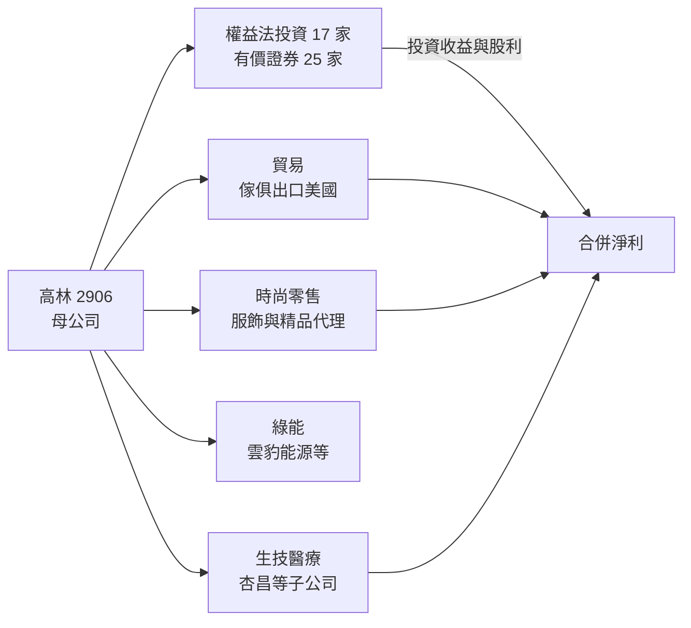
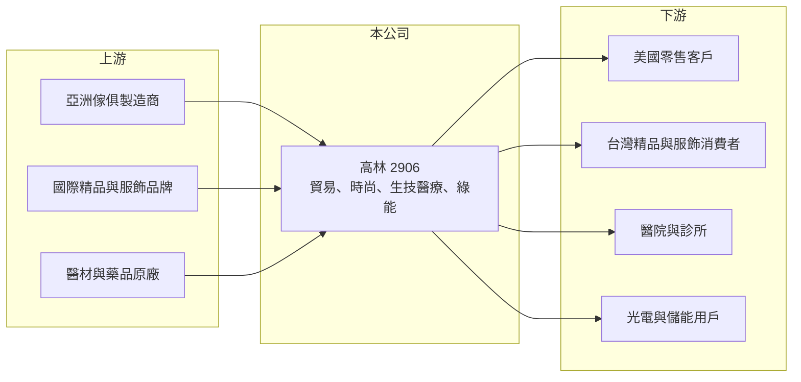

# 2906 高林

> 上市｜[[產業索引-貿易百貨業|貿易百貨業]]｜上市（櫃）日期 1989/12/26

# 第一章：企業模式與商業藍圖

> [!info] 撰寫說明
> 精簡版，由 Claude 依公開資料整理，架構比照 [[2330台積電]] 的四章研究，資料截至 2026-10-08。來源：Goodinfo 年度經營績效頁、富果研究 2026 年 3 月法說會整理、證交所開放資料（基本資料、2026 年第二季資產負債與綜合損益、營益分析、股利、每月營收）。各子公司持股比例與有息負債未查得。#待校對

高林實業是一家[[多角化經營]]的集團，從出口貿易起家，逐步擴展到時尚[[品牌代理]]、生技醫療與綠能投資。本章說明它的四大事業與經營策略。

## 一、核心定位：以貿易起家的多品牌、多事業集團

高林成立於 1969 年，1989 年上市，董事長為李忠良、總經理為李界羲，實收資本額約 20.9 億元（證交所開放資料）。依富果研究整理的 2026 年 3 月法說會，2025 年營收比重如下：

* **貿易事業：** 出口室內外傢俱等產品，主要客戶在美國，海外據點包括美國、深圳與香港。美國約占集團營收兩成。
* **生技醫療：** 透過 [[1788杏昌]]、麗彤生醫、君綺生醫、高昌生醫、臺寶生醫、三和健康等子公司，經營醫材代理、醫藥物流與健康相關事業。
* **時尚事業：** 代理 G2000 與日本 BAYCREW'S 旗下 JOURNAL STANDARD 等服飾品牌，並透過美之心國際代理 DELVAUX、BALLY、RIMOWA、CHRISTIAN LOUBOUTIN 等精品，2026 年引進法式甜點 Ladurée；另經營 FLIPPER'S 舒芙蕾鬆餅等餐飲品牌。
* **綠能與其他投資：** 投資 [[6869雲豹能源]]、羽光能源、高明能源，布局屋頂型光電、儲能與充電。

## 二、商業模式：多角化分散風險，積極參與轉投資

高林的策略是多品牌、多角化，用不同景氣循環的事業互相平衡：貿易看美國消費、時尚看台灣精品與服飾需求、生技醫療看健保與醫院採購、綠能看政策與電價。公司在多數轉投資公司取得董事席次，屬於積極參與經營的投資人；帳上[[權益法]]投資 17 家、帳面約 20.5 億元，另有 25 家有價證券投資、公允價值約 10.8 億元（富果研究）。

## 三、長期方向

公司表示將強化貿易供應鏈、擴張時尚零售與餐飲通路，並深化生技健康（醫藥物流、智慧醫療、長照）與綠能布局，策略性投資聚焦民生消費、零售與 AI（富果研究）。另參與台北台塑大樓都市更新案，該案於 2026 年 1 月取得候選綠建築證書，屬於長期的不動產開發布局（參與方式與權益比例未查得）。

# 第二章：護城河深度與競爭優勢

多角化集團的護城河通常分散在各個事業之中。本章分析高林各事業的競爭位置。

## 一、競爭優勢

* **精品代理權：** DELVAUX、RIMOWA、CHRISTIAN LOUBOUTIN 等國際精品的台灣代理權，取決於與品牌方的長期合作關係，新進者不易取得。代理權穩定時，可以享有品牌溢價。
* **貿易客戶關係：** 數十年的出口貿易經驗，讓公司在美國客戶與亞洲供應鏈之間扮演協調者，具備採購、品管與物流的整合能力。
* **醫藥通路：** 生技醫療子公司在醫院與醫材通路的長期經營，屬於需要法規許可與客戶信任的事業。

## 二、主要競爭對手

| 事業 | 主要對手 | 競爭重點 |
|---|---|---|
| 時尚與精品 | 各國際品牌台灣分公司、其他代理商 | 品牌直營化趨勢可能收回代理權 |
| 服飾零售 | 優衣庫、ZARA 等快時尚 | 價格與通路覆蓋 |
| 生技醫療通路 | [[4175杏一]] 等醫藥通路業者 | 醫院標案與醫材代理權 |
| 綠能 | 各屋頂型光電與儲能業者 | 取得屋頂資源與併網容量 |

## 三、守得住與守不住

* **守得住：** 長期合作的精品代理權、貿易客戶關係，以及多角化帶來的營收穩定性。
* **守不住：** 整體利潤率。營業利益率長期只有 3.6% 至 5.7%（Goodinfo），各事業都屬於薄利或中等利潤的業態。
* **觀察重點：** 生技醫療與綠能能否提高集團利潤率、精品代理權是否穩定，以及轉投資收益的貢獻。

# 第三章：財務體質與盈利規模

資料日期：2026-10-08，表格是撰寫當時的快照；最新月營收、毛利率、累計 EPS 由自動排程寫在本筆記的屬性欄位（月營收、毛利率、累計EPS 等）。#待校對

本章用多年度數據檢視高林的成長、利潤率與資本報酬，並說明轉投資與[[非控制權益]]對 ROE 的影響。

## 一、多年度三率與 ROE

| 年度 | 營收（新台幣） | [[毛利率]] | [[營業利益率]] | EPS（元） | [[ROE]] |
|---|---|---|---|---|---|
| 2019 | 72.2 億 | 24.6% | 3.62% | 0.30 | 3.52% |
| 2020 | 66.1 億 | 25.9% | 3.90% | 0.15 | 3.92% |
| 2021 | 82.5 億 | 23.3% | 4.06% | 0.43 | 5.45% |
| 2022 | 89.5 億 | 25.4% | 5.04% | 0.62 | 6.49% |
| 2023 | 80.0 億 | 29.8% | 5.69% | 0.57 | 5.63% |
| 2024 | 88.7 億 | 29.3% | 5.10% | 0.52 | 5.21% |
| 2025 | 88.8 億 | 29.5% | 3.95% | 0.47 | 4.60% |
| 2026 上半年 | 43.0 億 | 30.61% | 3.02% | 0.49 | 未查得 |

註：2019 至 2025 年取自 Goodinfo；2026 上半年取自證交所營益分析與綜合損益。

* **穩定成長、利潤率低：** 2019 至 2025 年營收年複合成長率約 3.5%（推算），毛利率從約 25% 提升到約 30%，反映高毛利的精品與生技事業比重上升。2026 年 1 至 8 月累計營收約 58.4 億元、年增約 2.5%（證交所每月營收）。
* **業外占比高：** 2026 年上半年營業利益約 1.30 億元，營業外收入約 1.57 億元（證交所綜合損益），轉投資收益已超過本業獲利。
* **ROE 偏低且穩定：** 2021 至 2025 年平均 ROE 約 5.5%（推算）。

## 二、非控制權益與轉投資對 ROE 的影響

2026 年第二季底總資產約 132.4 億元、總負債約 67.4 億元、權益約 65.0 億元，其中歸屬母公司約 34.1 億元、非控制權益約 30.9 億元（證交所資產負債）。非控制權益接近一半，代表許多子公司並非全資持有，子公司的獲利有相當比例屬於其他股東：2026 年上半年合併淨利約 2.10 億元中，歸屬母公司只有約 1.02 億元。再加上約 31 億元的權益法與有價證券投資，母公司股東的資本有很大一部分放在報酬率不高的轉投資上，這是 ROE 長期停留在 5% 左右的主要原因。

2025 年度每股配發現金股利 0.60 元，高於當年 EPS 0.47 元，配發率約 128%（證交所股利資料，推算），代表部分股利來自以前年度的保留盈餘。

## 三、[[ROIC]] 與 [[WACC]]

**ROIC 推算：** 2025 年營業利益約 88.8 億 × 3.95% ≈ 3.51 億元，以 20% 稅率計算稅後約 2.81 億元。有息負債未查得，以權益約 65 億元加上推估的有息負債約 30 億元、合計約 95 億元作為投入資本，ROIC 約 3%；若扣除約 31 億元的轉投資資產，本業 ROIC 約 4.4%（推算）。

**WACC 推算：** 台灣 10 年期公債 1.75%、市場風險溢酬 6%、β 取多角化貿易零售同業常見值 0.7，權益成本約 6%；負債成本約 2.5%、稅後約 2%，以權益 70%、負債 30% 加權，WACC 約 4.8%（推算）。

**結論：** 高林的 ROIC 略低於 WACC，代表多角化擴張雖然帶來營收成長與穩定性，但尚未轉化為超額報酬。長期能否創造價值，取決於生技醫療、精品與綠能等較高利潤事業的比重能否持續提高，以及轉投資組合的報酬率。

# 第四章：總體風險與地緣政治

本章整理高林長期面對的貿易、代理權與投資風險。

## 一、外部環境

* **美國關稅與消費：** 貿易事業以美國客戶為主，美國關稅政策與消費景氣變化，會直接影響出口訂單；匯率波動也會影響毛利。
* **台灣精品與服飾消費：** 時尚事業受國內消費景氣、出國旅遊與跨境購物影響。

## 二、營運風險

* **代理權收回：** 國際精品品牌有直營化的趨勢，代理合約到期時可能被收回，影響時尚事業的營收。
* **多角化管理：** 事業橫跨貿易、時尚、醫療、綠能與不動產，管理資源分散，各事業的經營品質不易兼顧。

## 三、其他風險

* **轉投資價值波動：** 權益法與有價證券投資金額大，被投資公司獲利與股價的波動會影響淨利與淨值。
* **綠能與醫療法規：** 綠能電價、併網政策與健保給付、醫材法規的變化，會影響相關事業的長期報酬。
* **都更開發：** 都市更新案的時程與成本存在不確定性。

# 專有名詞解析

## 金融

- **[[非控制權益]]**：子公司中不屬於母公司持有的股權部分，其對應的淨利不計入母公司股東的 EPS。
- **[[權益法]]**：持有被投資公司 20% 至 50% 股權、具重大影響力時，依持股比例認列對方損益為投資收益的會計方法。
- **[[ROIC]]**：投入資本報酬率，衡量企業用股東與債權人投入的資本，每年能產生多少稅後營業利益。
- **[[WACC]]**：加權平均資金成本，股東要求報酬與負債利息依資本結構加權後的平均值，是判斷是否創造價值的門檻。

## 產業

- **[[品牌代理]]**：企業向國外品牌取得特定地區的銷售與經營權，負責進貨、開店與行銷，品牌直營化時可能被收回。
- **[[多角化經營]]**：企業同時經營多個不同產業的事業，以分散單一產業景氣循環的風險。

# 核心供應鏈

- 上游：亞洲傢俱製造商、國際精品與服飾品牌（DELVAUX、BALLY、RIMOWA、G2000 等）、醫材與藥品原廠。
- 下游／客戶：美國零售客戶、台灣精品與服飾消費者、醫院與診所、屋頂型光電與儲能用戶。
- 主要子公司與轉投資：[[1788杏昌]]、[[6869雲豹能源]]。
- 同業與比較對象：[[4175杏一]]（醫藥通路）、[[2903遠百]]（百貨零售業比較）。

## 最新新聞
<!-- news:start -->
<!-- news:end -->

## 相關連結
- [公開資訊觀測站](https://mopsov.twse.com.tw/mops/web/t05st03?step=1&firstin=1&co_id=2906)
- [Goodinfo](https://goodinfo.tw/tw/StockDetail.asp?STOCK_ID=2906)
- [Yahoo 股市](https://tw.stock.yahoo.com/quote/2906)
- [鉅亨網新聞](https://www.cnyes.com/twstock/2906/news)
