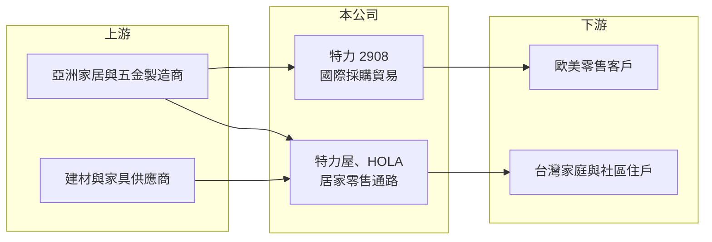

# 2908 特力

> 上市｜[[產業索引-貿易百貨業|貿易百貨業]]｜上市（櫃）日期 1993/02/18

# 第一章：企業模式與商業藍圖

> [!info] 撰寫說明
> 精簡版，由 Claude 依公開資料整理，架構比照 [[2330台積電]] 的四章研究，資料截至 2026-10-08。財務數字來源：Goodinfo 年度經營績效頁、科技新報 2026 年 9 月引述今周刊的特力屋專訪、證交所開放資料（基本資料、2026 年第二季資產負債與綜合損益、營益分析、股利）；集團沿革與事業分工有部分憑記憶整理，已標「待校對」。#待校對

特力（股票代號：2908）是一家同時經營「國際採購貿易」與「台灣居家零售通路」的集團，理解它的關鍵在於兩種商業模式的獲利邏輯完全不同，而集團正透過分割上市重新整理這兩塊事業。

## 一、核心定位：從貿易商走向居家零售集團

- **起家於國際採購貿易：** 特力成立於 1978 年，實收資本額約 51 億元，董事長為李麗秋。公司早年以替歐美零售商在亞洲採購家居、五金與家飾用品起家（待校對），這類貿易業務毛利率低、靠規模與供應商管理賺錢，景氣好壞直接反映在歐美零售商的下單量上。
- **轉入台灣居家零售：** 1990 年代中期，集團成立特力屋（1995 年成立），之後又發展和樂家居（HOLA）等家居品牌，把貿易時期累積的商品開發與採購能力，延伸到台灣消費者的居家修繕與佈置需求。零售業毛利率明顯高於貿易，但需要負擔門市租金與人事，屬於高固定成本的模式。
- **事業分割與特力屋上市：** 依科技新報 2026 年 9 月報導，集團在 2024 年決定分割零售事業，特力屋已於 2025 年 10 月登錄興櫃，預計 2026 年 10 月底轉上市。這代表特力未來將更像一家持有零售子公司股權的控股集團，母公司的價值有一部分要透過子公司的市值來衡量。

## 二、營收結構

公開資料未查得最新的貿易與零售營收比重，以下為定性說明：

- **零售（特力屋、HOLA 等）：** 經營居家修繕建材、五金工具、家具家飾與生活用品，門市以都會區大型店為主，近年轉向較小型的社區店與「社區管家」經營模式，主攻住宅大樓住戶的修繕與服務需求。
- **貿易：** 替海外零售客戶開發與採購家居相關商品，營收規模大但毛利薄，近年受美國關稅政策與客戶庫存調整影響較大（推估）。
- **營收規模變化：** 集團營收從 2021 年的 438 億元高點，降到 2025 年的 336 億元（Goodinfo），反映貿易業務縮減與房市降溫對居家零售的雙重影響。

## 三、零售通路的經營邏輯

- **實體店的價值重新定義：** 特力屋總裁何湯雄在 2024 年回任後，主張「電商做不到的事」才是實體店的出路，例如現場安裝、修繕諮詢與到府服務。居家修繕商品體積大、需要專業建議，電商較難完全取代，這是特力屋在電商衝擊下仍保有存在價值的原因。
- **門市與坪效：** 依科技新報引述，特力屋巔峰時期年營收曾超過百億元，但電商與房市冷凍使來客數下滑。公司以縮小店型、調整商品組合來提高[[坪效]]，門市數與坪效的具體數字本文未查得。
- **成果：** 特力屋 2025 年營收雖下滑，但 EPS 年增約四成至 2.39 元；2026 年上半年營收恢復成長，EPS 已達 3.06 元，超過 2025 年全年。

## 四、長期方向

特力的長期方向可以歸納為三點：一是零售事業獨立上市，讓特力屋自行籌資與擴張，母公司則持有股權；二是零售門市轉型為「服務型通路」，用安裝、修繕與社區經營建立電商無法提供的價值；三是貿易事業在關稅與供應鏈重組下調整客戶與產地布局（推估）。集團能否同時處理好兩種體質不同的事業，是長期觀察重點。

# 第二章：護城河深度與競爭優勢

特力的護城河主要來自零售端的通路與服務能力，貿易端的競爭優勢較薄。本章說明兩者的差異與主要對手。

## 一、護城河的組成

- **居家修繕的專業服務：** 修繕與安裝需要專業人員與在地服務網絡，消費者重視「買了有人裝、壞了有人修」。特力屋多年累積的服務體系與會員資料，是新進者與純電商短期內難以複製的優勢。
- **自有商品開發能力：** 貿易起家讓集團熟悉亞洲供應鏈，能開發[[自有品牌]]與獨家商品，在價格與毛利上比單純經銷國際品牌更有彈性。2026 年上半年集團毛利率升至 30.99%（證交所營益分析），高於過去五年約 22% 至 27% 的區間，部分反映產品組合改善（推估）。
- **品牌知名度：** 特力屋與 HOLA 在台灣居家通路經營近三十年，品牌辨識度高，但這種優勢在價格戰中保護力有限。

## 二、主要競爭對手

| 對手 | 定位 | 對特力的威脅 |
|---|---|---|
| IKEA | 平價家具與家飾 | 家具家飾品類直接競爭，品牌與設計力強 |
| 振宇五金等五金連鎖（[[2947振宇五金]]） | 五金與修繕工具 | 搶修繕工具與耗材客群 |
| 電商平台（[[8454富邦媒]]、[[8044網家]]、外資電商） | 線上家居與生活用品 | 以低價與便利搶走標準化商品 |
| 量販與生活百貨（[[5904寶雅]]等） | 生活雜貨 | 分食小型生活用品需求 |

## 三、守得住與守不住

- **守得住：** 需要安裝、諮詢與售後服務的修繕商品與工程服務，以及社區型的在地經營。
- **守不住：** 標準化、可比價的生活用品與家飾，容易被電商與平價品牌搶走；貿易業務則缺乏定價權，只能隨海外客戶下單量波動。
- **觀察重點：** 特力屋上市後的資本運用與展店節奏、集團毛利率能否維持在 30% 左右，以及貿易事業能否穩定獲利。

# 第三章：財務體質與盈利規模

資料日期：2026-10-08，表格是撰寫當時的快照；最新月營收、毛利率、累計 EPS 由自動排程寫在本筆記的屬性欄位（月營收、毛利率、累計EPS 等）。#待校對

財務數字顯示，特力是一家「營收大、利潤薄」的公司，獲利對費用控制與產品組合高度敏感。

## 一、多年度財務表

| 年度 | 營收（新台幣） | [[毛利率]] | [[營業利益率]] | EPS（元） | [[ROE]] |
|---|---|---|---|---|---|
| 2019 | 381 億 | 27.1% | 2.25% | 0.20 | 1.61% |
| 2020 | 418 億 | 25.5% | 2.75% | 1.60 | 12.2% |
| 2021 | 438 億 | 22.5% | 1.74% | 1.58 | 11.9% |
| 2022 | 374 億 | 24.3% | 0.53% | 0.86 | 6.43% |
| 2023 | 354 億 | 25.1% | 1.33% | 0.52 | 4.05% |
| 2024 | 368 億 | 25.7% | 1.70% | 0.66 | 約 4.7%（推算） |
| 2025 | 336 億 | 25.3% | 0.48% | 0.23 | 約 1.6%（推算） |
| 2026 上半年 | 178.8 億 | 30.99% | 2.81% | 1.02 | 未查得 |

註：2019 至 2025 年取自 Goodinfo；2024、2025 年 ROE 頁面數值與 EPS 不一致，改以 EPS 除以每股淨值約 14 元推算。2026 上半年取自證交所開放資料。

- **薄利結構：** 營業利益率長期在 0.5% 至 3% 之間，代表營收每波動 5%，就可能讓獲利大幅增減，屬於典型的高[[營運槓桿]]零售與貿易模式。
- **營收趨勢：** 2019 至 2025 年營收年複合成長率約 -2.1%（推算），2021 年疫情期間居家需求帶動高點後逐年回落。
- **2026 年的改善：** 上半年毛利率與營業利益率同步提升，反映特力屋轉型成效與產品組合改善，但能否延續仍需觀察全年數字。

## 二、ROE 與資本結構

2021 至 2025 年平均 ROE 約 5.7%（推算），從疫情高點一路下滑。2026 年第二季底總資產約 395.6 億元、總負債約 305.2 億元，負債比約 77%（證交所開放資料），其中相當比例是門市租約認列的[[租賃負債]]，這是零售業的共同特徵，會放大帳面槓桿。股利方面，2025 年度配發現金 0.55 元（含法定盈餘公積發放 0.22 元），高於當年 EPS，章程規定盈餘分配不低於可分配盈餘的 50%。

## 三、[[ROIC]] 與 [[WACC]]

**ROIC 推算：** 2025 年營業利益約 1.6 億元（336 億元 × 0.48%），扣除 20% 稅率後約 1.3 億元。投入資本以 2026 年第二季底權益總計約 90.4 億元，加上假設約一半負債為有息負債與租賃負債（約 150 億元，推估），合計約 240 億元，ROIC 約 0.5%（推算）。若以 2026 年上半年營業利益 5.03 億元年化，ROIC 約 3.3%（推算）。

**WACC 推算：** 台灣 10 年期公債殖利率假設 1.75%、市場風險溢酬 6%、β 取零售業常見值 0.7，股東權益成本約 5.95%；負債成本假設 2.5%，稅後 2.0%；權益約占 38%、負債約占 62%，WACC 約 3.5%（推算）。

**結論：** 2022 至 2025 年特力的 ROIC 明顯低於資金成本，代表這段期間並未替股東創造價值；2026 年上半年的改善若能持續，ROIC 才有機會接近或超過 WACC。特力屋分割上市後，母公司的報酬率會更多取決於持股價值與子公司的獲利分配。

# 第四章：總體風險與地緣政治

特力面臨的風險來自房市、消費習慣、國際貿易與集團結構四個方向。

## 一、產業週期

- **房市與居家修繕需求：** 居家修繕與家具需求和房屋交易量高度相關。央行[[信用管制]]或房市降溫時，新屋入住與裝修需求會減少，直接衝擊特力屋與 HOLA 的業績。
- **貿易訂單週期：** 海外零售客戶的庫存調整具有[[長鞭效應]]，終端需求小幅轉弱，就可能讓貿易訂單大幅減少。

## 二、營運風險

- **電商侵蝕：** 標準化的家居用品容易被電商比價，實體門市必須用服務與體驗維持來客，否則坪效會持續下滑。
- **高固定成本：** 門市租金與人事成本固定，營收下滑時獲利會被放大壓縮，2025 年營業利益率僅 0.48% 就是例子。
- **事業分割後的治理：** 特力屋上市後，母公司與子公司之間的利益分配、關係人交易與資源調度，都需要投資人留意。

## 三、其他風險

- **關稅與供應鏈：** 貿易業務與自有商品多在亞洲生產，美國關稅政策與匯率變動會影響海外客戶下單與進貨成本。
- **匯率：** 貿易以美元計價、零售以台幣銷售，新台幣升貶會同時影響兩邊的毛利。
- **少子化與住宅結構：** 長期而言，家戶數成長放緩與小坪數住宅增加，會改變居家用品的需求型態，門市需要持續調整商品組合。

# 專有名詞解析

## 金融

- **[[營運槓桿]]**：固定成本占比高的企業，營收小幅變動就會造成獲利大幅變動的現象。
- **[[租賃負債]]**：企業租用門市、廠房等資產，依會計準則把未來租金折現後認列在資產負債表上的負債。
- **[[信用管制]]**：中央銀行限制房貸成數、利率等措施，用來抑制房地產投機，會影響房屋交易與裝修需求。
- **[[長鞭效應]]**：終端需求的小幅變動，沿供應鏈往上游傳遞時被逐級放大，造成上游訂單劇烈波動。
- **[[ROIC]]**：投入資本報酬率，稅後營業利益除以股東權益與有息負債的合計，衡量本業對所有資金提供者的報酬。
- **[[WACC]]**：加權平均資金成本，依股東權益與負債的比重加權計算的資金成本，ROIC 高於它才代表創造價值。

## 產業

- **[[坪效]]**：每坪賣場面積每年創造的營收，衡量零售門市空間使用效率的指標。
- **[[自有品牌]]**：零售商自行開發、以自家品牌銷售的商品，毛利率通常高於代銷外部品牌。

# 核心供應鏈

## 1. 上游：商品供應
- 亞洲家居用品、五金工具、家具與建材製造商（多為未上市廠商）

## 2. 本公司：貿易與零售
- 國際採購貿易事業
- 特力屋（2026 年 10 月預計上市）、HOLA 和樂家居等零售品牌

## 3. 下游與同業
- 歐美零售客戶、台灣家庭與社區住戶
- 同業：IKEA、[[2947振宇五金]]、[[5904寶雅]]、[[8454富邦媒]]、[[8044網家]]

## 最新新聞
<!-- news:start（自動產生，請勿手動編輯此範圍） -->
- 2026-10-15 🏛️ 重訊 19:09｜本公司及子公司背書保證金額達 「公開發行公司資金貸與及背書保證處理準則」 第二十五條第一項第一款之公告｜[觀測站](https://mops.twse.com.tw/mops/#/web/t05st01)
- 2026-10-15 🏛️ 重訊 18:51｜本公司依「公開發行公司資金貸與及背書保證處理準則」 第二十五條第一項第二款、第三款及第四款規定公告｜[觀測站](https://mops.twse.com.tw/mops/#/web/t05st01)
- 2026-10-15 🏛️ 重訊 18:48｜公告本公司董事會決議通過辦理銀行聯合授信案｜[觀測站](https://mops.twse.com.tw/mops/#/web/t05st01)

完整紀錄：[[2908特力 新聞]]
<!-- news:end -->

## 相關連結
- [公開資訊觀測站](https://mopsov.twse.com.tw/mops/web/t05st03?step=1&firstin=1&co_id=2908)
- [Goodinfo](https://goodinfo.tw/tw/StockDetail.asp?STOCK_ID=2908)
- [Yahoo 股市](https://tw.stock.yahoo.com/quote/2908)
- [鉅亨網新聞](https://www.cnyes.com/twstock/2908/news)
