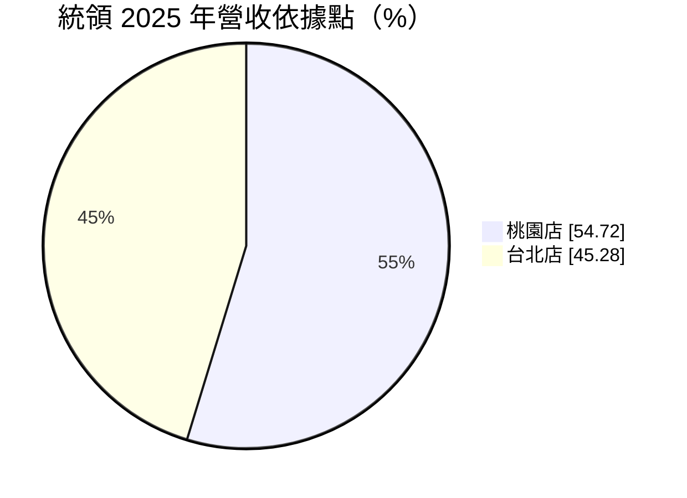
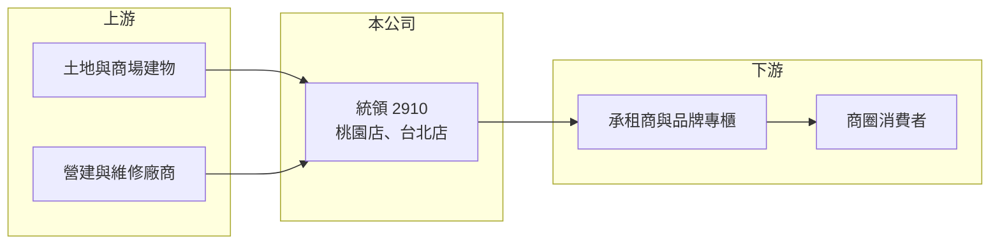

# 2910 統領

> 上市｜[[產業索引-貿易百貨業|貿易百貨業]]｜上市（櫃）日期 1996/12/30

# 第一章：企業模式與商業藍圖

> [!info] 撰寫說明
> 精簡版，由 Claude 依公開資料整理，架構比照 [[2330台積電]] 的四章研究，資料截至 2026-10-08。財務數字來源：Goodinfo 年度經營績效頁、MoneyDJ 個股基本資料（2025 年營收比重）、證交所開放資料（基本資料、2026 年第二季資產負債與綜合損益、營益分析、股利）。公開資料有限，經營模式轉變的細節為依財務數字推估。#待校對

統領（股票代號：2910）是一家規模很小、但資產集中的百貨不動產公司。理解它的關鍵，是看懂它如何從「自己經營百貨」逐步轉為「靠物業收取租金」，以及這個轉變如何改變它的獲利結構。

## 一、核心定位：兩棟商場的經營者

- **公司基本面：** 統領成立於 1982 年，1996 年上市，實收資本額約 17.5 億元，董事長為蘇建義、總經理為翁華利。公司營運據點只有兩個：桃園店與台北店，2025 年營收中桃園店占 54.72%、台北店占 45.28%（MoneyDJ）。
- **資產型公司：** 2026 年第二季底總資產約 68.1 億元，其中非流動資產約 57.7 億元（證交所開放資料），大部分應是商場土地與建物（推估）。換句話說，統領的價值主要來自這兩處都會區不動產，而不是百貨經營的品牌或通路。

## 二、經營模式的轉變：從百貨聯營到收租

- **毛利率透露的轉型：** 統領的[[毛利率]]從 2019 年的 50.2% 一路升到 2025 年的 88.2%，同期營收從 6.5 億元降到 5.18 億元（Goodinfo）。這種「營收下降、毛利率大升」的組合，通常代表收入來源由商品銷售或[[專櫃抽成]]轉向固定租金，因為租金收入幾乎沒有對應的銷貨成本（推估）。
- **為什麼重要：** 收租模式讓營收規模變小，但獲利更穩定、更像不動產公司。營業利益率從 2019 年的 16.5% 升到 2025 年的 53.8%，EPS 則從 0.64 元提高到 1.23 元，說明這個轉變對股東是有利的。
- **代價：** 收租模式把經營風險轉嫁給承租商，但也讓統領失去參與商場營業額成長的機會，未來的成長主要取決於租約續約與租金調整。

## 三、長期方向

統領屬於傳統百貨產業，公司在章程中自述「業績變動不大，預期將呈微幅成長之趨勢」，股利發放以穩定為原則。長期而言，統領的價值取決於兩件事：一是商場地段的租金行情能否隨都市發展上升，二是這兩處不動產未來是否有改建、合建或[[資產活化]]的機會（推估，本文未查得具體計畫）。

# 第二章：護城河深度與競爭優勢

統領的護城河不是經營能力，而是不動產本身的地段價值。本章說明這種資產型護城河的特性與限制。

## 一、護城河的組成

- **都會區地段：** 桃園店與台北店都位於都會區，土地供給有限，好的商場位置很難被複製。只要地段的人流與商業價值存在，就能持續吸引承租商。
- **低經營風險：** 改採收租模式後，統領不需要承擔百貨銷售的庫存、促銷與專櫃招商壓力，營業費用相對固定，2026 年上半年營業利益率達 54.76%（證交所營益分析）。
- **財務穩定：** 公司長期維持配息，2025 年度配發現金股利 1.04 元，章程規定股東股利不低於可分配盈餘的 10%，且以穩定為原則。

## 二、主要競爭對手

| 對手 | 定位 | 對統領的影響 |
|---|---|---|
| [[2903遠百]] | 大型百貨與購物中心集團 | 在桃園等地以大型購物中心吸走人潮 |
| 新光三越、SOGO 等百貨 | 都會區百貨 | 爭奪同一批消費者與品牌專櫃 |
| 新型購物中心與 Outlet | 大型商場 | 改變商圈重心，影響周邊舊商場的租金 |
| 電商 | 線上購物 | 降低實體百貨來客，間接影響承租商的承租意願 |

## 三、守得住與守不住

- **守得住：** 地段本身的價值，以及收租帶來的穩定現金流。
- **守不住：** 一旦周邊出現新的大型商場、商圈重心移動，舊商場的租金議價力會下降。
- **觀察重點：** 主要承租商的租約年限與續約情況、兩處不動產的公允價值變化，以及公司是否啟動改建或活化計畫。

# 第三章：財務體質與盈利規模

資料日期：2026-10-08，表格是撰寫當時的快照；最新月營收、毛利率、累計 EPS 由自動排程寫在本筆記的屬性欄位（月營收、毛利率、累計EPS 等）。#待校對

統領的財務數字呈現「營收萎縮、獲利率上升」的典型收租化軌跡。

## 一、多年度財務表

| 年度 | 營收（新台幣） | [[毛利率]] | [[營業利益率]] | EPS（元） | [[ROE]] |
|---|---|---|---|---|---|
| 2019 | 6.50 億 | 50.2% | 16.5% | 0.64 | 4.83% |
| 2020 | 5.54 億 | 65.7% | 29.2% | 0.65 | 4.82% |
| 2021 | 5.29 億 | 61.0% | 24.8% | 0.80 | 5.91% |
| 2022 | 7.12 億 | 49.4% | 23.1% | 0.55 | 4.03% |
| 2023 | 6.84 億 | 58.4% | 30.5% | 1.17 | 8.23% |
| 2024 | 6.06 億 | 71.1% | 39.1% | 1.13 | 7.45% |
| 2025 | 5.18 億 | 88.2% | 53.8% | 1.23 | 7.85% |
| 2026 上半年 | 2.80 億 | 86.46% | 54.76% | 1.02 | 未查得 |

註：2019 至 2025 年取自 Goodinfo；2026 上半年取自證交所開放資料。

- **獲利率持續提高：** 營業利益率從 16.5% 升到超過 50%，說明收入結構轉向租金後，每一元營收能留下的利潤大幅增加。
- **營收趨勢：** 2019 至 2025 年營收年複合成長率約 -3.7%（推算），但這是商業模式改變的結果，不代表經營惡化。
- **業外收益：** 2026 年上半年營業外收入約 0.51 億元，占稅前淨利約四分之一，內容本文未逐項查證。

## 二、ROE 與股利

2021 至 2025 年平均 ROE 約 6.7%（推算），以收租型公司而言屬於中等水準。2026 年第二季底權益約 27.7 億元，每股淨值約 15.78 元。2025 年度現金股利 1.04 元，以 EPS 1.23 元計算配發率約 85%（推算），顯示公司把大部分盈餘發還股東。

## 三、[[ROIC]] 與 [[WACC]]

**ROIC 推算：** 2025 年營業利益約 2.79 億元（5.18 億元 × 53.8%），稅後約 2.23 億元。2026 年第二季底權益 27.7 億元，非流動負債約 31.5 億元，假設其中約 30 億元為長期借款與類似有息負債（推估，可能包含租戶保證金），投入資本約 57.7 億元，ROIC 約 3.9%（推算）。

**WACC 推算：** 公債殖利率假設 1.75%、市場風險溢酬 6%、β 取資產型公司常見值 0.5，股東權益成本約 4.75%；負債成本假設 2.2%，稅後約 1.8%；權益約占 48%、負債約占 52%，WACC 約 3.2%（推算）。

**結論：** 統領的 ROIC 略高於資金成本，代表收租模式大致能創造小幅價值，但空間有限。對長期投資人而言，它比較像穩定配息的不動產股，價值的上檔主要來自地段增值與未來的資產活化，而不是本業成長。

# 第四章：總體風險與地緣政治

統領的風險集中在不動產與商圈變化，經營槓桿雖低，但資產過度集中。

## 一、產業週期

- **實體零售與商圈變化：** 百貨業長期面臨電商與新型購物中心的競爭，舊商場若無法更新，承租商可能流失，租金水準也會受壓。
- **消費景氣：** 承租商的營業額受景氣影響，景氣差時可能要求降租或提前解約。

## 二、營運風險

- **資產集中：** 全部營收來自兩處據點，任何一處失去主要承租商或發生重大事故，都會大幅影響營收。
- **建物老化：** 商場建物有使用年限，長期需要整修或改建，可能帶來資本支出與營運中斷。
- **租約集中：** 若主要承租商集中於少數業者，議價力會偏向承租方（推估，本文未查得承租商名單）。

## 三、其他風險

- **利率：** 公司帶有長期負債，利率上升會增加利息負擔，也會壓抑不動產評價。
- **法規與稅負：** 房地產相關稅制、都市計畫與建築法規的變動，會影響未來改建或活化的可行性。
- **股本小、流動性低：** 股本約 17.5 億元，市場交易量有限，股價容易受少量買賣影響。

# 專有名詞解析

## 金融

- **[[毛利率]]**：營業毛利占營收的比例，反映產品定價能力與成本控制。
- **[[營業利益率]]**：扣除營業費用後的營業利益占營收的比例，衡量本業整體獲利能力。
- **[[ROIC]]**：投入資本報酬率，稅後營業利益除以股東權益與有息負債的合計，衡量本業對所有資金提供者的報酬。
- **[[WACC]]**：加權平均資金成本，依股東權益與負債的比重加權計算的資金成本，ROIC 高於它才代表創造價值。

## 產業

- **[[專櫃抽成]]**：百貨公司向品牌專櫃收取營業額一定比例作為收入的聯營模式，收入隨營業額波動。
- **[[資產活化]]**：企業透過出租、改建、合建或出售閒置與低度利用的不動產，提高資產報酬的做法。

# 核心供應鏈

## 1. 上游：不動產與維護
- 自有商場土地與建物（推估）、營建與維修廠商

## 2. 本公司
- 統領：桃園店與台北店的商場經營與出租

## 3. 下游與同業
- 承租商、品牌專櫃與商圈消費者
- 同業：[[2903遠百]]、新光三越、SOGO

## 最新新聞
<!-- news:start -->
<!-- news:end -->

## 相關連結
- [公開資訊觀測站](https://mopsov.twse.com.tw/mops/web/t05st03?step=1&firstin=1&co_id=2910)
- [Goodinfo](https://goodinfo.tw/tw/StockDetail.asp?STOCK_ID=2910)
- [Yahoo 股市](https://tw.stock.yahoo.com/quote/2910)
- [鉅亨網新聞](https://www.cnyes.com/twstock/2910/news)
