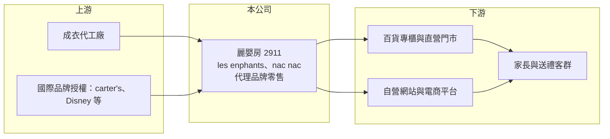

# 2911 麗嬰房

> 上市｜[[產業索引-貿易百貨業|貿易百貨業]]｜上市（櫃）日期 1997/01/18

# 第一章：企業模式與商業藍圖

> [!info] 撰寫說明
> 精簡版，由 Claude 依公開資料整理，架構比照 [[2330台積電]] 的四章研究，資料截至 2026-10-08。財務數字來源：Goodinfo 年度經營績效頁、富果研究 2025 年 12 月法說會整理、證交所開放資料（基本資料、2026 年第二季資產負債與綜合損益、營益分析、股利）。#待校對

麗嬰房（股票代號：2911）是台灣歷史最久的嬰幼童服飾品牌零售商之一。它的故事是一家老品牌在少子化與電商衝擊下長期虧損，最後靠出售中國子公司與資產重估修補資產負債表，並嘗試轉型的過程。

## 一、核心定位：多品牌的嬰幼童零售商

- **公司基本面：** 麗嬰房成立於 1973 年，1997 年上市，實收資本額約 10.5 億元，董事長為林柏蒼。公司以多品牌模式經營嬰幼童服飾與用品，自有品牌為 les enphants（麗嬰房）與 nac nac，代理品牌包括 carter's、OSHKOSH B'gosh、adidas KIDS、PUMA KIDS，另有 Disney Collection 授權商品（富果研究法說會整理）。
- **為什麼要多品牌：** 嬰幼童市場客群小、購買期短，單一品牌很難撐起全國通路。用[[自有品牌]]守住高毛利，再用國際代理品牌補足流行性與來客，是麗嬰房長期的經營策略。

## 二、通路結構與收縮

- **台灣為主：** 截至 2025 年 11 月底，台灣直營店櫃 167 家，以百貨專櫃與街邊門市為主；線上除了自營網站，也與第三方電商平台合作。
- **退出中國實體零售：** 中國原有 33 家據點，公司預計 2025 年底全數關閉，並出售上海麗嬰房，出售款項於 2025 年 12 月收訖。中國業務改採輕資產的電商模式，並探索品牌授權與[[加盟]]。
- **營收長期萎縮：** 營收從 2019 年的 50.5 億元降到 2025 年的 23.3 億元（Goodinfo），年複合成長率約 -12.1%（推算），反映少子化、電商分流與中國業務收縮的共同影響。

## 三、轉型藍圖

公司在 2025 年法說會提出五大事業體：台灣零售、大陸零售、物流（目標三年內成為集團第二大營收來源）、B2B 供應鏈服務，以及數據變現（零售媒體網路、會員管理服務，預計 2026 年起開發）。台灣零售的目標客群由 0 至 2 歲延伸到 0 至 12 歲，並引進新品牌。公司形容目標是成為市場的「最後存活者」，也就是在同業退出後取得更大的市占。這些新事業目前規模都還小，能否成功仍待觀察。

# 第二章：護城河深度與競爭優勢

麗嬰房的護城河在過去十年明顯變窄，剩下的優勢主要是品牌歷史與台灣通路。

## 一、護城河的組成

- **品牌信任：** 嬰幼兒用品的購買者重視安全與品質，五十年的老品牌在祖父母與父母兩代之間有一定的信任度，這是新品牌短期內難以建立的。
- **代理權組合：** 取得 carter's 等國際品牌的台灣代理，讓麗嬰房能在同一個通路提供多種價位與風格，但[[代理商]]的權利取決於品牌方續約，並非永久優勢。
- **百貨專櫃網絡：** 全台 167 個店櫃形成實體通路覆蓋，在同業逐漸退出後，可能接收部分市場（推估）。

## 二、主要競爭對手

| 對手 | 定位 | 對麗嬰房的威脅 |
|---|---|---|
| 國際快時尚童裝（UNIQLO、H&M 等） | 平價童裝 | 價格低、款式更新快，搶走一般童裝需求 |
| 電商平台與中國平價童裝 | 線上低價商品 | 以價格優勢分流標準化商品 |
| 運動品牌直營童裝 | 運動童裝 | 品牌方自建通路，降低對代理商的依賴 |
| 嬰幼兒用品連鎖與藥妝通路 | 嬰兒用品 | 分食奶瓶、尿布周邊等用品 |

## 三、守得住與守不住

- **守得住：** 重視品質與送禮需求的新生兒禮盒、高單價嬰兒服飾。
- **守不住：** 一般童裝與標準化用品，在價格上難與快時尚與電商競爭，2025 年毛利率降到 36.1%，低於過去約 41% 至 44% 的水準。
- **觀察重點：** 台灣零售能否止血、物流與 B2B 新事業能否帶來穩定收入，以及代理品牌的續約狀況。

# 第三章：財務體質與盈利規模

資料日期：2026-10-08，表格是撰寫當時的快照；最新月營收、毛利率、累計 EPS 由自動排程寫在本筆記的屬性欄位（月營收、毛利率、累計EPS 等）。#待校對

麗嬰房的財務數字呈現長期本業虧損，2025 年的獲利來自一次性的資產處分，不代表本業已經轉好。

## 一、多年度財務表

| 年度 | 營收（新台幣） | [[毛利率]] | [[營業利益率]] | EPS（元） | [[ROE]] |
|---|---|---|---|---|---|
| 2019 | 50.5 億 | 42.7% | -8.99% | -1.84 | -14.5% |
| 2020 | 40.3 億 | 44.2% | -8.09% | -1.72 | -13.3% |
| 2021 | 37.1 億 | 43.9% | -14.1% | -1.32 | -11.9% |
| 2022 | 33.4 億 | 41.2% | -19.1% | -3.42 | -38.0% |
| 2023 | 30.7 億 | 40.3% | -18.3% | -3.83 | -46.1% |
| 2024 | 28.1 億 | 40.9% | -15.6% | -4.07 | -59.3% |
| 2025 | 23.3 億 | 36.1% | -24.2% | 2.15 | 32.1% |
| 2026 上半年 | 8.59 億 | 42.51% | -16.46% | -0.17 | 未查得 |

註：2019 至 2025 年取自 Goodinfo；2026 上半年取自證交所開放資料。

- **本業連年虧損：** 營業利益率自 2019 年起每年都是負值，且虧損幅度擴大，主因是營收下滑而門市租金與人事等固定成本無法同步減少。
- **2025 年轉盈的原因：** 2025 年業外收益約 8.39 億元（Goodinfo），主要是出售上海麗嬰房的處分利益，屬於[[一次性收益]]。同年營業利益率仍為 -24.2%，說明本業並未好轉。
- **2026 年上半年：** 本業仍虧損，但其他綜合損益約 5.56 億元（證交所開放資料），推估與公司 2026 年計畫的蘆竹土地資產重估有關，使權益大幅回升。

## 二、ROE 與資產負債表修復

由於多數年度虧損，ROE 平均值沒有參考意義。2025 年 9 月底負債比曾達 92%、每股淨值僅 1.48 元，股票被列為[[全額交割股]]；到 2026 年第二季底，權益總計回升至約 14.6 億元、每股淨值約 12.95 元，負債比降至約 58%（證交所開放資料）。不過帳上仍有待彌補虧損，2025 年度未配發股利。

## 三、[[ROIC]] 與 [[WACC]]

**ROIC 推算：** 2025 年營業損失約 5.64 億元（23.3 億元 × -24.2%），虧損年度不計稅盾。投入資本以 2026 年第二季底權益約 14.6 億元，加上假設約 12 億元的有息負債與[[租賃負債]]（推估），合計約 26.6 億元，ROIC 約 -21%（推算）。

**WACC 推算：** 公債殖利率 1.75%、市場風險溢酬 6%、β 取零售業常見值 0.8，再因財務體質弱加計約 2% 的個別風險溢酬，股東權益成本約 8.55%；負債成本假設 3%，稅後 2.4%；權益與負債約各半，WACC 約 5.5%（推算）。

**結論：** 麗嬰房的 ROIC 長期為負且遠低於資金成本，代表本業持續消耗股東價值。2025 至 2026 年的資產處分與重估只是修補帳面，真正的價值創造要等台灣零售轉虧為盈後才會出現。

# 第四章：總體風險與地緣政治

麗嬰房面臨的是結構性的長期風險，而不只是景氣循環。

## 一、產業結構

- **少子化：** 台灣出生數持續下降，嬰幼兒用品的整體市場規模萎縮，這是無法靠經營努力扭轉的趨勢。公司將客群延伸到 12 歲，正是為了擴大可服務的市場。
- **通路轉移：** 年輕父母購物大量轉向電商與社群，百貨專櫃的來客減少，實體門市的坪效持續下滑。

## 二、營運風險

- **轉型執行：** 物流、B2B 與數據變現都是與零售不同的能力，公司需要投入資源與人才，若短期看不到成效，可能拖累整體財務。
- **代理權續約：** 國際品牌可能收回代理權或改由自營，一旦失去主要代理品牌，營收會明顯下滑。
- **存貨風險：** 童裝有季節性與尺碼汰換快的特性，銷售不佳時需提列[[存貨跌價損失]]。

## 三、其他風險

- **財務體質：** 雖然資產重估使淨值回升，但本業仍虧損，若虧損持續，淨值可能再次下降。
- **中國電商模式：** 中國改為輕資產電商後，需面對當地低價競爭與平台規則變動。
- **消費景氣：** 嬰幼兒用品屬於相對必需品，但高單價品牌服飾在景氣差時仍會被替代。

# 專有名詞解析

## 金融

- **[[一次性收益]]**：處分資產、出售子公司等非經常性來源產生的獲利，不能代表本業長期獲利能力。
- **[[全額交割股]]**：因財務或其他原因被交易所要求買賣時須先繳足款券的股票，通常與淨值過低或財報異常有關。
- **[[租賃負債]]**：企業租用門市、廠房等資產，依會計準則把未來租金折現後認列在資產負債表上的負債。
- **[[存貨跌價損失]]**：存貨的可回收價值低於帳面成本時，須認列的損失。
- **[[ROIC]]**：投入資本報酬率，稅後營業利益除以股東權益與有息負債的合計，衡量本業對所有資金提供者的報酬。
- **[[WACC]]**：加權平均資金成本，依股東權益與負債的比重加權計算的資金成本，ROIC 高於它才代表創造價值。

## 產業

- **[[自有品牌]]**：零售商自行開發、以自家品牌銷售的商品，毛利率通常高於代銷外部品牌。
- **[[代理商]]**：取得原廠授權，在特定地區銷售其產品的公司，權利取決於與原廠的合約。
- **[[加盟]]**：品牌總部授權加盟主使用品牌與營運系統開店，由加盟主出資並支付加盟金或權利金的展店模式。

# 核心供應鏈

## 1. 上游：商品來源
- 成衣代工廠（外包生產）
- 國際品牌授權方：carter's、OSHKOSH B'gosh、adidas KIDS、PUMA KIDS、Disney

## 2. 本公司
- 麗嬰房：台灣 167 個店櫃（2025 年 11 月底）、中國改為電商模式

## 3. 下游與同業
- 百貨公司（如 [[2903遠百]]）、電商平台（如 [[8454富邦媒]]、[[8044網家]]）
- 同業：國際快時尚童裝品牌、[[2929淘帝-KY]]

## 最新新聞
<!-- news:start（自動產生，請勿手動編輯此範圍） -->
- 2026-10-08 🏛️ 重訊 16:42｜公告本公司國內第一次私募無擔保轉換公司債 （簡稱：麗嬰房私債一，代碼：Y131AA）於115年12月6日 發行屆滿三年，債券持有人得行使賣回權相關事宜｜[觀測站](https://mops.twse.com.tw/mops/#/web/t05st01)

完整紀錄：[[2911麗嬰房 新聞]]
<!-- news:end -->

## 相關連結
- [公開資訊觀測站](https://mopsov.twse.com.tw/mops/web/t05st03?step=1&firstin=1&co_id=2911)
- [Goodinfo](https://goodinfo.tw/tw/StockDetail.asp?STOCK_ID=2911)
- [Yahoo 股市](https://tw.stock.yahoo.com/quote/2911)
- [鉅亨網新聞](https://www.cnyes.com/twstock/2911/news)
