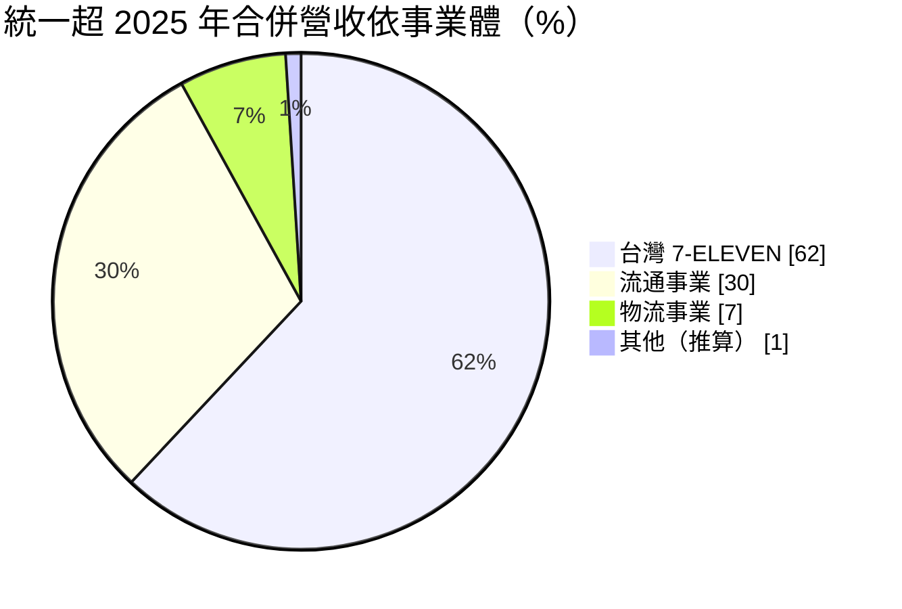
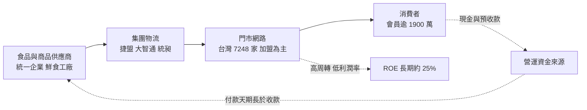
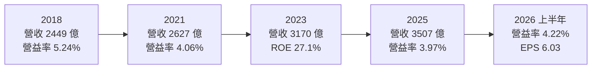
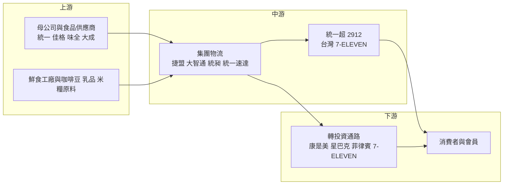

# 2912 統一超

> 上市｜[[產業索引-貿易百貨業|貿易百貨業]]｜上市（櫃）日期 1997/08/22

# 第一章：企業模式與商業藍圖

> [!info] 撰寫說明
> 本文由 Claude 依公開資料整理，架構比照 [[2330台積電]] 的四章研究，資料截至 2026-10-08。財務數字來源：證交所開放資料快照（基本資料、2026 年第二季綜合損益與資產負債、2025 年度股利）、Goodinfo 經營績效頁與股利政策頁（2016 至 2025 年）、MoneyDJ 季資產負債表（2026 年第二季借款與租賃負債）、富果研究統一超 2025 年度法說會整理與統一超產業分析文章；2017 年一次性處分利益的來源、部分轉投資沿革係憑舊版筆記與記憶整理，尚未逐條比對原始文件。#待校對

在評估一家公司的長期投資價值時，第一步是看懂它靠什麼賺錢、為什麼能一直賺下去。本章針對統一超商（股票代號：2912，以下簡稱統一超）的商業模式進行定性分析，說明一家便利商店如何長成橫跨藥妝、咖啡、物流與海外市場的流通集團，以及它如何在營業利益率只有 4% 左右的零售業中，長期維持 25% 上下的股東權益報酬率。

## 一、核心定位：台灣最大的便利商店與流通集團

統一超是台灣 7-ELEVEN 的經營者，母公司為食品集團 [[1216統一]]。依證交所資料，統一超於 1987 年 6 月 10 日設立，1997 年 8 月上市，董事長為羅智先，實收資本額約 104 億元。統一超的本體是台灣 7-ELEVEN 連鎖便利商店，經過三十多年的轉投資，已成為一個以便利商店為核心，橫跨藥妝（康是美）、咖啡連鎖（台灣星巴克）、物流、宅配與海外便利商店的流通集團。

依 2025 年度法說會，合併營收約 3,507 億元，台灣 7-ELEVEN 個體營業額約 2,200 億元；2025 年底台灣 7-ELEVEN 門市 7,248 家，菲律賓 7-ELEVEN 4,491 家，集團全球門市合計 13,866 家。依富果研究整理，統一超在台灣便利商店的市占率約 55%，遠高於第二名。

統一超的定位有兩個長期特性。第一是「高頻率、低單價」：便利商店賣的是消費者每天都會買的東西，單筆金額不高，但來客數極大且穩定，景氣好壞對需求的影響有限。第二是「平台化」：門市不只賣商品，也提供繳費、寄取件、票券、咖啡與鮮食，逐步成為社區的生活服務據點，這讓便利商店的價值不只來自商品毛利，也來自流量本身。

## 二、終端應用與產品板塊：台灣 7-ELEVEN 是本體，轉投資撐起另一半獲利

依 2025 年度法說會，三大事業體的營收與稅前淨利占比如下（其他事業為 100% 減去三大事業的推算值）：

| 事業體 | 營收占比 | 稅前淨利占比 | 主要成員 |
|---|---|---|---|
| 台灣 7-ELEVEN | 62% | 49% | 台灣便利商店本體 |
| 流通事業 | 30% | 32% | 菲律賓 7-ELEVEN、康是美、統一速達等 |
| 物流事業 | 7% | 7% | 捷盟、統昶、大智通等 |

- **台灣 7-ELEVEN：** 營收占比超過六成，但稅前淨利占比不到一半。台灣門市密度已是全球最高之一，成長主要靠單店營收與新服務，是穩定的現金來源。
- **[[鮮食]]與現煮咖啡：** 2025 年鮮食業績約 500 億元、占比超過 25%，CITY CAFE 營業額接近 200 億元。鮮食與咖啡的毛利率高於一般包裝商品，也是讓消費者天天上門的主要理由，是台灣 7-ELEVEN 在成熟市場仍能成長的核心。
- **菲律賓 7-ELEVEN：** 統一超在 2000 年取得菲律賓 7-ELEVEN 過半股權，依富果研究持股約 55%。菲律賓人口年輕、便利商店密度仍低，公司中長期目標 7,000 店，是集團最重要的海外成長引擎。
- **流通與物流轉投資：** 康是美與台灣星巴克在各自市場都是領先品牌；物流子公司則負責整個集團的配送，既是成本中心，也是競爭門檻。

## 三、資本轉化邏輯：用供應商與消費者的錢經營

統一超的資本循環有三個關鍵。

- **[[負營運資金]]：** 零售業向消費者收現金，付款給供應商卻有一段天期，再加上禮券、儲值卡與代收款，流動負債長期高於營運所需的流動資產。依 MoneyDJ，2026 年第二季應付帳款約 332 億元、合約負債約 142 億元，這些等於是供應商與消費者無息提供的資金。這是統一超能用較少股東資本支撐龐大營收的原因。
- **[[加盟]]為主的展店：** 大部分門市由加盟主出資經營，總部提供品牌、商品、系統與物流，並收取分潤。總部不必負擔每家店的全部投資，也把一部分人事與營運風險轉給加盟主，這讓展店的資本效率很高。
- **高周轉、低利潤率、高 ROE：** 統一超的[[營業利益率]]長期只有 4% 到 5%，但資產周轉快、股東權益相對小，2021 至 2025 年 ROE 都在 22% 到 28% 之間。這是零售龍頭典型的「薄利多銷加上別人的錢」的獲利模式。

## 四、企業長期藍圖：大店化、會員經濟與海外展店

- **台灣：展店與[[大店化]]：** 2026 年計畫台灣 7-ELEVEN 淨增 150 至 200 家門市，同時推動大店化，以咖啡座位區、主題區與複合服務提高客單價與停留時間。在成熟市場，單店營收的提升比門市數量更重要。
- **[[會員經濟]]：** 會員數逾 1,900 萬人，會員營收貢獻約 55%。以 OPENPOINT 會員資料做精準行銷、跨通路導流，並把康是美、星巴克等集團通路串在同一個會員體系，長期目標是讓會員資料轉化為廣告、金融與數位服務收入。
- **物流基礎建設：** 南部新市物流園區已於 2025 年啟用，中部與北部園區將陸續啟用。物流是便利商店的血管，提早建置大型物流園區，是支撐未來鮮食比重提升與門市擴張的長期投資。
- **菲律賓：** 持續展店，中長期目標 7,000 店，並全面導入非現金支付。菲律賓的成長速度，將決定統一超未來十年營收成長能否高於台灣本地市場。

# 第二章：護城河深度與競爭優勢

在長期價值投資中，「護城河」指企業抵禦競爭、長期維持超額利潤的保護機制。本章分析統一超的護城河構成、主要競爭對手，以及這些優勢在飽和的台灣零售市場中能守住多少。

## 一、統一超護城河的核心組成要素

統一超的護城河屬於「寬護城河」，由規模、密度、供應鏈與生態系共同構成：

- **1. 門市密度與店點卡位：** 台灣 7-ELEVEN 門市超過 7,200 家，在都會區幾乎步行幾分鐘就有一家。好的店點有限，先占先贏，後進者很難找到同等條件的位置；門市密度越高，物流配送與廣告效率也越高，形成正向循環。
- **2. 規模化的採購與物流：** 集團自有物流與鮮食供應體系，讓每家門市每天可以多次補貨。高頻配送需要龐大的門市數才能攤平成本，對手規模不足時，同樣的服務成本會高出許多。
- **3. 鮮食與自有商品：** 約 500 億元的鮮食業績，背後是長期合作的鮮食工廠、研發團隊與冷鏈物流。鮮食的口味與品質會形成日常購買習慣，是消費者選擇門市時最直接的理由之一。
- **4. 會員與服務生態系：** 超過 1,900 萬名會員、點數與支付工具，以及繳費、寄取件、票券等服務，把消費者綁在統一超的通路內。服務越多，消費者越不需要去別家。
- **5. 品牌經營權的長期性：** 7-ELEVEN 在台灣與菲律賓的經營權由統一超集團長期持有，品牌知名度與信任度高，這是競爭對手無法複製的資產。

## 二、主要競爭對手格局

| 對手 | 定位 | 對統一超的影響 |
|---|---|---|
| [[5903全家]] | 台灣第二大便利商店 | 在鮮食、咖啡與會員 APP 正面競爭，是最主要的對手 |
| 萊爾富、OK 超商 | 規模較小的便利商店 | 在局部商圈分食客源 |
| 全聯福利中心、量販店 | 生活必需品低價通路 | 價格帶重疊，近年也加入鮮食與咖啡 |
| 外送平台與電商 | 即時配送與線上購物 | 分走部分即時購買需求 |
| [[5904寶雅]]、屈臣氏、平價咖啡連鎖 | 藥妝與咖啡 | 分別與康是美、星巴克競爭 |
| Alfamart 等菲律賓本地通路 | 菲律賓便利商店與小型零售 | 在菲律賓展店與價格上競爭 |

## 三、優勢轉化：哪些守得住、哪些守不住

- **守得住：** 門市網路、物流與會員規模。台灣 7-ELEVEN 的門市數比第二名多出約六成以上（推算，以全家約 4,500 店計），這種規模差距在可預見的未來很難被追上，因此統一超在台灣便利商店市場的龍頭地位相當穩固。
- **守不住：** 費用端的上漲壓力。台灣便利商店市場已高度飽和，基本工資與租金每年上升，而商品售價受競爭限制，難以完全轉嫁。Goodinfo 資料顯示，統一超營業利益率由 2018 年的 5.24% 逐步下滑到 2025 年的 3.97%，就是這個壓力的長期證據。
- **觀察重點：** 長期可以追蹤三件事。第一是營業利益率能否穩定在 4% 以上，不再持續下滑；第二是菲律賓 7-ELEVEN 的展店速度與獲利貢獻；第三是會員經濟能否轉化為更高毛利的廣告、金融與數位服務收入，抵銷人事與租金上漲。

# 第三章：財務體質與盈利規模

資料日期：2026-10-08。數字取自 Goodinfo 經營績效頁與股利政策頁、證交所開放資料快照、MoneyDJ 季資產負債表與富果研究法說會整理，表格是撰寫當時的快照；最新月營收、毛利率、累計 EPS 由自動排程寫在本筆記的屬性欄位（月營收、毛利率、累計EPS 等）。#待校對

財務報表是檢驗護城河是否真實存在的最終標準。本章用多年度數據，檢視統一超「低利潤率、高周轉、高 ROE」的獲利品質是否長期穩定。

## 一、獲利能力的基石：三率

| 年度 | 營收（億元） | [[毛利率]] | [[營業利益率]] | EPS（元） | [[ROE]] |
|---|---|---|---|---|---|
| 2021 | 2,627 | 33.5% | 4.06% | 8.52 | 22.8% |
| 2022 | 2,904 | 33.7% | 4.25% | 8.93 | 25.0% |
| 2023 | 3,170 | 34.1% | 4.34% | 10.21 | 27.1% |
| 2024 | 3,379 | 34.2% | 4.13% | 11.10 | 27.5% |
| 2025 | 3,507 | 34.4% | 3.97% | 10.78 | 25.4% |

（來源：Goodinfo 經營績效頁，合併報表。2026 年上半年依證交所資料，營收 1,807 億元、毛利率 34.58%、營業利益率 4.22%、EPS 6.03 元。）

- **毛利率極度穩定：** 2016 至 2025 年毛利率都在 32.8% 到 34.4% 之間，十年幾乎沒有波動。這代表統一超的商品組合與定價能力非常穩定，鮮食與咖啡比重提高，讓毛利率還能小幅上升。
- **營業利益率緩慢下滑：** 毛利率穩定，但營業利益率從 2018 年的 5.24% 降到 2025 年的 3.97%，差距被人事、租金與門市營運費用吃掉。這是統一超長期最需要留意的趨勢。
- **營收穩定成長：** 2020 至 2025 年營收由 2,585 億元成長到 3,507 億元，年複合成長率約 6.3%（推算）。2017 年 EPS 達 29.83 元，是因為處分轉投資（上海星巴克股權，待校對）的一次性利益；2024 年也有處分山東銀座等一次性收益，評估本業時應排除這類年度。

## 二、[[ROE]]：資本效率

近 5 年（2021 至 2025 年）平均 ROE 約 25.6%（推算），2016 年以來除了 2017 年因一次性利益達 69.7% 外，每年都在 22.7% 到 34.6% 之間。ROE 遠高於 ROA（2025 年約 4.74%），兩者差距來自財務槓桿，但這裡的槓桿主要不是銀行借款，而是應付帳款、預收款項與租賃負債。依證交所資料，2026 年第二季統一超負債總計約 2,527 億元、權益總計約 514 億元，負債中有很大一部分是門市租約依會計準則認列的租賃負債（約 1,085 億元，MoneyDJ）。

## 三、資本支出、自由現金流與股利

- **[[CapEx]]：** 主要用於新店裝修、舊店改裝、設備（冷藏櫃、咖啡機）與物流園區，每筆金額不大但持續發生。多年度資本支出數字本次未查得。
- **[[自由現金流]]：** 零售業收現快、付款慢，營業現金流通常穩定高於淨利。多年度自由現金流數字未查得，但從十年來每年都能配發高額現金股利、借款規模不大來看，自由現金流長期為正的可能性高（推估）。
- **股利穩定度：** 依 Goodinfo，2019 至 2025 年度現金股利每年都是 9 元，2018 年度 8.8 元；2017 年度因一次性利益配發 25 元。以 2025 年度 EPS 10.78 元計算配息率約 83%，2021、2022 年度配息率甚至略超過 100%（推算）。章程規定股東股息紅利不低於可分配盈餘的 50%。統一超是台股中股利最穩定的公司之一，但也代表股利成長有限，未來能否提高取決於本業獲利能否突破。

## 四、[[ROIC]] 與 [[WACC]]：價值創造利差

- **ROIC（推算）：** 以 2025 年營業利益約 139 億元、扣除 20% 稅率後約 111 億元為分子。投入資本若以 2026 年第二季權益總計約 514 億元，加上銀行借款與票券約 348 億元（短期借款 146.8 億、應付短期票券 28.0 億、一年內到期長期負債 2.7 億、長期借款 170.4 億，MoneyDJ），合計約 861 億元，ROIC 約 12.9%（推算）。若把約 1,085 億元的租賃負債也視為投入資本，並把租賃利息約 16 億元（假設利率 1.5%）加回營業利益，ROIC 約 6.4%（推算）。
- **WACC（推算）：** 以 [[CAPM]] 估算股東權益成本：無風險利率取台灣 10 年期公債約 1.75%，市場風險溢酬 6%，β 假設 0.6（民生零售股波動低，取同業常見值，未查得統一超實際數字），權益成本約 5.35%。稅前負債成本假設 2%、稅率 20%，稅後約 1.6%。以不含租賃的帳面價值計算，權益約占 60%、負債約 40%，WACC 約 3.9%；若含租賃負債、負債比重提高，WACC 更低。保守來看，WACC 約在 4% 至 5.5% 之間（推算）。
- **價值創造判斷：** 不論是否把租賃負債納入，統一超的 ROIC 都高於 WACC：不含租賃時約有 7 到 9 個百分點的利差，含租賃時約 1 到 2 個百分點。這說明統一超長期確實在創造價值，但這個價值高度依賴兩件事：一是負營運資金帶來的低成本資金，二是租約條件與門市租金。若租金與人事成本持續上升、營業利益率繼續往 3% 移動，含租賃的 ROIC 利差會被壓縮到接近零。

# 第四章：總體風險與地緣政治

任何企業都無法脫離宏觀環境獨立存在。本章分析統一超未來必須面對的地緣政治、產業結構、營運與法規風險。

## 一、地緣政治與海外投資風險

- **菲律賓：** 菲律賓 7-ELEVEN 是最重要的海外成長引擎，但面對當地匯率、通膨、利率與政策變動風險。菲律賓披索若大幅貶值，換算回新台幣的獲利會縮水。
- **中國投資：** 統一超過去在中國的投資（如山東銀座超市）已在 2024 年處分，對中國的曝險明顯下降。這減少了地緣政治風險，但也代表海外成長幾乎只剩菲律賓一個主要市場。
- **兩岸情勢：** 營運集中在台灣，兩岸風險主要透過總體經濟、消費信心與供應鏈中斷間接影響。

## 二、產業週期與市場結構風險

- **市場飽和：** 台灣便利商店密度高，新店容易侵蝕既有店的業績，未來成長更依賴單店營收、鮮食與新服務。
- **跨業態競爭：** 全家、全聯、外送平台與電商持續在鮮食、咖啡與即時配送上競爭，可能壓抑價格或增加促銷費用。
- **消費景氣：** 民生消費相對抗景氣，但咖啡、甜點、預購等較高單價品項在景氣轉弱時會受到影響。整體而言，統一超的獲利波動在台股中屬於最低的一群。

## 三、營運環境的隱性風險

- **人力成本：** 基本工資逐年調升，門市與物流人力招募不易，是營業利益率長期下滑的主因。人口老化與少子化會讓這個問題在未來十年更嚴重。
- **租金與租約：** 門市租約占負債很大比重，好店點的租金只會越來越高，租約到期重新議價時，可能壓縮單店利潤。
- **原物料成本：** 咖啡豆、乳製品、雞蛋與米等鮮食原料價格波動，會直接影響毛利率。
- **食品安全與加盟關係：** 鮮食與咖啡比重高，食安事件對品牌的傷害很大；加盟主的利潤分配與勞動條件若引起爭議，也可能影響展店。

## 四、科技與法規演進風險

- **自動化與無人化：** 自助結帳、無人商店與 AI 補貨可以降低人力依賴，但需要大量投資，導入速度與效果仍待驗證。
- **支付與個資法規：** 電子支付、個資保護與會員資料應用受法規規範，法規收緊可能限制會員經濟的變現方式。
- **環保與健康法規：** 一次性塑膠、包材與食物浪費的規範趨嚴，以及菸酒相關稅費與販售規範調整，都會影響營運成本與營收。

# 專有名詞解析

## 金融

- **[[負營運資金]]**：收現快、付款慢加上預收款項，使流動負債高於營運所需流動資產，等於由供應商與消費者提供資金。
- **[[毛利率]]**：營業毛利除以營收，零售業毛利率看似高，但大部分會被人事、租金等營業費用吸收。
- **[[營業利益率]]**：營業利益除以營收，反映扣除人事、租金等費用後的本業獲利能力。
- **[[ROE]]**：股東權益報酬率，稅後淨利除以股東權益，衡量公司運用股東資金賺錢的效率。
- **[[CapEx]]**：資本支出，用於購置廠房、設備、門市裝修等長期資產的支出。
- **[[自由現金流]]**：營業活動現金流減去資本支出，代表企業可自由用於配息、還債或併購的現金。
- **[[ROIC]]**：投入資本報酬率，稅後營業利益除以股東權益加有息負債，衡量本業運用資本的效率。
- **[[WACC]]**：加權平均資金成本，依股東權益與負債的比重，加權計算公司取得資金的平均成本。
- **[[CAPM]]**：資本資產定價模型，以無風險利率加上 β 乘以市場風險溢酬，估算股東要求的報酬率。
- **[[租賃負債]]**：依會計準則把長期租約未來應付租金折現後認列的負債，門市多的零售業此項金額很大。

## 產業

- **[[鮮食]]**：便當、飯糰、麵食、甜點等需要冷藏且保存期短的即食商品，毛利率高於包裝商品，是便利商店的來客核心。
- **[[大店化]]**：把門市坪數擴大並加入座位區、主題區與複合服務，以提高客單價與停留時間的展店策略。
- **[[會員經濟]]**：以會員點數、APP 與消費資料串連多個通路，提高回購率，並延伸出廣告、金融等收入來源。
- **[[加盟]]**：由加盟主出資經營門市，總部提供品牌、商品與物流並收取分潤的經營模式，可降低總部的資本支出。

# 核心供應鏈

## 1. 上游：商品與鮮食供應
- 母公司與主要食品供應商：[[1216統一]]
- 其他食品飲料供應商：[[1227佳格]]、[[1201味全]]、[[1210大成]]
- 咖啡豆、乳品、米糧等原料：國內外進口商與農產品供應商

## 2. 中游：統一超與集團物流
- 便利商店本體：台灣 7-ELEVEN
- 物流配送：捷盟行銷、統昶行銷（低溫物流）、大智通文化行銷、統一速達（宅配）

## 3. 下游：自有通路與轉投資
- 海外便利商店：菲律賓 7-ELEVEN
- 藥妝：統一生活（康是美）
- 咖啡：統一星巴克
- 消費者：門市來客與會員

## 4. 同業與競爭者
- 便利商店：[[5903全家]]、萊爾富、OK 超商
- 超市與量販：全聯福利中心、家樂福
- 藥妝：[[5904寶雅]]、屈臣氏

## 最新新聞
<!-- news:start（自動產生，請勿手動編輯此範圍） -->
- 2026-10-14 📰 媒體 11:02｜統一超自助結帳全面導入多語系 打造最綿密國際友善商店｜[鉅亨網](https://news.cnyes.com/news/id/6630043)
- 2026-10-13 📰 媒體 12:00｜統一超Q4鮮食淡季不淡 全新秋冬菜單上線打造社會廚房｜[鉅亨網](https://news.cnyes.com/news/id/6629281)

完整紀錄：[[2912統一超 新聞]]
<!-- news:end -->

## 相關連結
- [公開資訊觀測站](https://mopsov.twse.com.tw/mops/web/t05st03?step=1&firstin=1&co_id=2912)
- [Goodinfo](https://goodinfo.tw/tw/StockDetail.asp?STOCK_ID=2912)
- [Yahoo 股市](https://tw.stock.yahoo.com/quote/2912)
- [鉅亨網新聞](https://www.cnyes.com/twstock/2912/news)
