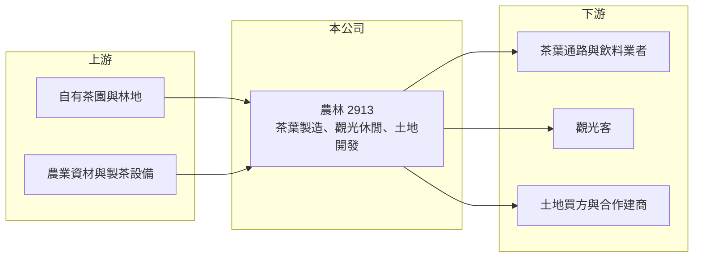

# 2913 農林

> 上市｜[[產業索引-貿易百貨業|貿易百貨業]]｜上市（櫃）日期 1962/02/09

# 第一章：企業模式與商業藍圖

> [!info] 撰寫說明
> 精簡版，由 Claude 依公開資料整理，架構比照 [[2330台積電]] 的四章研究，資料截至 2026-10-08。財務數字來源：Goodinfo 年度經營績效頁、富果研究 2026 年 5 月法說會整理、證交所開放資料（基本資料、2026 年第二季資產負債與綜合損益、營益分析、股利）。#待校對

台灣農林（股票代號：2913）是一家擁有大量土地、但本業規模很小的老牌公司。投資人看農林，實際上是在看兩件事：茶葉與觀光本業能否轉虧為盈，以及約 3,700 公頃土地能否被開發或出售。

## 一、核心定位：茶葉本業加上龐大土地資產

- **公司基本面：** 農林成立於 1950 年，1962 年上市，是台灣最早上市的公司之一，實收資本額 79 億元，董事長為吳清源。公司源自日治時期的茶業與農林事業，戰後經公營事業民營化而來（待校對）。
- **四大板塊：** 依 2026 年 5 月法說會，公司分為茶本業、觀光休閒、土地資產與土地開發四大板塊。茶本業與觀光休閒是營收來源，土地則是資產價值的主體。
- **土地規模：** 公司持有土地約 3,715 公頃，2025 年底[[投資性不動產]]公允價值約 253 億元，遠高於公司 2025 年 4.73 億元的營收。

## 二、茶本業與觀光休閒

- **茶廠布局：** 熊空茶廠（新北三峽，有機碧螺春）、三義茶廠（苗栗，東方美人茶）、魚池茶廠（南投，阿薩姆與紅玉紅茶）、老埤農場（屏東，號稱台灣第一座智慧茶園）。2026 年茶葉銷售目標 500 噸，約占國內產量 3%。
- **觀光休閒：** 大溪老茶廠、銅鑼茶廠、日月老茶廠、鹿篙咖啡莊園等據點，把茶廠轉成觀光與品牌體驗空間，熊空休閒農場則委外經營。日月老茶廠的台茶 8 號取得台灣首個紅茶碳標籤。
- **為什麼重要：** 茶葉是農產品，單純賣茶毛利有限；結合觀光、品牌與體驗，才能提高每位消費者的貢獻，這是農林把老茶廠活化的商業邏輯。

## 三、土地開發

- **三義科技物流園區：** 已完成開發與地目變更，公司傾向全區出售。
- **銅科別墅住宅區與工商綜合區：** 開發完成，2026 年已申請建照，尋求合作開發。
- **長期意義：** 土地開發可能一次帶來可觀的處分利益，但時點取決於市場與合作對象，無法像本業一樣穩定預期。

## 四、長期方向

公司目標在 3 至 5 年內讓本業轉虧為盈，方式包括調整茶葉產能、優化休閒事業與控制費用；同時活化土地資產，並評估林地的碳權發展可能性。農林的長期價值，大部分取決於土地資產的變現與開發效率。

# 第二章：護城河深度與競爭優勢

農林的護城河主要來自不可複製的土地與歷史茶廠，而非經營效率。

## 一、護城河的組成

- **稀缺的土地資產：** 3,715 公頃土地分布在多個縣市，部分已完成地目變更與開發，這種規模的土地庫存在台灣上市公司中少見，是農林最大的資產優勢。
- **歷史茶廠與產地：** 三峽、三義、魚池等茶區是台灣重要產地，老茶廠本身具有文化與觀光價值，新進者很難複製。
- **品牌與認證：** 有機茶園、碳標籤等認證，讓農林能在高端茶葉市場建立差異化。

## 二、主要競爭對手

| 對手 | 定位 | 對農林的威脅 |
|---|---|---|
| [[1233天仁]] | 茶葉品牌與門市 | 在品牌茶葉與零售通路上競爭 |
| 手搖飲原料茶供應商、進口茶葉 | 大宗原料茶 | 進口茶價格低，壓縮國產茶的原料市場 |
| 各地休閒農場與觀光工廠 | 觀光休閒 | 爭奪國旅消費者 |
| 建設公司（土地開發） | 不動產開發 | 合作或競爭開發機會 |

## 三、守得住與守不住

- **守得住：** 土地資產的價值與茶廠的產地特色。
- **守不住：** 大宗茶葉的價格，國產茶面對進口茶的成本劣勢。
- **觀察重點：** 本業營業損失能否在 2026 至 2028 年轉為獲利、三義物流園區能否順利出售，以及銅鑼開發案的合作進度。

# 第三章：財務體質與盈利規模

資料日期：2026-10-08，表格是撰寫當時的快照；最新月營收、毛利率、累計 EPS 由自動排程寫在本筆記的屬性欄位（月營收、毛利率、累計EPS 等）。#待校對

農林的財務特色是「資產大、營收小、本業虧損逐年收斂」。

## 一、多年度財務表

| 年度 | 營收（新台幣） | [[毛利率]] | [[營業利益率]] | EPS（元） | [[ROE]] |
|---|---|---|---|---|---|
| 2019 | 2.99 億 | 40.4% | -56.5% | -0.18 | -0.91% |
| 2020 | 3.12 億 | 40.0% | -47.3% | -0.02 | -0.11% |
| 2021 | 3.69 億 | 31.8% | -49.5% | -1.42 | -7.37% |
| 2022 | 3.77 億 | 43.7% | -41.0% | -2.07 | -11.8% |
| 2023 | 3.80 億 | 36.4% | -32.8% | -0.36 | -2.24% |
| 2024 | 4.33 億 | 37.4% | -13.9% | -0.22 | -1.39% |
| 2025 | 4.73 億 | 38.6% | -4.11% | -0.15 | -0.93% |
| 2026 上半年 | 2.21 億 | 36.36% | -7.69% | -0.10 | 未查得 |

註：2019 至 2025 年取自 Goodinfo；2026 上半年取自證交所開放資料。

- **營收成長、虧損收斂：** 2019 至 2025 年營收年複合成長率約 7.9%（推算），營業利益率從 -56.5% 收斂到 -4.11%，2025 年營業損失約 1,900 萬元，較前一年減少 68%，接近損益兩平。
- **業外損失：** 2021 與 2022 年業外損失分別約 9.5 億元與 14.6 億元（Goodinfo），是這兩年大幅虧損的主因，具體原因本文未查證；近三年業外損失縮小到約 1 億元上下。
- **2026 年上半年：** 營業利益率回落到 -7.69%，業外損失約 0.63 億元，本業轉盈仍需時間。

## 二、ROE 與資產結構

2019 至 2025 年 ROE 每年都是負值。農林的資產主要是土地，2026 年第二季底總資產約 212.8 億元、權益約 123.4 億元、負債約 89.4 億元（證交所開放資料），每股淨值約 15.62 元，股價淨值比約 0.70 倍。龐大的土地資產帶來的是潛在增值，而不是每年的營業利益，因此在土地變現之前，ROE 很難提高。公司近年未配發股利，帳上仍有待彌補虧損。

## 三、[[ROIC]] 與 [[WACC]]

**ROIC 推算：** 2025 年營業損失約 0.19 億元，虧損年度不計稅盾。投入資本以權益約 123.4 億元，加上假設約 40 億元的有息負債（推估，負債中部分應為土地增值相關的遞延所得稅），合計約 163 億元，ROIC 約 -0.1%（推算）。

**WACC 推算：** 公債殖利率 1.75%、市場風險溢酬 6%、β 取資產型公司常見值 0.6，股東權益成本約 5.35%；負債成本假設 2.5%，稅後 2.0%；權益約占 75%、負債約占 25%，WACC 約 4.5%（推算）。

**結論：** 農林的本業 ROIC 長期為負，遠低於資金成本，代表以目前的經營方式，龐大資產並沒有創造價值。價值能否實現，取決於土地出售或開發，以及本業能否如公司目標在 3 至 5 年內轉盈。

# 第四章：總體風險與地緣政治

農林的風險集中在土地變現的不確定性與本業規模過小。

## 一、產業週期

- **房地產與工業地景氣：** 三義物流園區與銅鑼開發案的出售價格與速度，取決於房地產與工業用地市場。景氣反轉時，土地可能長期無法變現。
- **國旅與消費景氣：** 觀光休閒據點的來客受國內旅遊景氣、天候與假期影響。

## 二、營運風險

- **土地開發執行：** 地目變更、環評與建照申請流程長，合作開發也需要找到合適夥伴，任何一環延誤都會推遲收益。
- **本業規模小：** 營收不到 5 億元，費用稍有增加就會吃掉毛利，轉盈的過程容易反覆。
- **公允價值評價：** 投資性不動產以公允價值衡量時，評價變動會影響帳面淨值與損益，但不代表實際現金流入。

## 三、其他風險

- **氣候與農業風險：** 茶葉產量與品質受天候影響，極端氣候可能造成減產。
- **進口茶競爭：** 國產茶成本較高，在大宗原料茶市場面臨進口茶的價格壓力。
- **法規與政策：** 土地使用、農地變更與碳權相關法規的變動，會影響開發計畫與林地碳權的可行性。

# 專有名詞解析

## 金融

- **[[ROIC]]**：投入資本報酬率，稅後營業利益除以股東權益與有息負債的合計，衡量本業對所有資金提供者的報酬。
- **[[WACC]]**：加權平均資金成本，依股東權益與負債的比重加權計算的資金成本，ROIC 高於它才代表創造價值。

## 產業

- **[[投資性不動產]]**：企業持有、用來賺取租金或等待增值而非自用的土地與建物，可依公允價值衡量。
- **[[資產活化]]**：企業透過出租、改建、合建或出售閒置與低度利用的不動產，提高資產報酬的做法。
- **[[碳權]]**：企業或機構透過減少排放或增加碳吸收所取得、可交易或抵換排放量的權利。

# 核心供應鏈

## 1. 上游：自有資源
- 自有茶園（三峽、三義、魚池、屏東老埤）與林地

## 2. 本公司
- 農林：茶葉製造與品牌、觀光休閒據點、三義與銅鑼土地開發

## 3. 下游與同業
- 茶葉通路、飲料業者、國旅觀光客、土地買方與合作建商
- 同業：[[1233天仁]]、各地休閒農場

## 最新新聞
<!-- news:start（自動產生，請勿手動編輯此範圍） -->
- 2026-10-12 📰 媒體 18:50｜營收速報 - 農林(2913)9月營收5,759萬元年增率高達34.07％｜[鉅亨網](https://news.cnyes.com/news/id/6628379)

完整紀錄：[[2913農林 新聞]]
<!-- news:end -->

## 相關連結
- [公開資訊觀測站](https://mopsov.twse.com.tw/mops/web/t05st03?step=1&firstin=1&co_id=2913)
- [Goodinfo](https://goodinfo.tw/tw/StockDetail.asp?STOCK_ID=2913)
- [Yahoo 股市](https://tw.stock.yahoo.com/quote/2913)
- [鉅亨網新聞](https://www.cnyes.com/twstock/2913/news)
