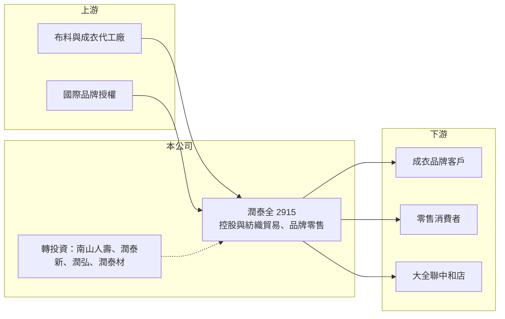

# 2915 潤泰全

> 上市｜[[產業索引-貿易百貨業|貿易百貨業]]｜上市（櫃）日期 1977/07/20

# 第一章：企業模式與商業藍圖

> [!info] 撰寫說明
> 精簡版，由 Claude 依公開資料整理，架構比照 [[2330台積電]] 的四章研究，資料截至 2026-10-08。財務數字來源：Goodinfo 年度經營績效頁、富果研究 2026 年 6 月法說會整理、證交所開放資料（基本資料、2026 年第二季資產負債與綜合損益、營益分析、股利、本益比）；集團沿革有部分憑記憶整理，已標「待校對」。#待校對

潤泰全（股票代號：2915）名義上屬於貿易百貨業，實際上是一家[[控股公司]]：本業營收只有二十多億元，獲利卻主要來自持有的南山人壽與潤泰集團轉投資。看懂潤泰全，就是看懂它的投資組合。

## 一、核心定位：從紡織廠轉型為投資控股

- **公司基本面：** 潤泰全成立於 1976 年，1977 年上市，實收資本額約 110.4 億元，董事長為徐盛育。公司原為潤泰集團的紡織事業，2019 年結束工廠，轉為貿易模式（富果研究法說會整理）。
- **獲利來自轉投資：** 依 2026 年第一季法說會，當季歸屬母公司淨利 27.08 億元，其中南山人壽貢獻 17.37 億元、潤泰創新貢獻 6.19 億元，合併營業利益則為 -800 萬元。也就是說，潤泰全的 EPS 幾乎完全由[[權益法]]認列的轉投資收益決定。
- **主要持股：** 南山人壽 26.62%、潤泰創新（[[9945潤泰新]]）25.7%、潤弘精密（[[2597潤弘]]）9.10%、潤泰精材（[[8463潤泰材]]）4.76%、潤德 2.23%；另布局生技，例如 [[4147中裕]]、[[4174浩鼎]]。

## 二、本業：紡織貿易、品牌零售與量販物業

- **紡織貿易：** 保留研發、設計與品管團隊，提供布料開發到成衣的整合服務，不再自有工廠。
- **品牌零售：** 代理 Nautica、Jeep、Whittard 等品牌，透過 59 個據點銷售。
- **流通：** 經營大全聯中和店，賣場面積約 12,000 坪，提供穩定現金流；2026 年起量販事業改採[[淨額法]]認列，只計毛利，使帳面營收下降但對獲利影響不大。
- **集團沿革：** 潤泰集團曾經營大潤發，並透過轉投資持有中國高鑫零售，相關股權已在 2020 年前後陸續出售（待校對）。

## 三、資產活化

公司持有中壢、新豐、台中、楊梅等地，總面積約 53,298 坪，公司預估潛在開發獲利約 118.66 億元。新豐、台中、楊梅廠已轉列[[投資性不動產]]，截至 2026 年 3 月認列評價利益 67.58 億元；中壢一廠約 4,965 坪工業用地正申請變更為建地。這些土地是潤泰全除了轉投資之外的第二個價值來源。

## 四、長期方向

公司自述策略為「穩固本業、仰賴投資、活化資產」。長期而言，潤泰全的價值有三個驅動：南山人壽的獲利與淨值、潤泰創新等集團公司的營建與建材景氣，以及土地開發的實現進度。

# 第二章：護城河深度與競爭優勢

潤泰全的護城河其實是南山人壽的護城河，加上集團交叉持股形成的穩定控制權。

## 一、護城河的組成

- **南山人壽的規模：** 南山人壽是台灣大型壽險公司之一，擁有龐大的保戶與業務員體系（待校對）。潤泰全持有 26.62%，2026 年第一季持股淨值約 991 億元，這筆資產帶來的權益法收益是潤泰全最主要的獲利來源。
- **集團交叉持股：** 潤泰全、潤泰新、潤弘、潤泰材之間互相持股，使集團對核心資產有穩定的控制力，但也讓單一公司的財報與集團整體高度連動。
- **土地資產：** 早年紡織廠留下的工業用地，在轉為住宅或商業用地後可能帶來可觀的開發利益。

## 二、比較對象

| 比較對象 | 定位 | 與潤泰全的關係 |
|---|---|---|
| [[9945潤泰新]] | 營建、建材與轉投資控股 | 同集團，雙方互相持股並共同持有南山人壽 |
| 國泰金、富邦金等金控 | 壽險與金控 | 南山人壽的主要競爭對手 |
| [[1402遠東新]]、[[2903遠百]] | 集團型控股與零售 | 同樣有大量轉投資與不動產的集團公司 |

## 三、守得住與守不住

- **守得住：** 南山人壽的市場地位與集團對它的控制權。
- **守不住：** 壽險業的獲利受利率、股債市與會計制度影響，波動很大，潤泰全無法控制。
- **觀察重點：** 南山人壽在新會計制度下的獲利與淨值、潤泰全的股利政策，以及中壢土地變更進度。

# 第三章：財務體質與盈利規模

資料日期：2026-10-08，表格是撰寫當時的快照；最新月營收、毛利率、累計 EPS 由自動排程寫在本筆記的屬性欄位（月營收、毛利率、累計EPS 等）。#待校對

潤泰全的財務數字必須把「本業」和「業外」分開看，營業利益只占稅前淨利的極小比例。

## 一、多年度財務表

| 年度 | 營收（新台幣） | [[毛利率]] | [[營業利益率]] | EPS（元） | [[ROE]] |
|---|---|---|---|---|---|
| 2019 | 34.9 億 | 26.0% | -1.92% | 16.52 | 15.8% |
| 2020 | 27.4 億 | 35.7% | 1.91% | 14.85 | 8.09% |
| 2021 | 27.0 億 | 35.5% | 1.83% | 25.05 | 14.4% |
| 2022 | 28.7 億 | 34.1% | 1.95% | 15.55 | 11.6% |
| 2023 | 26.8 億 | 34.9% | 2.45% | 7.19 | 8.4% |
| 2024 | 28.9 億 | 38.0% | 7.17% | 13.00 | 13.5% |
| 2025 | 24.2 億 | 42.6% | 6.46% | 9.29 | 9.39% |
| 2026 上半年 | 9.86 億 | 47.34% | 6.83% | 8.96 | 未查得 |

註：2019 至 2025 年取自 Goodinfo；2026 上半年取自證交所開放資料。

- **業外決定一切：** 2019 至 2025 年每年業外損益約 76 億至 176 億元（Goodinfo），而營業利益最多只有約 2 億元。2026 年上半年營業利益約 0.67 億元，營業外收入約 94.3 億元。
- **EPS 波動大：** EPS 從 2021 年的 25.05 元到 2023 年的 7.19 元，主要反映南山人壽的獲利起伏，而不是本業變化。

## 二、ROE 與轉投資對資本效率的影響

2021 至 2025 年平均 ROE 約 11.5%（推算）。潤泰全的股東權益中，絕大部分是轉投資的帳面價值，因此 ROE 實際上反映的是南山人壽等轉投資的報酬率。2026 年第二季底權益總計約 1,663 億元、負債約 149 億元，負債比僅約 8%；上半年其他綜合損益約 621 億元（證交所開放資料），推估主要來自南山人壽的金融資產評價變動，顯示淨值會隨股債市大幅波動。每股淨值約 153.6 元，股價淨值比約 0.37 倍，反映市場對控股公司的折價。股利方面，2025 年度配發現金 1.9 元，配發率約 20%（推算），章程以「扣除權益法收益後」的盈餘作為配息基礎，因此配息遠低於 EPS。

## 三、[[ROIC]] 與 [[WACC]]

**ROIC 推算：** 本業 2025 年營業利益約 1.56 億元（24.2 億元 × 6.46%），稅後約 1.25 億元，相對於約 1,700 億元的投入資本（權益約 1,663 億元加上假設約 50 億元的有息負債，推估），本業 ROIC 不到 0.1%（推算），沒有分析意義。若把轉投資收益視為主要報酬，整體資本報酬約等於 ROE，近五年約 8% 至 14%。

**WACC 推算：** 公債殖利率 1.75%、市場風險溢酬 6%、β 取控股與壽險相關股常見值 0.8，股東權益成本約 6.55%；負債比例很低，WACC 約 6.4%（推算）。

**結論：** 以整體報酬計算，潤泰全多數年度的 ROE 高於資金成本，代表投資組合長期有創造價值；但股價長期低於淨值，說明市場對控股結構、低配息與壽險獲利波動給予大幅折價。

# 第四章：總體風險與地緣政治

潤泰全的風險主要來自壽險業與集團結構。

## 一、產業週期

- **壽險業的利率與資本市場風險：** 南山人壽的獲利與淨值受利率、股市、債市與匯率影響。股債市大跌時，潤泰全的淨值與 EPS 會同步下滑。
- **營建與建材景氣：** 潤泰創新、潤弘等轉投資屬於營建與建材產業，受房市與公共工程景氣影響。

## 二、營運風險

- **集團交叉持股：** 交叉持股讓集團控制權穩定，但也使各公司的財報互相牽動，透明度較低，投資人需要同時追蹤多家公司。
- **低配息政策：** 章程以扣除權益法收益後的盈餘作為配息基礎，配息遠低於帳面獲利，股東較難分享轉投資的成果。
- **土地開發不確定：** 中壢土地變更涉及公有地協商與聯外道路，時程難以預估。

## 三、其他風險

- **保險會計與監理：** 台灣壽險業導入 [[IFRS]] 17 與新一代清償能力制度後，獲利認列方式與資本要求改變，可能影響南山人壽的配息能力與獲利波動（推估）。
- **匯率：** 壽險業持有大量海外資產，新台幣升值會造成匯兌損失。
- **生技投資：** 中裕、浩鼎等生技轉投資屬於高風險資產，評價波動大。

# 專有名詞解析

## 金融

- **[[權益法]]**：持股約兩成至五成的轉投資，依持股比例認列被投資公司損益的會計方法，收益列在業外。
- **[[淨額法]]**：企業只扮演代理角色時，只以收取的佣金或毛利認列營收，而非以商品總售價認列。
- **[[IFRS]]**：國際財務報導準則，台灣上市櫃公司採用的會計準則，IFRS 17 為保險合約的新準則。
- **[[ROIC]]**：投入資本報酬率，稅後營業利益除以股東權益與有息負債的合計，衡量本業對所有資金提供者的報酬。
- **[[WACC]]**：加權平均資金成本，依股東權益與負債的比重加權計算的資金成本，ROIC 高於它才代表創造價值。

## 產業

- **[[控股公司]]**：主要資產是其他公司股權、獲利主要來自轉投資收益的公司。
- **[[投資性不動產]]**：企業持有、用來賺取租金或等待增值而非自用的土地與建物，可依公允價值衡量。

# 核心供應鏈

## 1. 上游：商品與授權
- 布料與成衣代工廠、Nautica、Jeep、Whittard 等品牌授權

## 2. 本公司與轉投資
- 南山人壽（26.62%）
- [[9945潤泰新]]、[[2597潤弘]]、[[8463潤泰材]]
- 生技轉投資：[[4147中裕]]、[[4174浩鼎]]

## 3. 下游與比較對象
- 成衣品牌客戶、零售消費者、大全聯中和店
- 比較對象：[[1402遠東新]]、[[2903遠百]]

## 最新新聞
<!-- news:start -->
<!-- news:end -->

## 相關連結
- [公開資訊觀測站](https://mopsov.twse.com.tw/mops/web/t05st03?step=1&firstin=1&co_id=2915)
- [Goodinfo](https://goodinfo.tw/tw/StockDetail.asp?STOCK_ID=2915)
- [Yahoo 股市](https://tw.stock.yahoo.com/quote/2915)
- [鉅亨網新聞](https://www.cnyes.com/twstock/2915/news)
