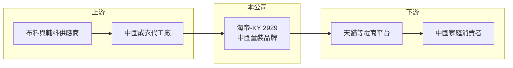

# 2929 淘帝-KY

> 上市｜[[產業索引-貿易百貨業|貿易百貨業]]｜上市（櫃）日期 2013/12/30

# 第一章：企業模式與商業藍圖

> [!info] 撰寫說明
> 精簡版，由 Claude 依公開資料整理，架構比照 [[2330台積電]] 的四章研究，資料截至 2026-10-08。財務數字來源：MoneyDJ 年度財務比率頁、理財周刊 2020 年 8 月營收報導、證交所開放資料（基本資料、2026 年第二季資產負債與綜合損益、營益分析、股利、每月營收）。公開資料有限，產品與通路描述有部分憑記憶整理，已標「待校對」；歷年營收為依淨利率與成長率回推。#待校對

淘帝-KY（股票代號：2929）是在台上市的中國童裝品牌公司。它的歷史是一個電商童裝品牌從高成長、高獲利，到 2020 年後急速萎縮、長期虧損的過程，適合用來理解中國消費品牌在電商平台上的興衰。

## 一、核心定位：中國電商童裝品牌

- **公司基本面：** 淘帝-KY 註冊於開曼群島，2012 年成立、2013 年在台上市，實收資本額約 10.9 億元，董事長為周志鴻。作為 [[KY股]]，主要營運與消費市場都在中國。
- **業務模式：** 公司以自有童裝品牌為主，早期大量透過天貓等電商平台銷售，曾以「快時尚」風格童裝鎖定年輕父母（待校對）。電商模式的優點是不需要大量實體門市，但必須持續投入平台流量與行銷費用。
- **營收規模的劇烈變化：** 依 MoneyDJ 的淨利率與成長率回推，2019 年營收約 71.6 億元（推算），2020 年驟降約 61% 到約 28 億元，2025 年再降到約 17.5 億元（推算）。

## 二、2020 年的轉折

- **疫情與存貨衝擊：** 2020 年營收大減，毛利率由 2019 年的 39.09% 轉為 -48.34%（MoneyDJ），代表公司當年認列大量[[存貨跌價損失]]，賣出的商品低於成本。童裝季節性強、尺碼汰換快，一旦銷售中斷，存貨價值會快速下滑。
- **之後的調整：** 2022 至 2024 年毛利率回到 11% 至 17%，虧損縮小，2024 年小幅獲利；但 2025 年毛利率又降到 8.55%，再度虧損。2026 年 1 至 8 月營收年增約 11%，公司說明 8 月營收增幅包含匯率影響約 13%（證交所每月營收）。

## 三、長期方向

公司公開資訊未提供明確的長期策略。從財務數字看，淘帝目前的課題是先讓毛利率回到能支撐營業費用的水準，再談成長；帳上仍有相對充足的流動資產，提供轉型的時間（推估）。

# 第二章：護城河深度與競爭優勢

淘帝的護城河很窄，電商童裝的進入門檻低，品牌忠誠度有限。

## 一、護城河的組成

- **品牌與平台經營經驗：** 公司在電商平台經營多年，累積了商品開發、平台營運與會員資料，這是新進品牌需要時間建立的能力。
- **輕資產模式：** 不依賴大量實體門市，固定成本相對低，在需求轉弱時可以較快調整規模。
- **限制：** 童裝的設計容易被模仿，消費者在電商平台上比價方便，品牌溢價能力有限，這也是毛利率從近 40% 降到一成左右的原因。

## 二、主要競爭對手

| 對手 | 定位 | 對淘帝的威脅 |
|---|---|---|
| 森馬（巴拉巴拉）等中國大型童裝品牌 | 全通路童裝 | 規模大、品牌力強，市占高 |
| 安踏兒童等運動品牌童裝 | 運動童裝 | 以運動品牌形象吸引父母 |
| 直播電商與白牌童裝 | 低價線上商品 | 以極低價格搶奪流量 |
| [[2911麗嬰房]] 等台灣童裝品牌 | 台灣與中國市場 | 同屬童裝品牌，但市場重疊有限 |

## 三、守得住與守不住

- **守得住：** 既有的平台店鋪與老客戶。
- **守不住：** 價格與流量，[[直播電商]]興起後，傳統平台店鋪的流量成本上升，白牌商品壓低售價。
- **觀察重點：** 毛利率能否回到 15% 以上、營業費用能否控制，以及公司是否運用帳上資金進行轉型或回饋股東。

# 第三章：財務體質與盈利規模

資料日期：2026-10-08，表格是撰寫當時的快照；最新月營收、毛利率、累計 EPS 由自動排程寫在本筆記的屬性欄位（月營收、毛利率、累計EPS 等）。#待校對

淘帝的財務數字呈現「營收萎縮、毛利率偏低、帳上資產仍充足」的特徵。

## 一、多年度財務表

| 年度 | 營收（新台幣） | [[毛利率]] | [[營業利益率]] | EPS（元） | [[ROE]] |
|---|---|---|---|---|---|
| 2019 | 約 71.6 億（推算） | 39.09% | 21.68% | 12.01 | 21.33% |
| 2020 | 約 28.0 億（推算） | -48.34% | -86.56% | -20.44 | -48.87% |
| 2021 | 約 29.6 億（推算） | -7.45% | -24.78% | -6.43 | -22.51% |
| 2022 | 約 25.4 億（推算） | 11.50% | -5.43% | 1.22 | 4.68% |
| 2023 | 約 23.8 億（推算） | 16.44% | -0.17% | -0.63 | -2.38% |
| 2024 | 約 21.2 億（推算） | 16.51% | -0.30% | 0.14 | 0.52% |
| 2025 | 約 17.5 億（推算） | 8.55% | -10.97% | -1.68 | -6.48% |
| 2026 上半年 | 8.04 億 | 14.20% | -12.50% | -0.74 | 未查得 |

註：2019 至 2025 年比率取自 MoneyDJ；營收以 2025 年稅後淨損約 1.83 億元（證交所股利資料）除以淨利率 10.45% 得到約 17.5 億元，再依各年營收成長率回推，皆為推算。早年股本與現在不同，EPS 不宜直接比較。2026 上半年取自證交所開放資料。

- **毛利率決定生死：** 2022 年以後營業費用率約在 17% 上下（推估），毛利率只要低於這個水準就會虧損。
- **業外收益：** 2022 年營業利益為負但稅後淨利為正，推估來自利息收入或其他業外收益。
- **營收趨勢：** 2019 至 2025 年營收年複合成長率約 -21%（推算）。

## 二、ROE 與資產結構

2021 至 2025 年平均 ROE 約 -5.2%（推算）。2026 年第二季底總資產約 35.2 億元，其中流動資產約 32.7 億元，負債約 7.4 億元，負債比約 21%（證交所開放資料），每股淨值約 25.36 元，但股價淨值比僅約 0.22 倍，顯示市場對 KY 公司帳上資產的可回收性與公司治理存有疑慮。帳上有待彌補虧損，2025 年度未配發股利。

## 三、[[ROIC]] 與 [[WACC]]

**ROIC 推算：** 2025 年營業損失約 1.92 億元（17.5 億元 × -10.97%，推算），虧損年度不計稅盾。投入資本以權益約 27.8 億元為主，有息負債推估很少，ROIC 約 -7%（推算）。若扣除帳上大量流動資產只計營運資產，ROIC 的負值會更大。

**WACC 推算：** 公債殖利率 1.75%、市場風險溢酬 6%、β 取中國消費類 KY 股常見值 1.0，再加計約 2% 的中國與公司治理風險溢酬，股東權益成本約 9.75%；負債比例很低，WACC 約 9.5%（推算）。

**結論：** 淘帝的 ROIC 自 2020 年後多數年度為負，遠低於資金成本，代表本業持續消耗股東價值。股價深度低於淨值，反映市場已預期這種狀態會持續，除非毛利率明顯改善或公司以實際行動回饋股東。

# 第四章：總體風險與地緣政治

淘帝的風險結合了中國消費、電商平台與 KY 公司治理三個層面。

## 一、產業週期

- **中國消費與出生率：** 中國出生人口持續下降，童裝市場整體規模面臨萎縮；消費信心疲弱時，父母傾向購買低價商品。
- **電商平台規則：** 平台流量分配、抽成與促銷規則變動，會直接影響銷量與行銷成本。

## 二、營運風險

- **存貨風險：** 2020 年的經驗顯示，童裝存貨一旦滯銷，跌價損失會讓毛利率轉為負值。
- **流量成本上升：** 直播電商興起後，傳統平台店鋪需要更高的行銷投入才能維持曝光。
- **管理層資訊有限：** 公開資訊對產品、通路與策略的揭露有限，投資人較難追蹤經營細節。

## 三、其他風險

- **KY 公司治理：** 主要資產與營運在中國，台灣投資人對資金流向與資產真實性的查核能力有限，這是 KY 股普遍面臨的折價原因。
- **匯率：** 營收以人民幣計價，換算成新台幣時受人民幣匯率影響，2026 年 8 月的營收增幅就有一部分來自匯率。
- **兩岸與法規：** 兩岸關係與中國對外資企業、資金匯出的法規變化，會影響盈餘匯回與配息能力。

# 專有名詞解析

## 金融

- **[[KY股]]**：在開曼群島等地註冊、在台灣上市櫃的外國公司股票，主要營運多在海外。
- **[[存貨跌價損失]]**：存貨的可回收價值低於帳面成本時，須認列的損失。
- **[[ROIC]]**：投入資本報酬率，稅後營業利益除以股東權益與有息負債的合計，衡量本業對所有資金提供者的報酬。
- **[[WACC]]**：加權平均資金成本，依股東權益與負債的比重加權計算的資金成本，ROIC 高於它才代表創造價值。

## 產業

- **[[直播電商]]**：透過網路直播即時展示並銷售商品的電商模式，在中國已成為主要銷售通路之一。

# 核心供應鏈

## 1. 上游：生產
- 中國成衣代工廠與布料、輔料供應商（推估）

## 2. 本公司
- 淘帝-KY：自有童裝品牌開發與電商銷售

## 3. 下游與同業
- 中國電商平台與家庭消費者
- 同業：森馬（巴拉巴拉）、安踏兒童、[[2911麗嬰房]]

## 最新新聞
<!-- news:start（自動產生，請勿手動編輯此範圍） -->
- 2026-10-12 📰 媒體 17:52｜營收速報 - 淘帝-KY(2929)9月營收1.93億元年增率高達55.25％｜[鉅亨網](https://news.cnyes.com/news/id/6628271)

完整紀錄：[[2929淘帝-KY 新聞]]
<!-- news:end -->

## 相關連結
- [公開資訊觀測站](https://mopsov.twse.com.tw/mops/web/t05st03?step=1&firstin=1&co_id=2929)
- [Goodinfo](https://goodinfo.tw/tw/StockDetail.asp?STOCK_ID=2929)
- [Yahoo 股市](https://tw.stock.yahoo.com/quote/2929)
- [鉅亨網新聞](https://www.cnyes.com/twstock/2929/news)
