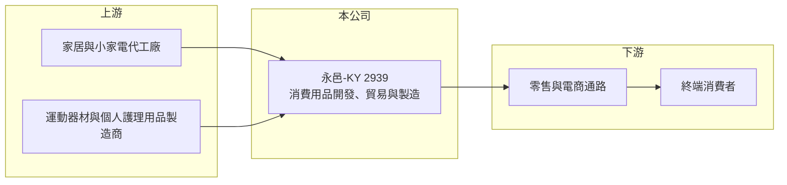

# 2939 永邑-KY

> 上市｜[[產業索引-貿易百貨業|貿易百貨業]]｜上市（櫃）日期 2018/01/11

# 第一章：企業模式與商業藍圖

> [!info] 撰寫說明
> 精簡版，由 Claude 依公開資料整理，架構比照 [[2330台積電]] 的四章研究，資料截至 2026-10-08。財務數字來源：MoneyDJ 年度財務比率頁、nStock 公司簡介、證交所開放資料（基本資料、2026 年第二季資產負債與綜合損益、營益分析、股利、每月營收）。公開資料有限，主要市場與銷售通路未查得；歷年營收為依成長率回推。#待校對

永邑-KY（股票代號：2939）是一家規模很小的消費性用品貿易與製造商。它的財務軌跡是營收連續多年大幅萎縮、虧損擴大，屬於仍在尋找出路的小型 KY 公司。

## 一、核心定位：多品類的家居與消費用品

- **公司基本面：** 永邑-KY 的控股公司 2015 年在開曼群島設立（前身為凱羿國際集團），2018 年 1 月在台上市，實收資本額約 4.55 億元，董事長為陳柏融。作為 [[KY股]]，主要營運據點在海外。
- **業務範圍：** 依 nStock 公司簡介，公司經營廚房用品、家居用品、美體養護、電子電器與運動器材等商品的進出口貿易與製造。品類分散，代表公司較像「商品開發與貿易平台」，而不是專注單一品類的品牌商。
- **主要市場與通路：** 本文未查得公司的主要銷售市場與通路比重，早年可能以中國的電視購物與電商通路為主（待校對）。

## 二、營收的長期萎縮

- **規模變化：** 依 nStock，2025 年營收約 2.99 億元；以 MoneyDJ 的營收成長率回推，2019 年約 22.4 億元，2023 年降到約 4 億元（推算）。六年間營收縮小到原來的一成多，說明原有的產品或通路已大幅失去競爭力。
- **為什麼重要：** 消費性用品貿易的毛利本來就不高，營收縮小後，固定的管理與銷售費用無法分攤，虧損就會快速擴大。2025 年營業利益率為 -52.89%（MoneyDJ）。

## 三、長期方向

公開資料未查得公司明確的轉型計畫。2026 年 1 至 9 月營收約 2.08 億元，年減約 6%（nStock），營收尚未止跌。永邑的長期課題是找到新的產品或通路，讓營收回到能支撐費用的規模。

# 第二章：護城河深度與競爭優勢

永邑目前缺乏明顯的護城河，消費性用品貿易的進入門檻低。

## 一、競爭條件

- **商品開發與貿易經驗：** 公司在多個品類累積了開發與採購經驗，可以較快切換商品，這是貿易商的基本能力，但不構成長期優勢。
- **輕資產彈性：** 規模小、固定資產不多（2026 年第二季底非流動資產約 2 億元），轉型的財務負擔相對低。
- **限制：** 品類分散、缺乏強勢品牌，在價格競爭中容易被淘汰。

## 二、主要競爭對手

| 對手 | 定位 | 對永邑的威脅 |
|---|---|---|
| 中國白牌與電商自有品牌 | 低價家居用品 | 價格極低，壓縮貿易商利潤 |
| 大型家電與廚具品牌 | 品牌商品 | 品牌與通路優勢明顯 |
| 平台直營與跨境電商 | 線上銷售 | 供應鏈直連消費者，貿易商角色被取代 |

## 三、守得住與守不住

- **守得住：** 本文未查得具體的利基市場，難以判斷。
- **守不住：** 一般家居與小家電的價格競爭。
- **觀察重點：** 毛利率能否回升到 20% 以上、營收能否止跌，以及公司是否提出明確的轉型或處分計畫。

# 第三章：財務體質與盈利規模

資料日期：2026-10-08，表格是撰寫當時的快照；最新月營收、毛利率、累計 EPS 由自動排程寫在本筆記的屬性欄位（月營收、毛利率、累計EPS 等）。#待校對

永邑的財務數字呈現營收大幅萎縮、毛利率下滑與虧損擴大的趨勢。

## 一、多年度財務表

| 年度 | 營收（新台幣） | [[毛利率]] | [[營業利益率]] | EPS（元） | [[ROE]] |
|---|---|---|---|---|---|
| 2019 | 約 22.4 億（推算） | 27.73% | 13.00% | 5.00 | 15.63% |
| 2020 | 約 18.3 億（推算） | 27.83% | 4.97% | 0.20 | 0.25% |
| 2021 | 約 11.5 億（推算） | 17.05% | -3.14% | -1.06 | -5.55% |
| 2022 | 約 8.3 億（推算） | 22.86% | -7.04% | 0.58 | 2.28% |
| 2023 | 約 4.0 億（推算） | 23.35% | -35.19% | -1.76 | -8.90% |
| 2024 | 約 3.0 億（推算） | 12.35% | -38.38% | -2.96 | -16.99% |
| 2025 | 2.99 億 | 8.69% | -52.89% | -3.68 | -25.96% |
| 2026 上半年 | 1.46 億 | 17.35% | -27.13% | -0.56 | 未查得 |

註：2019 至 2025 年比率取自 MoneyDJ；2025 年營收取自 nStock，2019 至 2024 年依 MoneyDJ 營收成長率回推，皆為推算。2026 上半年取自證交所開放資料。

- **營收趨勢：** 2019 至 2025 年營收年複合成長率約 -28%（推算）。
- **毛利率下滑：** 毛利率從約 28% 降到 2025 年的 8.69%，代表產品失去定價能力或需要降價出清存貨。
- **2026 年上半年：** 毛利率回升到 17.35%，虧損幅度較 2025 年縮小，但營業利益率仍為 -27%。

## 二、ROE 與資產結構

2021 至 2025 年平均 ROE 約 -11%（推算）。2026 年第二季底總資產約 8.1 億元、權益約 5.4 億元、負債約 2.7 億元（證交所開放資料），每股淨值約 11.84 元，股價淨值比約 2.0 倍。以虧損公司而言，股價明顯高於淨值，可能反映市場對轉型或其他題材的預期，這種評價缺乏獲利支撐。公司過去五年未配發股利。

## 三、[[ROIC]] 與 [[WACC]]

**ROIC 推算：** 2025 年營業損失約 1.58 億元（2.99 億元 × -52.89%），虧損年度不計稅盾。投入資本以權益約 5.4 億元，加上假設約 1.5 億元的有息負債（推估），合計約 6.9 億元，ROIC 約 -23%（推算）。

**WACC 推算：** 公債殖利率 1.75%、市場風險溢酬 6%、β 取小型消費類 KY 股常見值 1.0，再加計約 3% 的規模與公司治理風險溢酬，股東權益成本約 10.75%；負債比例低，WACC 約 9.5%（推算）。

**結論：** 永邑的 ROIC 自 2021 年起多數年度為負，與資金成本的差距很大，代表本業持續消耗股東資本。以目前的虧損速度，若營收無法回升，淨值會持續下降。

# 第四章：總體風險與地緣政治

永邑的風險以營運存續與規模不足為主。

## 一、產業週期

- **消費景氣：** 家居、小家電與運動器材屬於非必需消費，景氣轉弱時最先被延後購買。
- **通路轉移：** 消費者購物從傳統通路移向直播與跨境電商，中間貿易商的價值被壓縮。

## 二、營運風險

- **持續虧損：** 營業損失占營收的比例過高，若營收無法止跌，淨值會逐年下降，可能需要增資或縮減營運。
- **規模不足：** 營收只有約 3 億元，難以支撐研發、品牌與通路投資。
- **資訊揭露有限：** 公開資料對產品、市場與客戶的說明很少，投資人難以評估轉型進度。

## 三、其他風險

- **KY 公司治理：** 主要營運在海外，台灣投資人對資產與營運的查核能力有限。
- **匯率：** 營收以外幣計價，新台幣匯率變動會影響帳面營收與損益。
- **評價風險：** 股價淨值比約 2 倍而本業虧損，若轉型題材落空，股價可能大幅修正。

# 專有名詞解析

## 金融

- **[[KY股]]**：在開曼群島等地註冊、在台灣上市櫃的外國公司股票，主要營運多在海外。
- **[[ROIC]]**：投入資本報酬率，稅後營業利益除以股東權益與有息負債的合計，衡量本業對所有資金提供者的報酬。
- **[[WACC]]**：加權平均資金成本，依股東權益與負債的比重加權計算的資金成本，ROIC 高於它才代表創造價值。
- **[[毛利率]]**：營業毛利占營收的比例，反映產品定價能力與成本控制。

# 核心供應鏈

## 1. 上游：商品製造
- 家居、廚房用品、小家電、運動器材與個人護理用品的代工廠（推估）

## 2. 本公司
- 永邑-KY：多品類消費用品的開發、貿易與製造

## 3. 下游與同業
- 零售與電商通路、終端消費者（主要市場未查得）
- 同業：中國白牌家居用品業者、跨境電商賣家

## 最新新聞
<!-- news:start -->
<!-- news:end -->

## 相關連結
- [公開資訊觀測站](https://mopsov.twse.com.tw/mops/web/t05st03?step=1&firstin=1&co_id=2939)
- [Goodinfo](https://goodinfo.tw/tw/StockDetail.asp?STOCK_ID=2939)
- [Yahoo 股市](https://tw.stock.yahoo.com/quote/2939)
- [鉅亨網新聞](https://www.cnyes.com/twstock/2939/news)
