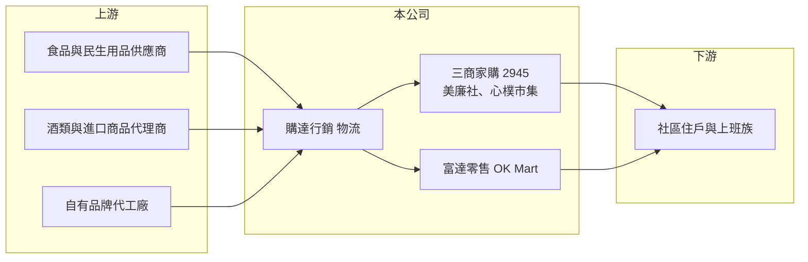

# 2945 三商家購

> 上市｜[[產業索引-貿易百貨業|貿易百貨業]]｜上市（櫃）日期 2021/11/30

# 第一章：企業模式與商業藍圖

> [!info] 撰寫說明
> 精簡版，由 Claude 依公開資料整理，架構比照 [[2330台積電]] 的四章研究，資料截至 2026-10-08。財務數字來源：MoneyDJ 年度財務比率頁、富果研究 2026 年 5 月法說會整理、工商時報旺得富 2026 年 1 月併購報導標題、證交所開放資料（基本資料、2026 年第二季資產負債與綜合損益、營益分析、股利、每月營收）；集團關係有部分憑記憶整理，已標「待校對」。#待校對

三商家購（股票代號：2945）是社區型超市「美廉社」的經營者，2026 年併購 OK 便利商店後，成為同時經營超市與超商的連鎖通路。理解它的關鍵，在於「小店、密集、低價」的社區零售模式，以及併購後的整合能力。

## 一、核心定位：社區型平價超市

- **公司基本面：** 三商家購 2013 年成立，2021 年 11 月上市，實收資本額 6.75 億元，董事長為陳翔玢，屬於三商集團（[[2905三商]]）旗下（待校對）。
- **美廉社的模式：** 美廉社開在住宅區巷弄，店面比一般超市小、比便利商店大，主打民生必需品的平價供應，以來客數與商品週轉率取勝。2026 年第一季差異化商品占比約 27.62%，包括[[自有品牌]]「心樸市集」，以及設有酒窖專區的 393 家門市。
- **為什麼重要：** 民生必需品需求穩定，景氣影響小，但毛利率低，必須靠規模採購與物流效率才能賺錢。

## 二、併購 OK 超商：從超市跨入超商

- **交易：** 依旺得富報導，三商家購董事會於 2026 年 1 月 23 日決議以現金 1.25 億元收購來來超商（OK Mart）100% 股權；交易於 2026 年 3 月 27 日完成，OK Mart 更名為富達零售，新增 376 家門市，總門市數接近 1,200 家（富果研究法說會整理；另有報導稱合計逾 1,500 家，以公司公告為準）。
- **營收規模跳升：** 第二季起 OK Mart 完整併表，2026 年 8 月營收年增約 35%，1 至 8 月累計營收約 125.2 億元、年增約 29%（證交所每月營收）。
- **整合重點：** 統一系統、採購、物流與會員服務，把美廉社的暢銷商品導入 OK Mart，並縮減虧損或無發展性的項目。

## 三、展店節奏與加盟

- **加盟比例提高：** 併入 OK Mart 後，整體[[加盟]]比例約 45%，公司計畫持續提高，以因應缺工並加速展店。加盟模式由加盟主負擔部分人力與營運，總部可以用較少資本擴大門市網絡。
- **物流分割：** 物流部門於 2026 年 6 月分割為子公司「購達行銷」，同時服務美廉社、心樸市集與 OK Mart，目標是用更大的配送量降低單位物流成本。
- **坪效：** 公司未揭露店均營收或[[坪效]]；2026 年第一季營收成長主要來自來客數增加，客單價與件單價略降。

## 四、長期方向

三商家購的長期方向是成為台灣第三大的社區型零售網絡，以超市加超商的雙業態覆蓋住宅區。能否成功，取決於 OK Mart 的轉虧與整合速度，以及能否在 [[2912統一超]]、[[5903全家]] 與全聯的夾擊下維持差異化。

# 第二章：護城河深度與競爭優勢

三商家購的護城河來自門市網絡密度與採購物流規模，但與大型同業相比仍屬於追趕者。

## 一、護城河的組成

- **社區門市網絡：** 門市深入住宅區，便利性是消費者選擇的主要原因之一。門市越密集，物流配送與品牌曝光的效率越高。
- **採購與物流規模：** 併購後門市數增加，可以向供應商爭取更好的進貨條件，物流子公司的配送量也隨之擴大。
- **差異化商品：** 自有品牌與酒類專區提高毛利與來客黏著度，2025 年毛利率約 27.32%（MoneyDJ），高於 2019 年的 24.30%。

## 二、主要競爭對手

| 對手 | 定位 | 對三商家購的威脅 |
|---|---|---|
| 全聯 | 全國最大超市連鎖 | 門市數與採購規模遠大於美廉社，價格競爭力強 |
| [[2912統一超]]（7-ELEVEN） | 便利商店龍頭 | 對 OK Mart 形成直接壓力，鮮食與服務能力強 |
| [[5903全家]] | 第二大便利商店 | 同上 |
| 家樂福等量販 | 大型量販 | 搶奪家庭大量採購需求 |

## 三、守得住與守不住

- **守得住：** 巷弄社區的近距離便利性與平價民生商品。
- **守不住：** 若與全聯或超商龍頭正面價格戰，規模劣勢明顯。
- **觀察重點：** OK Mart 的虧損何時收斂、加盟比例與展店速度、物流子公司能否降低成本。

# 第三章：財務體質與盈利規模

資料日期：2026-10-08，表格是撰寫當時的快照；最新月營收、毛利率、累計 EPS 由自動排程寫在本筆記的屬性欄位（月營收、毛利率、累計EPS 等）。#待校對

三商家購是典型的「高營收、薄利潤」連鎖通路，營業利益率長期在 1% 上下。

## 一、多年度財務表

| 年度 | 營收（新台幣） | [[毛利率]] | [[營業利益率]] | EPS（元） | [[ROE]] |
|---|---|---|---|---|---|
| 2019 | 未查得 | 24.30% | 0.51% | 0.70 | 3.53% |
| 2020 | 未查得（年增 9.25%） | 24.96% | 1.90% | 3.04 | 14.58% |
| 2021 | 未查得（年增 10.34%） | 25.47% | 1.33% | 3.21 | 12.07% |
| 2022 | 未查得（年減 2.79%） | 24.89% | 0.22% | 0.82 | 2.25% |
| 2023 | 未查得（年減 1.00%） | 25.92% | 0.86% | 1.50 | 4.40% |
| 2024 | 未查得（年增 1.82%） | 27.12% | 1.24% | 2.02 | 6.09% |
| 2025 | 未查得（年增 3.54%） | 27.32% | 1.15% | 2.14 | 6.48% |
| 2026 上半年 | 89.2 億 | 26.78% | 0.71% | 0.57 | 未查得 |

註：2019 至 2025 年比率取自 MoneyDJ（2025 年為個體數據，其餘為合併數據）；2025 年 1 至 8 月營收約 97.1 億元（證交所每月營收「去年累計」欄）。2026 上半年取自證交所開放資料，已含 OK Mart 併表。

- **薄利結構：** 營業利益率長期在 0.2% 至 1.9% 之間，毛利率每變動 1 個百分點，就可能讓營業利益增減一倍，屬於高[[營運槓桿]]模式。
- **毛利率緩步提升：** 2019 至 2025 年毛利率提高約 3 個百分點，反映自有品牌與差異化商品的貢獻。
- **併購初期稀釋：** 2026 年上半年營業利益率降到 0.71%，推估與 OK Mart 併表初期的整合成本與虧損有關。

## 二、ROE、股利與資本結構

2021 至 2025 年平均 ROE 約 6.3%（推算）。2026 年第二季底總資產約 81.6 億元、負債約 60.6 億元，負債比約 74%（證交所開放資料），其中大部分是門市租約認列的[[租賃負債]]，屬於連鎖零售業的正常結構。2025 年度配發現金股利 1.5 元，配發率約 70%，顯示公司願意把大部分盈餘發還股東。

## 三、[[ROIC]] 與 [[WACC]]

**ROIC 推算：** 2025 年營收以約 146 億元估算（以 1 至 8 月營收年化，推估），營業利益約 1.7 億元（× 1.15%），稅後約 1.3 億元。投入資本以 2026 年第二季底權益約 21 億元，加上假設約 30 億元的有息負債與租賃負債（推估），合計約 51 億元，ROIC 約 2.6%（推算）。

**WACC 推算：** 公債殖利率 1.75%、市場風險溢酬 6%、β 取民生零售常見值 0.6，股東權益成本約 5.35%；負債成本（含租賃隱含利率）假設 2.5%，稅後 2.0%；權益約占 41%、負債約占 59%，WACC 約 3.4%（推算）。

**結論：** 三商家購的 ROIC 略低於或接近資金成本，代表目前的規模只能勉強維持價值。併購 OK Mart 是以規模換取效率的賭注，若整合成功、營業利益率回到 1.5% 以上，ROIC 才有機會穩定超過 WACC。

# 第四章：總體風險與地緣政治

三商家購的風險集中在競爭、整合與成本三方面。

## 一、產業結構

- **寡占競爭：** 台灣超市與超商市場由全聯、統一超、全家等大型業者主導，三商家購的規模仍明顯較小，價格與門市選點上都面臨壓力。
- **門市飽和：** 台灣便利商店密度已經很高，新展店的邊際效益遞減，好的店點租金也持續上升。

## 二、營運風險

- **併購整合：** OK Mart 過去長期處於競爭劣勢，整合系統、物流與商品需要時間與費用，若整合不順，可能拖累整體獲利。
- **缺工與人事成本：** 零售業高度依賴第一線人力，基本工資調升與缺工都會壓縮薄利結構，這也是公司提高加盟比例的原因。
- **加盟管理：** 加盟比例提高後，總部對門市品質的控制力下降，需要更完善的管理制度。

## 三、其他風險

- **物價與進貨成本：** 民生商品價格受原物料與匯率影響，成本上升時若無法轉嫁，毛利率會被壓縮。
- **租金：** 門市以租賃為主，租金上漲會直接增加營運成本。
- **法規：** 食品安全、菸酒販售與勞動法規的變動，都會影響營運成本與商品組合。

# 專有名詞解析

## 金融

- **[[營運槓桿]]**：固定成本占比高的企業，營收小幅變動就會造成獲利大幅變動的現象。
- **[[租賃負債]]**：企業租用門市、廠房等資產，依會計準則把未來租金折現後認列在資產負債表上的負債。
- **[[ROIC]]**：投入資本報酬率，稅後營業利益除以股東權益與有息負債的合計，衡量本業對所有資金提供者的報酬。
- **[[WACC]]**：加權平均資金成本，依股東權益與負債的比重加權計算的資金成本，ROIC 高於它才代表創造價值。

## 產業

- **[[坪效]]**：每坪賣場面積每年創造的營收，衡量零售門市空間使用效率的指標。
- **[[自有品牌]]**：零售商自行開發、以自家品牌銷售的商品，毛利率通常高於代銷外部品牌。
- **[[加盟]]**：品牌總部授權加盟主使用品牌與營運系統開店，由加盟主出資並支付加盟金或權利金的展店模式。

# 核心供應鏈

## 1. 上游：商品供應
- 食品與民生用品供應商，例如 [[1216統一]]、[[1231聯華食]] 等台灣食品廠（推估，未查證實際往來）
- 酒類與進口商品代理商、自有品牌代工廠

## 2. 本公司
- 美廉社、心樸市集、富達零售（OK Mart）、物流子公司購達行銷
- 集團：[[2905三商]]（待校對）

## 3. 下游與同業
- 社區住戶與上班族
- 同業：全聯、[[2912統一超]]、[[5903全家]]、家樂福

## 最新新聞
<!-- news:start -->
<!-- news:end -->

## 相關連結
- [公開資訊觀測站](https://mopsov.twse.com.tw/mops/web/t05st03?step=1&firstin=1&co_id=2945)
- [Goodinfo](https://goodinfo.tw/tw/StockDetail.asp?STOCK_ID=2945)
- [Yahoo 股市](https://tw.stock.yahoo.com/quote/2945)
- [鉅亨網新聞](https://www.cnyes.com/twstock/2945/news)
