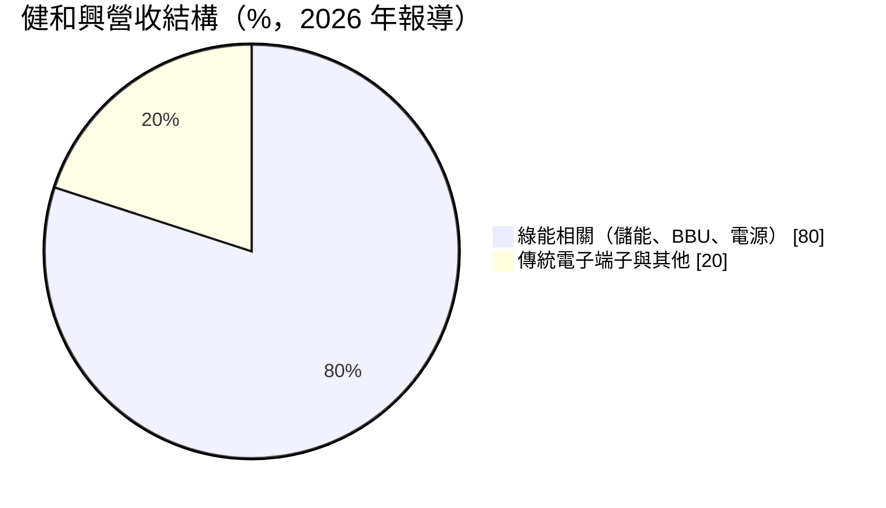
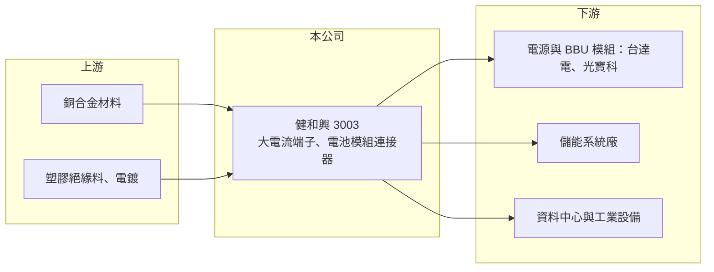

# 3003 健和興

> 上市｜[[產業索引-電子零組件業|電子零組件業]]｜上市（櫃）日期 2002/02/19

# 第一章：企業模式與商業藍圖

> [!info] 撰寫說明
> 精簡版，由 Claude 依公開資料整理，架構比照 [[2330台積電]]，資料截至 2026-10-08。來源：證交所開放資料快照（基本資料、2026 年第二季財報、股利）、Goodinfo 經營績效年度表、工商時報 2026 年 6 月報導。公開資料有限，產品別營收比重未查得。#待校對

健和興是端子與[[連接器]]廠，本章說明它如何從一般電子端子，轉型為以儲能、電源與電動車相關產品為主的綠能零件供應商。

- **核心業務：** 健和興成立於 1978 年，主要產品是電子端子與連接器，特別是承載大電流、高電壓的電源端子與電池模組連接器。端子是把電線與電路板或電池連接起來的金屬接點，看似簡單，但在高電流環境下，接觸電阻、發熱與耐久性直接關係到設備安全，因此高功率端子的技術門檻與認證要求遠高於一般訊號連接器。
- **營收結構：** 依 2026 年 6 月報導，綠能相關產品約占營收 80%，包括儲能系統、[[BBU]]（備援電池）電池模組與電源供應相關的連接器；其餘為傳統電子端子。報導指出公司是 [[2308台達電]]、[[2301光寶科]] 在電源與 BBU 電池模組連接器的主要供應商之一。
- **營運據點：** 總部在台灣，泰國新廠 2025 年底試產、2026 年正式量產，印度廠房已完工、2026 年底可望試產（依 2026 年 6 月報導）。在東南亞與印度設廠，主要是為了配合客戶分散生產地、降低關稅與地緣政治風險。
- **長期方向：** 公司鎖定 AI 資料中心電源架構轉向 [[HVDC]]（±400V 與 800V 直流）以及 BBU 普及化的趨勢，380V、1000V 等級的 HVDC 端子與 1500V 儲能用大線徑端子已在送樣階段。若新一代資料中心全面改用高壓直流供電，高壓、大電流端子的單價與用量都會提高。

# 第二章：護城河深度與競爭優勢

連接器市場由國際大廠主導，健和興的規模不大，本章分析它在高功率端子領域的利基。

- **競爭優勢：** 健和興的優勢在於大電流、高電壓端子的設計與量產經驗。電源與儲能客戶導入新端子時需要做溫升、耐久與安全認證，供應商一旦被設計進產品，在該產品生命週期內不易被替換。與台達電、光寶科等電源大廠的長期合作，也讓它能較早參與新規格（HVDC、BBU）的開發。
- **主要對手：** 國際對手包括 TE Connectivity、Molex、Amphenol 等全方位連接器大廠，台灣同業有 [[3023信邦]]、[[3665貿聯-KY]]、[[2392正崴]] 等。這些對手規模大、產品線廣，健和興的策略是專注在電源與儲能這個較窄但技術要求高的領域。
- **觀察重點：** 長期要看 HVDC 端子能否從送樣進入量產、泰國與印度廠能否取得新客戶，以及客戶集中度。綠能產品占八成意味著公司高度依賴少數電源大廠的訂單，客戶多元化程度是評估風險的關鍵。

# 第三章：財務體質與盈利規模

資料日期：2026-10-08，表格是撰寫當時的快照；最新月營收、毛利率、累計 EPS 由自動排程寫在本筆記的屬性欄位（月營收、毛利率、累計EPS 等）。#待校對

健和興 2021 至 2022 年受惠於儲能與電動車需求，獲利達到高峰，2025 年明顯下滑，2026 年上半年回升。

| 年度 | 營收（億元） | [[毛利率]] | [[營業利益率]] | EPS（元） | [[ROE]] |
|---|---|---|---|---|---|
| 2020 | 33.8 | 31.8% | 17.6% | 2.32 | 7.77% |
| 2021 | 47.9 | 35.5% | 23.4% | 4.98 | 15.1% |
| 2022 | 48.5 | 33.1% | 20.3% | 5.75 | 15.5% |
| 2023 | 41.7 | 30.7% | 16.5% | 3.49 | 8.86% |
| 2024 | 45.4 | 28.7% | 14.2% | 3.88 | 9.42% |
| 2025 | 44.0 | 22.2% | 6.6% | 0.99 | 2.55% |

- **營收規模：** 營收從 2020 年 33.8 億元成長到 2025 年 44.0 億元，五年年複合成長率約 5.4%。2025 年營收年減 3.28%，營業利益年減約 55%。2026 年上半年營收 28.8 億元，若下半年持平，全年可望創新高（推估）。
- **獲利：** 毛利率從 2021 年 35.5% 降到 2025 年 22.2%，反映銅價上漲、產品價格競爭與新廠初期成本。2026 年上半年毛利率約 23.6%、營業利益率約 10.0%、EPS 1.46 元，已超過 2025 全年。近五年（2021 至 2025 年）平均 ROE 約 10.3%。
- **財務特色：** 2026 年第二季末總資產 87.4 億元、總負債 20.6 億元，負債比約 24%，每股淨值 42.3 元。2025 年度配發現金股利 1 元，約等於當年 EPS；公司累積未分配盈餘約 38 億元，有能力在獲利低谷時維持配息。
- **[[ROIC]] 與 [[WACC]]：** 2025 年營業利益約 2.9 億元，稅後約 2.3 億元；投入資本以權益總額 66.8 億元計 ROIC 約 3.5%，含全部負債 20.6 億元則約 2.7%（推算）。2026 年上半年營業利益 2.9 億元，年化稅後約 4.6 億元，ROIC 約 5.3% 至 6.9%（推算）。WACC 以 CAPM 推估：無風險利率 1.75%、市場風險溢酬 6%、β 取連接器同業常見值 1.0，股東權益成本約 7.75%；負債成本 2%、稅後 1.6%，負債占資本 10%，WACC 約 7.1%（推算）。2021 至 2022 年 ROIC 明顯高於 WACC，2025 年則低於 WACC；新廠與 HVDC 產品能否讓 ROIC 回到 WACC 之上，是判斷轉型成效的指標。

# 第四章：總體風險與地緣政治

健和興的成長高度依賴綠能與資料中心電源，本章整理相關風險。

- **產業週期：** 儲能與電動車市場在 2023 至 2025 年經歷庫存調整與價格戰，健和興的獲利也同步下滑。AI 資料中心的電源投資目前快速成長，但資本支出週期一旦放緩，BBU 與電源相關連接器的需求也會隨之修正。
- **營運風險：** 銅是端子的主要原料，銅價大漲時若轉嫁不及會壓縮毛利，公司 2026 年已因銅價上漲調漲售價。泰國與印度新廠的良率爬坡、管理與折舊成本，短期可能壓低獲利率。客戶集中在少數電源大廠，議價能力相對弱。
- **其他風險：** HVDC 架構的標準仍在發展，若主流規格與公司送樣產品不同，前期研發投入可能無法回收。海外設廠涉及當地法規、勞動成本與匯率風險。

# 專有名詞解析

## 產業

- **[[連接器]]**：讓電子零件、模組或設備之間可插拔連接的元件，負責傳遞電力或訊號。
- **[[BBU]]**：備援電池單元，AI 伺服器機櫃在市電中斷時的短時供電裝置，可避免運算中斷。
- **[[HVDC]]**：高壓直流供電，資料中心以 ±400V 或 800V 直流取代傳統交流配電，可減少轉換損耗。

# 核心供應鏈

- 上游：銅合金帶材、塑膠絕緣材料與電鍍加工。
- 下游／客戶：電源與 BBU 模組廠 [[2308台達電]]、[[2301光寶科]]，儲能系統廠，資料中心與工業設備廠。
- 同業：[[3023信邦]]、[[3665貿聯-KY]]、[[2392正崴]]；國外有 TE Connectivity、Molex、Amphenol。

## 最新新聞
<!-- news:start（自動產生，請勿手動編輯此範圍） -->
- 2026-10-15 🏛️ 重訊 16:01｜公告本公司115年09月份自結損益｜[觀測站](https://mops.twse.com.tw/mops/#/web/t05st01)
- 2026-10-12 📰 媒體 19:51｜營收速報 - 健和興(3003)9月營收5.47億元年增率高達54.79％｜[鉅亨網](https://news.cnyes.com/news/id/6628761)

完整紀錄：[[3003健和興 新聞]]
<!-- news:end -->

## 相關連結
- [公開資訊觀測站](https://mopsov.twse.com.tw/mops/web/t05st03?step=1&firstin=1&co_id=3003)
- [Goodinfo](https://goodinfo.tw/tw/StockDetail.asp?STOCK_ID=3003)
- [Yahoo 股市](https://tw.stock.yahoo.com/quote/3003)
- [鉅亨網新聞](https://www.cnyes.com/twstock/3003/news)
