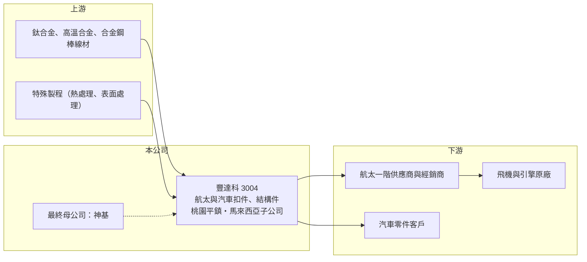

# 3004 豐達科

> 上市｜[[產業索引-鋼鐵工業|鋼鐵工業]]｜上市（櫃）日期 2002/02/25

# 第一章：企業模式與商業藍圖

> [!info] 撰寫說明
> 精簡版，由 Claude 依公開資料整理，架構比照 [[2330台積電]]，資料截至 2026-10-08。來源：Goodinfo 台灣股市資訊網經營績效年表（2016 至 2025 年）；nStock 公司資料（主要業務、最終母公司持股、馬來西亞子公司）；證交所開放資料快照（基本資料、2026 年上半年資產負債與損益、營益分析、2026 年 8 月營收說明、2025 年度股利、本益比淨值比）。產品別營收比重與具名客戶未查得。#待校對

豐達科技成立於 1997 年 10 月，2002 年 2 月在證交所上市，總部與工廠位於桃園平鎮，董事長蔡豐賜、總經理林威村，最終母公司為 [[3005神基]]（持股約 35%）。豐達科是台灣少數專攻[[航太扣件]]的公司，生意本質是用嚴格認證與長期驗證，換取比一般螺絲高得多的單價與毛利。

- **核心業務：** 豐達科製造、加工並代理買賣飛機與汽車用的扣件、結構件與相關零組件（nStock 整理公司登記資料）。航太扣件包括用在機身、機翼與引擎上的螺栓、螺帽與鉚釘，材質多為[[鈦合金]]、高溫合金與高強度合金鋼，每一顆都要能追溯原料批號與製程紀錄。
- **營收結構：** 航太與汽車的營收比重未查得。從營收變化看，2019 年營收 28.2 億元，2020 至 2021 年疫情使航空業停擺，營收降到 14.3 億元並出現虧損，之後隨民航機產量回升，2025 年營收達 40.6 億元（Goodinfo），顯示航太是目前的主要成長來源（推估）。
- **營運據點：** 總部與工廠位於桃園平鎮（證交所基本資料）。2023 年董事會通過投資馬來西亞子公司（nStock 新聞），用途與產能規劃未查得，推估與擴充產能或分散產地有關。
- **長期方向：** 民航機訂單積壓多年，波音與空中巴士持續提高產量，帶動上游扣件需求。豐達科 2026 年 8 月營收說明寫的是「客戶需求增加」（證交所資料），長期要看擴產速度能否跟上需求，以及新的認證料號能否持續增加。

# 第二章：護城河深度與競爭優勢

豐達科的護城河來自航太認證的高門檻與長驗證週期，屬於扣件業中較寬的護城河。

- **競爭優勢：** 航太供應商必須取得 [[AS9100]] 品質系統與特殊製程（如熱處理、表面處理）的[[Nadcap]] 認證，每一個料號還要經過飛機或引擎原廠的資格認可，整個流程往往需要數年。一旦進入合格供應商名單，客戶很少更換，這使得豐達科的毛利率在正常年份能維持在 24% 至 32%（Goodinfo）。
- **主要對手：** 全球航太扣件市場由美國 Howmet（Arconic 分拆）、PCC（Precision Castparts，隸屬波克夏）旗下扣件事業與法國 LISI Aerospace 等大廠主導，豐達科屬於規模較小的二線供應商（對手名單為一般產業資訊，待校對）。國內航太零組件同業包括 [[2634漢翔]]、[[5009榮剛]]（材料端）等。
- **觀察重點：** 2023 至 2025 年毛利率約 24.5% 至 27.7%，營業利益率 11% 至 13%（Goodinfo），2026 年上半年毛利率 24.15%、營業利益率 13.16%（證交所資料）。長期要看營收擴大後營業利益率能否往 15% 以上提升，以及產能擴充是否壓抑短期毛利。

# 第三章：財務體質與盈利規模

資料日期：2026-10-08，表格是撰寫當時的快照；最新月營收、毛利率、累計 EPS 由自動排程寫在本筆記的屬性欄位（月營收、毛利率、累計EPS 等）。#待校對

豐達科的財務呈現「疫情重挫、之後高速成長」的軌跡：2021 年營收只剩 14.3 億元，四年後成長到 40.6 億元，年複合成長率接近三成。

| 年度 | 營收（億元） | [[毛利率]] | [[營業利益率]] | EPS（元） | [[ROE]] |
|---|---|---|---|---|---|
| 2021 | 14.3 | 11.6% | -8.22% | -1.84 | -5.30% |
| 2022 | 21.9 | 23.3% | 5.78% | 2.85 | 8.06% |
| 2023 | 30.7 | 26.5% | 11.2% | 5.77 | 14.4% |
| 2024 | 35.0 | 27.7% | 13.4% | 6.88 | 14.9% |
| 2025 | 40.6 | 24.5% | 11.7% | 5.85 | 10.4% |

- **長期指標：** 2021 至 2025 年營收年複合成長率約 30%（推算），平均 ROE 約 8.5%（推算，受 2021 年虧損拉低）；疫情前 2016 至 2019 年 ROE 介於 12.5% 至 19.3%（Goodinfo），代表正常年份的資本報酬約在一成五上下。2025 年度配發現金股利 2.55 元，配發率約 44%（證交所資料推算），保留較多盈餘支應擴產。
- **[[ROIC]] 與 [[WACC]]：** 2025 年營業利益約 4.75 億元（營收 40.6 億元 × 11.7%），稅後約 3.8 億元。投入資本以 2026 年第二季權益總計 37.8 億元，加上有息負債推估約 31.6 億元（負債總計 52.7 億元的六成，官方快照未拆分）計算，2025 年 ROIC 約 5.5%（推算）；2026 年上半年營業利益 3.4 億元，年化 ROIC 約 7.9%（推算）。WACC 約 6.1%（推算：無風險利率 1.75%、市場風險溢酬 6%、β 取航太零組件同業常見值 1.0，股東權益成本 7.75%；稅前負債成本 2.5%、稅率 20%，以市值約 78 億元與有息負債約 31.6 億元計算權重約 71：29）。目前 ROIC 與 WACC 大致相當，擴產期的資本投入尚未完全轉為獲利；若營收持續成長、營業利益率回到 13% 以上，ROIC 可望明顯高於 WACC。
- **財務特色：** 2026 年第二季總資產 90.4 億元、負債 52.7 億元，負債比率約 58%，非流動負債 24.8 億元，推估與擴產的長期借款有關。每股淨值 58.64 元。2026 年上半年營收 25.9 億元、EPS 4.01 元（證交所資料）。

# 第四章：總體風險與地緣政治

豐達科的風險集中在航空業景氣、客戶與機型集中度，以及擴產期的財務壓力。

- **產業週期：** 航太扣件需求跟著飛機交機量走，2020 至 2021 年疫情就讓營收在兩年內腰斬並轉虧。飛機原廠的品質問題、罷工或供應鏈瓶頸，都可能讓交機延後，訂單會沿供應鏈遞延到扣件廠。
- **營運風險：** 擴產期借款增加、折舊上升，若需求不如預期，產能利用率下降會壓低毛利率。鈦合金與高溫合金原料價格高且供應集中，原料取得與價格波動直接影響成本。客戶多為國際航太大廠與其一階供應商，議價力較強。
- **其他風險：** 營收以美元計價為主，新台幣升值會壓縮獲利；美國關稅與國防、出口管制規範可能影響航太零件的跨國供應。最終母公司神基的策略變動，也可能影響豐達科的資本配置與股利政策。

# 專有名詞解析

## 金融

- **[[ROIC]]**：投入資本報酬率，稅後營業利益除以股東權益加有息負債，衡量本業運用資本的效率。
- **[[WACC]]**：加權平均資金成本，股東與債權人要求報酬率的加權平均，是 ROIC 要超越的門檻。

## 產業

- **[[航太扣件]]**：用於飛機機身、機翼與引擎的螺栓、螺帽與鉚釘，需符合航太規格並可追溯原料與製程紀錄。
- **[[鈦合金]]**：以鈦為主並加入其他金屬的合金，重量輕、強度高且耐腐蝕。
- **[[AS9100]]**：航太產業的品質管理系統標準，是進入航太供應鏈的基本門檻。
- **[[Nadcap]]**：航太特殊製程（熱處理、表面處理、非破壞檢測等）的國際認證計畫，由航太原廠共同推動。

# 核心供應鏈

- 上游：鈦合金、高溫合金與合金鋼材料（具名供應商未查得），國內特殊鋼與超合金供應商如 [[5009榮剛]]。
- 下游／客戶：國際航太一階供應商、扣件經銷商與飛機、引擎原廠，以及汽車零件客戶（具名客戶未查得）。
- 同業：Howmet、PCC、LISI Aerospace 等國際航太扣件廠；國內航太零組件業者如 [[2634漢翔]]。母公司 [[3005神基]]。

## 最新新聞
<!-- news:start -->
<!-- news:end -->

## 相關連結
- [公開資訊觀測站](https://mopsov.twse.com.tw/mops/web/t05st03?step=1&firstin=1&co_id=3004)
- [Goodinfo](https://goodinfo.tw/tw/StockDetail.asp?STOCK_ID=3004)
- [Yahoo 股市](https://tw.stock.yahoo.com/quote/3004)
- [鉅亨網新聞](https://www.cnyes.com/twstock/3004/news)
