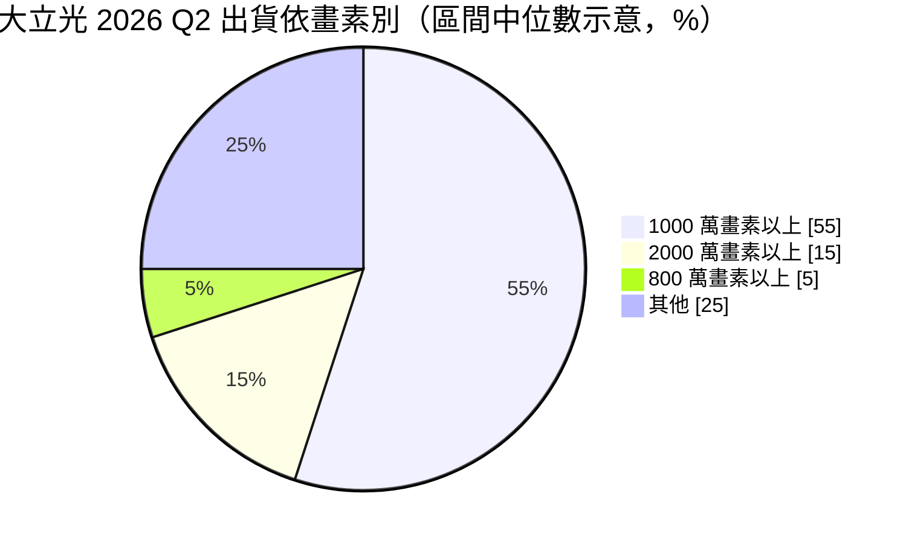
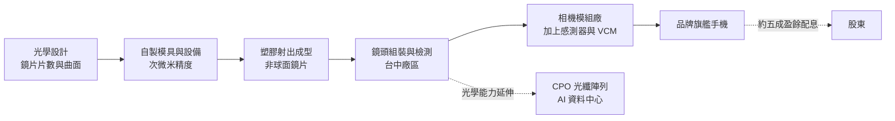
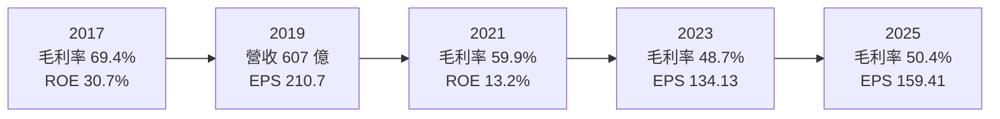
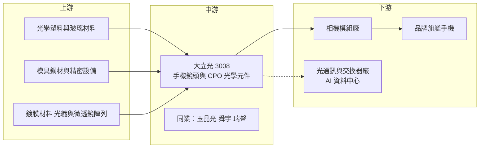

# 3008 大立光

> 上市｜[[產業索引-光電業|光電業]]｜上市（櫃）日期 2002/03/11

# 第一章：企業模式與商業藍圖

> [!info] 撰寫說明
> 本文由 Claude 依公開資料整理，架構比照 [[2330台積電]] 的四章研究，資料截至 2026-10-08。財務數字來源：證交所開放資料快照（基本資料、2026 年第二季綜合損益與資產負債、股利）、Goodinfo 經營績效頁與股利政策頁（2016 至 2025 年）、MoneyDJ 季資產負債表（2026 年第二季現金與金融資產）、ETtoday 與自由時報 2026 年法說會報導（CPO 時程、新廠規劃）；市占率、專利訴訟沿革與部分產業描述係憑舊版筆記與記憶整理，尚未逐條比對原始文件。#待校對

在評估一家公司的長期投資價值時，第一步是看懂它靠什麼賺錢、為什麼能一直賺下去。本章針對大立光電（股票代號：3008，以下簡稱大立光）的商業模式進行定性分析，說明它如何在手機鏡頭這個看似標準化的零組件市場，長期維持零組件業罕見的高毛利，以及為什麼它的毛利率在過去十年從近七成降到五成左右，又為何開始把光學能力延伸到 AI 資料中心的光通訊。

## 一、核心定位：全球高階手機鏡頭龍頭

大立光成立於 1987 年 4 月 17 日，總部在台中，2002 年 3 月上市。依證交所資料，董事長為林恩平、總經理為黃有執；實收資本額只有約 13.1 億元，股數極少，因此每股盈餘與股價都以百元、千元計，是台股著名的高價股。大立光從塑膠鏡片起家，2000 年後搭上照相手機浪潮，成為全球最大的手機鏡頭製造商，是少數能穩定量產 8P、9P 高階鏡頭的廠商（P 代表一顆鏡頭中塑膠鏡片的片數；全球市占率超過三成的說法來自舊版筆記，待校對）。

大立光的產品是「鏡頭」本身：把多片[[非球面鏡片]]、間隔環與鏡筒組裝成光學模組，再交給相機模組廠，與影像感測器、音圈馬達（[[VCM]]）組成手機相機。它的商業模式有兩個長期特性。

- **以精密製造換取高毛利：** 手機鏡片的形狀精度要求在次微米等級，鏡片越多，累積誤差越難控制。大立光從光學設計、模具、射出成型到組裝都自己做，並自行設計部分設備，[[良率]]高於同業，單位成本就能壓得比同業低，這是它毛利率長期遠高於其他光學廠的原因。
- **高度集中於旗艦手機：** 主要客戶是 [[AAPL蘋果]] 等國際品牌的旗艦機，產品集中在高畫素主鏡頭與[[潛望式鏡頭]]。這讓大立光享有最高階規格的訂單，但也讓營收與少數客戶的新機週期高度連動。

## 二、終端應用板塊：以高畫素手機鏡頭為主

大立光不揭露應用別營收，只在法說會公布出貨的畫素別區間。依 2026 年第二季法說會，1,000 萬畫素以上占 50% 至 60%，2,000 萬畫素以上占 10% 至 20%，其餘為較低畫素產品。由於公司只給區間，以下以區間中位數示意：

- **手機主鏡頭與潛望式長焦：** 這是營收與獲利的主體。手機相機規格每年升級，感測器變大、光圈變大、長焦倍數提高，鏡片片數與精度門檻都跟著提高，有利於製程能力最強的大立光。
- **前鏡頭、超廣角與其他鏡頭：** 單價較低、規格門檻較低，中國鏡頭廠的競爭激烈，是大立光較難維持定價的部分。
- **光通訊新事業：** 用於共同封裝光學（[[CPO]]）的[[光纖陣列]]（FA）與光纖陣列單元（FAU）。依 2026 年 10 月法說會報導，FA 已通過一家客戶認證，FA 與 FAU 預計 2027 年量產，多排 FA 預計 2028 年；目前尚未對營收形成明顯貢獻。

## 三、資本轉化邏輯：模具、良率與現金

- **垂直整合與自動化：** 從光學設計、模具、射出、鍍膜到組裝都在內部完成，生產集中在台中。大立光持續推動自動化產線，並自行設計設備，讓它在新規格量產初期能比同業更快解決良率問題。
- **良率決定毛利：** 每年新機種量產初期良率較低，毛利率會下滑，隨良率爬坡回升。因此大立光的毛利率除了反映價格，也反映新規格的製造難度。
- **現金累積：** 大立光幾乎沒有借款，獲利大部分以現金保留在帳上。依證交所與 MoneyDJ 資料，2026 年第二季總資產約 2,261 億元，其中現金及約當現金約 1,185 億元、流動金融資產約 164 億元，權益總計約 1,935 億元。這筆現金讓大立光能在景氣低點持續投資，也能支撐每年兩次的穩定配息。

## 四、企業長期藍圖：手機鏡頭升級與光通訊第二支柱

- **手機鏡頭規格升級：** 更大的感測器、可變光圈與潛望式長焦，持續提高鏡片設計與製造門檻。公司表示下一代主鏡頭將搭配更大感測器、潛望式升級預計在 2028 年，這些規格升級是大立光維持技術領先的主戰場。
- **CPO 光通訊：** 大立光把精密光學與量產能力延伸到 AI 資料中心的光通訊元件。依自由時報報導，一座新落成廠房將全數用於 FAU 量產，2026 年新購土地上的廠房預計 2030 年完成、同樣用於光通訊；2026 年第三季資本支出 81.8 億元，多數是購地款。這是大立光成立以來最明確的第二事業布局。
- **其他光學應用：** 車用鏡頭、AR／VR 與機器視覺等，屬於長期選項，目前比重未揭露。

# 第二章：護城河深度與競爭優勢

在長期價值投資中，「護城河」指企業抵禦競爭、長期維持超額利潤的保護機制。本章分析大立光的護城河構成、全球主要競爭對手，以及這些優勢在中國鏡頭廠追趕、手機市場成熟之下能守住多少。

## 一、大立光護城河的核心組成要素

大立光是台灣電子零組件中少數具備「寬護城河」特徵的公司，但這條護城河在過去十年明顯變窄。它由三個要素構成：

- **1. 製程 know-how 與良率：** 高階鏡頭的片數越多、厚度越薄，公差越難控制。大立光自製模具與設備，長期累積的製程參數與量產經驗，是同業最難複製的部分。在最高階規格上，誰能先達到可接受的良率，誰就能先拿到訂單並享有較好的價格。
- **2. 光學設計專利：** 大立光擁有大量光學設計專利，過去曾對同業提起專利訴訟（訴訟沿革待校對），提高對手進入高階規格的法律成本。
- **3. 旗艦客戶的共同開發關係：** 高階手機的鏡頭規格要提前一到兩年共同開發，大立光長期是旗艦機主鏡頭的主要供應商，新規格往往由它先量產。這種合作關係需要長期的品質紀錄，不是短期內能被取代的。

## 二、全球主要競爭對手格局

| 對手 | 定位 | 對大立光的影響 |
|---|---|---|
| 舜宇光學 | 中國最大手機鏡頭與模組廠 | 出貨量大，深耕中國品牌，逐步切入高階規格 |
| [[3406玉晶光]] | 台灣鏡頭廠，國際品牌供應商 | 在部分機種分食份額，是客戶的第二供應來源 |
| 瑞聲科技 | 中國聲學與光學廠 | 以玻塑混合鏡頭等不同技術路線爭取高階規格 |
| [[3019亞光]]、[[3504揚明光]] | 台灣光學廠 | 主要在車用、安控、投影等非手機領域，與大立光重疊有限 |
| 光通訊元件廠 | FA 與光學被動元件 | 大立光在 CPO 是新進者，需與既有光通訊供應商競爭 |

## 三、優勢轉化：哪些守得住、哪些守不住

- **守得住：** 旗艦機高畫素主鏡頭與潛望式長焦。這些規格門檻高、量產良率是關鍵，大立光仍居領先，[[營業利益率]]在 2025 年仍有 38.5%，是零組件業極高的水準。
- **守不住：** 中低階手機鏡頭與中國品牌訂單。中國鏡頭廠以規模、價格與在地關係取得主導地位，中國品牌也傾向扶植本土供應鏈。Goodinfo 資料顯示，大立光毛利率由 2017 年的 69.4% 下降到 2023 年的 48.7%、2025 年的 50.4%，十年間少了將近 20 個百分點，這是定價能力被侵蝕的長期證據。
- **觀察重點：** 長期可以追蹤三件事。第一是毛利率能否穩定在五成上下，不再出現新的下台階；第二是新一代大感測器主鏡頭與潛望式升級的量產進度；第三是 FA 與 FAU 能否在 2027 年如期量產，並在 2030 年新廠完成後成為真正的第二支柱。

# 第三章：財務體質與盈利規模

資料日期：2026-10-08。數字取自 Goodinfo 經營績效頁與股利政策頁、證交所開放資料快照與 MoneyDJ 季資產負債表，表格是撰寫當時的快照；最新月營收、毛利率、累計 EPS 由自動排程寫在本筆記的屬性欄位（月營收、毛利率、累計EPS 等）。#待校對

財務報表是檢驗護城河是否真實存在的最終標準。本章用十年的數據，檢視大立光的獲利水準如何從高峰回落，以及大量現金如何影響它的資本報酬。

## 一、獲利能力的基石：三率

| 年度 | 營收（億元） | [[毛利率]] | [[營業利益率]] | EPS（元） | [[ROE]] |
|---|---|---|---|---|---|
| 2021 | 470 | 59.9% | 49.3% | 139.28 | 13.2% |
| 2022 | 477 | 54.7% | 42.8% | 169.52 | 15.2% |
| 2023 | 488 | 48.7% | 36.5% | 134.13 | 11.2% |
| 2024 | 595 | 52.5% | 40.4% | 194.17 | 14.9% |
| 2025 | 611 | 50.4% | 38.5% | 159.41 | 11.5% |

（來源：Goodinfo 經營績效頁，合併報表。2016 至 2020 年毛利率在 67.0% 到 69.4% 之間、ROE 在 18.4% 到 32.4% 之間。2026 年上半年依證交所資料，營收 292.1 億元、毛利率 49.41%、營業利益率 37.52%、EPS 82.35 元。）

- **毛利率兩段式下滑：** 2016 至 2020 年毛利率穩定在 67% 到 69%，2021 年降到 59.9%，2023 年再降到 48.7%，之後在五成上下持平。這反映兩件事：高階鏡頭的價格競爭加劇，以及中國市場的份額流失。
- **營收停滯：** 2016 至 2025 年營收由 484 億元成長到 611 億元，年複合成長率約 2.6%（推算）；2020 至 2025 年約 1.8%（推算）。手機市場成熟，大立光的營收成長主要靠規格升級帶動的單價提高，而非出貨量。
- **業外收益比重高：** 大立光帳上現金龐大，利息收入與匯兌損益對淨利影響很大。新台幣大幅升值的年度，匯兌損失會壓低 EPS；評估本業時應以營業利益為準。

## 二、[[ROE]]：資本效率

近 5 年（2021 至 2025 年）平均 ROE 約 13.2%（推算），遠低於 2016 至 2019 年 24% 到 32% 的水準。ROE 下降有兩個原因：一是營業利益率從約 60% 降到約 40%；二是保留盈餘持續累積，權益基數越來越大。依證交所資料，2026 年第二季每股淨值約 1,464 元，權益總計約 1,935 億元，其中保留盈餘約 1,834 億元，股本只有約 13 億元。也就是說，大立光的 ROE 被大量閒置現金稀釋，本業的資本效率其實遠高於帳面 ROE。

## 三、資本支出、自由現金流與股利

- **[[CapEx]]：** 過去以台中廠房與自動化設備為主，金額相對營業現金流不高；2026 年起因光通訊新事業購地與建廠，資本支出明顯提高，第三季單季達 81.8 億元（自由時報）。多年度資本支出數字本次未查得。
- **[[自由現金流]]：** 多年度數字未查得。從帳上現金持續累積、從無借款來看，自由現金流長期為正（推估）。
- **股利穩定度：** 依 Goodinfo，2016 至 2025 年度現金股利在 63.5 到 97.5 元之間，2021 年起改為一年兩次發放。以各年度 EPS 計算，2016 至 2019 年度配息率約 37.5%，2020 至 2025 年度提高到約 50%（推算），十年間非常一致，顯示大立光有固定比例配息的紀律。2025 年度兩次合計 80 元，以 EPS 159.41 元計算配息率約 50.2%（推算）。

## 四、[[ROIC]] 與 [[WACC]]：價值創造利差

- **ROIC（推算）：** 以 2025 年營業利益約 235 億元（營收 611 億元乘以營業利益率 38.5%）、扣除 20% 稅率後約 188 億元為分子。大立光沒有銀行借款，有息負債只有約 1.7 億元的租賃負債（MoneyDJ），若以 2026 年第二季權益總計約 1,935 億元加上租賃負債作為投入資本，ROIC 約 9.7%（推算）。若扣除現金及約當現金約 1,185 億元與流動金融資產約 164 億元，本業實際使用的資本約 588 億元，ROIC 約 32%（推算）。
- **WACC（推算）：** 以 [[CAPM]] 估算股東權益成本：無風險利率取台灣 10 年期公債約 1.75%，市場風險溢酬 6%，β 假設 1.0（未查得大立光實際 β 值，取電子零組件股常見值），權益成本約 7.75%。大立光幾乎沒有有息負債，WACC 約等於權益成本，約 7.75%（推算）。
- **價值創造判斷：** 以本業實際使用的資本計算，ROIC 約 32%，遠高於約 7.75% 的資金成本，代表手機鏡頭本業仍然是高度創造價值的事業；但以全部權益計算的 ROIC 只有約 9.7%，只略高於資金成本。差距來自帳上大量閒置現金：這些現金只賺取利息，報酬率低於股東要求的報酬。長期而言，大立光創造價值的關鍵有兩個：一是本業毛利率不再下滑，二是累積的現金能否投入報酬率夠高的新事業（例如光通訊），或以更高的配息、買回庫藏股還給股東。

# 第四章：總體風險與地緣政治

任何企業都無法脫離宏觀環境獨立存在。本章分析大立光未來必須面對的地緣政治、產業週期、營運與技術風險。

## 一、地緣政治風險

- **中國市場的本土化：** 中國手機品牌傾向扶植本土鏡頭廠，美國的出口管制也讓部分中國客戶與台灣供應鏈的合作受到影響，大立光在中國市場的份額長期受限。
- **生產集中台灣：** 主要產能都在台中，兩岸情勢、地震、供電與供水風險都會直接影響全部產能。對國際客戶而言，供應來源集中在台灣，也可能在未來被要求分散產地。
- **關稅與供應鏈重組：** 美國對手機與零組件的關稅政策，會透過品牌客戶的組裝地與採購決策間接影響大立光的訂單。

## 二、產業週期與市場結構風險

- **手機市場成熟：** 全球智慧型手機出貨已進入低成長，大立光的成長只能依靠規格升級與市占提升，營收長期停滯的風險高。
- **客戶集中：** 營收高度依賴少數國際品牌的旗艦機，新機銷售、規格決策與供應商分配直接影響營收，並造成明顯的季節性：下半年拉貨旺季，上半年淡季。
- **[[長鞭效應]]：** 品牌廠調整庫存或下修新機需求時，零組件廠的訂單波動會被放大。

## 三、營運環境的隱性風險

- **新機種良率：** 每年新規格量產初期良率低，是毛利率短期波動的主因。若遇上規格難度大幅提高的年度，毛利率可能出現新的下台階。
- **匯率：** 營收以美元計價，帳上也有大量美元資產，新台幣升值會同時壓低營收與造成業外匯兌損失。
- **綠電與成本：** 國際客戶要求供應鏈使用再生能源，綠電採購成本若無法即時反映在報價上，會壓縮毛利率。
- **新事業執行風險：** 光通訊的客戶、技術與製程都和手機鏡頭不同，新廠投資會先拉低資本報酬，若量產時程延後或份額不如預期，投資回收期會拉長。

## 四、科技演進風險

- **鏡頭技術路線：** [[玻塑混合鏡頭]]、超透鏡（[[Metalens]]）等新技術若成為主流，可能削弱純塑膠鏡片製程的優勢，大立光需要持續投入研發以跟上。
- **手機相機的角色變化：** 若手機影像的進步越來越依賴感測器與運算攝影，而非鏡頭本身，鏡頭的附加價值可能被壓縮。
- **光通訊架構演進：** CPO 的標準與架構仍在演進，若主流方案改變，大立光的 FA 與 FAU 產品可能需要重新開發。

# 專有名詞解析

## 半導體

- **[[良率]]**：合格產品占總產出的比例，新機種量產初期的良率是大立光毛利率的主要變數。

## 應用

- **[[CPO]]**：共同封裝光學，把光學收發元件和交換器晶片封裝在一起，可降低 AI 資料中心高速傳輸的耗電。
- **[[光纖陣列]]**：FA，把多條光纖精準排列固定的元件，是 CPO 與光模組中讓光纖對準晶片的關鍵零件。

## 金融

- **[[CapEx]]**：資本支出，企業購買土地、廠房與設備的支出。
- **[[自由現金流]]**：營業活動現金流減去資本支出，代表企業可自由用於配息、還債或併購的現金。
- **[[長鞭效應]]**：終端需求的小幅變動，沿供應鏈往上游傳遞時被逐級放大，造成上游庫存與訂單劇烈波動。
- **[[ROIC]]**：投入資本報酬率，稅後營業利益除以股東權益加有息負債，衡量本業運用資本的效率。
- **[[WACC]]**：加權平均資金成本，依股東權益與負債的比重，加權計算公司取得資金的平均成本。
- **[[CAPM]]**：資本資產定價模型，以無風險利率加上 β 乘以市場風險溢酬，估算股東要求的報酬率。

## 產業

- **[[非球面鏡片]]**：表面曲率不是單一球面的鏡片，可用較少片數修正像差，是手機鏡頭小型化的關鍵。
- **[[潛望式鏡頭]]**：以稜鏡把光路轉折 90 度、在手機內部橫向排列鏡片的長焦鏡頭，可在薄機身內實現高倍光學變焦。
- **[[玻塑混合鏡頭]]**：同一鏡頭中混用玻璃與塑膠鏡片，兼顧玻璃的光學性能與塑膠的輕薄和成本。
- **[[VCM]]**：音圈馬達，推動鏡頭前後移動以完成自動對焦的小型馬達。
- **[[Metalens]]**：超透鏡，以奈米結構在平面上操控光線的光學元件，未來可能取代部分傳統曲面鏡片。

# 核心供應鏈

## 1. 上游：材料與設備
- 光學級塑膠與玻璃材料：多為日本化學廠，大立光未揭露具體供應商
- 精密模具與設備：以自製模具與自行設計設備為主
- 光通訊材料：光纖、外購的微透鏡陣列（PMLA）

## 2. 中游：鏡頭同業
- [[3406玉晶光]]、舜宇光學、瑞聲科技
- 非手機光學廠：[[3019亞光]]、[[3504揚明光]]

## 3. 下游：手機品牌與模組
- 品牌手機：[[AAPL蘋果]] 等國際品牌
- 影像感測器搭配：[[SONY索尼]]（產業搭配關係，非大立光直接客戶）

## 4. 新事業：光通訊
- CPO 用 FA 與 FAU，終端為 AI 資料中心交換器；客戶未揭露

## 最新新聞
<!-- news:start（自動產生，請勿手動編輯此範圍） -->
- 2026-10-18 📰 媒體 12:02｜正面回應大立光林恩平 友達彭双浪：Micro LED光通訊短距傳輸有優勢｜[鉅亨網](https://news.cnyes.com/news/id/6632880)
- 2026-10-17 📰 媒體 20:30｜光通訊水很深 !? 大立光跨足CPO真能變萬金股？美巨頭爆「缺貨率70%」！法人：不只台積電，還有這幾檔吃不完！｜[鉅亨網](https://news.cnyes.com/news/id/6632765)
- 2026-10-13 📰 媒體 18:12｜拿出賺大錢的霸氣!!大立光、天二科⊕、冠西電⊕、其陽⊕｜[鉅亨網](https://news.cnyes.com/news/id/6629538)
- 2026-10-13 📰 媒體 11:21｜《價值型投資 最新產業研究報告》大立光 (3008-TW) 光纖陣列通過認證，完整模組開啟新商機｜[鉅亨網](https://news.cnyes.com/news/id/6629279)
- 2026-10-12 🏛️ 重訊 11:10｜大立光電澄清媒體報導｜[觀測站](https://mops.twse.com.tw/mops/#/web/t05st01)

完整紀錄：[[3008大立光 新聞]]
<!-- news:end -->

## 相關連結
- [公開資訊觀測站](https://mopsov.twse.com.tw/mops/web/t05st03?step=1&firstin=1&co_id=3008)
- [Goodinfo](https://goodinfo.tw/tw/StockDetail.asp?STOCK_ID=3008)
- [Yahoo 股市](https://tw.stock.yahoo.com/quote/3008)
- [鉅亨網新聞](https://www.cnyes.com/twstock/3008/news)
