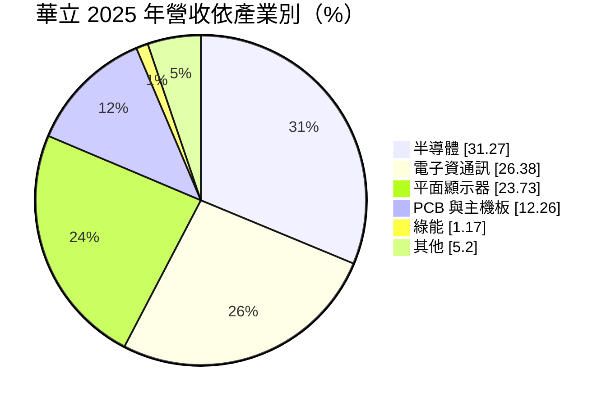
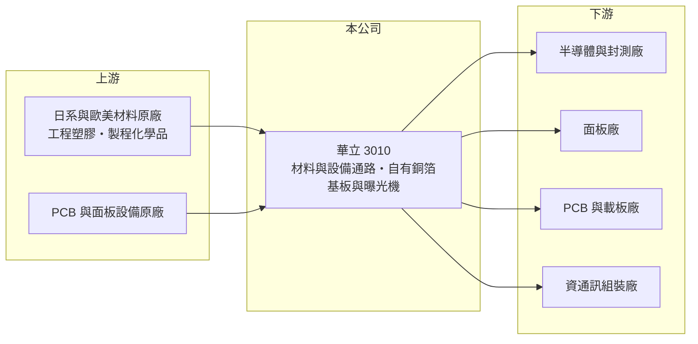

# 3010 華立

> 上市｜[[產業索引-電子通路業|電子通路業]]｜上市（櫃）日期 2002/07/22

# 第一章：企業模式與商業藍圖

> [!info] 撰寫說明
> 精簡版，由 Claude 依公開資料整理，架構比照 [[2330台積電]]，資料截至 2026-10-08。來源：證交所開放資料快照（基本資料、2026 年第二季資產負債與損益、股利）、Goodinfo 經營績效頁、富邦 MoneyDJ 公司基本資料（2025 年營收比重）、優分析新聞標題。代理品牌與客戶名單未逐條查證。#待校對

華立企業（以下簡稱華立）是台灣歷史最久的電子材料通路商之一，理解它的關鍵在於：它賣的不是 IC，而是半導體、面板與 [[PCB]] 工廠生產時消耗的材料、化學品與設備，並且逐步加入自有材料產品。

- **核心業務：** 華立成立於 1968 年，總部在高雄，2002 年上市。公司屬於[[電子通路]]，替國際材料與設備原廠在台灣、中國與東南亞銷售工程塑膠、半導體與面板製程材料、PCB 材料與設備，並提供備貨、物流與技術服務。材料通路和 IC 通路不同，客戶是製造工廠，採購量跟著產能利用率走，而且材料一經工廠驗證就不常更換。
- **營收結構：** 依 2025 年營收比重，半導體約 31%、電子資通訊約 26%、平面顯示器約 24%、PCB 與主機板約 12%，綠能與其他合計約 6%。這個組合代表華立的成長來源已由早年的面板與塑膠，移向半導體與 PCB。依優分析報導標題，2025 年銅箔基板營收倍數成長，顯示公司在 AI 伺服器帶動的高階 PCB 材料上分到需求（具體金額未查得）。
- **營運據點：** 華立以台灣為總部，在中國華南、華東與東南亞設有據點，服務跟著台商移動的面板、PCB 與組裝工廠（據點明細未查得，#待校對）。2026 年第二季總資產約 641 億元，規模在台灣材料通路中名列前茅。
- **長期方向：** 華立長期的課題是從「純代理」走向「代理加自有產品」，例如銅箔基板等材料與 PCB 曝光設備。依 2026 年報導，PCB 曝光機訂單已排到 2030 年，代表設備業務有較長的能見度。自有產品的毛利率通常高於代理品，比重提高才能讓整體獲利率脫離通路業的低毛利結構。

# 第二章：護城河深度與競爭優勢

華立的護城河來自原廠長期授權與工廠端的材料驗證，屬於典型的「窄護城河」通路模式。

- **競爭優勢：** 半導體與面板材料要經過客戶製程驗證才能量產使用，驗證期長、失敗代價高，工廠一旦選定很少換供應來源，這讓代理線具有黏著度。華立代理日系與歐美材料原廠數十年，[[代理權]]與客戶關係是主要資產。橫跨半導體、面板、PCB 與資通訊四大產業，也讓單一產業景氣下滑時衝擊較小。
- **主要對手：** 半導體材料與設備通路方面最接近的同業是 [[5434崇越]]，廠務與設備工程方面有 [[6196帆宣]]、[[2404漢唐]] 等。工程塑膠則與石化原廠自營業務及其他塑膠貿易商競爭。原廠若決定自設據點直銷，是通路商最大的結構性威脅。
- **觀察重點：** 長期最值得追蹤的是半導體與 PCB 材料占比是否持續上升，以及銅箔基板、曝光設備等自有產品能否把[[毛利率]]從 7% 至 8% 區間往上推。另外，面板產業成熟後，平面顯示器營收能否穩住也影響整體成長。

# 第三章：財務體質與盈利規模

資料日期：2026-10-08，表格是撰寫當時的快照；最新月營收、毛利率、累計 EPS 由自動排程寫在本筆記的屬性欄位（月營收、毛利率、累計EPS 等）。#待校對

華立的財務呈現材料通路商的典型樣貌：營收大、毛利率約 8%、營業利益率約 3.5% 至 4.5%，靠周轉與規模賺錢，且獲利穩定、長期配息。

| 年度 | 營收（億元） | [[毛利率]] | [[營業利益率]] | EPS（元） | [[ROE]] |
|---|---|---|---|---|---|
| 2021 | 705 | 8.48% | 4.36% | 12.05 | 19.1% |
| 2022 | 736 | 7.57% | 3.59% | 10.53 | 15.0% |
| 2023 | 668 | 8.28% | 3.75% | 8.96 | 11.9% |
| 2024 | 800 | 7.44% | 3.33% | 8.89 | 11.3% |
| 2025 | 782 | 8.08% | 3.99% | 8.84 | 10.3% |

（來源：Goodinfo 經營績效頁；2020 年營收 591 億元、EPS 8.03 元。）

- **營收規模：** 2020 至 2025 年營收由 591 億元增至 782 億元，年複合成長率約 5.8%（推算）。2026 年上半年營收 456.8 億元、EPS 5.93 元，毛利率 8.24%、營業利益率 4.04%，獲利率高於近五年平均，反映半導體與 PCB 材料的貢獻。
- **獲利：** 2021 至 2025 年平均 ROE 約 13.5%（推算），但呈逐年下滑，主要因為股東權益隨保留盈餘累積而變大、EPS 卻停在 9 元附近。通路業毛利率只差 1 個百分點，營業利益就可能變動兩到三成，這是低毛利模式的營業槓桿。
- **財務特色：** 2026 年第二季總資產約 641 億元、負債約 343 億元、歸屬母公司權益約 274 億元，每股淨值約 105 元。2025 年度現金股利每股 5.3 元，配息率約六成（推算），Goodinfo 統計歷年平均現金股利約 3.08 元，配息長期穩定。自由現金流在營收擴張年度會因存貨與應收帳款增加而轉弱（推估，具體數字未查得）。
- **[[ROIC]] 與 [[WACC]]：** 以 2025 年營業利益約 31.2 億元（782 億元 × 3.99%）、稅率 20% 計算，稅後營業利益約 25.0 億元。有息負債未查得，投入資本以權益總計約 298 億元到「權益加全部負債」約 641 億元為區間，ROIC 約 3.9% 至 8.4%（推算），實際值應接近中間偏上。WACC 以 [[CAPM]] 推估：無風險利率 1.75%、市場風險溢酬 6%、β 假設 0.8（通路股常見值），權益成本約 6.6%；稅後負債成本 2%、負債占投入資本三成，WACC 約 5.2%（推算）。ROIC 大致高於 WACC，代表華立長期小幅創造經濟價值，但幅度不大，價值主要來自穩定而非高報酬。

# 第四章：總體風險與地緣政治

華立的風險集中在下游產業景氣、原廠代理關係與海外據點。

- **產業週期：** 營收來自半導體、面板、PCB 等資本密集產業，這些產業的稼動率一下滑，材料用量立即減少，2023 年營收由 736 億元降到 668 億元就是例子。面板產業成熟、產能向中國集中，相關業務的長期成長空間有限。
- **營運風險：** 通路商的核心資產是代理權，原廠被併購、改變通路策略或轉為直銷，代理線就可能消失。營收成長時存貨與應收帳款同步增加，需要銀行借款支應[[營運資金]]，利率上升會壓縮獲利。
- **其他風險：** 中國據點占比不低，兩岸政策與美中科技管制可能影響客戶在中國的產能。營收多以美元、日圓計價，匯率波動影響帳面毛利。自有設備與材料業務需要研發投入，若技術跟不上，會變成資本負擔。

# 專有名詞解析

## 金融

- **[[營運資金]]**：存貨加應收帳款減應付帳款，是企業營運需要先墊付的資金，通路商營收成長時需求會同步增加。
- **[[CAPM]]**：資本資產定價模型，以無風險利率加上 β 乘以市場風險溢酬，推估股東要求的報酬率。

## 產業

- **[[電子通路]]**：替上游原廠銷售零組件並提供備貨、技術支援與帳期的中間商，毛利率低、靠周轉賺錢。
- **[[代理權]]**：原廠授權通路商在特定地區或客戶銷售其產品的權利，是通路商最核心的資產，但可被收回。
- **[[PCB]]**：印刷電路板，用銅線路連接電子元件的基板，是所有電子產品的骨架。

# 核心供應鏈

- 上游：日系與歐美的工程塑膠、半導體與面板製程材料、PCB 材料與設備原廠（代理品牌明細未查得，#待校對）。
- 下游／客戶：半導體與封測廠（如 [[2330台積電]]、[[3711日月光投控]]）、面板廠（如 [[2409友達]]、[[3481群創]]）、PCB 廠（如 [[2313華通]]、[[3044健鼎]]），以及資通訊組裝廠。上述為產業內代表性廠商，並非公司揭露的客戶名單。#待校對
- 同業：[[5434崇越]]（半導體材料通路）、[[6196帆宣]]（設備與廠務）。

## 最新新聞
<!-- news:start（自動產生，請勿手動編輯此範圍） -->
- 2026-10-12 📰 媒體 17:52｜營收速報 - 華立(3010)9月營收90.12億元年增率高達41.27％｜[鉅亨網](https://news.cnyes.com/news/id/6628272)

完整紀錄：[[3010華立 新聞]]
<!-- news:end -->

## 相關連結
- [公開資訊觀測站](https://mopsov.twse.com.tw/mops/web/t05st03?step=1&firstin=1&co_id=3010)
- [Goodinfo](https://goodinfo.tw/tw/StockDetail.asp?STOCK_ID=3010)
- [Yahoo 股市](https://tw.stock.yahoo.com/quote/3010)
- [鉅亨網新聞](https://www.cnyes.com/twstock/3010/news)
