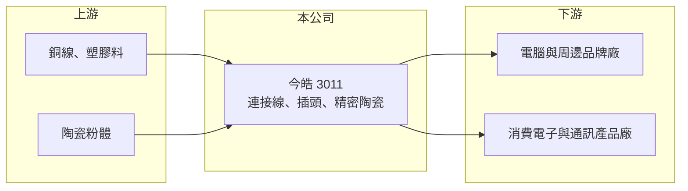

# 3011 今皓

> 上市｜[[產業索引-電子零組件業|電子零組件業]]｜上市（櫃）日期 2002/07/22

# 第一章：企業模式與商業藍圖

> [!info] 撰寫說明
> 精簡版，由 Claude 依公開資料整理，架構比照 [[2330台積電]]，資料截至 2026-10-08。來源：證交所開放資料快照（基本資料、2026 年第二季財報、股利）、Goodinfo 經營績效年度表與公司基本資料頁。公開資料有限，營收比重與主要客戶未查得。#待校對

今皓是一家以電腦周邊[[連接線]]起家的老牌零件廠，近年營收快速萎縮並持續虧損，本章說明它的業務組成與目前處境。

- **核心業務：** 今皓成立於 1983 年，總部在新北市新店，主要產品是電腦周邊、消費電子與通訊產品使用的連接線與插頭。連接線是把電腦、螢幕、周邊設備連起來的線材組件，一般規格產品技術門檻不高，競爭主要在成本與交期。中國昆山子公司另外生產[[精密陶瓷]]與精密模具，陶瓷件可延伸到光通訊等需要高精度的領域（今皓陶瓷產品的具體用途與營收占比未查得，待校對）。
- **營收結構：** 產品別與客戶別比重未查得。從營收規模看，2021 年 15.7 億元、2025 年只剩 7.55 億元，顯示傳統連接線業務大幅流失，公司尚未找到能替代的主力產品。
- **營運據點：** 生產據點在中國昆山（今皓光電，生產精密陶瓷、模具與電腦線材插頭）與泰國（J.B.T Industrial，生產電腦線材與插頭），兩家子公司均於 2013 年登記為重要子公司。台灣總部以管理、研發與業務為主。
- **長期方向：** 2026 年 6 月董事會改選並由石浩吉出任董事長，同年辦理限制員工權利新股註銷減資，並對昆山子公司提供資金貸與及背書保證。這些動作顯示公司處於經營調整期，但具體的轉型方向與新產品計畫未查得，長期定位仍待觀察。

# 第二章：護城河深度與競爭優勢

今皓面對的是高度競爭、低進入門檻的線材市場，本章分析它的競爭處境。

- **競爭優勢：** 目前公開資料看不出明顯的護城河。今皓的潛在資產是四十多年的線材與模具經驗，以及昆山廠的精密陶瓷製程能力；若陶瓷件能打入光通訊或其他高精度應用，可能成為差異化來源，但目前尚未反映在營收上。
- **主要對手：** 電腦與消費電子線材領域有大量台灣與中國業者，台灣上市櫃同業包括 [[2462良得電]]、[[6290良維]]、[[8103瀚荃]]，高階線材與線束則有 [[3665貿聯-KY]]。中國本地線材廠在成本上有明顯優勢，一般規格產品很難靠價格以外的因素勝出。
- **觀察重點：** 長期要看三件事：營收能否止跌回升、毛利率能否回到兩位數以上，以及經營團隊調整後是否提出明確的新事業方向。2023 至 2025 年營業虧損逐年擴大，若無法止血，股東權益會持續被侵蝕。

# 第三章：財務體質與盈利規模

資料日期：2026-10-08，表格是撰寫當時的快照；最新月營收、毛利率、累計 EPS 由自動排程寫在本筆記的屬性欄位（月營收、毛利率、累計EPS 等）。#待校對

今皓近六年只有 2021 年獲利，營收在 2021 年後持續下滑，本業虧損逐年擴大。

| 年度 | 營收（億元） | [[毛利率]] | [[營業利益率]] | EPS（元） | [[ROE]] |
|---|---|---|---|---|---|
| 2020 | 12.0 | 8.49% | -8.88% | -0.80 | -8.98% |
| 2021 | 15.7 | 7.75% | -5.65% | 0.59 | 6.80% |
| 2022 | 15.0 | 12.7% | -1.87% | -0.12 | -1.33% |
| 2023 | 11.5 | 12.5% | -13.5% | -1.23 | -11.0% |
| 2024 | 11.5 | 7.37% | -23.6% | -2.21 | -16.6% |
| 2025 | 7.55 | 5.28% | -43.5% | -2.55 | -20.4% |

- **營收規模：** 營收 2020 年 12.0 億元、2025 年 7.55 億元，五年年複合成長率約 −8.9%。2026 年上半年營收只有 2.68 億元，衰退仍在持續。
- **獲利：** 毛利率長期只有 5% 至 13%，連營業費用都無法覆蓋，六年中每年營業利益率皆為負值，2021 年的獲利主要來自業外。2026 年上半年毛利率約 4.5%、營業損失 1.84 億元、EPS −1.56 元。近五年（2021 至 2025 年）平均 ROE 約 −8.5%。
- **財務特色：** 2026 年第二季末總資產 26.4 億元、總負債 12.7 億元，負債比約 48%，母公司權益 13.3 億元、每股淨值 10.25 元，已接近面額。2025 年度可分配盈餘為負，未配發股利。若虧損持續，資金來源與繼續擴大的負債比是主要財務壓力。
- **[[ROIC]] 與 [[WACC]]：** 2025 年營業損失約 3.28 億元（7.55 億 × −43.5%），虧損時不計稅盾；投入資本以權益總額 13.6 億元加全部負債 12.7 億元計，ROIC 約 −12.4%，若只算權益則約 −24%（推算）。WACC 以 CAPM 推估：無風險利率 1.75%、市場風險溢酬 6%、β 取電子零組件同業常見值 1.1，股東權益成本約 8.4%；負債成本 2%、稅後 1.6%，負債占資本 40%，WACC 約 5.7%（推算）。ROIC 大幅低於 WACC 且差距逐年擴大，代表目前的營運模式持續在毀損股東價值。

# 第四章：總體風險與地緣政治

今皓的主要風險來自本業萎縮與財務體質轉弱，本章整理相關風險。

- **產業週期：** 電腦周邊線材需求與 PC 出貨連動，而 PC 是成熟市場，加上無線傳輸普及，傳統線材的長期需求偏向萎縮。即使 PC 景氣回溫，一般規格線材的價格競爭也限制了獲利回升的空間。
- **營運風險：** 營收規模縮小後，工廠固定成本無法分攤，形成虧損擴大的惡性循環。經營團隊更替後的策略執行、昆山與泰國廠的產能調整或處分，都可能帶來一次性損失。
- **其他風險：** 每股淨值已接近 10 元面額，若虧損持續，可能需要減資彌補虧損或增資，對既有股東造成稀釋或損失。中國子公司營運受當地政策、人工成本與匯率影響。

# 專有名詞解析

## 產業

- **[[連接線]]**：兩端帶有插頭、用來連接電子設備的線材組件，例如 USB、HDMI 與電源線。
- **[[精密陶瓷]]**：以高純度氧化鋁、氧化鋯等材料製成、尺寸精度極高的陶瓷零件，用於光通訊、半導體與醫療等領域。

# 核心供應鏈

- 上游：銅線、PVC 與工程塑膠料、端子與插頭零件，以及陶瓷粉體。
- 下游／客戶：電腦與周邊設備品牌與代工廠、消費電子與通訊產品廠；具體客戶名稱未查得。
- 同業：[[2462良得電]]、[[6290良維]]、[[8103瀚荃]]、[[3665貿聯-KY]]。

## 最新新聞
<!-- news:start -->
<!-- news:end -->

## 相關連結
- [公開資訊觀測站](https://mopsov.twse.com.tw/mops/web/t05st03?step=1&firstin=1&co_id=3011)
- [Goodinfo](https://goodinfo.tw/tw/StockDetail.asp?STOCK_ID=3011)
- [Yahoo 股市](https://tw.stock.yahoo.com/quote/3011)
- [鉅亨網新聞](https://www.cnyes.com/twstock/3011/news)
