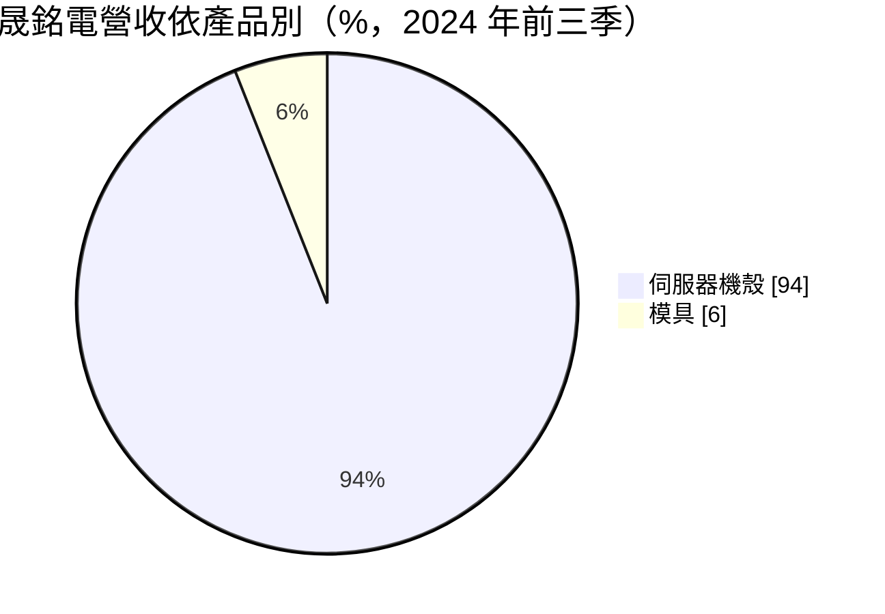
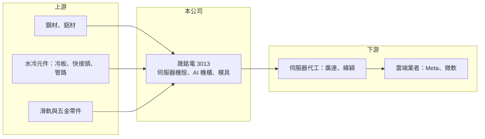

# 3013 晟銘電

> 上市｜[[產業索引-電腦及週邊設備業|電腦及週邊設備業]]｜上市（櫃）日期 2002/09/16

# 第一章：企業模式與商業藍圖

> [!info] 撰寫說明
> 精簡版，由 Claude 依公開資料整理，架構比照 [[2330台積電]]，資料截至 2026-10-08。來源：證交所開放資料快照（基本資料、2026 年第二季財報、營益分析、股利、每月營收）、Goodinfo 經營績效年度表、口袋學堂晟銘電公司介紹（2024 年資料）。客戶與市占率描述來自媒體整理，未與公司正式揭露比對。#待校對

晟銘電是伺服器機殼與機櫃的金屬機構件廠，近年隨 AI 伺服器與水冷機櫃需求快速成長，本章說明它的商業模式與轉型。

- **核心業務：** 晟銘電成立於 1976 年、2002 年上市，總部在台北內湖，英文名稱 UNEEC。公司從模具與金屬沖壓起家，早年做 PC 機殼，現在以[[伺服器機殼]]與機櫃為主，另有模具業務。機殼看似是鈑金件，但 AI 伺服器重量、功耗與散熱要求大幅提高，結構強度、氣流與水冷管路配置都需要和系統廠共同設計。
- **營收結構：** 依 2024 年前三季資料，伺服器機殼約占 94%、模具約 6%；同期 [[AI 伺服器]]機殼約占營收 31%（兩組數字口徑不同，待校對）。主要客戶是 [[2382廣達]]、[[6669緯穎]] 等伺服器代工廠，再間接供應 [[META臉書]]、[[MSFT微軟]] 等雲端業者（[[CSP]]）。
- **營運據點：** 生產以台灣與中國為主（中國據點細節待校對），泰國新廠預計 2025 年第一季投產，可增加約 30% 產能，用來服務要求中國以外生產的美國客戶。
- **長期方向：** 晟銘電布局[[液冷散熱]]機櫃，依媒體報導，Meta 的 GB200 水冷機櫃專案於 2024 年第四季量產，晟銘電為主要供應商（市占率說法待校對）。從單一機殼往[[機櫃級整合]]延伸，能提高每台伺服器的單價與技術門檻，是公司從傳統鈑金廠轉為 AI 基礎設施供應商的關鍵。

# 第二章：護城河深度與競爭優勢

伺服器機殼是台廠高度集中的產業，本章分析晟銘電在 AI 伺服器時代的競爭位置。

- **競爭優勢：** 晟銘電長期經營模具與沖壓，能自行開模、快速打樣，配合系統廠縮短新機種開發時間。AI 伺服器機櫃需要整合水冷管路、快接頭與機構強度，早期參與大型雲端客戶專案的供應商可以累積設計經驗與量產良率，後進者較難短期追上。
- **主要對手：** 主要對手為 [[8210勤誠]]、[[6117迎廣]]、[[3032偉訓]]，另有 [[2059川湖]]（滑軌）與鴻海集團內部機構件廠在機櫃整合上競爭。依 2024 年第三季資料，勤誠營收與毛利率都高於晟銘電，客戶涵蓋 Amazon、Google、Meta。
- **觀察重點：** 晟銘電毛利率從 2021 年的 4.9% 提高到 2025 年的 18.5%，反映產品組合往 AI 與水冷機櫃移動。長期要看新一代 AI 機櫃能否持續取得主力供應商地位、客戶能否從少數雲端業者分散出去，以及泰國廠能否順利放量。

# 第三章：財務體質與盈利規模

資料日期：2026-10-08，表格是撰寫當時的快照；最新月營收、毛利率、累計 EPS 由自動排程寫在本筆記的屬性欄位（月營收、毛利率、累計EPS 等）。#待校對

晟銘電 2024 年起進入 AI 伺服器成長期，營收、毛利率與 ROE 同步跳升。

| 年度 | 營收（億元） | [[毛利率]] | [[營業利益率]] | EPS（元） | [[ROE]] |
|---|---|---|---|---|---|
| 2021 | 52.8 | 4.93% | −2.32% | −0.74 | −4.88% |
| 2022 | 65.2 | 8.61% | 1.96% | 1.17 | 8.37% |
| 2023 | 64.6 | 11.8% | 3.52% | 1.29 | 8.07% |
| 2024 | 94.1 | 15.6% | 8.53% | 3.63 | 19.0% |
| 2025 | 106 | 18.5% | 10.6% | 4.03 | 17.1% |

- **營收規模：** 2020 年營收 61.2 億元，2025 年 106 億元，五年年複合成長率約 11.6%。2026 年上半年營收 61.5 億元，前 8 月累計 79.0 億元、年增約 22%。
- **獲利：** 2021 至 2025 年平均 ROE 約 9.5%，但 2024 與 2025 年已提高到 17% 至 19%。2026 年上半年毛利率 20.8%、營業利益率 13.4%、EPS 2.78 元，獲利能力持續改善。
- **財務特色：** 2026 年第二季末母公司權益 57.2 億元、每股淨值 26.8 元，負債總額 43.8 億元，負債比約 43%。2025 年度配發現金股利 0.4 元與股票股利 0.4 元，現金配息率約一成，顯示公司把大部分盈餘保留給泰國廠與水冷產能擴充。股票股利會讓股本持續膨脹，長期需留意 EPS 稀釋。
- **[[ROIC]] 與 [[WACC]]：** 2025 年營業利益約 11.2 億元（106 億 × 10.6%），稅後約 9.0 億元；以權益 57.2 億元計 ROIC 約 15.7%，若把負債總額 43.8 億元全部計入則約 8.9%（推算，有息負債細項未查得，實際值介於兩者之間）。WACC 以 CAPM 推估：無風險利率 1.75%、市場風險溢酬 6%、β 取 AI 伺服器零組件常見值 1.1，股東權益成本約 8.4%；負債成本 2.5%、稅後 2%，負債占資本約三成，WACC 約 6.5%（推算）。2024 年後 ROIC 明顯高於 WACC，代表 AI 轉型開始創造價值；2021 年虧損時則低於資金成本，週期性仍不可忽視。

# 第四章：總體風險與地緣政治

晟銘電的風險主要來自客戶集中與 AI 投資週期。

- **產業週期：** 伺服器機殼需求跟著雲端業者資本支出走，AI 投資擴張時訂單快速成長，一旦雲端業者放緩建置或世代交替延遲，營收可能明顯下滑。2021 年毛利率僅 4.9% 並出現虧損，說明傳統機殼業務在景氣差時利潤非常薄。
- **營運風險：** 客戶集中在少數代工廠與雲端業者，單一專案的得失影響很大。水冷機櫃規格隨 GPU 世代快速變化，每一代都要重新設計與驗證，若錯過新平台，前一代的領先優勢可能無法延續。
- **其他風險：** 鋼材、鋁材等原物料價格會影響成本；美國關稅與供應鏈在地化要求使泰國等海外擴產成為必要，但新廠初期良率與成本壓力較高。營收以美元計價，匯率變動影響獲利。

# 專有名詞解析

## 應用

- **[[AI 伺服器]]**：搭載 GPU 等加速晶片、專門執行 AI 模型訓練與推論的伺服器。
- **[[CSP]]**：雲端服務供應商，例如亞馬遜、微軟、谷歌、Meta，是 AI 伺服器的最大買家。

## 產業

- **[[伺服器機殼]]**：容納伺服器主機板、電源、硬碟與散熱元件的金屬外殼，需配合系統設計氣流與結構強度。
- **[[液冷散熱]]**：以液體帶走晶片熱量的散熱方式，散熱效率高於空氣，適用高功耗 AI 伺服器。
- **[[機櫃級整合]]**：以整個機櫃為單位整合伺服器、網路、電源與散熱，出貨後可直接上線運作。

# 核心供應鏈

- 上游：鋼材與鋁材、水冷冷板與快接頭等液冷元件、滑軌與五金零件（如 [[2059川湖]]）。
- 下游／客戶：伺服器代工廠 [[2382廣達]]、[[6669緯穎]]，終端雲端業者 [[META臉書]]、[[MSFT微軟]]。
- 同業：[[8210勤誠]]、[[6117迎廣]]、[[3032偉訓]]。

## 最新新聞
<!-- news:start（自動產生，請勿手動編輯此範圍） -->
- 2026-10-06 📰 媒體 11:10｜〈焦點股〉晟銘電L11比重升、Q4展望佳 翻紅走揚｜[鉅亨網](https://news.cnyes.com/news/id/6622571)

完整紀錄：[[3013晟銘電 新聞]]
<!-- news:end -->

## 相關連結
- [公開資訊觀測站](https://mopsov.twse.com.tw/mops/web/t05st03?step=1&firstin=1&co_id=3013)
- [Goodinfo](https://goodinfo.tw/tw/StockDetail.asp?STOCK_ID=3013)
- [Yahoo 股市](https://tw.stock.yahoo.com/quote/3013)
- [鉅亨網新聞](https://www.cnyes.com/twstock/3013/news)
