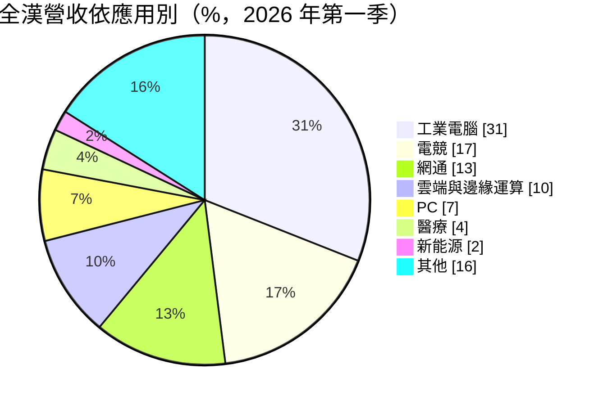
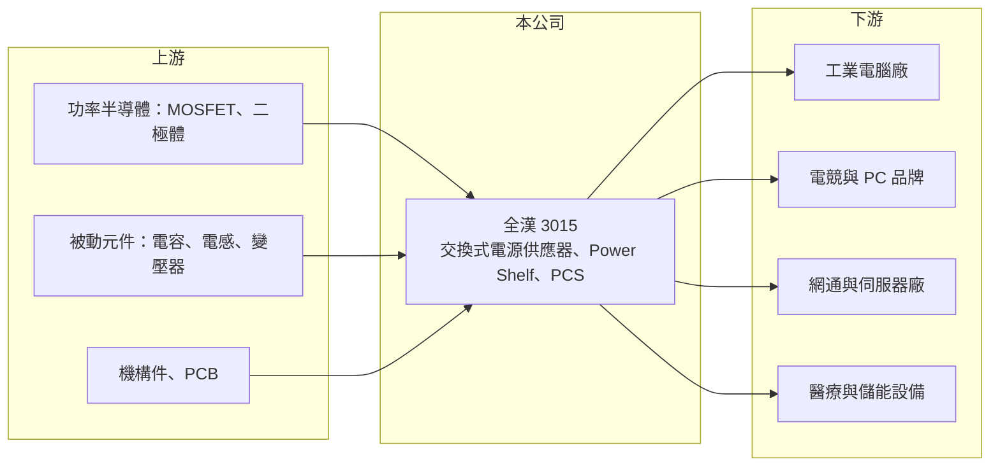

# 3015 全漢

> 上市｜[[產業索引-電子零組件業|電子零組件業]]｜上市（櫃）日期 2002/10/16

# 第一章：企業模式與商業藍圖

> [!info] 撰寫說明
> 精簡版，由 Claude 依公開資料整理，架構比照 [[2330台積電]]，資料截至 2026-10-08。來源：證交所開放資料快照（基本資料、2026 年第二季財報、股利）、Goodinfo 經營績效年度表、富果研究 2026 年 6 月法說會摘要（2026 年第一季資料）。法說會摘要為 AI 整理稿，數字需與公司簡報核對。#待校對

全漢是台灣中型的[[電源供應器]]廠，本章說明它「少量多樣」的經營模式，以及從 PC 電源轉向工業、網通與邊緣 AI 電源的方向。

- **核心業務：** 全漢成立於 1993 年，生產交換式電源供應器，產品涵蓋工業電腦、電競與 PC、網通設備、伺服器、醫療與儲能。電源供應器負責把市電轉成電子設備需要的穩定直流電，品質直接影響設備穩定度與能源效率。全漢的經營模式是少量多樣，以大量規格、彈性生產服務眾多中小型客戶，而不是依賴少數大客戶的大量訂單。
- **營收結構：** 依 2026 年第一季法說會摘要，[[工業電腦]]電源 31%、電競 17%、網通 13%、雲端與邊緣運算 10%、PC 7%、醫療 4%、新能源 2%、其他 16%。地區別為台灣 35%（多為客戶在台組裝後出口）、歐洲 23%、美洲 15%、中國 11%、其他 16%。工業與網通合計超過四成，屬於生命週期長、規格穩定的應用。
- **營運據點：** 法說會提到越南廠已營運並持續投資，用來服務希望在中國以外生產的客戶。其他生產據點的配置未在本次來源中查得（待校對）。
- **長期方向：** 公司選擇聚焦[[邊緣 AI]]，而非與大廠正面競爭超大型資料中心電源。產品規劃包括 3,200W 主流、3,600W 與 4,800W 規劃中的 CRPS 冗餘電源，以及 ORV3 規格的 [[Power Shelf]]（5.5kW 至 10kW 以上，開發中），並與英特爾合作新一代 AI PC 電源規格。儲能方面推出用於家庭、商業與微電網的功率轉換系統（[[PCS]]）。

# 第二章：護城河深度與競爭優勢

電源供應器產業由台達電、光寶科等大廠主導，本章分析全漢以少量多樣經營利基市場的優劣。

- **競爭優勢：** 全漢的優勢是產品線廣與客製彈性。工業電腦、醫療與網通客戶需要的電源規格多、單筆量不大，但要求長期供貨與安規認證，大廠通常不願意承接這類訂單，全漢則以大量既有設計快速回應。這類客戶一旦完成認證就很少更換供應商，提供一定的轉換成本。
- **主要對手：** 大型電源廠有 [[2308台達電]]、[[2301光寶科]]、[[6282康舒]]、[[6412群電]]，中小型同業有 [[2457飛宏]]、[[3078僑威]]，電競電源還有海韻等品牌。在 AI 伺服器電源上，台達電與光寶科已取得領先，全漢的空間主要在企業級與邊緣伺服器。
- **觀察重點：** 長期最重要的是本業獲利能力。全漢近年毛利率 17% 至 18%，但營業利益率只有 1% 左右，代表研發與營業費用吃掉大部分毛利；高瓦數伺服器電源與 Power Shelf 能否放量，決定營業利益率能否回到 2021 年 4% 左右甚至更高。

# 第三章：財務體質與盈利規模

資料日期：2026-10-08，表格是撰寫當時的快照；最新月營收、毛利率、累計 EPS 由自動排程寫在本筆記的屬性欄位（月營收、毛利率、累計EPS 等）。#待校對

全漢毛利率逐年改善，但營業利益率持續偏低，EPS 很大一部分來自業外收益。

| 年度 | 營收（億元） | [[毛利率]] | [[營業利益率]] | EPS（元） | [[ROE]] |
|---|---|---|---|---|---|
| 2020 | 148 | 13.9% | 3.12% | 3.55 | 6.72% |
| 2021 | 167 | 14.6% | 4.04% | 4.03 | 6.40% |
| 2022 | 139 | 16.6% | 3.90% | 3.86 | 5.84% |
| 2023 | 132 | 18.2% | 3.56% | 3.20 | 4.53% |
| 2024 | 116 | 17.4% | 0.42% | 2.16 | 2.87% |
| 2025 | 131 | 17.4% | 1.09% | 1.86 | 2.64% |

- **營收規模：** 營收 2021 年高峰 167 億元，2024 年降到 116 億元，2025 年回升到 131 億元，五年年複合成長率約 −2.4%。2026 年上半年營收 62.8 億元，與 2025 年同期相近。
- **獲利：** 毛利率從 2020 年 13.9% 提高到 17% 以上，反映產品組合往工業與網通移動，但營業利益率從約 4% 降到 1% 左右。2026 年上半年營業利益僅 0.36 億元，業外收益 2.36 億元（含匯兌與金融資產評價利益），EPS 1.08 元，本業貢獻比重偏低。近五年（2021 至 2025 年）平均 ROE 約 4.5%。
- **財務特色：** 2026 年第二季末總資產 217.8 億元、總負債 63.2 億元，母公司權益 150.1 億元、每股淨值 80.1 元，權益規模大於年營收，代表資產中有相當部分是長期投資與金融資產，而非生產設備（資產組成細項未查得）。公司章程規定稅後淨利至少 50% 分配股利，2025 年度配發現金股利 2.2 元，高於當年 EPS。
- **[[ROIC]] 與 [[WACC]]：** 2025 年營業利益約 1.43 億元（131 億 × 1.09%），稅後約 1.14 億元；投入資本以權益總額 154.6 億元計 ROIC 約 0.7%，含全部負債 63.2 億元則約 0.5%（推算）。由於權益中包含大量非營運投資，只計營運資產的實際 ROIC 會較高，但資料不足無法拆分。WACC 以 CAPM 推估：無風險利率 1.75%、市場風險溢酬 6%、β 取電源同業常見值 0.8，股東權益成本約 6.55%；負債成本 2%、稅後 1.6%，負債占資本 10%，WACC 約 6.1%（推算）。本業 ROIC 長期低於 WACC，公司價值較多來自資產與投資，而非本業的超額報酬。

# 第四章：總體風險與地緣政治

全漢的風險集中在本業獲利偏薄與市場結構變化，本章整理相關風險。

- **產業週期：** PC 與電競電源需求受記憶體、顯示卡價格與換機週期影響，2026 年第一季即因記憶體價格上漲導致低階電競與 PC 需求下滑。工業電腦與網通需求較穩定，但也會跟著企業資本支出循環起伏。
- **營運風險：** 營業利益率僅約 1%，原物料（半導體功率元件、被動元件、銅）或運費小幅上漲，就可能讓本業轉為虧損。在高瓦數伺服器電源領域，研發投入大、驗證期長，若產品無法順利放量，費用負擔會進一步壓縮獲利。
- **其他風險：** EPS 對業外收益依賴度高，金融資產評價與匯兌損益的波動會讓獲利不穩定。越南廠擴充涉及當地法規、勞動與供應鏈成熟度問題；美國關稅政策也會影響出口到美洲的產品競爭力。

# 專有名詞解析

## 應用

- **[[邊緣 AI]]**：在終端或靠近資料產生處（工廠、醫院、企業機房）執行 AI 運算，而非全部送到雲端資料中心。

## 產業

- **[[電源供應器]]**：把市電交流電轉換成電子設備所需穩定直流電的裝置，簡稱 PSU。
- **[[工業電腦]]**：用於工廠自動化、交通、醫療等場域的電腦，強調長期供貨、耐用與穩定。
- **[[Power Shelf]]**：資料中心機櫃中集中供電的電源層架，把多顆電源模組整合後供應整個機櫃。
- **[[PCS]]**：功率轉換系統，儲能系統中負責電池直流電與電網交流電雙向轉換的設備。

# 核心供應鏈

- 上游：MOSFET 與二極體等功率半導體，電容、電感與變壓器等被動元件，機殼、散熱片與 PCB。
- 下游／客戶：工業電腦廠、電競與 PC 品牌、網通與伺服器廠、醫療與儲能設備廠；法說會提及與 [[INTC英特爾]] 合作新一代電源規格。
- 同業：[[2308台達電]]、[[2301光寶科]]、[[6282康舒]]、[[6412群電]]、[[2457飛宏]]、[[3078僑威]]；電競電源另有海韻。

## 最新新聞
<!-- news:start -->
<!-- news:end -->

## 相關連結
- [公開資訊觀測站](https://mopsov.twse.com.tw/mops/web/t05st03?step=1&firstin=1&co_id=3015)
- [Goodinfo](https://goodinfo.tw/tw/StockDetail.asp?STOCK_ID=3015)
- [Yahoo 股市](https://tw.stock.yahoo.com/quote/3015)
- [鉅亨網新聞](https://www.cnyes.com/twstock/3015/news)
