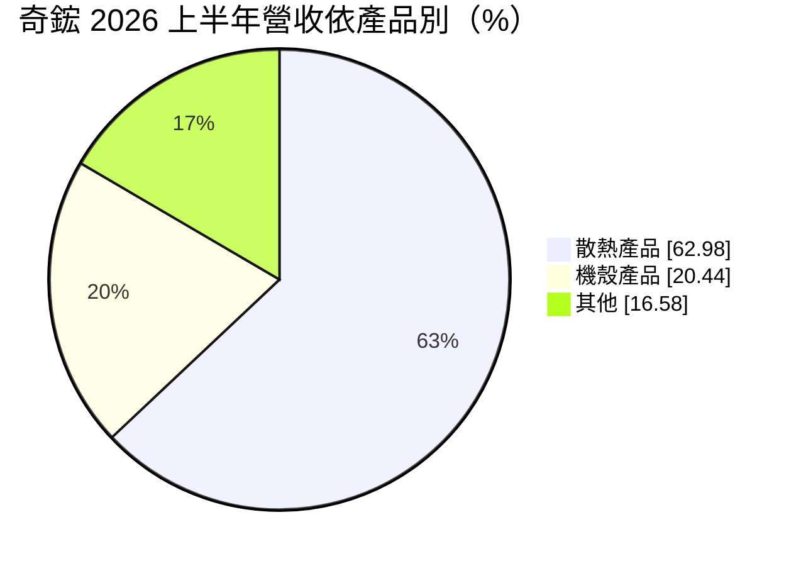
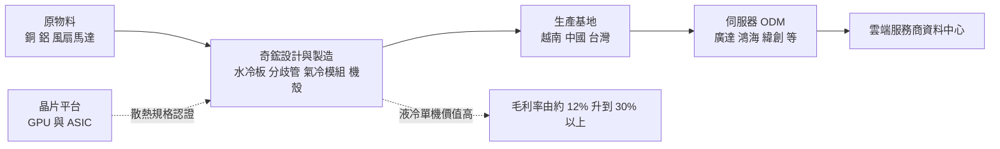
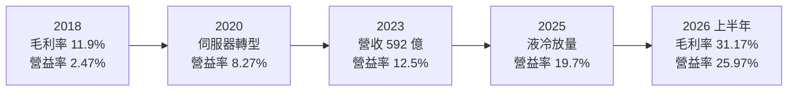
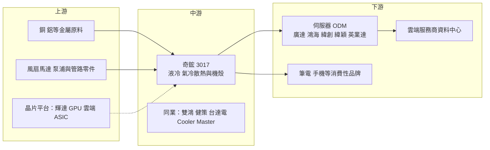

# 3017 奇鋐

> 上市｜[[產業索引-電腦及週邊設備業|電腦及週邊設備業]]｜上市（櫃）日期 2002/09/27

# 第一章：企業模式與商業藍圖

> [!info] 撰寫說明
> 本文由 Claude 依公開資料整理，架構比照 [[2330台積電]] 的四章研究，資料截至 2026-10-08。財務數字來源：證交所開放資料快照（基本資料、2026 年第二季綜合損益與資產負債、2025 年度股利）、Goodinfo 經營績效頁與股利政策頁（2016 至 2025 年）、MoneyDJ 季資產負債表（2026 年第二季借款與現金）、富果研究奇鋐 2026 年第二季法說會整理、優分析 2025 年財報報導；產業描述為整理性內容，尚未逐條比對原始文件。#待校對

在評估一家公司的長期投資價值時，第一步是看懂它靠什麼賺錢、為什麼能一直賺下去。本章針對奇鋐科技（股票代號：3017，以下簡稱奇鋐）的商業模式進行定性分析，說明這家從風扇與筆電散熱起家的公司，如何隨著 [[AI伺服器]] 功耗暴增，轉型為[[液冷]]散熱與伺服器機構件的主要供應商，以及這個轉型為什麼同時改變了它的營收規模與獲利水準。

## 一、核心定位：AI 伺服器散熱與機殼的一站式供應商

奇鋐（英文名 AVC）成立於 1991 年 12 月 17 日，2002 年 9 月上市，董事長兼總經理為沈慶行（證交所資料）。奇鋐是全球主要的電子散熱解決方案廠商之一，產品從風扇、熱導管、[[均熱板]]，到 AI 伺服器使用的[[水冷板]]、[[分歧管]]、[[快接頭]]與伺服器機殼。

奇鋐的發展可以分成兩個階段。第一個階段是消費性電子散熱：筆電、桌機與手機的風扇、熱導管與均熱板，這是規模大但競爭激烈、毛利率偏低的市場，2016 至 2019 年奇鋐的[[營業利益率]]只有 2% 到 5%。第二個階段是伺服器與 AI：資料中心晶片功耗快速上升，散熱從零組件變成影響系統效能與可靠度的關鍵，奇鋐的營收與獲利在 2020 年後明顯躍升，2025 年營收 1,396 億元、EPS 49.17 元，都是歷史新高。

這個定位有三個特點：

- **伺服器已成為主體：** 依富果研究整理，2026 年上半年伺服器與網通營收 649 億元，占比約 66%，前一年同期約 48%。奇鋐已從消費性電子散熱廠，轉變為以資料中心為主的公司。
- **散熱加機構件的整合：** 奇鋐同時生產散熱模組與伺服器機殼、滑軌等機構件，可以提供「散熱加機構」的一站式方案，減少客戶的供應商數量與整合時間。
- **液冷轉型的領先者：** 單顆 AI 晶片功耗動輒上千瓦，傳統[[氣冷]]已不足以散熱。公司表示目前可提供 3,000 瓦以上的散熱方案，並預估 2027 年資料中心水冷滲透率將超過 50%。

## 二、終端應用板塊：產品結構

- **散熱產品（約 63%）：** 包括 AI 伺服器的水冷板、分歧管、快接頭與冷卻液分配裝置（[[CDU]]）零組件，以及氣冷散熱模組、風扇與均熱板。液冷產品的單機價值遠高於傳統氣冷，是營收與毛利率同步提升的主因。
- **機殼產品（約 20%）：** 伺服器機殼、機櫃與機構件。隨著機櫃密度提高、整櫃出貨成為主流，機構件的設計難度與單櫃價值量都在增加。
- **其他（約 17%）：** 筆電、手機與消費性電子的散熱元件等。公司表示手機與平板均熱板仍在持續，但 AI 業務成長更快，占比會相對縮小。

## 三、資本轉化邏輯：跟著晶片功耗走

- **規格由晶片平台決定：** 奇鋐的散熱設計必須先通過 [[NVDA輝達]] GPU 平台或雲端業者自研 [[ASIC]] 平台的規格認證，再由伺服器 ODM 採購。進入晶片平台的參考設計名單，等於取得後續量產訂單的門票。公司把 2026 年稱為「ASIC 元年」，並預期 2027 年 ASIC 相關營收有機會超越 GPU。
- **液冷提升單機價值：** 一台液冷 AI 伺服器需要水冷板、分歧管、快接頭、管線與機構件，散熱價值遠高於傳統氣冷伺服器。產品組合從氣冷轉向液冷，是奇鋐毛利率從 2019 年的 11.8% 升到 2025 年 25.8% 的主要原因。
- **產能就是市占：** AI 平台換代快、交期緊，誰能先擴好產能、通過驗證，誰就能拿到主要份額。公司表示「有訂單就會持續擴廠」，擴產主要集中在越南。

## 四、企業長期藍圖：液冷全面滲透與全球擴產

- **液冷從 GPU 擴散到 ASIC 與一般伺服器：** 公司預估 2027 年資料中心水冷滲透率超過 50%。液冷若從高階 GPU 擴散到更多 ASIC 與一般伺服器，市場規模將持續擴大。
- **擴產與資本支出：** 2025 年資本支出約 150 億元，2026 年約 150 億元，公司表示 2027 年將高於 2026 年，主要用於越南廠區。在「中國以外」的產能需求下，越南產能是奇鋐的長期戰略資產。
- **新世代產品：** 公司已為 CPO、光通訊與新一代 GPU 平台的散熱提前投入資源，CPO 相關散熱預計 2027 年開始出貨；邊緣 AI 散熱市場較分散但利潤較佳，也有產品開發。
- **獲利優先：** 管理層表示策略重心是獲利成長，而非單純擴大營收規模，這對評估它未來的資本配置很重要。

# 第二章：護城河深度與競爭優勢

在長期價值投資中，「護城河」指企業抵禦競爭、長期維持超額利潤的保護機制。散熱產業過去被視為門檻不高的零組件業，本章分析奇鋐在 AI 液冷時代建立了哪些防禦能力、面對哪些對手，以及這些優勢在對手紛紛擴產後能守住多少。

## 一、奇鋐護城河的核心組成要素

奇鋐的護城河屬於「正在形成中的窄護城河」，主要由三個要素構成：

- **1. 晶片平台的早期參與與認證：** AI 伺服器散熱需要在晶片設計階段就參與熱設計，並通過長時間的可靠度驗證。奇鋐長期與 GPU 與 ASIC 平台合作，每一代新平台都能較早取得規格，這讓它在新平台量產初期就能拿到主要份額。
- **2. 散熱與機構件整合：** 同時提供散熱模組、機殼與滑軌，能替伺服器 ODM 簡化供應鏈管理。機櫃密度越高，散熱與機構的整合設計就越重要，客戶也越傾向把兩者交給同一家供應商。
- **3. 大規模量產與越南產能：** 水冷板與分歧管需要精密加工、焊接與嚴格的洩漏測試，大量生產時的良率與交期是客戶分配訂單的關鍵。奇鋐在越南的大規模產能，也符合美國客戶「中國以外」的供應鏈要求。

## 二、主要競爭對手格局

| 對手 | 定位 | 對奇鋐的影響 |
|---|---|---|
| [[3324雙鴻]] | 台灣主要散熱廠，積極布局液冷 | 水冷板、分歧管與 CDU 直接競爭 |
| [[3653健策]] | 均熱片與液冷零組件 | 在 GPU 均熱片與水冷板部分重疊 |
| [[2308台達電]] | 電源與散熱整合 | 以 CDU 與液冷機櫃等系統級方案切入 |
| Cooler Master（訊凱） | 散熱與液冷模組 | GPU 平台的水冷板供應商之一 |
| [[6230尼得科超眾]]、[[3338泰碩]]、[[2421建準]] | 熱導管、散熱模組與風扇 | 在氣冷與部分液冷零組件競爭 |
| [[8210勤誠]]、[[2059川湖]] | 伺服器機殼、滑軌 | 在機構件與機殼領域競爭 |

## 三、優勢轉化：哪些守得住、哪些守不住

- **守得住：** 高階 GPU 與 ASIC 平台的液冷方案與機構件整合。這些產品需要長時間驗證與大量產能，客戶更換供應商的成本高。2026 年第二季[[毛利率]] 32.57%、營業利益率 27.44%（富果研究），顯示目前仍有相當的定價能力。
- **守不住：** 一般氣冷散熱與消費性產品。技術門檻較低、價格競爭激烈，是奇鋐過去十年營業利益率只有個位數的主因。液冷一旦標準化、對手產能到位，也可能逐步走向同樣的價格競爭。
- **觀察重點：** 長期可以追蹤三件事。第一是液冷產品在對手大量擴產後，毛利率能否維持在 25% 以上；第二是 ASIC 平台的份額能否如公司預期超越 GPU，降低對單一平台的依賴；第三是兩相冷卻、浸沒式冷卻等新技術出現時，奇鋐能否維持技術領先。

# 第三章：財務體質與盈利規模

資料日期：2026-10-08。數字取自 Goodinfo 經營績效頁與股利政策頁、證交所開放資料快照、MoneyDJ 季資產負債表與富果研究法說會整理，表格是撰寫當時的快照；最新月營收、毛利率、累計 EPS 由自動排程寫在本筆記的屬性欄位（月營收、毛利率、累計EPS 等）。#待校對

財務報表是檢驗護城河是否真實存在的最終標準。本章用十年的數據，檢視奇鋐從低毛利零組件廠轉型為 AI 液冷供應商的過程，以及這個轉型帶來的資本報酬變化。

## 一、獲利能力的基石：三率

| 年度 | 營收（億元） | [[毛利率]] | [[營業利益率]] | EPS（元） | [[ROE]] |
|---|---|---|---|---|---|
| 2021 | 473 | 17.7% | 10.2% | 8.21 | 26.2% |
| 2022 | 560 | 19.4% | 11.3% | 11.78 | 29.3% |
| 2023 | 592 | 20.9% | 12.5% | 14.11 | 26.9% |
| 2024 | 718 | 23.5% | 15.1% | 21.21 | 31.0% |
| 2025 | 1,396 | 25.8% | 19.7% | 49.17 | 49.9% |

（來源：Goodinfo 經營績效頁，合併報表。2016 至 2019 年毛利率在 11.8% 到 13.9% 之間、營業利益率 2.47% 到 5.42%。2026 年上半年依證交所資料，營收 981.6 億元、毛利率 31.17%、營業利益率 25.97%、EPS 44.54 元。）

- **每一年都在改善：** 2018 年以後，奇鋐的毛利率與營業利益率幾乎每年都提高，沒有明顯倒退。這種連續改善反映的是產品組合的結構性轉變，而不是單一年度的景氣好壞。
- **營收爆發式成長：** 2020 至 2025 年營收由 397 億元成長到 1,396 億元，年複合成長率約 28.6%（推算），其中 2025 年單年就成長約 95%。這是 AI 伺服器液冷放量的直接結果。
- **稅率偏高：** 2026 年上半年所得稅費用約占稅前淨利 27%（依證交所資料推算），高於台灣 20% 的營所稅率，反映海外生產據點與盈餘匯回的稅負。

## 二、[[ROE]]：資本效率

近 5 年（2021 至 2025 年）平均 ROE 約 32.7%（推算），2025 年達 49.9%；相較之下，2016 至 2019 年 ROE 只有 8% 到 11%。ROE 的提升主要來自營業利益率擴大，但也有部分來自財務槓桿：依富果研究，2026 年 6 月底負債比約 68%，依證交所資料負債總計約 1,325 億元、權益總計約 621 億元。負債中大部分是應付帳款等營運負債，有息借款約 291 億元，而現金約 777 億元，整體仍是淨現金狀態。

## 三、資本支出、自由現金流與股利

- **[[CapEx]]：** 2025 年約 150 億元，2026 年約 150 億元，公司表示 2027 年將更高，主要用於越南廠區。資本支出相對過去大幅提高，代表奇鋐正從輕資產的零組件廠變成需要持續擴產的製造商。
- **[[自由現金流]]：** 依富果研究，2026 年上半年營業現金流入約 263 億元、自由現金流約 192 億元，即使在大幅擴產期間仍為正，顯示獲利有實際現金支撐。多年度自由現金流數字本次未查得。
- **股利穩定度：** 依 Goodinfo，2016 至 2025 年度現金股利由 1.2 元逐步提高到 20.88 元，隨獲利成長而增加。以各年度 EPS 計算，2021 至 2025 年度配息率約在 42% 到 52% 之間（推算）。2025 年度依證交所資料為盈餘配發 18 元加資本公積配發 3 元，合計 21 元，Goodinfo 列為 20.88 元，推估是股數變動後的調整。

## 四、[[ROIC]] 與 [[WACC]]：價值創造利差

- **ROIC（推算）：** 以 2025 年營業利益約 275 億元（營收 1,396 億元乘以營業利益率 19.7%）、扣除 20% 稅率後約 220 億元為分子。投入資本以 2026 年第二季權益總計約 621 億元，加上有息負債約 291 億元（短期借款 176.3 億、一年內到期長期負債 13.8 億、長期借款 77.4 億、租賃負債 23.7 億，MoneyDJ），合計約 912 億元，ROIC 約 24%（推算）。若以 2026 年上半年營業利益 255 億元年化約 510 億元、稅後約 408 億元計算，ROIC 約 45%（推算）。
- **WACC（推算）：** 以 [[CAPM]] 估算股東權益成本：無風險利率取台灣 10 年期公債約 1.75%，市場風險溢酬 6%，β 假設 1.3（AI 伺服器零組件股波動大，取同業常見值，未查得奇鋐實際數字），權益成本約 9.55%。稅前負債成本假設 2.5%、稅率 20%，稅後約 2.0%。以帳面價值計算，權益約占投入資本 68%、有息負債約 32%，WACC 約 7.1%；若以市值計算權益比重，負債比重會大幅降低，WACC 接近權益成本約 9.5%。合理區間約在 7% 至 9.5% 之間（推算）。
- **價值創造判斷：** 以 2025 年計算的 ROIC 約 24%，已遠高於 7% 至 9.5% 的資金成本，2026 年的利差更大。但回顧十年，2016 至 2019 年奇鋐的 ROE 只有約一成，ROIC 推估接近甚至低於資金成本，代表目前的高利差是 AI 液冷這一波結構轉變帶來的。長期的關鍵在於：當液冷成為標準品、對手產能到位，奇鋐的 ROIC 能否維持在 15% 以上，而不是回到過去零組件廠的水準。

# 第四章：總體風險與地緣政治

任何企業都無法脫離宏觀環境獨立存在。本章分析奇鋐未來必須面對的地緣政治、產業週期、營運與技術風險。

## 一、地緣政治風險

- **美國關稅與供應鏈重組：** 奇鋐的產品最終多出貨到美國資料中心，美國對越南、中國與台灣的關稅政策，會影響成本、報價與客戶的組裝地選擇。
- **越南產能集中：** 越南是主要擴產地，若越南與美國的貿易關係變化，或越南出現電力、勞動力與基礎建設瓶頸，出貨會受影響。
- **AI 晶片出口管制：** 美國對中國的 AI 晶片管制，會影響部分伺服器專案的出貨地區與規模。

## 二、產業週期與市場結構風險

- **雲端資本支出循環：** 奇鋐的成長高度依賴大型雲端業者的 AI 資本支出。一旦雲端業者放緩投資，液冷需求的成長會立刻放慢，而奇鋐為擴產增加的固定成本仍在。
- **平台集中：** AI 伺服器營收高度集中在少數 GPU 與 ASIC 平台，若單一平台換代延遲、規格改變或份額重新分配，營收會出現明顯波動。
- **競爭者擴產：** 雙鴻、台達電、Cooler Master 等對手同步擴充液冷產能，液冷產品可能在數年內走向價格競爭，毛利率有回落風險。

## 三、營運環境的隱性風險

- **品質風險：** 液冷系統一旦洩漏，可能損壞昂貴的 AI 伺服器，品質事故的賠償與商譽損失遠高於傳統散熱產品。
- **原物料價格：** 銅、鋁價格上漲會推高水冷板與散熱模組成本，若無法即時轉嫁，毛利率會受壓。
- **擴產執行：** 越南多座新廠同時投產，人力訓練、良率爬坡與管理能力都需要時間。若需求在新產能開出時放緩，產能利用率下降會拉低資本報酬。
- **營運資金：** 營收快速成長時，應收帳款與存貨同步增加，若客戶付款條件惡化，營運資金壓力會上升。

## 四、科技演進風險

- **散熱技術路線：** 目前主流是單相水冷板，未來可能演進到兩相冷卻或[[浸沒式冷卻]]。公司表示持續研發雙相方案，但若技術路線轉換速度快於預期，奇鋐需要重新投資與認證。
- **晶片封裝與供電改變：** 先進封裝、晶片背面供電與 CPO 等技術會改變熱源分布，散熱設計必須跟著重做，研發投入會持續增加。

# 專有名詞解析

## 半導體

- **[[ASIC]]**：特殊應用積體電路，為特定用途設計的晶片，例如雲端業者自研的 AI 加速晶片。

## 應用

- **[[AI伺服器]]**：搭載 GPU 或 ASIC 等 AI 加速晶片的伺服器，功耗與發熱量遠高於一般伺服器。

## 金融

- **[[ROIC]]**：投入資本報酬率，稅後營業利益除以股東權益加有息負債，衡量本業運用資本的效率。
- **[[WACC]]**：加權平均資金成本，依股東權益與負債的比重，加權計算公司取得資金的平均成本。
- **[[CAPM]]**：資本資產定價模型，以無風險利率加上 β 乘以市場風險溢酬，估算股東要求的報酬率。
- **[[自由現金流]]**：營業活動現金流減去資本支出，代表企業可自由用於配息、還債或併購的現金。

## 產業

- **[[液冷]]**：以冷卻液流經晶片上方的水冷板帶走熱量的散熱方式，散熱效率遠高於風扇氣冷。
- **[[氣冷]]**：以散熱鰭片、熱導管與風扇把熱量排到空氣中的傳統散熱方式。
- **[[水冷板]]**：貼附在晶片上方、內部有冷卻液流道的金屬板，是液冷系統中直接吸收晶片熱量的元件。
- **[[分歧管]]**：把冷卻液分配到機櫃內各台伺服器並收回的管路元件，是液冷機櫃的關鍵零件。
- **[[快接頭]]**：可快速插拔且不漏液的冷卻液管路接頭，方便伺服器維修與更換。
- **[[CDU]]**：冷卻液分配裝置，負責冷卻液的循環、降溫與壓力控制，是液冷系統的心臟。
- **[[均熱板]]**：內部有毛細結構與工作流體的扁平散熱元件，可快速把熱量從熱源擴散到較大面積。
- **[[浸沒式冷卻]]**：把整台伺服器浸泡在不導電的冷卻液中散熱的技術，散熱效率高但建置成本高。

# 核心供應鏈

## 1. 上游：原料、零件與晶片平台
- 銅、鋁等金屬原料與加工
- 風扇馬達、泵浦、管路與密封零件
- 散熱規格來源：[[NVDA輝達]] GPU 平台、雲端業者自研 ASIC 平台

## 2. 中游：奇鋐與散熱同業
- 液冷與散熱：[[3324雙鴻]]、[[3653健策]]、[[2308台達電]]、Cooler Master
- 熱導管與風扇：[[6230尼得科超眾]]、[[3338泰碩]]、[[2421建準]]
- 伺服器機構件：[[8210勤誠]]、[[2059川湖]]

## 3. 下游：伺服器 ODM
- [[2382廣達]]、[[2317鴻海]]、[[3231緯創]]、[[6669緯穎]]、[[2356英業達]]

## 4. 下游：終端
- 雲端服務商資料中心
- 筆電、手機與消費性電子品牌

## 最新新聞
<!-- news:start（自動產生，請勿手動編輯此範圍） -->
- 2026-10-16 🏛️ 重訊 16:15｜(補充公告)針對本公司特定員工涉及內線交易案之澄清說明。｜[觀測站](https://mops.twse.com.tw/mops/#/web/t05st01)
- 2026-10-07 📰 媒體 20:33｜奇鋐、富世達新莊廠區遭調查局搜索 與富世達2023年申請上市有關｜[鉅亨網](https://news.cnyes.com/news/id/6624007)
- 2026-10-07 🏛️ 重訊 18:55｜公告法務部調查局至本公司新莊廠區對員工進行搜索及調查。｜[觀測站](https://mops.twse.com.tw/mops/#/web/t05st01)
- 2026-10-07 📰 媒體 11:50｜營收速報 - 奇鋐(3017)9月營收210.18億元年增率高達44.92％｜[鉅亨網](https://news.cnyes.com/news/id/6623531)

完整紀錄：[[3017奇鋐 新聞]]
<!-- news:end -->

## 相關連結
- [公開資訊觀測站](https://mopsov.twse.com.tw/mops/web/t05st03?step=1&firstin=1&co_id=3017)
- [Goodinfo](https://goodinfo.tw/tw/StockDetail.asp?STOCK_ID=3017)
- [Yahoo 股市](https://tw.stock.yahoo.com/quote/3017)
- [鉅亨網新聞](https://www.cnyes.com/twstock/3017/news)
