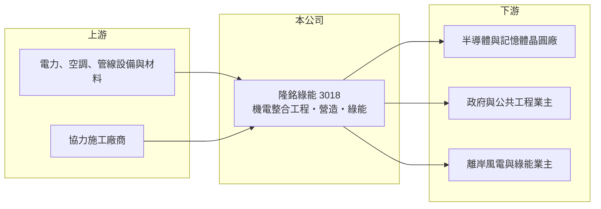

# 3018 隆銘綠能

> 上市｜[[產業索引-其他電子業|其他電子業]]｜上市（櫃）日期 2002/08/26

# 第一章：企業模式與商業藍圖

> [!info] 撰寫說明
> 精簡版，由 Claude 依公開資料整理，架構比照 [[2330台積電]] 的四章研究，資料截至 2026-10-08。來源：證交所開放資料快照（基本資料、2026 年上半年綜合損益與資產負債、股利、每月營收與備註）、Goodinfo 經營績效頁（2019 至 2025 年）、富果研究隆銘綠能 2025 年 12 月法說會筆記、nStock 公司簡介。有息負債未查得，ROIC 與 WACC 為推算。#待校對

隆銘綠能科技工程（股票代號：3018，以下簡稱隆銘綠能）是一家承攬科技廠房與公共工程機電系統的工程公司，前身為同開科技工程，2022 年更名。本章說明工程承攬業的商業模式，以及隆銘綠能長期虧損的結構性原因。

- **核心業務：** 公司成立於 1996 年，2002 年上市，總部位於台北市中山區。主要承攬科技廠房、工業廠房與住宅的[[機電工程]]，包括[[無塵室]]、一般機電、特殊系統與太陽能工程；營造業務由百分之百持有的子公司同開營造（甲級營造廠）負責，另有廢棄物處理業務。
- **營收結構：** 依 2025 年 12 月法說會資料，機電事業約占營收九成以上，營造事業比重較小，綠能事業為中長期發展方向。
- **客戶與案源：** 隆銘綠能長期承攬美商記憶體晶圓廠林口廠區的擴建與機電工程（推估為美光），也承建八德外役監獄、中科院修繕等公共工程。工程公司營收取決於手上的[[在手訂單]]與施工進度，大案完工後若沒有新案接續，營收會大幅下滑。2026 年 8 月月營收備註指出，今年承接的工程已在施作，但尚未進入高峰期。
- **長期方向：** 管理層採「固本增源」策略，鞏固機電與營造本業，並爭取離岸風電維運中心、高科技廠房與綠能環保工程，希望以綠能相關案源擺脫對少數科技廠客戶的依賴。

# 第二章：護城河深度與競爭優勢

工程承攬業的護城河通常來自施工經驗、客戶關係與規模；隆銘綠能在規模上明顯落後。

- **競爭優勢：** 長期參與記憶體晶圓廠的機電施工，累積半導體廠房的施工經驗與廠商資格，並以 [[BIM]] 3D 技術整合機電設計與施工、減少管線衝突。科技廠業主重視施工品質與工期，既有承包商在擴建案中具有一定的優先性。
- **主要對手：** 大型無塵室與廠務工程商 [[2404漢唐]]、[[6139亞翔]]、[[5536聖暉]]、[[6196帆宣]]，這些公司的規模、接單能力與財務實力都遠大於隆銘綠能，能承接台積電等大型客戶的整廠工程。
- **護城河評估：** 工程業屬於競爭激烈、議價力偏低的行業，隆銘綠能的規模小、客戶集中，難以在報價上占優勢。2019 至 2025 年七年都虧損，代表它沒有能持續賺到超額報酬的護城河。
- **觀察重點：** 長期可以追蹤新承攬工程能否以合理毛利完成、與鴻森營造的訴訟與仲裁結果，以及綠能案源能否成為穩定的業務。

# 第三章：財務體質與盈利規模

資料日期：2026-10-08，表格是撰寫當時的快照；最新月營收、毛利率、累計 EPS 由自動排程寫在本筆記的屬性欄位（月營收、毛利率、累計EPS 等）。#待校對

財務數字顯示，隆銘綠能長期處於虧損，淨值已低於股票面額。

| 年度 | 營收（億元） | [[毛利率]] | [[營業利益率]] | EPS（元） | [[ROE]] |
|---|---|---|---|---|---|
| 2019 | 10.6 | -6.45% | -28.7% | -2.99 | -34.1% |
| 2020 | 16.3 | 8.84% | -3.71% | -0.80 | -12.1% |
| 2021 | 16.2 | 3.36% | -6.88% | -4.18 | -78.7% |
| 2022 | 12.8 | -8.89% | -18.1% | -2.73 | -106% |
| 2023 | 6.00 | 4.03% | -20.9% | -1.72 | -78.9% |
| 2024 | 8.51 | 8.39% | -3.59% | -1.46 | -21.6% |
| 2025 | 4.63 | -7.39% | -40.1% | -2.16 | -25.2% |

（來源：Goodinfo 經營績效頁，合併報表。2026 年上半年依證交所資料，營收 1.56 億元、毛利率 -16.67%、營業利益率 -65.35%、EPS -2.17 元。）

- **毛利率長期偏低甚至為負：** 七年中有三年毛利率為負，代表部分工程的實際成本超過合約金額。工程合約多為固定總價，材料、人工上漲或工期延誤的風險由承包商承擔，規模小的承包商更難吸收。
- **長期指標：** 2021 至 2025 年平均 ROE 約 -62%（推算），2020 至 2025 年營收年複合成長率約 -22%（推算）。近五年未配發股利。
- **資產負債表：** 2026 年第二季資產總計約 11.65 億元，負債約 7.66 億元且幾乎全為流動負債，負債比約 66%；權益約 3.98 億元，保留盈餘為 -3.38 億元，每股淨值僅 5.28 元，低於 10 元面額。公司已透過私募引進資金（私募股數約 4,330 萬股），但持續虧損仍會侵蝕淨值。
- **[[ROIC]] 與 [[WACC]]：** 以 2025 年營收 4.63 億元乘營業利益率 -40.1%，營業損失約 1.86 億元，稅後約 -1.49 億元；投入資本以 2026 年第二季權益 3.98 億元加上有息負債推估約 2 億元（未查得，推估），合計約 6 億元，ROIC 約 -25%（推算）。WACC 以 [[CAPM]] 估算：無風險利率 1.75%、市場風險溢酬 6%、β 假設 1.2（虧損小型工程股，未查得實際數字），權益成本約 9.0%；稅前負債成本假設 3%、稅率 20%，稅後 2.4%；權益與負債約 67：33，WACC 約 6.8%（推算）。ROIC 長期為負，遠低於資金成本，代表投入的資本持續被消耗；要扭轉，首先必須讓工程毛利轉正。

# 第四章：總體風險與地緣政治

隆銘綠能的風險集中在工程虧損、財務壓力與訴訟。

- **產業週期：** 機電工程營收取決於科技廠與公共工程的發包週期。記憶體廠的擴建節奏跟著記憶體景氣起伏，客戶延後投資時，隆銘綠能就會出現接單斷層，營收大幅下滑。
- **營運風險：** 固定總價合約讓材料、人工上漲與工期延誤的風險落在承包商身上；營建業缺工推升人工成本，是近年工程業普遍的毛利壓力。客戶高度集中於少數業主，一旦失去主要客戶，營收會急遽萎縮。
- **財務風險：** 淨值低於面額、負債以流動負債為主，持續虧損會增加籌資與銀行授信壓力，可能需要再透過增資或私募補充資本，稀釋既有股東。
- **法律風險：** 與鴻森營造的訴訟與仲裁結果不確定，可能需要認列損失或影響現金流。

# 專有名詞解析

## 半導體

- **[[無塵室]]**：控制空氣中微粒、溫濕度與壓力的密閉空間，半導體製程必須在高等級無塵室中進行。

## 金融

- **[[ROIC]]**：投入資本報酬率，稅後營業利益除以股東權益加有息負債，衡量本業運用資本的效率。
- **[[WACC]]**：加權平均資金成本，依股東權益與負債的比重，加權計算公司取得資金的平均成本。

## 產業

- **[[機電工程]]**：廠房與建築的電力、空調、給排水、消防與管線系統的設計與施工。
- **[[BIM]]**：建築資訊模型，以 3D 模型整合建築、結構與機電資料，可在施工前找出管線衝突。
- **[[在手訂單]]**：已簽約但尚未完成認列營收的工程金額，是工程公司未來營收的主要指標。

# 核心供應鏈

- 上游：電力、空調與管線設備材料商，以及協力施工廠商（推估）
- 下游／客戶：美商記憶體晶圓廠林口廠區（推估為美光）、法務部與中科院等公共工程業主、綠能工程業主
- 同業：[[2404漢唐]]、[[6139亞翔]]、[[5536聖暉]]、[[6196帆宣]]

## 最新新聞
<!-- news:start -->
<!-- news:end -->

## 相關連結
- [公開資訊觀測站](https://mopsov.twse.com.tw/mops/web/t05st03?step=1&firstin=1&co_id=3018)
- [Goodinfo](https://goodinfo.tw/tw/StockDetail.asp?STOCK_ID=3018)
- [Yahoo 股市](https://tw.stock.yahoo.com/quote/3018)
- [鉅亨網新聞](https://www.cnyes.com/twstock/3018/news)
