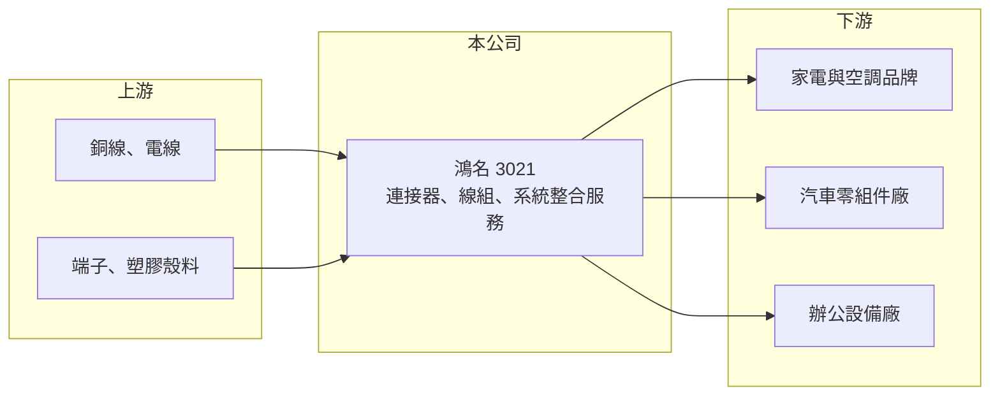

# 3021 鴻名

> 上市｜[[產業索引-電子零組件業|電子零組件業]]｜上市（櫃）日期 2002/08/26

# 第一章：企業模式與商業藍圖

> [!info] 撰寫說明
> 精簡版，由 Claude 依公開資料整理，架構比照 [[2330台積電]]，資料截至 2026-10-08。來源：證交所開放資料快照（基本資料、2026 年第二季財報、股利）、Goodinfo 經營績效年度表與公司基本資料頁。公開資料有限，營收比重與主要客戶未查得。#待校對

鴻名是以家電與空調[[線束]]、[[連接器]]為主的零件廠，本章說明它的業務組成與營運布局。

- **核心業務：** 鴻名成立於 1993 年，總部在台北，主要研發、製造與銷售連接器、連接線組與電子零件，應用以家電、空調、汽車與辦公設備為主。家電與空調用的線組負責把電源、控制板、馬達與感測器連接起來，必須通過安規認證並耐受高溫、潮濕與震動，客戶重視的是品質穩定與長期供貨。公司另外經營電腦資訊系統整合與維護服務（2025 年設立展昇資訊）。
- **營收結構：** 產品別與客戶別比重未查得。從應用領域看，家電與空調屬於成熟、需求穩定的市場，車用與辦公設備則提供部分成長與分散效果。資訊系統整合服務的規模推估較小（推估）。
- **營運據點：** 子公司分布在香港（展昇投資，控股）、菲律賓（CELERAISE ELECTRONIC，2021 年登記）、中國惠州（展茂電子，2023 年登記）與台灣。菲律賓與中國的生產布局，讓公司能就近服務在東南亞與華南設廠的家電客戶，並分散單一國家的生產風險。
- **長期方向：** 公司近年多次實施庫藏股並註銷（2026 年完成第七次買回並辦理註銷減資），顯示經營層在缺乏大型擴產計畫時，傾向以回購回饋股東。長期成長要看車用線束與海外據點能否帶來家電以外的新訂單。

# 第二章：護城河深度與競爭優勢

家電線束是勞力密集、競爭者眾多的產業，本章分析鴻名的定位。

- **競爭優勢：** 鴻名的優勢在於與家電、空調客戶的長期合作與安規認證經驗。家電機種的生命週期長，供應商一旦被指定進某個機種，通常會持續供貨多年，客戶轉換供應商需要重新認證，提供一定的穩定度。多國生產據點也符合客戶分散供應鏈的需求。
- **主要對手：** 台灣同業有 [[2462良得電]]、[[3501維熹]]、[[8103瀚荃]]、[[6290良維]] 等線材與連接器廠，車用線束有 [[3023信邦]]；中國與東南亞也有大量本地線束廠以成本競爭。鴻名規模不大，議價能力有限。
- **觀察重點：** 長期要看毛利率能否穩定在 20% 左右、營業利益率能否回到 2022 年 7.5% 的水準，以及菲律賓與惠州廠的產能利用率。2023 至 2025 年營業利益率由 6% 降到 3.3%，代表價格競爭或成本上升已侵蝕獲利。

# 第三章：財務體質與盈利規模

資料日期：2026-10-08，表格是撰寫當時的快照；最新月營收、毛利率、累計 EPS 由自動排程寫在本筆記的屬性欄位（月營收、毛利率、累計EPS 等）。#待校對

鴻名的營收規模在 30 億元上下，獲利率偏低，2022 年為近年高峰。

| 年度 | 營收（億元） | [[毛利率]] | [[營業利益率]] | EPS（元） | [[ROE]] |
|---|---|---|---|---|---|
| 2020 | 27.2 | 21.1% | 6.28% | 1.03 | 7.76% |
| 2021 | 33.7 | 20.2% | 7.00% | 1.41 | 10.4% |
| 2022 | 39.1 | 18.5% | 7.52% | 1.92 | 13.4% |
| 2023 | 29.8 | 19.0% | 6.03% | 1.25 | 7.95% |
| 2024 | 34.7 | 16.7% | 5.68% | 0.58 | 3.45% |
| 2025 | 33.4 | 15.6% | 3.3% | 0.33 | 1.66% |

- **營收規模：** 營收從 2020 年 27.2 億元成長到 2025 年 33.4 億元，五年年複合成長率約 4.2%，2022 年曾達 39.1 億元。2026 年上半年營收 14.7 億元。
- **獲利：** 毛利率從 2020 年 21.1% 逐步降到 2025 年 15.6%，EPS 從 2022 年 1.92 元降到 2025 年 0.33 元。2026 年上半年毛利率約 20.0%、營業利益率約 5.9%、EPS 0.46 元，毛利率明顯回升，但業外仍有小幅損失。近五年（2021 至 2025 年）平均 ROE 約 7.4%。
- **財務特色：** 2026 年第二季末總資產 32.7 億元、總負債 16.1 億元，負債比約 49%，在零件廠中偏高（有息負債比重未查得）。母公司權益 15.9 億元、每股淨值 16.8 元。2025 年度配發現金股利 0.6 元，高於當年 EPS，並多次實施庫藏股，資本配置以回饋股東為主。
- **[[ROIC]] 與 [[WACC]]：** 2025 年營業利益約 1.10 億元（33.4 億 × 3.3%），稅後約 0.88 億元；投入資本以權益總額 16.6 億元計 ROIC 約 5.3%，含全部負債 16.1 億元則約 2.7%（推算）。2026 年上半年營業利益 0.87 億元，年化稅後約 1.4 億元，ROIC 約 4.3% 至 8.4%（推算）。WACC 以 CAPM 推估：無風險利率 1.75%、市場風險溢酬 6%、β 取電子零組件同業常見值 0.9，股東權益成本約 7.2%；負債成本 2%、稅後 1.6%，負債占資本 30%，WACC 約 5.5%（推算）。2024 至 2025 年 ROIC 低於或接近 WACC，2026 年若維持上半年水準可小幅高於 WACC，整體屬於勉強創造價值的狀態。

# 第四章：總體風險與地緣政治

鴻名的需求主要來自家電與空調，本章整理相關風險。

- **產業週期：** 家電與空調需求與房地產、消費景氣及天氣相關，屬於成熟市場，長期成長平緩。家電品牌的庫存調整會直接反映在線束訂單上，2023 年營收從 39.1 億元降到 29.8 億元即為一例。
- **營運風險：** 線束屬於勞力密集產業，銅價與人工成本上漲若無法轉嫁，會直接壓縮毛利。負債比接近五成，利率上升會增加財務費用。
- **其他風險：** 生產據點在中國與菲律賓，面臨當地勞動法規、工資上漲與匯率波動；美國對中國製家電的關稅政策，也可能促使客戶調整生產地，影響惠州廠的訂單。

# 專有名詞解析

## 產業

- **[[線束]]**：把多條電線、端子與連接器組合成一組的配線組件，用於家電、汽車與工業設備內部配線。
- **[[連接器]]**：讓電子零件、模組或設備之間可插拔連接的元件，負責傳遞電力或訊號。

# 核心供應鏈

- 上游：銅線與電線、端子、塑膠殼料與絕緣材料。
- 下游／客戶：家電與空調品牌及代工廠、汽車零組件廠、辦公設備廠；具體客戶名稱未查得。
- 同業：[[2462良得電]]、[[3501維熹]]、[[8103瀚荃]]、[[6290良維]]、[[3023信邦]]。

## 最新新聞
<!-- news:start -->
<!-- news:end -->

## 相關連結
- [公開資訊觀測站](https://mopsov.twse.com.tw/mops/web/t05st03?step=1&firstin=1&co_id=3021)
- [Goodinfo](https://goodinfo.tw/tw/StockDetail.asp?STOCK_ID=3021)
- [Yahoo 股市](https://tw.stock.yahoo.com/quote/3021)
- [鉅亨網新聞](https://www.cnyes.com/twstock/3021/news)
