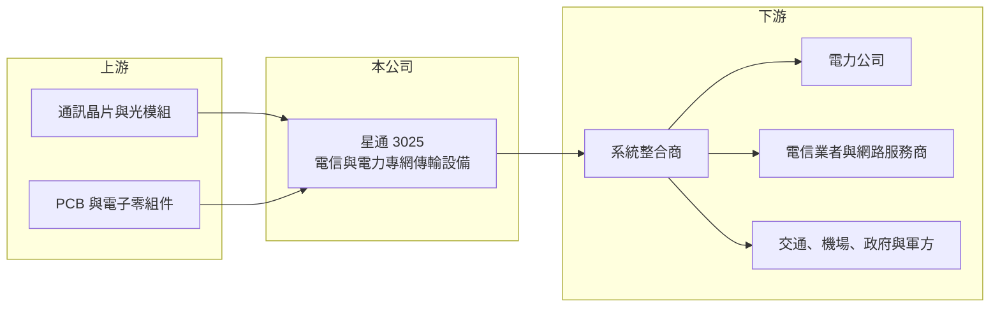

# 3025 星通

> 上市｜[[產業索引-通信網路業|通信網路業]]｜上市（櫃）日期 2002/08/26

# 第一章：企業模式與商業藍圖

> [!info] 撰寫說明
> 精簡版，由 Claude 依公開資料整理，架構比照 [[2330台積電]] 的四章研究，資料截至 2026-10-08。來源：星通官網公司簡介（Company Overview）、Goodinfo 年度經營績效、證交所開放資料（基本資料、綜合損益、資產負債、營益分析、股利、每月營收、本益比殖利率）；產業描述為整理性內容，尚未逐條比對原始文件。#待校對

本章說明星通資訊（股票代號：3025，英文名 Loop Telecom，以下簡稱星通）的商業模式：一家專做電信業者與電力公司[[專網]]傳輸設備的利基型通訊廠。

- **核心業務：** 星通成立於 1991 年，2002 年在台灣證券交易所上市，總部位於新竹科學園區。依官網，創辦團隊來自 Verizon、Tellabs、AT&T 等通訊業者與設備商。星通的產品超過 60 種，涵蓋多業務接取、[[TDM]]、[[SDH]]/SONET、PTN/MPLS、電信級乙太網路、IP 接取與路由器、光纖與 G.SHDSL 最後一哩、WDM 與網路管理系統。簡單說，星通做的是把語音、資料與控制訊號穩定傳送到遠端的「傳輸設備」，用在對可靠度要求極高的關鍵網路。
- **營收結構：** 公開資料未提供產品或客戶別營收比重。依官網，主要市場有兩類：一是電力公司，星通有專為電力產業設計的數據產品，用於變電站之間的保護電驛與監控通訊；二是電信業者，包括固網、行動網路業者與網路服務商。另外也服務交通、機場、軍方與政府網路。
- **營運據點：** 依官網，產品銷售到 80 多個國家，在台灣、法國與美國設有銷售據點，並在希臘（服務歐洲、中東與非洲）與美國（服務北美）設有技術支援中心。研發與生產集中在新竹，海外以系統整合商與通路合作為主。
- **長期方向：** 電力電網正在數位化，變電站通訊從傳統 TDM 轉向封包化的 IP/MPLS 架構，但又必須維持過去 TDM 的低延遲與高可靠度。星通的機會在於提供「新舊並存」的過渡設備，讓電力公司分階段升級。全球再生能源併網與電網韌性投資，是星通未來十年最主要的需求來源。

# 第二章：護城河深度與競爭優勢

本章評估星通的護城河。以 2023 年以來近七成的毛利率來看，星通在利基市場具有明顯的定價能力。

- **競爭優勢：** 第一，關鍵網路的高轉換成本：電力保護與控制通訊一旦出錯可能造成大停電，電力公司選用設備需經過長期測試與認證，裝上後通常使用十年以上，更換供應商的風險很高。第二，產品符合 ETSI 與 ANSI 等國際標準，並同時支援舊的 TDM 與新的封包網路，滿足客戶漸進升級的需求。第三，官網自述以小型公司的快速、客製服務與具成本競爭力的產品，與大廠區隔。整體屬於窄但穩固的護城河。
- **主要對手：** 電力與關鍵網路傳輸設備的國際對手包括 Nokia、Hitachi Energy、Siemens、GE Vernova 等大型電力與通訊設備商，以及 RAD 等專業接取設備廠（對手名單為產業常識整理，待校對）。大廠以整套解決方案取勝，星通以專業產品與彈性服務切入。
- **觀察重點：** 第一，毛利率能否維持在 60% 以上，這代表利基定位沒有被侵蝕。第二，營收規模能否擴大，因為公司營收不到 10 億元，大型專案的有無會讓年度數字劇烈波動。第三，電網投資（尤其歐洲與新興市場）的持續性。

# 第三章：財務體質與盈利規模

資料日期：2026-10-08。數字取自 Goodinfo 年度經營績效與證交所開放資料，表格是撰寫當時的快照；最新月營收、毛利率、累計 EPS 由自動排程寫在本筆記的屬性欄位（月營收、毛利率、累計EPS 等）。#待校對

星通的財務呈現高毛利、低負債、高配息的利基型公司特徵，2023 年起獲利明顯躍升。

| 年度 | 營收（新台幣） | [[毛利率]] | [[營業利益率]] | EPS（元） | [[ROE]] |
|---|---|---|---|---|---|
| 2020 | 5.98 億 | 55.8% | 15.8% | 1.11 | 9.50% |
| 2021 | 5.16 億 | 51.7% | 7.76% | 0.47 | 4.00% |
| 2022 | 4.38 億 | 54.9% | 3.31% | 0.95 | 8.13% |
| 2023 | 6.49 億 | 68.7% | 29.8% | 3.00 | 23.6% |
| 2024 | 6.50 億 | 68.5% | 29.5% | 3.68 | 24.3% |
| 2025 | 6.78 億 | 68.1% | 29.0% | 3.45 | 22.2% |
| 2026 上半年 | 2.59 億 | 64.15% | 16.98% | 1.26 | 未查得 |

註：2020 至 2025 年取自 Goodinfo 合併報表；2026 上半年取自證交所開放資料。

- **營收規模：** 2020 至 2025 年營收年複合成長率約 2.5%（推算），規模不大但 2023 年後穩定在 6.5 億元以上。2026 年 1 至 8 月累計營收 3.21 億元，較去年同期成長約 31%。
- **獲利：** 2023 年起毛利率從五成多跳升到近七成、營業利益率升到約 30%，代表產品組合轉向高附加價值的電力專網產品（推估）。2021 至 2025 年平均 ROE 約 16.5%（推算），近三年都在 22% 以上。2026 上半年營業利益率降到 17%，稅後淨利 0.71 億元中有 0.27 億元來自業外。
- **財務特色：** 依證交所資料，2026 年第二季底資產總計 12.2 億元、股東權益 7.76 億元、負債 4.43 億元，每股淨值 13.68 元。2025 年度配發現金股利 3.2 元，以 EPS 3.45 元計算配發率約 93%（推算），證交所資料顯示 2026 年 10 月初殖利率約 5.4%。公司幾乎把盈餘全數發放，資本支出需求低。
- **[[ROIC]] 與 [[WACC]]：** 以 2025 年營業利益約 1.97 億元（營收 6.78 億元 × 營業利益率 29%）扣 20% 稅後約 1.57 億元，投入資本以股東權益 7.76 億元加非流動負債 0.44 億元（代替有息負債）約 8.2 億元計算，ROIC 約 19%（推算）；以 2026 上半年年化計算約 8.6%（推算）。WACC 以 CAPM 推估：無風險利率 1.75%、市場風險溢酬 6%、β 取 0.9（推估，利基型通信設備股常見值），權益成本約 7.15%；幾乎無有息負債，WACC 約 7%（推算）。2023 至 2025 年 ROIC 明顯高於 WACC，代表星通在利基市場持續創造價值；2026 上半年利差縮小，需觀察是短期專案落差還是長期趨勢。

# 第四章：總體風險與地緣政治

本章整理星通面對的長期風險，主要來自規模小與專案型營收的波動。

- **產業週期：** 電力與電信業者的資本支出受預算週期與政策影響，大型標案的時點會讓單一年度營收大幅波動，2021 至 2022 年營收與獲利的低谷即是例子。電網數位化是長期趨勢，但各國推進速度不一。
- **營運風險：** 公司規模小，研發與業務人力有限，要同時維持舊 TDM 產品支援與開發新一代封包產品，資源壓力大。客戶與區域分散在 80 多國，個別市場的政治與付款風險需要管理。
- **其他風險：** 電力與關鍵基礎設施網路的資安要求日益嚴格，產品需要持續取得資安認證。營收以外幣計價為主，新台幣升值會壓縮高毛利產品的獲利。部分國家可能偏好本國或特定國家供應商，影響投標資格。

# 專有名詞解析

## 應用

- **[[專網]]**：為電力、交通、政府等特定單位建置、與公眾網路隔離的通訊網路，要求高可靠度與低延遲。
- **[[TDM]]**：分時多工，把傳輸時間切成固定時槽分給不同訊號，延遲穩定，是傳統電信與電力通訊的主流技術。
- **[[SDH]]**：同步數位階層，傳統電信骨幹網路的光纖傳輸標準，北美對應標準為 SONET。

## 金融

- **[[ROIC]]**：投入資本報酬率，稅後營業利益除以股東權益與有息負債的合計，衡量本業對所有資金提供者的報酬。
- **[[WACC]]**：加權平均資金成本，依股東權益與負債的比重加權計算的資金成本，ROIC 高於它才代表創造價值。

# 核心供應鏈

- 上游：通訊晶片、光收發模組、印刷電路板與電子零組件（供應商本次未查得，待校對）。
- 下游／客戶：全球 80 多國的系統整合商、電力公司、電信與行動網路業者、網路服務商，以及交通、機場、軍方與政府網路。
- 同業：Nokia、Hitachi Energy、Siemens、RAD 等國際設備商；台灣同業 [[3380明泰]]、[[3704合勤控]]（電信接取設備）。

## 最新新聞
<!-- news:start -->
<!-- news:end -->

## 相關連結
- [公開資訊觀測站](https://mopsov.twse.com.tw/mops/web/t05st03?step=1&firstin=1&co_id=3025)
- [Goodinfo](https://goodinfo.tw/tw/StockDetail.asp?STOCK_ID=3025)
- [Yahoo 股市](https://tw.stock.yahoo.com/quote/3025)
- [鉅亨網新聞](https://www.cnyes.com/twstock/3025/news)
