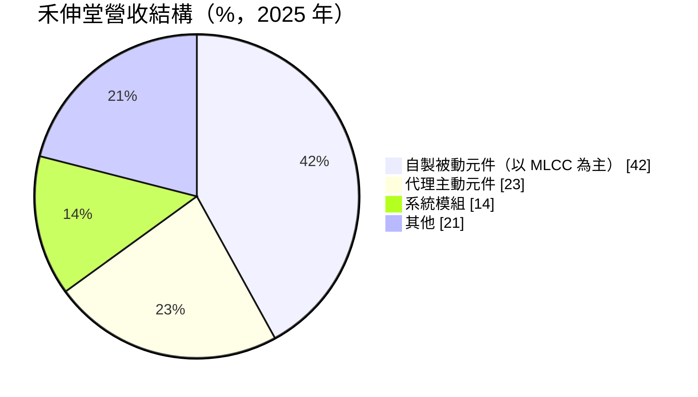
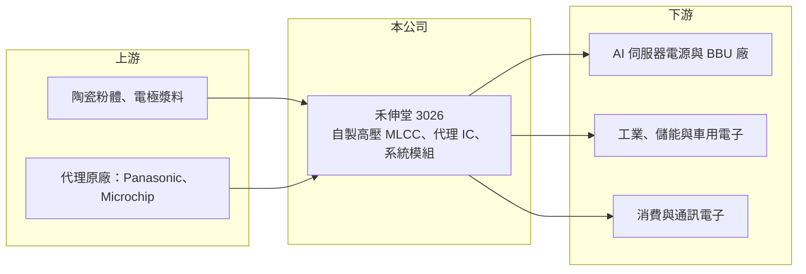

# 3026 禾伸堂

> 上市｜[[產業索引-電子零組件業|電子零組件業]]｜上市（櫃）日期 2002/08/26

# 第一章：企業模式與商業藍圖

> [!info] 撰寫說明
> 精簡版，由 Claude 依公開資料整理，架構比照 [[2330台積電]]，資料截至 2026-10-08。來源：證交所開放資料快照（基本資料、2026 年第二季財報、股利）、Goodinfo 經營績效年度表、股感 2025 年第四季法說會整理文章。法說會整理文章含分析師觀點，本文只採用事實性資料。#待校對

禾伸堂是同時經營自有[[MLCC]]生產與電子零件代理的公司，本章說明這兩種商業模式的差異，以及公司如何轉向 AI 電源用的高壓 MLCC。

- **核心業務：** 禾伸堂成立於 1981 年，業務分為兩大塊：一是自製[[被動元件]]，以積層陶瓷電容（MLCC）為主；二是代理國際品牌的主動元件，主要是 Panasonic 與 Microchip 的邏輯與類比 IC，另有系統模組業務。自製產品賺的是製造附加價值，毛利較高；代理業務賺的是通路服務費，毛利低但營收規模穩定，兩者合在一起讓公司兼具成長性與現金流。
- **營收結構：** 依 2025 年法說會整理，自製被動元件占 42%（其中 MLCC 約占八到九成）、代理主動元件 23%、系統模組 14%、其他 21%。地區以大中華區為主，台灣負責技術支援與高階應用。文章並指出公司預期 2027 年被動元件占比將超過 54%，代表營收重心持續往自製產品移動。
- **營運據點：** MLCC 生產據點包括桃園龍潭廠（將原本消費性產線轉為 AI 高壓產線）、宜蘭利澤廠（啟用閒置空間設置 AI 專用產線），以及日本北海道（研發中心轉為生產基地）。公司規劃 2026 至 2029 年第二期四年資本支出計畫約 30 億元。
- **長期方向：** 公司策略是從「生產加代理」轉型為 AI 高階電源核心元件供應商。高壓、高容值 MLCC 用於 AI 伺服器電源的 LLC 諧振電路、[[HVDC]] 800V 架構與機櫃 [[BBU]]，文章指出每個 AI 機櫃的 BBU 需要 3,000 至 5,000 顆 MLCC；人形機器人關節所需的耐高壓脈衝元件則是另一個長期應用。

# 第二章：護城河深度與競爭優勢

MLCC 是由日韓大廠主導的寡占市場，本章分析禾伸堂如何在高壓利基市場建立位置。

- **競爭優勢：** 禾伸堂的優勢在於高壓、高容值 MLCC 的技術累積，特別是使用 NPO 介電材料、低損耗的高壓產品。一般 MLCC 是規模經濟的產業，小廠難以和大廠比成本；但高壓 MLCC 需要特殊的介電配方與疊層技術，能量產 800V 以上產品的供應商不多，文章指出主要對手只有村田與 TDK，禾伸堂在台廠中居領先地位。代理業務則提供穩定的客戶關係，讓公司能更早得知客戶的新產品需求。
- **主要對手：** MLCC 全球龍頭是日本村田製作所，其次為三星電機、TDK、太陽誘電，台灣有 [[2327國巨]]、[[2492華新科]]。在一般規格 MLCC 上，禾伸堂規模遠小於這些對手；它的競爭定位集中在高壓與特殊規格領域。
- **觀察重點：** 長期要看自製 MLCC 占營收比重能否如公司規劃持續提高、30 億元資本支出計畫能否如期轉為有效產能，以及 AI 伺服器以外的應用（儲能、機器人、車用）能否接續成長。文章提到相關產線利用率已超過 100%、交期 16 至 20 週，這種供不應求的狀態能維持多久，決定毛利率的高點能否延續。

# 第三章：財務體質與盈利規模

資料日期：2026-10-08，表格是撰寫當時的快照；最新月營收、毛利率、累計 EPS 由自動排程寫在本筆記的屬性欄位（月營收、毛利率、累計EPS 等）。#待校對

禾伸堂在 2021 年被動元件高峰後獲利回落，2024 年起隨產品組合轉變回升，2026 年上半年大幅成長。

| 年度 | 營收（億元） | [[毛利率]] | [[營業利益率]] | EPS（元） | [[ROE]] |
|---|---|---|---|---|---|
| 2020 | 148 | 20.8% | 10.2% | 8.31 | 12.8% |
| 2021 | 166 | 22.1% | 12.1% | 12.36 | 18.7% |
| 2022 | 151 | 20.8% | 9.37% | 7.79 | 11.2% |
| 2023 | 132 | 17.3% | 5.37% | 5.13 | 6.55% |
| 2024 | 128 | 16.3% | 4.85% | 5.87 | 9.08% |
| 2025 | 134.3 | 18.8% | 8.03% | 6.58 | 9.87% |

- **營收規模：** 營收 2021 年高峰 166 億元，2024 年降到 128 億元，2025 年回升到 134.3 億元（年增約 5%），五年年複合成長率約 −1.9%。營收規模中有相當比例來自代理業務，因此營收變化不能完全代表自製 MLCC 的成長。2026 年上半年營收 77.2 億元。
- **獲利：** 2025 年稅後淨利約 10.9 億元，年增約 12%，EPS 已連續八年高於面額一半（5 元）。2026 年上半年毛利率約 25.3%、營業利益率約 14.4%、EPS 6.73 元，半年就超過 2025 全年，主要來自高壓 MLCC 比重提高。近五年（2021 至 2025 年）平均 ROE 約 11.1%。
- **財務特色：** 2026 年第二季末總資產 177.2 億元、總負債 71.8 億元，負債比約 41%，代理業務需要較多存貨與應收帳款，是負債比偏高的原因之一（推估）。2025 年度配發現金股利 5.8 元，配息率約 88%，公司章程規定現金股利占股利總額 50% 至 100%，長期維持高配息。
- **[[ROIC]] 與 [[WACC]]：** 2025 年營業利益約 10.8 億元（134.3 億 × 8.03%），稅後約 8.6 億元；投入資本以權益總額 105.4 億元計 ROIC 約 8.2%，含全部負債 71.8 億元則約 4.9%（推算）。2026 年上半年營業利益 11.1 億元，年化稅後約 17.8 億元，ROIC 約 10% 至 17%（推算）。WACC 以 CAPM 推估：無風險利率 1.75%、市場風險溢酬 6%、β 取被動元件同業常見值 1.2，股東權益成本約 8.95%；負債成本 2%、稅後 1.6%，負債占資本 10%，WACC 約 8.2%（推算）。2023 至 2025 年 ROIC 約在 WACC 附近，2026 年起明顯高於 WACC，代表轉型高壓 MLCC 正在提高資本報酬。

# 第四章：總體風險與地緣政治

禾伸堂的成長高度連結 AI 伺服器電源，本章整理相關風險。

- **產業週期：** MLCC 是景氣循環明顯的產業，2021 年高峰後經歷兩年以上的庫存調整，禾伸堂毛利率從 22.1% 降到 16.3%。目前 AI 需求帶來供不應求，但當日韓大廠擴充高壓產能、或 AI 資本支出放緩時，價格與利用率都可能回落。
- **營運風險：** 30 億元資本支出計畫會提高折舊，若需求不如預期，新產能將拖累毛利率。代理業務依賴原廠授權，原廠若調整代理政策或改為直營，相關營收可能流失。
- **其他風險：** 高壓 MLCC 需求集中在少數 AI 伺服器平台，若電源架構轉變（例如改用其他類型電容或固態變壓器），產品需求會受影響。營收以美元計價為主、日本有生產據點，新台幣與日圓匯率都會影響獲利。

# 專有名詞解析

## 產業

- **[[被動元件]]**：不需外加電源即可運作的電子元件，主要是電容、電阻與電感，負責儲能、濾波與限流。
- **[[MLCC]]**：積層陶瓷電容，以多層陶瓷介質與電極交疊製成，體積小、用量大，是最主要的被動元件。
- **[[HVDC]]**：高壓直流供電，資料中心以 ±400V 或 800V 直流取代傳統交流配電，可減少轉換損耗。
- **[[BBU]]**：備援電池單元，AI 伺服器機櫃在市電中斷時的短時供電裝置，可避免運算中斷。

# 核心供應鏈

- 上游：MLCC 用的陶瓷介電粉體與電極漿料；代理業務的原廠為 Panasonic、Microchip。
- 下游／客戶：AI 伺服器電源與 BBU 模組廠（目標平台為 [[NVDA輝達]] 的 Blackwell、Vera Rubin），工業、儲能與車用電子廠，以及消費與通訊電子廠；具體客戶名稱未查得。
- 同業：[[2327國巨]]、[[2492華新科]]；國外有村田製作所、三星電機、TDK、太陽誘電。

## 最新新聞
<!-- news:start -->
<!-- news:end -->

## 相關連結
- [公開資訊觀測站](https://mopsov.twse.com.tw/mops/web/t05st03?step=1&firstin=1&co_id=3026)
- [Goodinfo](https://goodinfo.tw/tw/StockDetail.asp?STOCK_ID=3026)
- [Yahoo 股市](https://tw.stock.yahoo.com/quote/3026)
- [鉅亨網新聞](https://www.cnyes.com/twstock/3026/news)
