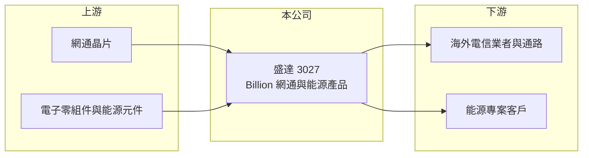

# 3027 盛達

> 上市｜[[產業索引-通信網路業|通信網路業]]｜上市（櫃）日期 2002/08/26

# 第一章：企業模式與商業藍圖

> [!info] 撰寫說明
> 精簡版，由 Claude 依公開資料整理，架構比照 [[2330台積電]] 的四章研究，資料截至 2026-10-08。來源：證交所開放資料（基本資料、綜合損益、資產負債、營益分析、股利、每月營收）、Goodinfo 年度經營績效。公開資料有限，本次未取得產品別資料，業務描述多依記憶整理，需逐條比對原始文件。#待校對

本章說明盛達電業（股票代號：3027，英文品牌 Billion，以下簡稱盛達）的商業模式：一家歷史悠久、以網通設備為核心並涉足能源產品的中型電子公司。

- **核心業務：** 盛達成立於 1973 年，2002 年在台灣證券交易所上市，總部位於新北市新店區。盛達以 Billion [[自有品牌]]與代工方式銷售寬頻網通設備，例如 xDSL、行動寬頻與 [[Wi-Fi]] 路由器，產品主要銷往海外電信業者與通路（待校對）。此外，盛達也經營電源與能源相關產品，例如電源供應設備與太陽光電系統（待校對）。
- **營收結構：** 公開資料本次未取得產品別營收比重。從營收變化來看，2020 年營收 8.5 億元，2025 年成長到 21.1 億元，五年增加超過一倍，2026 年 1 至 8 月卻較去年同期減少約 46%，顯示營收中有相當比例來自波動大的專案型業務（推估，專案內容待校對）。
- **營運據點：** 總部位於新北新店，生產與海外據點本次未查得（待校對）。董事長為陳振乾，證交所資料顯示目前未設總經理職位。
- **長期方向：** 盛達的長期課題是在網通與能源兩條產品線中找到具規模的核心業務。寬頻網通設備面臨同質化與價格競爭，能源產品則受惠於再生能源與電網韌性的長期需求，但也需要不同的技術與客戶基礎。公司能否把營收成長轉化為穩定獲利，是評估的重點。

# 第二章：護城河深度與競爭優勢

本章評估盛達的競爭位置。從近年毛利率由近四成降到兩成以下來看，盛達的定價能力明顯減弱。

- **競爭優勢：** 盛達經營 Billion 品牌多年，在部分海外市場的電信業者與通路中具有知名度與長期合作關係，這是中小型網通廠少見的品牌資產（待校對）。不過網通路由器是高度標準化的產品，品牌溢價有限，整體屬於無護城河或極窄護城河。
- **主要對手：** 寬頻路由器市場的對手包括 TP-Link、[[2332友訊]]、[[3704合勤控]]、[[5388中磊]]、[[3596智易]] 等，它們的規模都比盛達大；能源產品領域則面對大量的太陽光電與電源設備廠（對手名單為產業常識整理，待校對）。
- **觀察重點：** 第一，毛利率能否從 2025 年的 17.2% 回升，2026 上半年為 23.25%，已有改善。第二，2026 年營收大幅下滑的原因，是專案結束還是產品退出。第三，公司在網通與能源之間的資源配置與策略方向。

# 第三章：財務體質與盈利規模

資料日期：2026-10-08。數字取自 Goodinfo 年度經營績效與證交所開放資料，表格是撰寫當時的快照；最新月營收、毛利率、累計 EPS 由自動排程寫在本筆記的屬性欄位（月營收、毛利率、累計EPS 等）。#待校對

盛達的財務數字呈現「營收放大、毛利率下滑、獲利始終微薄」的走勢。

| 年度 | 營收（新台幣） | [[毛利率]] | [[營業利益率]] | EPS（元） | [[ROE]] |
|---|---|---|---|---|---|
| 2020 | 8.5 億 | 38.8% | 4.65% | 0.32 | 2.36% |
| 2021 | 10.5 億 | 30.7% | 0.53% | 0.28 | 2.34% |
| 2022 | 12.1 億 | 24.5% | 0.48% | 0.41 | 3.10% |
| 2023 | 18.3 億 | 21.9% | -0.13% | 0.64 | 5.49% |
| 2024 | 20.2 億 | 20.5% | -0.97% | -0.22 | 未查得 |
| 2025 | 21.1 億 | 17.2% | -3.22% | -1.06 | -6.13% |
| 2026 上半年 | 7.02 億 | 23.25% | -4.64% | -0.06 | 未查得 |

註：2020 至 2025 年取自 Goodinfo 合併報表。Goodinfo 頁面 2024 年 ROE 為 0.70%，與當年 EPS 為負不一致，因此改列未查得。2026 上半年取自證交所開放資料。

- **營收規模：** 2020 至 2025 年營收年複合成長率約 19.9%（推算），成長快速；但 2026 年 1 至 8 月累計營收 8.83 億元，較去年同期的 16.29 億元減少約 46%，成長並不穩定。
- **獲利：** 營收擴大的同時毛利率從 38.8% 一路降到 17.2%，代表新增的營收多屬低毛利產品或專案。營業利益率自 2023 年起轉負，2023 年的 EPS 0.64 元主要來自業外收益（推估）。2025 年稅後淨損 1.21 億元，2026 上半年營業損失 0.33 億元、靠業外收益 0.26 億元縮小虧損。
- **財務特色：** 依證交所資料，2026 年第二季底資產總計 29.9 億元、股東權益 21.4 億元、負債 7.15 億元，每股淨值 16.60 元，保留盈餘 1.95 億元，財務結構仍屬穩健。2025 年度未配發股利。
- **[[ROIC]] 與 [[WACC]]：** 以 2026 上半年營業損失 0.33 億元年化約 -0.65 億元（虧損不計稅盾），投入資本以股東權益 21.4 億元加非流動負債 1.0 億元（代替有息負債）約 22.4 億元計算，ROIC 約 -2.9%（推算）；2025 年營業損失約 0.68 億元，ROIC 約 -3%（推算）。WACC 以 CAPM 推估：無風險利率 1.75%、市場風險溢酬 6%、β 取 1.0（推估，網通同業常見值），權益成本約 7.75%；負債比重低，WACC 約 7% 至 7.5%（推算）。ROIC 為負且遠低於 WACC，代表近年營收擴張並未創造價值，反而在消耗資本。

# 第四章：總體風險與地緣政治

本章整理盛達的長期風險，主要來自產品競爭力與營收穩定性。

- **產業週期：** 寬頻網通設備需求隨電信業者的網路升級與消費者換機波動；能源產品則受政策補助、電價與專案進度影響，兩者週期不同，使營收波動加大。
- **營運風險：** 營收規模與毛利率同時不穩，固定費用難以攤提。若專案型營收持續下滑，虧損可能擴大；產品線分散也使研發資源難以集中。
- **其他風險：** 網通與能源產品的關鍵零組件（晶片、電池、功率元件）價格與供應受國際市場影響。美國與歐洲對網通設備的資安規範與關稅政策，以及再生能源政策變動，都會影響產品出口與專案需求。

# 專有名詞解析

## 應用

- **[[Wi-Fi]]**：以無線電波讓設備連上區域網路的技術，每一代標準提升速度與連線數量。

## 金融

- **[[ROIC]]**：投入資本報酬率，稅後營業利益除以股東權益與有息負債的合計，衡量本業對所有資金提供者的報酬。
- **[[WACC]]**：加權平均資金成本，依股東權益與負債的比重加權計算的資金成本，ROIC 高於它才代表創造價值。

## 產業

- **[[自有品牌]]**：企業以自己的商標設計、行銷與銷售產品，掌握定價與通路，毛利通常高於代工。

# 核心供應鏈

- 上游：網通晶片（例如 [[2379瑞昱]]、[[AVGO博通]] 一類供應商，實際供應商未公開，待校對）、電子零組件與能源相關元件。
- 下游／客戶：海外電信業者、通路商與能源專案客戶，客戶名稱本次未查得。
- 同業：TP-Link、[[2332友訊]]、[[3704合勤控]]、[[5388中磊]]、[[3596智易]]。

## 最新新聞
<!-- news:start（自動產生，請勿手動編輯此範圍） -->
- 2026-10-20 🏛️ 重訊 14:05｜公告本公司115年9月份自結合併財務報告之相關資訊｜[觀測站](https://mops.twse.com.tw/mops/#/web/t05st01)

完整紀錄：[[3027盛達 新聞]]
<!-- news:end -->

## 相關連結
- [公開資訊觀測站](https://mopsov.twse.com.tw/mops/web/t05st03?step=1&firstin=1&co_id=3027)
- [Goodinfo](https://goodinfo.tw/tw/StockDetail.asp?STOCK_ID=3027)
- [Yahoo 股市](https://tw.stock.yahoo.com/quote/3027)
- [鉅亨網新聞](https://www.cnyes.com/twstock/3027/news)
