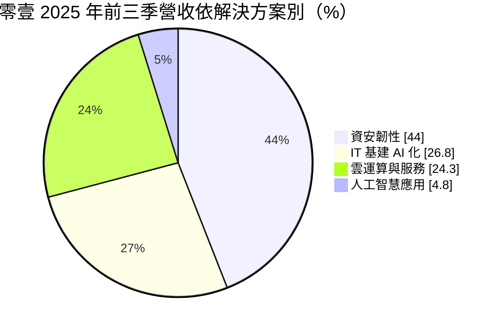
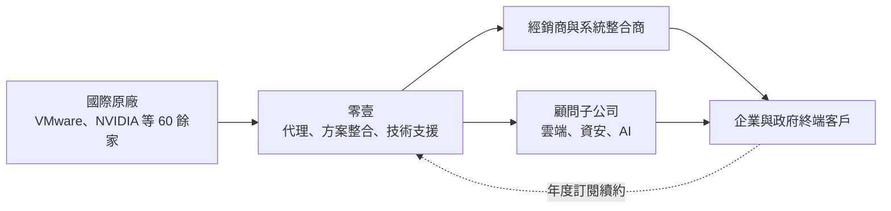
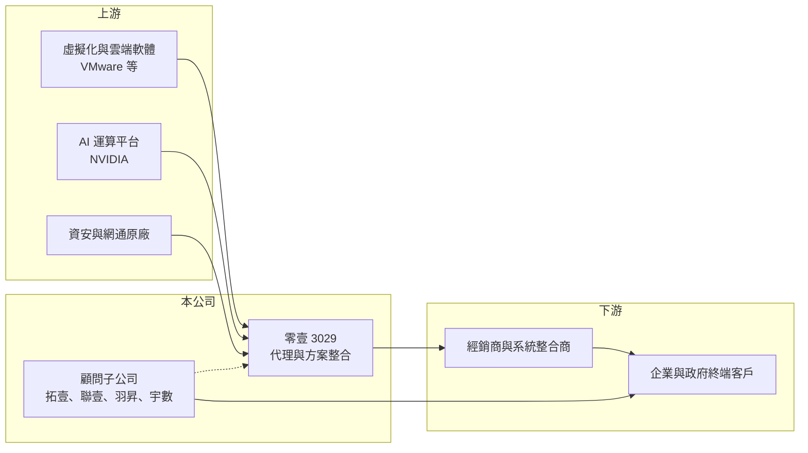

# 3029 零壹

> 上市｜[[產業索引-資訊服務業|資訊服務業]]｜上市（櫃）日期 2002/08/26

# 第一章：企業模式與商業藍圖

> [!info] 撰寫說明
> 精簡版，由 Claude 依公開資料整理，架構比照 [[2330台積電]] 的四章研究，資料截至 2026-10-08。來源：富果研究 2025 年 12 月法說會備忘錄（2025 年前三季營收結構、代理品牌、訂閱制比重、股東政策）、Goodinfo 年度經營績效頁、證交所開放資料（基本資料、2026 年第二季資產負債與綜合損益、每月營收、股利）。#待校對

零壹科技是台灣主要的企業 IT 解決方案代理商，本章說明它如何從代理國際品牌起家，轉型為整合資安、雲端與 AI 的「解決方案聚合商」，以及訂閱制收入如何改變它的獲利結構。

## 一、核心定位：國際 IT 品牌的加值代理商

- **核心業務：** 零壹代理超過 60 家國際 ICT 品牌，再透過經銷商與系統整合商把產品與服務賣給企業（富果研究）。它在 [[AVGO博通]] 收購 VMware 後成為 VMware 在台灣的獨家代理，也是 [[NVDA輝達]] 在台灣的關鍵代理商。公司自我定位為「解決方案聚合商」（Solution Aggregator），也就是不只轉賣產品，而是把多家原廠的產品組合成完整方案，並提供導入與顧問服務。
- **公司背景：** 零壹成立於 1980 年、2002 年上市，實收資本額約 16.7 億元（證交所開放資料）。旗下有拓壹科技、聯壹數位（2024 年成立）、羽昇國際、宇數科技等子公司，提供雲端、資安與 AI 顧問服務（富果研究）。2026 年第二季底非控制權益約 12.9 億元（證交所資產負債），顯示子公司體系已有相當規模。
- **營收結構：** 2025 年前三季營收依解決方案別如下（富果研究）：

- **各板塊說明：** [[資安]]韌性是最大營收來源，年增 37.7%，受惠於資安法規要求企業增加預算；雲運算與服務年增 91.6%，是成長最快的板塊，主要來自虛擬化與雲端平台的訂閱；IT 基建 AI 化年增 36.6%，包含企業導入 AI 所需的伺服器、儲存與網路；人工智慧應用目前以顧問服務為主（富果研究）。

## 二、資本轉化邏輯：代理規模加訂閱堆疊

代理商的毛利率不高，零壹長年在 10% 至 13% 之間（Goodinfo），但它不需要自建工廠，靠周轉率與規模賺錢。關鍵變化在於訂閱制：軟體原廠轉向訂閱授權後，零壹的訂閱制營收已占整體「超過三成」（富果研究），這些按年續約的[[經常性收入]]會逐年堆疊，讓營收的可預測性大幅提高。

## 三、長期藍圖

公司以「共建平台生態圈」為核心，朝集團化、服務化與國際化發展，目標成為亞太區領先的解決方案供應商；2025 年被定為「海外服務元年」，在中國、越南、泰國設立據點（富果研究）。股東政策上，公司揭示配息率 85% 至 96% 以上、ROE 目標 15% 至 20%（富果研究），資本配置以高配息為主。

# 第二章：護城河深度與競爭優勢

本章分析零壹的護城河構成，以及代理商模式的競爭與限制。

## 一、競爭優勢

- **關鍵原廠的代理權：** VMware 獨家代理與 NVIDIA 關鍵代理的地位，讓需要虛擬化與 AI 平台的客戶必須透過零壹體系取得產品。代理權本身就是一種准入門檻，但它掌握在原廠手上，屬於「借來的護城河」。
- **技術支援與方案能力：** 原廠選擇代理商時，看重的是能否提供技術支援、教育訓練與方案整合。零壹透過顧問子公司與 60 多家品牌的組合，能提供單一品牌代理商做不到的跨產品整合，提高原廠與經銷商對它的依賴。
- **訂閱制的黏著度：** 企業導入虛擬化或資安平台後，每年續約是常態，零壹因此擁有一批持續貢獻收入的裝機基礎。

## 二、主要對手

| 對手 | 定位 | 與零壹的比較 |
|---|---|---|
| [[2347聯強]] | 台灣最大 IT 通路商 | 企業級產品代理的直接對手，規模大很多 |
| [[6214精誠]] | 資訊服務集團，旗下有代理事業 | 在雲端與軟體代理上競爭 |
| 敦陽科、大綜等系統整合商（[[2480敦陽科]]、[[3147大綜]]） | 終端客戶的系統整合 | 既是下游客戶，也可能直接向原廠取得產品 |
| 國際原廠直營團隊 | 大型客戶直接服務 | 原廠若收回代理權或改為直營，代理商會被取代 |

## 三、觀察重點

- **代理權穩定性：** 最大風險是原廠更換代理商或收回直營，VMware 被博通收購後的通路政策變化，就是這類風險的實例。
- **服務收入比重：** 顧問與雲端服務毛利較高，比重提升才能讓毛利率擺脫代理業的天花板。
- **海外擴張成效：** 中國、越南、泰國據點能否複製台灣的模式，決定集團化與國際化的長期空間。

# 第三章：財務體質與盈利規模

資料日期：2026-10-08，表格是撰寫當時的快照；最新月營收、毛利率、累計 EPS 由自動排程寫在本筆記的屬性欄位（月營收、毛利率、累計EPS 等）。#待校對

本章用多年度數據檢視零壹在代理規模擴張與訂閱轉型下的獲利與資本報酬。

## 一、多年度三率與 ROE

| 年度 | 營收（新台幣） | [[毛利率]] | [[營業利益率]] | EPS（元） | [[ROE]] |
|---|---|---|---|---|---|
| 2020 | 98.3 億 | 10.6% | 5.13% | 3.55 | 17.3% |
| 2021 | 129 億 | 10.1% | 4.86% | 4.24 | 16.2% |
| 2022 | 127 億 | 11.7% | 5.57% | 4.03 | 15.5% |
| 2023 | 139 億 | 11.8% | 5.68% | 4.50 | 17.0% |
| 2024 | 185 億 | 13.1% | 6.23% | 5.22 | 17.6% |
| 2025 | 249 億 | 12.2% | 6.01% | 6.53 | 18.6% |
| 2026 上半年 | 141.2 億 | 12.34% | 6.32% | 3.63 | 未查得 |

註：2020 至 2025 年取自 Goodinfo；2026 上半年取自證交所綜合損益與營益分析。

- **營收成長：** 2020 至 2025 年營收年複合成長率約 20.4%（推算），2026 年 1 至 8 月累計營收約 208.5 億元、年增約 20.1%（證交所每月營收）。成長來自資安、雲端訂閱與 AI 基礎建設三條主線。
- **利潤率：** 毛利率由 10% 左右升到 12% 至 13%，營業利益率由約 5% 升到 6% 以上，反映訂閱與服務比重提高。
- **ROE：** 2021 至 2025 年平均 ROE 約 17.0%（推算），落在公司 15% 至 20% 的目標區間。

## 二、股利與財務結構

2025 年度配發現金股利 5.5 元，以 EPS 6.53 元計算配發率約 84%（推算）。2026 年第二季底歸屬母公司權益約 52.3 億元、權益總計約 65.3 億元；總負債約 114.9 億元，其中流動負債約 104.6 億元、非流動負債約 10.3 億元（證交所資產負債）。代理商需要先向原廠進貨、再向經銷商收款，流動負債中推估包含應付帳款與短期借款（推估），營運資金管理是這類公司的財務重點。

## 三、[[ROIC]] 與 [[WACC]]

**ROIC 推算：** 2025 年營業利益約 249 億元 × 6.01% ≈ 14.96 億元，扣除 20% 稅後約 11.97 億元。投入資本以權益總計 65.3 億元加上非流動負債 10.3 億元計算，約 75.6 億元，ROIC 約 15.8%（推算）。短期借款金額未查得，若再計入，ROIC 推估落在 12% 至 16%。

**WACC 推算：** 公債殖利率 1.75%、市場風險溢酬 6%、β 取資服通路股常見值 0.8，權益成本約 6.55%；負債成本假設 2.5%、稅後 2.0%，以權益約 80%、有息負債約 20% 加權，WACC 約 5.6%（推算）。

**結論：** ROIC 約 12% 至 16%，高於約 5.6% 的 WACC，代表零壹的代理加服務模式長期創造價值。訂閱收入的持續堆疊若能推高利潤率，利差還有擴大的空間。

# 第四章：總體風險與地緣政治

本章整理零壹長期面對的產業、營運與其他風險。

## 一、產業週期

- **企業 IT 支出週期：** 硬體與基礎架構的採購受景氣影響，景氣轉弱時企業會延後擴充；訂閱與資安支出相對有韌性。
- **技術世代交替：** 虛擬化、雲端到 AI 的技術轉換，會改變企業採購的品牌與產品，代理商需要持續爭取新興原廠的代理權。

## 二、營運風險

- **原廠依賴：** 主要原廠的通路政策改變、合併或收回代理權，可能讓單一板塊營收大幅變動。
- **營運資金與信用風險：** 營收快速成長需要更多存貨與應收帳款，若下游經銷商財務出問題，可能產生呆帳。
- **海外擴張：** 中國、越南、泰國據點初期需要投入，當地法規與競爭可能影響回收速度。

## 三、其他風險

- **地緣政治與出口管制：** NVIDIA 等 AI 晶片受美國出口管制，中國據點的業務範圍與產品可能受限。
- **匯率：** 進貨多以美元計價，新台幣升貶會影響毛利率。

# 專有名詞解析

## 應用

- **[[資安]]**：資訊安全，保護企業系統與資料不被入侵、竊取或破壞的技術與服務。

## 金融

- **[[經常性收入]]**：按月或按年持續收取的收入，例如維護合約與訂閱費，可預測性高於一次性的專案收入。
- **[[ROIC]]**：投入資本報酬率，衡量企業用股東與債權人投入的資本，每年能產生多少稅後營業利益。
- **[[WACC]]**：加權平均資金成本，股東要求報酬與負債利息依資本結構加權後的平均值，是判斷是否創造價值的門檻。

## 產業

- **[[代理商]]**：取得國外原廠授權，在特定區域銷售其產品並提供技術支援的公司，賺取進銷價差與服務費。

# 核心供應鏈

- 上游：[[AVGO博通]]（VMware）、[[NVDA輝達]]，以及其他資安、網通與雲端原廠。
- 下游／客戶：經銷商與系統整合商，例如 [[2480敦陽科]]、[[3147大綜]]（產業代表，非指名客戶）；企業、製造業、醫療與政府終端客戶。
- 同業：[[2347聯強]]、[[6214精誠]]。

## 最新新聞
<!-- news:start（自動產生，請勿手動編輯此範圍） -->
- 2026-10-06 📰 媒體 18:50｜營收速報 - 零壹(3029)9月營收27.72億元年增率高達38.64％｜[鉅亨網](https://news.cnyes.com/news/id/6622878)

完整紀錄：[[3029零壹 新聞]]
<!-- news:end -->

## 相關連結
- [公開資訊觀測站](https://mopsov.twse.com.tw/mops/web/t05st03?step=1&firstin=1&co_id=3029)
- [Goodinfo](https://goodinfo.tw/tw/StockDetail.asp?STOCK_ID=3029)
- [Yahoo 股市](https://tw.stock.yahoo.com/quote/3029)
- [鉅亨網新聞](https://www.cnyes.com/twstock/3029/news)
