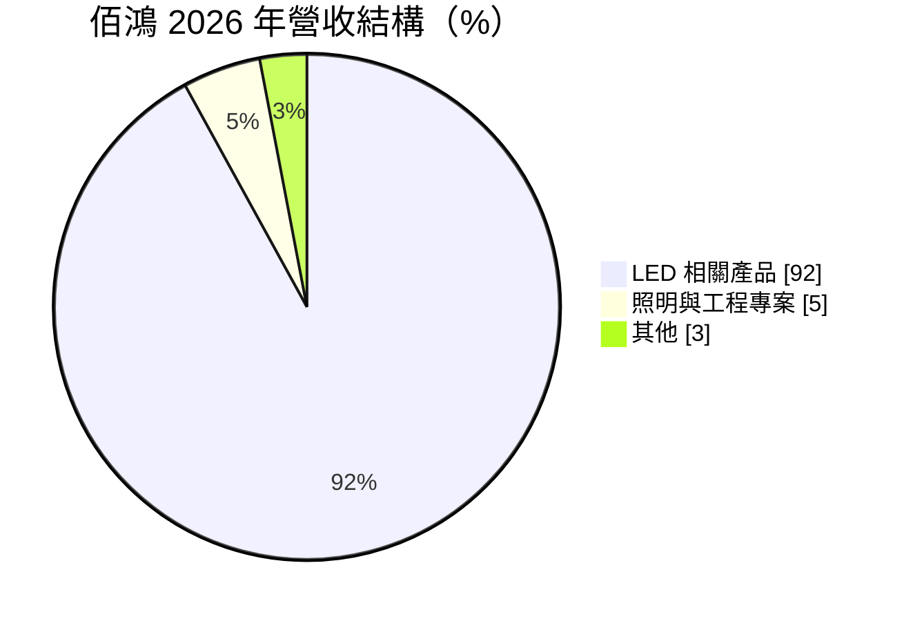
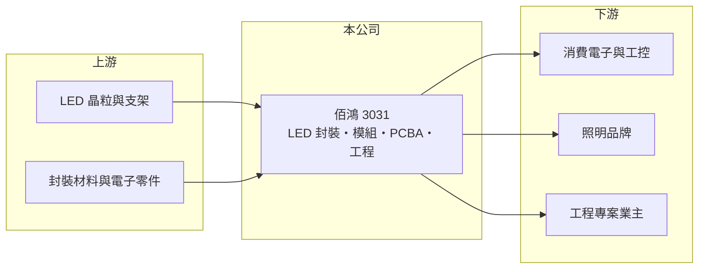

# 3031 佰鴻

> 上市｜[[產業索引-光電業|光電業]]｜上市（櫃）日期 2002/08/26

# 第一章：企業模式與商業藍圖

> [!info] 撰寫說明
> 精簡版，由 Claude 依公開資料整理，架構比照 [[2330台積電]] 的四章研究，資料截至 2026-10-08。來源：證交所開放資料快照（基本資料、2026 年上半年綜合損益與資產負債、股利、每月營收）、Goodinfo 經營績效頁（2019 至 2025 年）、富果研究佰鴻 2026 年 9 月法說會摘要。生產據點未查得；有息負債未查得，ROIC 與 WACC 為推算。#待校對

佰鴻工業（股票代號：3031，以下簡稱佰鴻）是一家老牌 LED 元件廠，在成熟且競爭激烈的 LED 產業中，以利基市場的客製化接單維持獲利。本章說明它的業務組成與在產業鏈中的位置。

- **核心業務：** 佰鴻成立於 1981 年，2002 年上市，總部位於新北市板橋區。業務橫跨 LED 產業鏈：上游的晶片與支架、中游的 [[LED封裝]]與模組、[[PCBA]] 組裝，到下游的照明與工程專案都有涉獵，產品用於消費電子、工控設備、號誌與照明等領域。
- **營收結構：** 依 2026 年 9 月法說會資料，LED 相關產品約占營收 92%，照明與工程專案約 5%，其他約 3%。

- **商業模式：** 佰鴻不和大廠拚標準品的規模，而是承接少量多樣、需要客製設計的 LED 元件與模組訂單，例如特殊尺寸、特殊光色或需要整合電路板的產品。這類訂單單價與毛利較高，但需求分散、成長有限。
- **長期方向：** 公司強調利基市場客製化、自動化整合與 ESG。對光通訊相關機會態度審慎樂觀，但因上游競爭擁擠，優先發展後段封裝能力，而不是投入資本密集的前段晶片。

# 第二章：護城河深度與競爭優勢

佰鴻的護城河來自產品組合的彈性與客戶關係，而不是規模或技術領先。

- **競爭優勢：** 從元件到模組的完整產品線，讓佰鴻可以替客戶做一站式的客製化設計，接單彈性高。2019 至 2025 年[[毛利率]]由 24% 逐步提高到 29%，即使營收下滑，毛利率仍在改善，說明產品組合正往較高附加價值移動。
- **主要對手：** 國內 LED 封裝同業 [[2393億光]]、[[3714富采]]、[[6168宏齊]]、[[8111立碁]]，以及中國大陸的大型 LED 封裝廠。中國廠商在標準品上具有明顯的規模與價格優勢，台灣業者普遍轉向利基與車用、工控等高可靠度市場。
- **守得住與守不住：** 客製化的工控、號誌與特殊應用訂單相對守得住，因為量小、規格多，大廠不願經營；守不住的是一般照明與消費性 LED，價格已被中國同業壓到很低。
- **觀察重點：** 長期可以追蹤 LED PCBA 與客製模組的成長、工程專案的接單，以及光通訊封裝布局是否帶來實際營收。

# 第三章：財務體質與盈利規模

資料日期：2026-10-08，表格是撰寫當時的快照；最新月營收、毛利率、累計 EPS 由自動排程寫在本筆記的屬性欄位（月營收、毛利率、累計EPS 等）。#待校對

財務數字顯示，佰鴻的營收規模逐年縮小，但毛利率穩定提升，獲利與配息維持穩定。

| 年度 | 營收（億元） | [[毛利率]] | [[營業利益率]] | EPS（元） | [[ROE]] |
|---|---|---|---|---|---|
| 2019 | 17.6 | 24.1% | 7.92% | 1.28 | 8.31% |
| 2020 | 13.8 | 27.4% | 7.83% | 0.74 | 4.70% |
| 2021 | 15.3 | 28.7% | 10.3% | 1.45 | 8.65% |
| 2022 | 15.1 | 24.2% | 7.79% | 1.16 | 6.50% |
| 2023 | 11.3 | 27.1% | 6.05% | 1.05 | 5.91% |
| 2024 | 11.8 | 28.1% | 8.32% | 1.09 | 6.08% |
| 2025 | 11.4 | 29.1% | 8.26% | 1.09 | 6.13% |

（來源：Goodinfo 經營績效頁，合併報表。2026 年上半年依證交所資料，營收 6.42 億元、毛利率 27.91%、營業利益率 9.26%、EPS 0.57 元。）

- **縮小規模、守住利潤：** 營收由 2019 年的 17.6 億元降到 2025 年的 11.4 億元，但營業利益率大致維持在 6% 至 10%，EPS 穩定在 1 元上下。這代表佰鴻主動退出低毛利標準品，用較小的規模換取穩定的利潤。2026 年上半年營收年增約兩成、營業利益約 0.60 億元，本業出現回溫。
- **業外比重高：** 2026 年上半年營業外收入約 0.57 億元，幾乎與營業利益相當，稅前淨利約 1.16 億元。業外收益（推估含投資收益、利息與匯兌）的波動會明顯影響 EPS，看獲利時宜分開本業與業外。
- **長期指標：** 2021 至 2025 年平均 ROE 約 6.7%（推算），2020 至 2025 年營收年複合成長率約 -3.7%（推算）。2025 年度配發現金股利 1 元，對照 EPS 1.09 元，配息率約 92%（推算），屬於把多數盈餘發還股東的公司。
- **資產負債表：** 2026 年第二季資產總計約 36.23 億元、負債約 6.48 億元，負債比約 18%；權益總計約 29.75 億元，每股淨值 16.70 元。非流動資產約 15.95 億元，推估含廠房與長期投資。
- **[[ROIC]] 與 [[WACC]]：** 以 2025 年營收 11.4 億元乘營業利益率 8.26%，營業利益約 0.94 億元，稅後約 0.75 億元；投入資本以 2026 年第二季權益 29.75 億元計（有息負債未查得，推估很小），ROIC 約 2.5%（推算）。若扣除帳上現金與長期投資，本業實際報酬會較高，但具體數字未查得。WACC 以 [[CAPM]] 估算：無風險利率 1.75%、市場風險溢酬 6%、β 假設 0.9（LED 同業常見值，未查得實際數字），權益成本約 7.2%；幾乎無有息負債，WACC 約 7%（推算）。ROIC 低於 WACC，代表以全部股東權益計算時，佰鴻並未賺回資金成本；高配息政策等於把報酬率不足的資本退還股東，是合理的資本配置選擇。

# 第四章：總體風險與地緣政治

佰鴻身處成熟的 LED 封裝產業，主要風險是價格競爭與成長有限。

- **產業週期：** LED 封裝已是成熟產業，需求跟著消費電子、照明、工控景氣起伏，景氣下行時客戶庫存調整會放大訂單波動。
- **競爭風險：** 中國同業的低價競爭持續壓縮標準品價格，若利基市場也被大廠切入，佰鴻的毛利率優勢可能縮小。管理層在 2026 年法說會中預估下半年與上半年相近，顯示成長幅度有限。
- **技術演進：** [[Mini LED]]、[[Micro LED]] 等新顯示技術需要大量資本與研發投入，佰鴻選擇不在前段重押，代價是可能錯過新一波的成長。光通訊雖有機會，但上游競爭擁擠，能否轉化為營收仍不確定。
- **其他風險：** 新台幣匯率波動影響外銷與業外損益；工程專案收入認列時點不固定，會造成季度波動。

# 專有名詞解析

## 半導體

- **[[LED封裝]]**：把 LED 晶粒固定在支架或基板上，接線並以膠體保護，做成可焊接使用的元件。
- **[[Mini LED]]**：晶粒尺寸約 100 至 200 微米的 LED，多用於液晶顯示器的分區背光。
- **[[Micro LED]]**：晶粒尺寸小於約 100 微米、每顆可獨立發光的 LED，被視為下一代自發光顯示技術。

## 金融

- **[[ROIC]]**：投入資本報酬率，稅後營業利益除以股東權益加有息負債，衡量本業運用資本的效率。
- **[[WACC]]**：加權平均資金成本，依股東權益與負債的比重，加權計算公司取得資金的平均成本。

## 產業

- **[[PCBA]]**：已焊上電子零件的印刷電路板組裝品，可直接裝進終端產品使用。

# 核心供應鏈

- 上游：LED 晶粒、支架、封裝材料與電子零件供應商（晶粒可對照 [[3714富采]]，推估）
- 下游／客戶：消費電子、工控、照明品牌與工程專案業主
- 同業：[[2393億光]]、[[3714富采]]、[[6168宏齊]]、[[8111立碁]]

## 最新新聞
<!-- news:start -->
<!-- news:end -->

## 相關連結
- [公開資訊觀測站](https://mopsov.twse.com.tw/mops/web/t05st03?step=1&firstin=1&co_id=3031)
- [Goodinfo](https://goodinfo.tw/tw/StockDetail.asp?STOCK_ID=3031)
- [Yahoo 股市](https://tw.stock.yahoo.com/quote/3031)
- [鉅亨網新聞](https://www.cnyes.com/twstock/3031/news)
