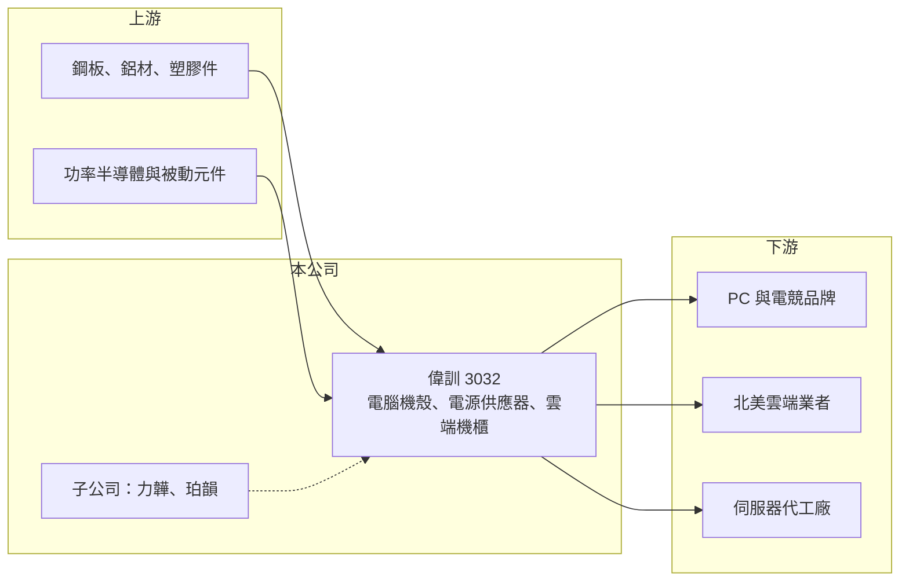

# 3032 偉訓

> 上市｜[[產業索引-電子零組件業|電子零組件業]]｜上市（櫃）日期 2002/08/26

# 第一章：企業模式與商業藍圖

> [!info] 撰寫說明
> 精簡版，由 Claude 依公開資料整理，架構比照 [[2330台積電]]，資料截至 2026-10-08。來源：證交所開放資料快照（基本資料、2026 年第二季財報、股利）、Goodinfo 經營績效年度表、自由時報 2025 年 8 月報導（子公司仲裁損失）。公開資料有限，產品別營收比重與子公司珀韻的業務內容未查得。#待校對

偉訓是電腦機殼與[[電源供應器]]的代工廠，近年切入雲端機櫃，本章說明它的業務組成與 2025 年的重大事件。

- **核心業務：** 偉訓成立於 1979 年，主要產品為電腦機殼、電源供應器（包括電競電源與伺服器相關電源），以及資料中心用的雲端機櫃。機殼與電源是 PC 與伺服器的基本零組件，傳統上屬於規格成熟、價格競爭激烈的代工業務；雲端機櫃則需要結構設計、散熱與大型鈑金製造能力，單價與技術門檻都較高。
- **營收結構：** 產品別比重未查得。依 2025 年 8 月報導，電競電源與 AI 伺服器相關電源需求強勁，雲端機櫃取得北美雲端業者新訂單、預計逐步放量；子公司力韡約占 2024 年營收 3%，另一家子公司珀韻自 2025 年 7 月起貢獻營收。2025 年營收從 74 億元跳升到 112 億元，主要來自新業務與子公司營收。
- **營運據點：** 生產據點的配置未在本次來源中查得（待校對）。資產負債表顯示合併資產規模在 2026 年第二季達 174.4 億元，遠大於早年以機殼代工為主的規模，反映新業務與子公司併入後的擴張。
- **長期方向：** 公司方向是從 PC 機殼與電源往 [[AI 機櫃]]與伺服器散熱機殼發展，以搭上雲端資料中心的資本支出。若雲端機櫃能成為長期主力，偉訓的營收規模與產品附加價值都會明顯提高；但新業務的客戶集中度與執行風險也較高。

# 第二章：護城河深度與競爭優勢

機殼與電源是競爭者眾多的代工產業，本章分析偉訓在新舊業務中的位置。

- **競爭優勢：** 傳統機殼與電源代工的護城河有限，主要靠與品牌客戶的長期合作與成本控制。偉訓的潛在優勢在於同時具備機殼結構與電源能力，能提供機殼加電源的整合方案；雲端機櫃若能通過北美雲端業者的認證並穩定出貨，客戶黏著度會高於傳統 PC 零件。
- **主要對手：** 伺服器機殼與機櫃領域有 [[3693營邦]]、[[8210勤誠]]、[[6117迎廣]]、[[3017奇鋐]] 等台廠，以及 [[2317鴻海]]、[[6669緯穎]] 等直接做[[機櫃級整合]]的代工大廠；電源領域則有 [[2308台達電]]、[[2301光寶科]]、[[6412群電]]。偉訓在這些領域都不是規模最大的廠商。
- **觀察重點：** 長期要看雲端機櫃訂單能否從單一客戶擴展到多家、子公司的法律與營運問題是否告一段落，以及合併負債大幅增加的原因與性質。2025 年的仲裁損失顯示子公司管理是公司治理上需要特別注意的地方。

# 第三章：財務體質與盈利規模

資料日期：2026-10-08，表格是撰寫當時的快照；最新月營收、毛利率、累計 EPS 由自動排程寫在本筆記的屬性欄位（月營收、毛利率、累計EPS 等）。#待校對

偉訓本業獲利率近年改善，但 2025 年因子公司仲裁等損失轉為大幅虧損。

| 年度 | 營收（億元） | [[毛利率]] | [[營業利益率]] | EPS（元） | [[ROE]] |
|---|---|---|---|---|---|
| 2020 | 92.3 | 18.4% | 6.55% | 4.21 | 15.5% |
| 2021 | 82.9 | 19.0% | 5.42% | 2.63 | 10.6% |
| 2022 | 63.8 | 21.4% | 7.54% | 3.28 | 13.7% |
| 2023 | 81.3 | 23.0% | 10.4% | 5.41 | 18.6% |
| 2024 | 74.0 | 21.9% | 6.53% | 4.61 | 14.7% |
| 2025 | 112 | 21.8% | 9.08% | -7.93 | -28.5% |

- **營收規模：** 營收 2020 年 92.3 億元、2025 年 112 億元，五年年複合成長率約 3.9%，但中間在 64 億至 92 億元之間大幅波動，2025 年的跳升主要來自新業務與子公司。2026 年上半年營收 55.5 億元。
- **獲利：** 2025 年營業利益率 9.08%，本業其實獲利，但子公司力韡因 2021 年客戶提出的品質與延遲交貨仲裁，2025 年 7 月 31 日被判賠 2,700 萬美元，偉訓在第二季認列約 7.91 億元損失，該季 EPS −4.36 元；全年虧損擴大到 EPS −7.93 元，下半年其他損失的原因未查得（待校對）。2026 年上半年毛利率約 23.7%、營業利益率約 9.9%、EPS 1.85 元，但業外損失 1.9 億元。近五年（2021 至 2025 年）平均 ROE 約 5.8%，若排除 2025 年則約 14%。
- **財務特色：** 2026 年第二季末總資產 174.4 億元、總負債 135.5 億元，負債比約 78%，母公司權益只有 29.2 億元、[[非控制權益]] 9.8 億元。負債遠高於權益，與一般機殼廠的財務結構差異很大，負債組成（借款、合約負債或仲裁應付款）未查得，是評估財務風險時必須釐清的重點。2025 年度因可分配盈餘為負，未配發股利。
- **[[ROIC]] 與 [[WACC]]：** 2025 年營業利益約 10.2 億元（112 億 × 9.08%），稅後約 8.1 億元；投入資本若只算權益總額 38.9 億元，ROIC 約 20.9%，若把全部負債 135.5 億元都計入則只有約 4.7%（推算）。兩者差距極大，正是因為負債性質不明，實際 ROIC 需視有息負債多寡而定。WACC 以 CAPM 推估：無風險利率 1.75%、市場風險溢酬 6%、β 取電腦零組件同業常見值 1.1，股東權益成本約 8.4%；負債成本 2%、稅後 1.6%，假設負債占資本 30%，WACC 約 6.3%（推算）。本業報酬率可能高於 WACC，但 2025 年的一次性損失讓股東實際報酬為負，說明子公司風險會直接抵銷本業創造的價值。

# 第四章：總體風險與地緣政治

偉訓正處於業務轉型與財務結構劇烈變化的階段，本章整理相關風險。

- **產業週期：** PC 機殼與電源需求跟著 PC 換機週期與電競市場起伏，雲端機櫃則跟著雲端業者的資本支出循環。兩者都有明顯的景氣波動，而雲端機櫃的訂單金額大、客戶少，景氣反轉時的衝擊會更集中。
- **營運風險：** 子公司力韡的仲裁案顯示，品質或交期問題可能帶來遠大於子公司營收規模的損失；公司表示會委任律師與專家降低實際損失，但最終金額仍有變數。雲端機櫃客戶集中在北美少數業者，議價能力有限，訂單變動對營收影響大。
- **其他風險：** 負債比約 78%，若其中有息負債比重高，利率上升或營運不如預期時將形成財務壓力。非控制權益占比高，合併獲利中有一部分不屬於母公司股東。美國關稅與供應鏈在地化政策，也可能影響出口到北美的機櫃與電源產品。

# 專有名詞解析

## 金融

- **[[非控制權益]]**：合併報表中屬於子公司其他股東的權益與淨利，不歸母公司股東所有。

## 產業

- **[[電源供應器]]**：把市電交流電轉換成電子設備所需穩定直流電的裝置，簡稱 PSU。
- **[[AI 機櫃]]**：為 AI 伺服器設計的資料中心機櫃，需承載高功耗設備並整合供電與散熱。
- **[[機櫃級整合]]**：代工廠把伺服器、交換器、電源與散熱整合成整座機櫃後出貨給雲端業者的模式。

# 核心供應鏈

- 上游：機殼與機櫃用的鋼板、鋁材與塑膠件；電源用的功率半導體、電容與變壓器。
- 下游／客戶：PC 與電競品牌、北美雲端業者（雲端機櫃）、伺服器代工廠；具體客戶名稱未查得。
- 同業：[[3693營邦]]、[[8210勤誠]]、[[6117迎廣]]、[[3017奇鋐]]、[[6412群電]]、[[2308台達電]]、[[2301光寶科]]。

## 最新新聞
<!-- news:start（自動產生，請勿手動編輯此範圍） -->
- 2026-10-12 🏛️ 重訊 13:36｜公告本公司115年09月份自結合併營業收入｜[觀測站](https://mops.twse.com.tw/mops/#/web/t05st01)

完整紀錄：[[3032偉訓 新聞]]
<!-- news:end -->

## 相關連結
- [公開資訊觀測站](https://mopsov.twse.com.tw/mops/web/t05st03?step=1&firstin=1&co_id=3032)
- [Goodinfo](https://goodinfo.tw/tw/StockDetail.asp?STOCK_ID=3032)
- [Yahoo 股市](https://tw.stock.yahoo.com/quote/3032)
- [鉅亨網新聞](https://www.cnyes.com/twstock/3032/news)
