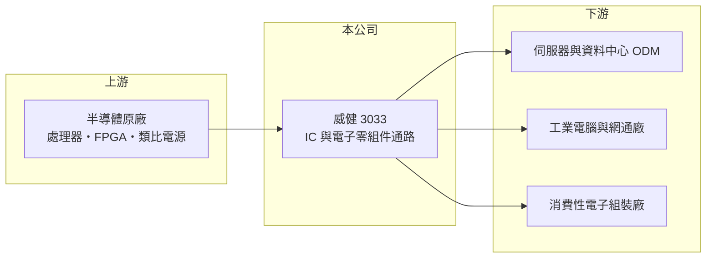

# 3033 威健

> 上市｜[[產業索引-電子通路業|電子通路業]]｜上市（櫃）日期 2002/08/26

# 第一章：企業模式與商業藍圖

> [!info] 撰寫說明
> 精簡版，由 Claude 依公開資料整理，架構比照 [[2330台積電]]，資料截至 2026-10-08。來源：證交所開放資料快照（基本資料、2026 年第二季資產負債與損益、股利）、Goodinfo 經營績效頁、富邦 MoneyDJ 公司基本資料、CMoney 文章標題。代理產品線依記憶整理，未逐條查證。#待校對

威健實業（以下簡稱威健）是台灣中型的 IC [[電子通路]]商，理解它的關鍵在於：營收規模已超過千億元，但毛利率只有 4% 至 8%，獲利高度取決於主力原廠的產品週期與自身的資金周轉能力。

- **核心業務：** 威健成立於 1977 年，2002 年上市，營收 100% 來自代理電子零組件與周邊設備。公司替半導體原廠向亞洲的系統廠與 ODM 銷售處理器、可程式邏輯、類比與電源 IC 等產品，並透過現場應用工程師（[[FAE]]）協助客戶完成[[設計導入]]。通路商的價值在於替原廠服務原廠照顧不到的大量中小客戶，並替客戶承擔備貨與帳期。
- **營收結構：** 公開資料只揭露「代理電子零組件暨周邊設備 100%」，未拆分原廠或應用別（未查得）。CMoney 文章曾以「AMD 亞太區最大通路商」形容威健，顯示 [[AMD超微]] 產品線（含 CPU、GPU 與併購而來的 FPGA）是重要營收來源（比重未查得，#待校對）。
- **營運據點：** 總部位於台北內湖，業務以台灣、中國華南與華東、東南亞為主，跟著 ODM 與組裝廠的生產地點布局（據點明細未查得）。2025 年營收約 1,087 億元，是首度站上千億元的年度。
- **長期方向：** 威健近年營收由 2020 年的 584 億元成長到 2025 年的 1,087 億元，主要受 AI 與資料中心相關處理器需求帶動。長期關鍵在於能否在既有大原廠之外，增加毛利較高的類比、電源或工業用產品線，降低對單一原廠的依賴。

# 第二章：護城河深度與競爭優勢

威健屬於「規模中等、集中於少數原廠」的通路商，護城河主要來自代理權與客戶關係。

- **競爭優勢：** 原廠通常只授權少數通路商在特定區域銷售，取得並維持[[代理權]]需要長期的業績與技術服務紀錄。威健與主力原廠合作多年，熟悉其產品藍圖，能在客戶開案階段就把晶片設計進去，量產後在產品生命週期內持續出貨。這種設計導入累積出的客戶黏著度，是新進者不易複製的部分。
- **主要對手：** 大型同業 [[3702大聯大]]、[[3036文曄]] 規模大十倍以上，產品線齊全、資金成本低；中型同業有 [[8112至上]]、[[3028增你強]]、[[3048益登]] 等。原廠若調整通路策略，把代理權集中給大型通路商，中型通路商的議價力最弱。
- **觀察重點：** 毛利率由 2022 年的 7.81% 降到 2025 年的 4.28%，顯示營收成長來自毛利較低的大單或高價處理器。長期最該觀察毛利率能否回到 6% 以上，以及營收擴張時借款與[[營運資金]]是否失控。

# 第三章：財務體質與盈利規模

資料日期：2026-10-08，表格是撰寫當時的快照；最新月營收、毛利率、累計 EPS 由自動排程寫在本筆記的屬性欄位（月營收、毛利率、累計EPS 等）。#待校對

威健的財務特徵是營收快速放大、毛利率被稀釋，資產負債表以短期負債支撐存貨與應收帳款。

| 年度 | 營收（億元） | [[毛利率]] | [[營業利益率]] | EPS（元） | [[ROE]] |
|---|---|---|---|---|---|
| 2021 | 724 | 7.13% | 3.49% | 4.54 | 24.4% |
| 2022 | 703 | 7.81% | 3.88% | 4.03 | 19.8% |
| 2023 | 709 | 6.34% | 2.60% | 1.85 | 8.77% |
| 2024 | 897 | 5.73% | 2.82% | 2.56 | 11.6% |
| 2025 | 1,087 | 4.28% | 1.65% | 1.81 | 7.99% |

（來源：Goodinfo 經營績效頁；2020 年營收 584 億元、EPS 1.90 元。）

- **營收規模：** 2020 至 2025 年營收年複合成長率約 13.2%（推算），在通路業中屬於高成長。2026 年上半年營收約 684.9 億元，毛利率回升到約 6.25%、營業利益率約 3.65%，EPS 3.38 元，已接近 2025 全年的兩倍，說明獲利率會隨產品組合大幅擺動。
- **獲利：** 2021 至 2025 年平均 ROE 約 14.5%（推算），但波動很大，高點 24.4%、低點 7.99%。通路商營業利益率只有 2% 至 4%，毛利率每少 1 個百分點，營業利益就可能少掉三到五成，這是低毛利模式的[[營業槓桿]]。
- **財務特色：** 2026 年第二季總資產約 581 億元、負債約 455 億元（其中流動負債約 428 億元）、股東權益約 125 億元，負債比率接近八成，資金主要用於存貨與應收帳款。2025 年度現金股利每股約 2.08 元、總額 10 億元，高於當年 EPS 1.81 元，配息率超過 100%（推算）；Goodinfo 統計歷年平均現金股利約 1.41 元。營收成長期自由現金流往往為負（推估）。
- **[[ROIC]] 與 [[WACC]]：** 以 2025 年營業利益約 17.9 億元（1,087 億元 × 1.65%）、稅率 20% 計算，稅後營業利益約 14.4 億元。有息負債未查得，投入資本以股東權益約 125 億元到「權益加全部負債」約 581 億元為區間，ROIC 約 2.5% 至 11.4%（推算）；若有息負債約占流動負債一半（推估），ROIC 約 4% 左右。WACC 以 [[CAPM]] 推估：無風險利率 1.75%、市場風險溢酬 6%、β 假設 1.0，權益成本約 7.75%；稅後負債成本 2%、負債占投入資本五成，WACC 約 4.9%（推算）。2025 年 ROIC 大致與 WACC 相當，2021、2022 年的高 ROE 期則明顯創造價值，顯示威健的價值創造高度依賴景氣與產品週期。

# 第四章：總體風險與地緣政治

威健的風險主要來自原廠集中、低毛利與高財務槓桿三者疊加。

- **產業週期：** 半導體通路位於供應鏈中段，終端需求變化會被[[長鞭效應]]放大。2023 年營收持平但 EPS 由 4.03 元掉到 1.85 元，就是庫存調整期毛利率下滑的結果。AI 伺服器需求若放緩，處理器相關營收可能快速回落。
- **營運風險：** 營收集中於少數原廠，一旦原廠被併購、整併通路或收回代理權，營收可能大幅縮水。高負債結構下，存貨跌價或客戶倒帳的損失會直接衝擊股東權益。
- **其他風險：** 中國客戶占比不低，美國出口管制可能限制高階處理器銷售對象。進貨多以美元計價，匯率與利率變動會影響財務成本與帳面毛利。

# 專有名詞解析

## 金融

- **[[營業槓桿]]**：固定費用占比高時，營收或毛利小幅變動會造成營業利益大幅變動的現象。
- **[[長鞭效應]]**：終端需求的小幅變動，沿供應鏈往上游傳遞時被逐級放大，造成上游庫存與訂單劇烈波動。

## 產業

- **[[電子通路]]**：替上游原廠銷售零組件並提供備貨、技術支援與帳期的中間商，毛利率低、靠周轉賺錢。
- **[[FAE]]**：現場應用工程師，協助客戶把原廠晶片設計進產品，是通路商技術附加價值的核心。
- **[[設計導入]]**：晶片被客戶選入產品設計並完成驗證，之後該產品量產期間都會持續採購，是通路商長期營收的來源。
- **[[代理權]]**：原廠授權通路商在特定地區或客戶銷售其產品的權利，是通路商最核心的資產，但可被收回。

# 核心供應鏈

- 上游：半導體原廠，主力包括 [[AMD超微]]（依 CMoney 文章標題），其他代理線未查得。#待校對
- 下游／客戶：伺服器與資料中心 ODM（如 [[2382廣達]]、[[3231緯創]]、[[6669緯穎]]）、工業電腦、網通與消費性電子廠。上述為產業代表性廠商，非公司揭露客戶。#待校對
- 同業：[[3702大聯大]]、[[3036文曄]]、[[8112至上]]、[[3028增你強]]、[[3048益登]]。

## 最新新聞
<!-- news:start（自動產生，請勿手動編輯此範圍） -->
- 2026-10-12 📰 媒體 18:50｜營收速報 - 威健(3033)9月營收188.39億元年增率高達79.87％｜[鉅亨網](https://news.cnyes.com/news/id/6628381)

完整紀錄：[[3033威健 新聞]]
<!-- news:end -->

## 相關連結
- [公開資訊觀測站](https://mopsov.twse.com.tw/mops/web/t05st03?step=1&firstin=1&co_id=3033)
- [Goodinfo](https://goodinfo.tw/tw/StockDetail.asp?STOCK_ID=3033)
- [Yahoo 股市](https://tw.stock.yahoo.com/quote/3033)
- [鉅亨網新聞](https://www.cnyes.com/twstock/3033/news)
