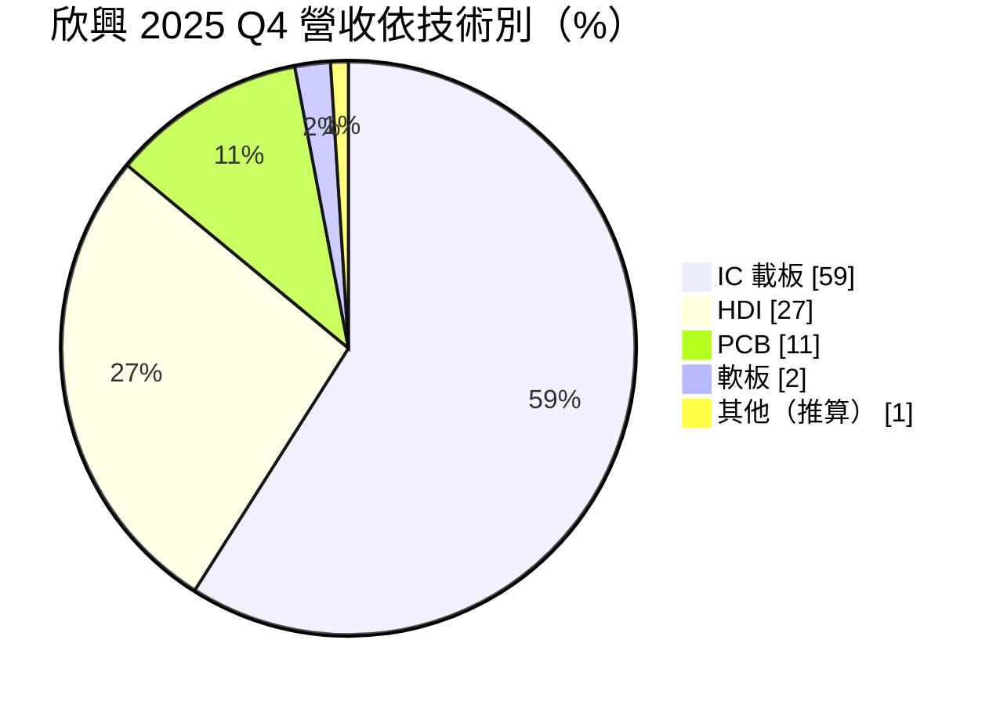
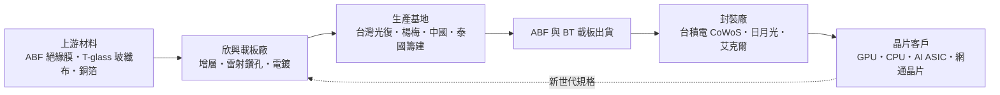
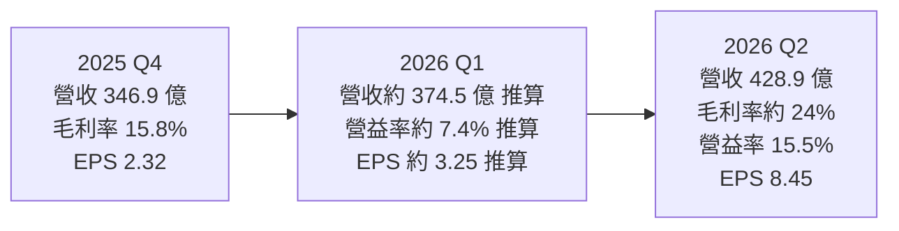

# 3037 欣興

> 上市｜[[產業索引-電子零組件業|電子零組件業]]｜上市（櫃）日期 2002/08/26

# 第一章：企業模式與商業藍圖

> [!info] 撰寫說明
> 本文由 Claude 依公開資料整理，架構比照 [[2330台積電]] 的四章研究，資料截至 2026-10-08。財務數字來源：Goodinfo 經營績效頁（2019 至 2025 年度）、證交所開放資料快照（基本資料、2026 年上半年損益與第二季資產負債、股利）、股感 2025 年第四季法說會整理、優分析 2026 年 7 月法說會報導、工商時報 2026 年 7 月財報報導、旺得富 2026 年 2 月董事會報導；產業描述為整理性內容，尚未逐條比對原始文件。#待校對

在評估單一個股的長期投資價值時，首要步驟是拆解企業的底層獲利邏輯。本章針對欣興電子（股票代號：3037，以下簡稱欣興）的商業模式進行定性分析，說明一家印刷電路板廠如何成為 AI 晶片封裝不可或缺的載板供應商，以及這門生意為何特別容易大起大落。

## 一、核心定位：全球 ABF 載板三大供應商之一

欣興成立於 1990 年 1 月，總部位於桃園，屬於 [[2303聯電]] 集團的轉投資公司，2026 年 2 月起由聯電共同總經理簡山傑出任董事長（依旺得富報導）。欣興的產品可以分成兩大類：一是 IC 載板，也就是晶片封裝時承載晶粒、把晶片上極細的線路轉接到電路板的「中間層」；二是各類印刷電路板，包括高密度連接板（[[HDI]]）、一般多層 [[PCB]] 與軟板。

欣興最重要的身分，是 [[ABF載板]]的全球主要供應商。ABF 載板使用味之素公司的增層絕緣膜，可以做出非常細的線路，是 CPU、GPU、AI 加速晶片與高階網通晶片封裝時必備的材料。依股感整理的 2025 年第四季法說會資料，欣興與日本 Ibiden 並列為全球 ABF 載板的核心供應商。使用者在核心供應鏈章節中，把欣興放在「台積電供應鏈 › 先進封裝大聯盟 › ABF 高階載板三雄」，指的就是這個角色：台積電的 [[CoWoS]] 把運算晶片與 [[HBM]] 封裝在一起之後，下面仍然需要一塊大面積、高層數的 ABF 載板。

這個定位有兩層商業意義：

* **技術門檻高、供應商少：** 高階 ABF 載板需要十幾到二十層以上的增層、極細線寬與極低翹曲，全球能穩定量產 AI 晶片等級載板的廠商屈指可數。供應商少，代表需求旺盛時有很強的議價能力。
* **重資產、高度週期性：** 載板廠需要先投入大量資金蓋廠與購置設備，產能建好後要好幾年才能回收。需求旺時供不應求、價格大漲；需求退潮時產能過剩、價格崩跌，欣興的獲利因此在 2022 年與 2024 年之間出現劇烈起伏。

## 二、終端應用板塊：載板過半，AI 比重快速上升

依股感整理的 2025 年第四季法說會資料，營收結構如下：

同一季依應用別，電腦占 63%、通訊 21%、消費性與其他 11%、汽車 5%。

* **IC 載板：** 包括 ABF 與 [[BT 載板]]。ABF 用於 CPU、GPU、AI 加速器與網通交換器晶片；BT 用於手機晶片、記憶體與射頻模組。依優分析報導，ABF 是 2026 年第二季成長最強的產品，占營收比重由第一季的 49% 升到 52%。
* **HDI：** 用於手機、筆電與 AI 伺服器的加速卡與模組板，需要雷射鑽孔與細線路技術。
* **PCB：** 一般多層板，用於伺服器、網通與車用。依股感整理，PCB 的 AI 比重在 2025 年約 55% 至 60%，2026 年目標 65% 至 70%。
* **軟板：** 比重很小，屬於非核心業務。

AI 是欣興最主要的結構性變化。依股感整理，載板的 AI 比重由 2025 年約 40% 提升到 2026 年約 60%；依優分析報導，2026 年上半年全公司 AI 產品占比已超過 60%，管理層預估下半年提升到約 70%。

## 三、資本轉化邏輯：先蓋廠、後收成的重資產生意

* **產能利用率決定獲利：** 載板與 PCB 都是設備密集的產業，折舊占成本比重高。依股感整理，2025 年第四季 ABF 產能利用率約 90%、BT 約 80% 至 85%，2026 年第一季目標都在 90% 以上。利用率從低谷回到高檔時，毛利率會大幅跳升：2026 年第二季毛利率約 24%，比前一年同期高出約 11 個百分點（優分析）。
* **規格升級提高單價：** AI 晶片的封裝面積越來越大，載板層數與面積同步增加，同一片載板的價值大幅提高，也消耗更多材料。這讓欣興即使產能沒有成倍增加，營收也能明顯成長。
* **材料是關鍵瓶頸：** 高階載板需要低膨脹係數的 T-glass 玻纖布（[[Low CTE 玻纖布]]），股感整理的法說會指出，T-glass 缺貨要到 2026 年第二季才舒緩。材料供應能否跟上，直接影響出貨。
* **產能集中與調整：** 主要高階產能在台灣光復廠與楊梅廠，泰國廠作為第三生產基地持續建置。2026 年欣興以 15.4 億元把新竹湖口廠出售給 [[6257矽格]]，理由是該廠不適合 PCB 生產，資源改為集中在光復與楊梅擴充 ABF 產能（旺得富）。

## 四、企業長期藍圖：押注 AI 載板的長期需求

* **資本支出大幅追加：** 依旺得富與工商時報報導，欣興 2026 年資本支出最初在 2025 年 7 月估約 194 億元，之後三度上調到約 537 億元，其中 80% 至 85% 投入 ABF 載板。董事會也追加 2027 年交貨的長交期設備訂單。這是欣興在 2022 年載板高峰後，再一次大規模的擴產周期。
* **新廠建設：** 依優分析報導，楊梅二廠在 2026 年第二季動土，楊梅三廠預計 2026 年底動土，光復二廠後段也持續投資。
* **聚焦高階、調整非核心：** 出售湖口廠、規劃讓蘇州子公司群策科技赴香港掛牌（股感），以及處分深圳的轉投資公司（工商時報），都顯示欣興正把資源從中國與一般產品，移向台灣的 AI 載板與高階 PCB。
* **價格策略：** 管理層表示，下半年對 ABF 載板採滾動式調價，並在 2025 年已向客戶反映銅箔、貴金屬、[[CCL]] 與玻纖布等成本上漲。能否把成本與稀缺性轉成價格，是這一輪週期獲利的關鍵。

# 第二章：護城河深度與競爭優勢

在長期價值投資中，「護城河」指企業抵禦競爭、維持超額利潤的保護機制。本章分析欣興的護城河構成、全球主要競爭對手，以及這些優勢在載板景氣循環中能守住多少。

## 一、欣興護城河的核心組成要素

欣興的護城河屬於「有寬度但會隨景氣漲退」的類型。技術與認證門檻是真實的，但無法阻止景氣反轉時的價格下跌。它由三個要素組成：

* **1. 高階 ABF 載板的製程門檻：** AI 晶片載板面積大、層數多、線路細，對翹曲控制與[[良率]]的要求極高。一塊載板出錯，整顆價值上萬美元的晶片就報廢，因此晶片客戶只會把訂單交給經過長期驗證的少數供應商。新進者即使買得到設備，也需要多年時間累積製程經驗與客戶信任。
* **2. 客戶認證與共同開發的轉換成本：** 載板的設計要配合晶片與封裝結構共同開發，每一代新晶片都要重新驗證。供應商一旦進入某個晶片平台，通常會一路供應到該世代結束。
* **3. 規模與產品線廣度：** 欣興同時擁有 ABF、BT 載板、HDI 與 PCB，可以滿足 AI 伺服器從晶片載板到加速卡與主機板的多種需求，也能在載板景氣低迷時以 PCB 業務支撐營運。

## 二、全球主要競爭對手格局

| 對手 | 定位 | 對欣興的威脅 |
|---|---|---|
| Ibiden（揖斐電） | 日本 ABF 載板龍頭，高階 GPU 與 CPU 載板主力 | 技術領先，在最高階 AI 載板與欣興直接競爭 |
| Shinko（新光電氣） | 日本載板廠，CPU 載板為主 | 在 CPU 與高階 FC-BGA 載板競爭 |
| 三星電機（SEMCO） | 韓國載板與被動元件大廠 | 背靠三星集團，積極爭取 AI 與伺服器載板 |
| AT&S | 奧地利載板廠，在馬來西亞擴產 | 以非中國、非台灣產能爭取歐美客戶 |
| [[8046南電]]、[[3189景碩]] | 台灣 ABF 與 BT 載板廠 | 在中高階 ABF 與 BT 載板直接競爭 |
| [[4958臻鼎-KY]] | 全球最大 PCB 集團，積極切入載板 | 資本雄厚，新進載板產能可能加劇價格競爭 |

## 三、優勢轉化：哪些市場守得住、哪些守不住

* **守得住：** AI GPU、AI ASIC 與高階網通晶片的大尺寸 ABF 載板。這些產品的認證期長、技術門檻高，加上材料與產能稀缺，欣興有較強的議價能力。
* **守不住：** 一般 PC 與消費性晶片的中低階載板，以及一般 PCB。這些市場在景氣反轉時會出現明顯的價格競爭。2023 至 2025 年欣興毛利率從 2022 年的 35.9% 掉到 14% 左右，說明景氣下行時，護城河無法阻止價格與利用率同時下滑。
* **觀察重點：** 第一，AI 產品占比能否穩定在六成以上，讓獲利不再跟著 PC 景氣起伏；第二，2026 年約 537 億元的擴產完成後，產能利用率能否維持；第三，同業（日本、韓國、中國載板廠）同步擴產，是否在 2028 年前後再度造成供過於求。

# 第三章：財務體質與盈利規模

資料日期：2026-10-08。數字取自 Goodinfo 經營績效頁、證交所開放資料快照與法說會報導，表格是撰寫當時的快照；最新月營收、毛利率、累計 EPS 由自動排程寫在本筆記的屬性欄位（月營收、毛利率、累計EPS 等）。#待校對

財務報表是檢驗護城河是否真實存在的最終標準。本章用多年度的三率、[[ROE]]、現金流與資本報酬，檢視欣興在載板景氣循環中的獲利品質。

## 一、獲利能力的基石：三率

| 年度 | 營收（新台幣） | [[毛利率]] | [[營業利益率]] | EPS（元） | [[ROE]] |
|---|---|---|---|---|---|
| 2019 | 825 億 | 13.7% | 4.23% | 2.24 | 6.89% |
| 2020 | 879 億 | 14.6% | 4.57% | 3.74 | 10.5% |
| 2021 | 1,046 億 | 22.6% | 12.6% | 8.98 | 22.8% |
| 2022 | 1,405 億 | 35.9% | 27.2% | 20.08 | 39.5% |
| 2023 | 1,040 億 | 19.5% | 8.57% | 7.88 | 12.9% |
| 2024 | 1,154 億 | 14.1% | 4.43% | 3.34 | 5.67% |
| 2025 | 1,312 億 | 13.9% | 5.09% | 4.38 | 7.31% |
| 2026 上半年 | 803.4 億 | 21.61% | 11.71% | 11.70 | 約 29%（年化推算，含大額業外收益） |

資料來源：2019 至 2025 年為 Goodinfo 經營績效頁；2026 上半年依證交所綜合損益與營益分析快照（營收 803.4 億元、營業利益 94.1 億元、營業外收入 124.7 億元、歸屬母公司淨利 181.6 億元），ROE 以上半年淨利年化除以 2026 年第二季歸屬母公司權益 1,238.9 億元推算。

* **典型的景氣循環股：** 欣興的毛利率在 2019、2020 年約 14%，2022 年載板缺貨時衝上 35.9%，2024、2025 年又回到 14% 左右；EPS 從 2022 年的 20.08 元跌到 2024 年的 3.34 元。同一家公司在三年內獲利相差六倍，說明載板產業的獲利主要由供需決定，而不是由單一公司的經營效率決定。
* **2026 年進入新一輪上升期：** 依工商時報報導，2026 年第二季營業利益率 15.51%，是約三年半來最高；上半年營業利益率 11.71%，比 2025 年全年的 5.09% 大幅改善，主因是 ABF 售價調漲、產能利用率提高與良率改善。
* **業外收益放大獲利：** 2026 年上半年營業外收入 124.7 億元，比營業利益 94.1 億元還多。依工商時報報導，第二季業外 89.2 億元來自利息收入倍增、權益法投資與金融資產評價轉盈，以及處分深圳轉投資公司的利益。這部分多屬一次性或與市場行情相關，評估本業時應以營業利益為準。

## 二、[[ROE]]：資本效率

欣興 2021 至 2025 年的 ROE 分別為 22.8%、39.5%、12.9%、5.67% 與 7.31%，五年平均約 17.6%（推算），但年度之間差距極大。2020 年到 2025 年營收從 879 億元成長到 1,312 億元，年複合成長率約 8.3%（推算）。

依證交所 2026 年第二季資產負債快照，欣興資產總計 3,132.4 億元，負債 1,855.2 億元，權益 1,277.2 億元，每股淨值 77.90 元。非流動負債高達 977.5 億元，推估除長期借款外，也包含客戶為確保載板產能而預付的長期款項（明細未查得）。依股感整理，2025 年底現金及約當現金 548.72 億元，財務上仍有相當緩衝。

## 三、資本支出、自由現金流與股利

* **[[CapEx]] 再度擴張：** 2026 年資本支出由最初約 194 億元上調到約 537 億元（旺得富、工商時報），相當於 2025 年營收的四成。載板廠的資本支出高峰往往出現在景氣上升期，而這些產能要到一兩年後才會開出。
* **[[自由現金流]]：** 多年度自由現金流數字未查得。以 2026 年資本支出規模與上半年營業利益相比，擴產期的自由現金流推估會轉弱甚至為負，需要依靠既有現金、借款與客戶預付款支應（推估）。
* **股利：** 依證交所股利資料，2025 年度配發現金股利 2 元，以 EPS 4.38 元計算配發率約 46%（推算）。公司章程規定現金股利至少為股利合計的 10%，股利占可分配盈餘比例為零至 90%，實際配發會隨景氣與擴產需求調整，穩定度不如高配息的電子股。

## 四、[[ROIC]] 與 [[WACC]]：價值創造利差

**ROIC 推算：** 2026 年上半年營業利益 94.1 億元，年化約 188 億元，以 20% 稅率計算稅後營業利益約 151 億元。投入資本以 2026 年第二季權益總計 1,277.2 億元，加上非流動負債 977.5 億元作為有息負債的近似值（有息負債明細未查得，非流動負債中可能含不計息的客戶預付款），合計約 2,255 億元，ROIC 約 6.7%（推算）。若以第二季營業利益 66.5 億元年化，稅後約 213 億元，ROIC 約 9.4%（推算）。2025 年營業利益約 66.8 億元（1,312 億元 × 5.09%），稅後約 53 億元，ROIC 只有約 2.4%（推算）。

**WACC 推算：** 台灣 10 年期公債殖利率取 1.75%，市場風險溢酬取 6%，β 取景氣循環性較高的載板與 PCB 股常見的 1.2 至 1.4（欣興本身的 β 未查得），股東權益成本約 9.0% 至 10.2%。負債成本取 2%，稅後 1.6%，以權益約 57%、負債約 43% 計算，WACC 約 5.8% 至 6.5%（推算）。

**解讀：** 欣興的 ROIC 在 2024、2025 年低谷時明顯低於 WACC，代表那兩年其實沒有創造經濟價值；2026 年隨景氣回升，ROIC 回到與 WACC 相當甚至略高的水準，第二季的年化數字已高出約 3 個百分點。歷史上欣興只有在 2021、2022 年的載板高峰期，ROIC 才大幅超過資金成本（推估）。長期投資人需要理解，這家公司的價值創造集中在景氣高峰，投資時點與產業週期的位置，比單一年度的獲利數字更重要。

# 第四章：總體風險與地緣政治

任何企業都無法脫離宏觀環境獨立存在。本章分析欣興未來必須面對的地緣政治、產業週期與營運風險。

## 一、地緣政治風險

* **台灣產能集中：** 最高階的 ABF 產能集中在桃園光復與楊梅，而 AI 晶片的封裝也集中在台灣，兩岸情勢若影響台灣生產，欣興與其客戶會同時受到衝擊。
* **中國產能的調整：** 欣興在中國仍有子公司與工廠，美中科技對抗下，中國廠主要服務非 AI 的一般產品。規劃讓蘇州群策赴港掛牌與處分深圳轉投資，可視為逐步降低中國資產比重的安排。
* **客戶的在地化要求：** 美國推動半導體封裝在地化，若主要晶片客戶要求在美國或東南亞取得載板，欣興需要投資新的海外產能；泰國廠是分散布局的第一步。

## 二、產業週期與市場結構風險

* **供需反轉的歷史教訓：** 2021、2022 年載板缺貨時，全球載板廠大舉擴產，2023 年 PC 與消費性需求轉弱後供過於求，欣興毛利率在兩年內從 35.9% 掉到 14.1%。2026 年同業再度同步擴產，供需何時再度反轉，是最大的長期風險。
* **AI 資本支出週期：** AI 產品已占營收六成以上，雲端業者的 AI 投資若放緩，載板需求會沿供應鏈被放大下修，也就是[[長鞭效應]]。
* **客戶集中：** 高階 ABF 的需求集中在少數 GPU、CPU 與 ASIC 客戶，單一客戶的產品轉換或供應商分配調整，對營收影響很大。

## 三、營運環境的隱性風險

* **材料與成本：** T-glass 玻纖布、ABF 絕緣膜與銅箔供應吃緊，材料漲價或缺料會影響出貨與毛利。
* **折舊壓力：** 約 537 億元的擴產完成後，每年折舊將大幅增加，若需求不如預期，毛利率會快速下滑。
* **客戶預付與長約的雙面性：** 客戶為確保產能而預付款項或簽訂長約，可以降低擴產的資金壓力，但也可能伴隨價格或交期的承諾；景氣反轉時，這些條件如何執行會影響欣興的實際獲利（推估）。
* **匯率：** 營收以美元計價為主，新台幣升值會壓縮以台幣計的獲利。

## 四、科技演進風險

載板技術正面臨幾個可能改變產業結構的演進。第一是玻璃基板（[[玻璃基板]]），以玻璃取代有機材料作為載板核心，可以做出更大、更平整的載板，英特爾等公司已投入研發，若成為主流，現有 ABF 載板的製程與設備可能需要大幅調整。第二是封裝架構的變化，例如面板級封裝（[[FOPLP]]）與把更多線路移到中介層或晶圓上，可能改變載板的層數需求。第三是 AI 晶片封裝面積持續放大，對翹曲、散熱與良率的要求越來越高。欣興能否在新材料與新架構上維持領先，決定它能否在下一代 AI 封裝中保住核心供應商的地位。

# 專有名詞解析

## 半導體

- **[[ABF載板]]**：使用味之素增層絕緣膜製作的 IC 載板，可做出極細線路，用於 CPU、GPU 與 AI 加速晶片封裝。
- **[[BT 載板]]**：以 BT 樹脂為基材的 IC 載板，主要用於手機晶片、記憶體與射頻模組封裝。
- **[[CoWoS]]**：台積電的 2.5D 先進封裝技術，把運算晶片與 HBM 並排放在矽中介層上，是 AI 晶片的主流封裝方式。
- **[[HBM]]**：高頻寬記憶體，以多層 DRAM 堆疊並緊鄰處理器封裝，是 AI 加速器的關鍵元件。
- **[[玻璃基板]]**：以玻璃取代有機材料作為載板核心，平整度與尺寸穩定性更好，被視為下一代 AI 封裝載板材料。
- **[[FOPLP]]**：面板級扇出型封裝，以方形面板取代圓形晶圓進行封裝，可提高面積利用率並降低成本。
- **[[良率]]**：合格產品占總產出的比例，高階載板良率直接決定成本與交期。

## 金融

- **[[CapEx]]**：資本支出，企業購買土地、廠房與設備的支出。
- **[[自由現金流]]**：營業活動現金流減去資本支出，代表企業可自由用於配息、還債或併購的現金。
- **[[長鞭效應]]**：終端需求的小幅變動，沿供應鏈往上游傳遞時被逐級放大，造成上游庫存與訂單劇烈波動。

## 產業

- **[[HDI]]**：高密度連接板，以雷射鑽微孔與細線路提高佈線密度的電路板。
- **[[PCB]]**：印刷電路板，用來承載電子元件並以銅線路連接，是所有電子產品的基礎零組件。
- **[[CCL]]**：銅箔基板，PCB 的核心原料，由銅箔、玻纖布與樹脂組成，等級決定訊號損耗。
- **[[Low CTE 玻纖布]]**：低熱膨脹係數的玻璃纖維布，俗稱 T-glass，用來降低大尺寸載板受熱時的翹曲。

# 核心供應鏈

## 供應鏈關係
- 供應給 [[2330台積電]]：ABF載板全球巨頭（台積電供應鏈 › 下游：先進封裝大聯盟 (CoWoS 設備與載板) › ABF 高階載板三雄 (先進封裝必備)）

## 最新新聞
<!-- news:start（自動產生，請勿手動編輯此範圍） -->
- 2026-10-12 📰 媒體 21:12｜營收速報》ABF載板供不應求 欣興連5月營收登高｜[自由時報](https://news.google.com/rss/articles/CBMiWEFVX3lxTE10cGJzSk1KZnBwbjJZLWs5aHVJSkRNYzJvQnBTTmdSLVdiV1d1THZ4WFVzVHMtbXZLaEkxejRyMUVqZEp4ano1ejNhV2RsREZkNVByVEtwaXM?oc=5)
- 2026-10-12 📰 媒體 19:30｜PCB被盯上！投信退貨「這4檔」3千多張 連砍欣興5刀帶走68.80億元｜[Yahoo股市](https://news.google.com/rss/articles/CBMizwJBVV95cUxOajQ4QndILUpSRWdqUUtQblZKUVdLQ3h4TWRNTG9uMUR3MGNIUzIzNUQyYzhzZVduSktiWTF3cWJtM1pOcEFBdTl5RzdJV0Q2d0JobmRleUI1bm54WjE5WWl2X2FTbU9iWndRN3d0a283Q3dqYW1GcmkxZi1LRzNvSUdCMDlBMmJJanRHX2t6ZnNWTFl6WkNkQmxudmJZMnBrcG8tZXVNMVo0TWt2MDN1UGlfYlh6TU9hOFdhb1UtRWZKUUtCcW9TSk1mV2Z3VUxaX2pvd1AxNDhKYjA5clpuMVVWaTd3a0NUSkJPcDM2NmwtcmFqZC1FNVBscm1ETDhXcVF3NnVfYmZ3S25vbHdlb0JxYVlZWW9NZGticnM3d3JRcUEwTjk4aElETXY5dnAyc3NNUWRjVnlYelh0OWtBODJNelo2N2tSOU1kQXV6aw?oc=5)
- 2026-10-12 📰 媒體 10:32｜欣興9月、Q3營收同創歷史新高｜[台視全球資訊網](https://news.google.com/rss/articles/CBMikgFBVV95cUxOMWphUE9UMGhmQlFlUVlPdnFhV09VazFvMEM3V2J1VEE1QkF6bGZzcEFaWVJoQXJ0b0g4Vk9FMmJEWHNvZFFMd1gzOUhRdUhFYV9WMUlURUJxd1NTclh3Qy04aVhqd1NGV3diTXhweGFVWThZVnc1aTctMDVMd2JXakJTVmc3SkRjRURVUDNaaFBXUQ?oc=5)
- 2026-10-12 📰 媒體 09:47｜焦點股》欣興：光通訊強勁成長！ 外資給力｜[聚財網](https://news.google.com/rss/articles/CBMiTEFVX3lxTE5kejhveDA4eWkxM1RKV1NtcFJWMEoxaE5iOGpMVlBsaXF4NC1tclA2VmVmcDJaR3FuZC12M1JDWmRiYWhNZ3l2NTBiNTE?oc=5)
- 2026-10-12 📰 媒體 08:57｜台股5萬點前大洗牌！欣興目標價喊1575元、全新上看846元 法人狂掃「三低一底」黑馬股｜[FTNN 新聞網](https://news.google.com/rss/articles/CBMiS0FVX3lxTE51WG9PLURxaHQ2N1d4WUdMTEVjUS13N3lwYTJDelhBUlJObTVvTjB6UjFSSVh1QUJ0Ql9vQVFQNnhOUVNqQUtiX3VQaw?oc=5)

完整紀錄：[[3037欣興 新聞]]
<!-- news:end -->

## 相關連結
- [公開資訊觀測站](https://mopsov.twse.com.tw/mops/web/t05st03?step=1&firstin=1&co_id=3037)
- [Goodinfo](https://goodinfo.tw/tw/StockDetail.asp?STOCK_ID=3037)
- [Yahoo 股市](https://tw.stock.yahoo.com/quote/3037)
- [鉅亨網新聞](https://www.cnyes.com/twstock/3037/news)
