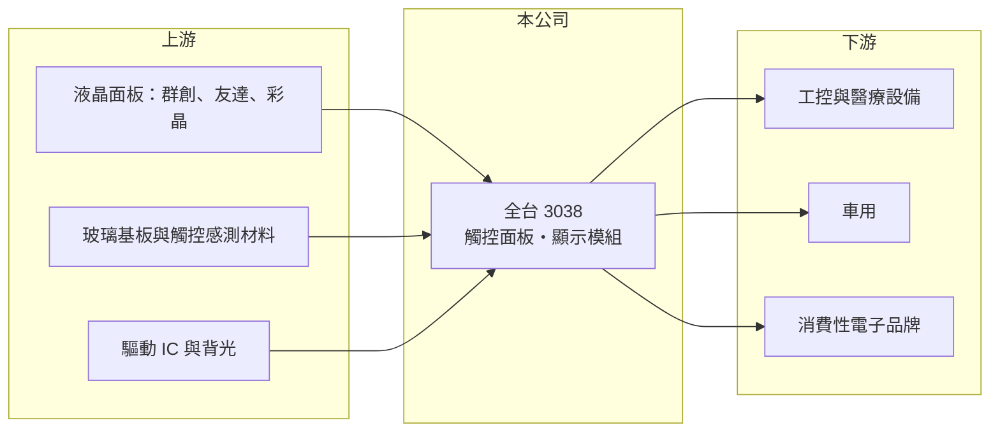

# 3038 全台

> 上市｜[[產業索引-光電業|光電業]]｜上市（櫃）日期 2002/08/26

# 第一章：企業模式與商業藍圖

> [!info] 撰寫說明
> 精簡版，由 Claude 依公開資料整理，架構比照 [[2330台積電]] 的四章研究，資料截至 2026-10-08。來源：證交所開放資料快照（基本資料、2026 年上半年綜合損益與資產負債、股利、每月營收）、Goodinfo 經營績效頁（2019 至 2025 年）、nStock 公司概況、科技新報。公開資料有限，產品與應用營收比重、海外生產據點未查得；有息負債未查得，ROIC 與 WACC 為推算。#待校對

全台晶像（股票代號：3038，以下簡稱全台）是一家把液晶面板與觸控元件整合成顯示模組的中小尺寸專業廠，鎖定大型面板廠較少經營的客製市場。本章說明它在顯示產業鏈中的位置與商業模式。

- **核心業務：** 全台成立於 1994 年，2002 年上市，總部位於高雄市前鎮區。主要從事[[電容式觸控]]面板與液晶顯示模組（[[LCM]]）的設計、製造與銷售，把面板廠的液晶面板、觸控感測器、驅動 IC 與背光組裝成客戶可以直接裝機的顯示單元。
- **營收結構：** 觸控與顯示模組的營收比重本次未查得。推估以中小尺寸的工控、醫療、車用與消費性電子等應用為主，這類產品出貨量不大，但規格多、需要客製設計。
- **商業模式：** 全台位於面板廠與終端設備品牌之間。大型面板廠追求大量標準化生產，對於少量多樣的工控與醫療客戶服務意願較低，全台就扮演把標準面板「客製化」的角色。這種模式的附加價值主要在設計整合與小量生產彈性，而不是面板製造本身。
- **長期方向：** 持續深耕中小尺寸、客製化觸控顯示市場（推估以工控、車用、醫療等利基應用為主），並維持穩定配息的政策。具體擴產或新事業計畫本次未查得。

# 第二章：護城河深度與競爭優勢

全台的護城河來自客製設計能力與客戶關係，但利潤空間受上下游擠壓。

- **競爭優勢：** 工控、醫療與車用設備的產品生命週期長，一款顯示模組通過客戶驗證後，往往能連續出貨多年，客戶更換供應商需要重新驗證，形成一定的轉換成本。全台從觸控到顯示的整合能力，可以替客戶一次解決介面、光學與機構設計問題。
- **主要對手：** 中小尺寸模組廠 [[8105凌巨]]，觸控廠 [[3622洋華]]，以及向下整合模組業務的面板廠 [[3481群創]]、[[2409友達]]、[[6116彩晶]]，還有大量中國模組廠。
- **上下游擠壓：** 上游面板與驅動 IC 的價格由大廠決定，下游客戶又有降價壓力，模組廠的毛利空間有限。全台的[[毛利率]]約兩成上下，但[[營業利益率]]多在 5% 至 10%，2025 年降到約 5%。
- **觀察重點：** 長期可以追蹤營收能否止跌回升、車用與醫療等高門檻應用的占比，以及營業利益率能否回到 8% 以上。

# 第三章：財務體質與盈利規模

資料日期：2026-10-08，表格是撰寫當時的快照；最新月營收、毛利率、累計 EPS 由自動排程寫在本筆記的屬性欄位（月營收、毛利率、累計EPS 等）。#待校對

財務數字顯示，全台在 2022 至 2023 年達到獲利高峰，之後營收連續下滑，但配息政策維持。

| 年度 | 營收（億元） | [[毛利率]] | [[營業利益率]] | EPS（元） | [[ROE]] |
|---|---|---|---|---|---|
| 2019 | 41.1 | 19.5% | 7.66% | 1.73 | 13.7% |
| 2020 | 37.4 | 21.0% | 8.94% | 1.57 | 11.8% |
| 2021 | 41.8 | 17.0% | 6.38% | 1.60 | 11.7% |
| 2022 | 46.9 | 19.6% | 8.19% | 2.83 | 19.1% |
| 2023 | 43.9 | 23.0% | 10.3% | 2.81 | 16.9% |
| 2024 | 36.1 | 22.9% | 6.44% | 2.21 | 12.3% |
| 2025 | 30.1 | 23.0% | 5.22% | 1.10 | 6.09% |

（來源：Goodinfo 經營績效頁，合併報表。2026 年上半年依證交所資料，營收 14.49 億元、毛利率約 21.8%、營業利益率約 3.8%（依營業毛利與營業利益推算）、EPS 0.64 元。）

- **營收縮小、毛利穩定：** 毛利率七年來維持在 17% 至 23%，2023 年後穩定在 23% 左右，產品定價大致守住；但營收由 2022 年的 46.9 億元降到 2025 年的 30.1 億元，固定費用分攤變重，營業利益率隨之下滑。這是典型的[[營運槓桿]]反向作用。
- **長期指標：** 2021 至 2025 年平均 ROE 約 13.2%（推算），但呈現由高峰下滑的趨勢；2020 至 2025 年營收年複合成長率約 -4.2%（推算）。2025 年度配發現金股利 1.2 元，略高於當年 EPS 1.10 元，配息率超過 100%；Goodinfo 列出的歷年加權平均現金股利約 0.65 元，近年配息水準較過去提高。
- **資產負債表：** 2026 年第二季資產總計約 38.45 億元、負債約 12.85 億元，負債比約 33%，其中非流動負債約 5.24 億元；權益總計約 25.61 億元，每股淨值 17.72 元。母公司與子公司合計持有約 1,620 萬股庫藏股。
- **[[ROIC]] 與 [[WACC]]：** 以 2025 年營收 30.1 億元乘營業利益率 5.22%，營業利益約 1.57 億元，稅後約 1.26 億元；投入資本以 2026 年第二季權益 25.61 億元加上有息負債推估約 5 億元（未查得，以非流動負債推估），合計約 30.6 億元，ROIC 約 4.1%（推算）。高峰期 2023 年營業利益約 4.5 億元，ROIC 推估約 12%。WACC 以 [[CAPM]] 估算：無風險利率 1.75%、市場風險溢酬 6%、β 假設 0.9（顯示模組同業常見值，未查得實際數字），權益成本約 7.2%；稅後負債成本 2.0%，權益與負債約 84：16，WACC 約 6.3%（推算）。全台在 2022 至 2023 年明顯創造價值，2025 年 ROIC 已低於資金成本，營收能否回升是價值創造能否恢復的關鍵。

# 第四章：總體風險與地緣政治

全台的風險在於營業利益率偏低、上下游議價力弱與匯率。

- **產業週期：** 中小尺寸觸控顯示需求跟著工控、消費性電子與車用景氣循環；終端客戶庫存調整時，模組廠的訂單會出現放大的波動。
- **營運風險：** 營業利益率只有約 4% 至 5%，營收再下滑就可能轉為本業虧損。上游面板與驅動 IC 價格上漲時，若無法即時轉嫁，毛利會被壓縮。
- **競爭風險：** 中國模組廠在成本上具有優勢，面板廠也可能向下整合模組業務，擠壓中間廠商的生存空間。
- **地緣與匯率：** 外銷以美元計價，新台幣升值會壓縮毛利；美國關稅與供應鏈「台灣加一」要求可能需要調整產地。技術方面，[[OLED]] 等自發光顯示在部分應用取代液晶，需要持續投入新技術。

# 專有名詞解析

## 應用

- **[[電容式觸控]]**：偵測手指造成的微小電容變化來判斷觸控位置，是手機、平板與工控面板的主流觸控技術。
- **[[LCM]]**：液晶顯示模組，把面板、背光、驅動 IC 與外框組裝成可直接裝機的顯示單元。
- **[[OLED]]**：有機發光二極體，每個像素自行發光、不需背光的顯示技術。

## 金融

- **[[營運槓桿]]**：固定費用占比高時，營收小幅變動就會造成營業利益大幅變動的現象。
- **[[ROIC]]**：投入資本報酬率，稅後營業利益除以股東權益加有息負債，衡量本業運用資本的效率。
- **[[WACC]]**：加權平均資金成本，依股東權益與負債的比重，加權計算公司取得資金的平均成本。

# 核心供應鏈

- 上游：液晶面板 [[3481群創]]、[[2409友達]]、[[6116彩晶]]，玻璃基板、觸控感測材料、驅動 IC 與背光供應商
- 下游／客戶：工控、醫療、車用與消費性電子品牌（推估）
- 同業：[[8105凌巨]]、[[3622洋華]]

## 最新新聞
<!-- news:start -->
<!-- news:end -->

## 相關連結
- [公開資訊觀測站](https://mopsov.twse.com.tw/mops/web/t05st03?step=1&firstin=1&co_id=3038)
- [Goodinfo](https://goodinfo.tw/tw/StockDetail.asp?STOCK_ID=3038)
- [Yahoo 股市](https://tw.stock.yahoo.com/quote/3038)
- [鉅亨網新聞](https://www.cnyes.com/twstock/3038/news)
