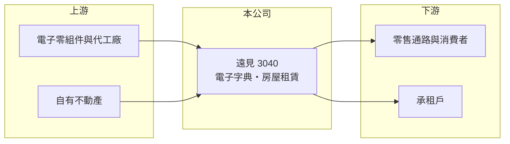

# 3040 遠見

> 上市｜[[產業索引-其他業|其他業]]｜上市（櫃）日期 2002/08/26

# 第一章：企業模式與商業藍圖

> [!info] 撰寫說明
> 精簡版，由 Claude 依公開資料整理，架構比照 [[2330台積電]] 的四章研究，資料截至 2026-10-08。來源：證交所開放資料快照（基本資料、2026 年上半年綜合損益與資產負債、股利、每月營收）、Goodinfo 經營績效頁（2019 至 2025 年）、nStock 公司簡介。公開資料有限，兩項業務的營收比重、產品品牌與不動產明細未查得；ROIC 與 WACC 為推算。#待校對

遠見科技（股票代號：3040，以下簡稱遠見）是一家營收規模很小、以電子字典產銷與房屋租賃為登記業務的公司。本章說明它的業務結構，以及為什麼這家公司更適合從資產與租金的角度理解。

- **核心業務：** 遠見成立於 1986 年，2000 年在櫃買中心掛牌，2002 年轉上市，總部位於新北市板橋區。公司登記的主要營業項目為產銷[[電子字典]]及房屋租賃。電子字典是 1990 至 2000 年代的熱門學習工具，但智慧型手機與線上翻譯普及後，市場已大幅萎縮。
- **營收結構：** 兩項業務的營收比重本次未查得。遠見年營收約 1.3 億至 2 億元，[[毛利率]]長期在 55% 至 71%，遠高於一般電子產品製造商，推估租賃收入占有相當比重（推估）。
- **營運特性：** 月營收穩定在約 1,000 萬元上下，波動很小，這也符合租金收入的特性。資產負債表上流動資產約 16.2 億元，遠大於營運所需，顯示公司持有大量現金或金融資產。
- **長期方向：** 本次未查得新業務規劃。電子字典屬於結構性衰退的市場，遠見的長期價值主要取決於不動產租金的穩定度，以及帳上資金如何運用。2025 年度公司配發每股 3.1 元的股票股利，股本由約 6.62 億元擴大到約 8.58 億元（推估），屬於罕見的大額盈餘轉增資。

# 第二章：護城河深度與競爭優勢

遠見的業務屬於成熟或萎縮中的市場，護城河有限，價值主要來自資產。

- **競爭優勢：** 主要來自既有不動產帶來的穩定租金收入（推估）。租金收入不需要大量研發與行銷，只要租約穩定，就能維持高毛利率。
- **主要對手：** 電子字典面對手機 App、線上翻譯服務與 AI 翻譯工具的全面替代，硬體產品幾乎沒有成長空間；租賃業務則面對一般商辦與廠房出租業者的競爭。具體同業名單本次未查得。
- **資產型公司的評價邏輯：** 這類公司的評價通常看每股淨值、不動產市價與現金部位，而不是本業成長。2026 年第二季每股淨值 22.07 元，帳上流動資產占總資產約 88%。
- **觀察重點：** 長期應追蹤租金收入的穩定度、營業費用是否持續上升侵蝕本業利潤，以及帳上資金的運用與配息政策。

# 第三章：財務體質與盈利規模

資料日期：2026-10-08，表格是撰寫當時的快照；最新月營收、毛利率、累計 EPS 由自動排程寫在本筆記的屬性欄位（月營收、毛利率、累計EPS 等）。#待校對

財務數字顯示，遠見的毛利率很高，但營業利益率近年明顯下滑，資本報酬偏低。

| 年度 | 營收（億元） | [[毛利率]] | [[營業利益率]] | EPS（元） | [[ROE]] |
|---|---|---|---|---|---|
| 2019 | 2.01 | 61.2% | 41.6% | 1.36 | 6.39% |
| 2020 | 1.55 | 55.4% | 25.4% | 6.34 | 26.7% |
| 2021 | 1.72 | 64.6% | 39.6% | 1.97 | 7.45% |
| 2022 | 1.56 | 70.9% | 46.8% | 1.60 | 6.46% |
| 2023 | 1.59 | 70.6% | 46.5% | 1.02 | 4.31% |
| 2024 | 1.38 | 60.6% | 29.8% | 0.73 | 3.07% |
| 2025 | 1.32 | 57.9% | 3.44% | 0.32 | 1.34% |

（來源：Goodinfo 經營績效頁，合併報表。2026 年上半年依證交所資料，營收 0.66 億元、毛利率約 60.5%、營業利益率約 8.9%（依營業毛利與營業利益推算）、EPS -0.10 元。）

- **營業利益率大幅下滑：** 2022 至 2023 年營業利益率約 47%，2025 年降到 3.44%，毛利率卻只從 71% 降到 58%，代表營業費用大幅增加。費用增加的原因本次未查得，可能與新業務投入或一次性費用有關（推估），是理解遠見近況最重要的問題。
- **一次性收益：** 2020 年 EPS 6.34 元、ROE 26.7%，明顯高於其他年度，推估含處分資產或投資的[[一次性收益]]，不代表本業實力。2026 年上半年稅前淨利約 0.08 億元，但稅後淨損約 0.06 億元，所得稅費用高於稅前淨利，原因需以財報附註確認。
- **長期指標：** 2021 至 2025 年平均 ROE 約 4.5%（推算），2020 至 2025 年營收年複合成長率約 -3.2%（推算）。2025 年度配發現金股利 0.4 元與股票股利 3.1 元；Goodinfo 列出的歷年加權平均現金股利約 1.72 元，過去配息較高，近年下降。
- **資產負債表：** 2026 年第二季資產總計約 18.53 億元，其中流動資產約 16.23 億元；負債約 4.61 億元；權益約 13.92 億元，股本約 8.58 億元，每股淨值 22.07 元，另持有 315 萬股庫藏股。
- **[[ROIC]] 與 [[WACC]]：** 以 2025 年營收 1.32 億元乘營業利益率 3.44%，營業利益約 0.045 億元，稅後約 0.036 億元；投入資本以 2026 年第二季權益 13.92 億元計（有息負債未查得，推估很小），ROIC 約 0.3%（推算）。WACC 以 [[CAPM]] 估算：無風險利率 1.75%、市場風險溢酬 6%、β 假設 0.7（資產型小型股，未查得實際數字），權益成本約 6.0%，WACC 約 6%（推算）。ROIC 遠低於資金成本，主因是大量資金停留在低報酬的流動資產上，而本業利潤又大幅縮小；提高資金使用效率或發還股東，是改善股東報酬的方向。

# 第四章：總體風險與地緣政治

遠見的風險在於本業萎縮、費用上升與資金運用。

- **產業週期與結構性衰退：** 電子字典需求長期下滑，屬於結構性衰退而非週期性波動，不太可能回到過去的規模。
- **營運風險：** 營收規模只有約 1.3 億元，營業費用小幅增加就會讓營業利益大幅縮小，2025 年營業利益率已降到 3% 左右。業外與所得稅項目也容易讓 EPS 大幅波動。
- **租賃風險：** 租金收入取決於承租戶續約與不動產景氣，若主要承租戶退租，營收與毛利都會明顯下滑。
- **資本配置風險：** 帳上資金龐大，若投入報酬不明的新業務或金融投資，可能進一步拉低資本報酬；公開資料揭露有限，投資人難以追蹤資金用途。

# 專有名詞解析

## 應用

- **[[電子字典]]**：內建字典與翻譯資料庫的掌上型電子裝置，市場已大幅被手機與線上翻譯取代。

## 金融

- **[[一次性收益]]**：處分資產、土地或投資等不會每年重複的收益，會讓單期 EPS 偏離本業實力。
- **[[股票股利]]**：以盈餘或公積轉增資發放新股給股東，股本擴大但公司現金不流出。
- **[[ROIC]]**：投入資本報酬率，稅後營業利益除以股東權益加有息負債，衡量本業運用資本的效率。
- **[[WACC]]**：加權平均資金成本，依股東權益與負債的比重，加權計算公司取得資金的平均成本。

# 核心供應鏈

- 上游：電子零組件供應商與代工廠、自有不動產（推估）
- 下游／客戶：零售通路、消費者與房屋承租戶（推估）
- 同業：電子字典品牌與一般不動產租賃業者（本次未查得具體名單）

## 最新新聞
<!-- news:start -->
<!-- news:end -->

## 相關連結
- [公開資訊觀測站](https://mopsov.twse.com.tw/mops/web/t05st03?step=1&firstin=1&co_id=3040)
- [Goodinfo](https://goodinfo.tw/tw/StockDetail.asp?STOCK_ID=3040)
- [Yahoo 股市](https://tw.stock.yahoo.com/quote/3040)
- [鉅亨網新聞](https://www.cnyes.com/twstock/3040/news)
