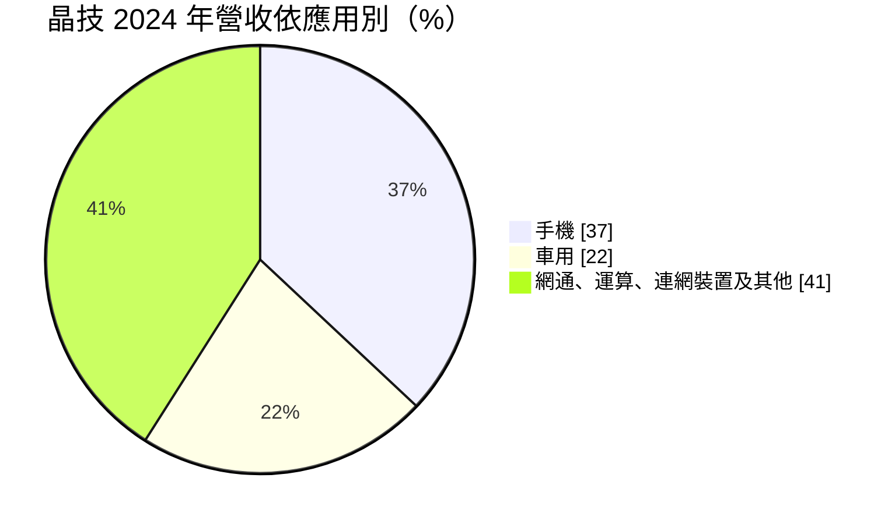
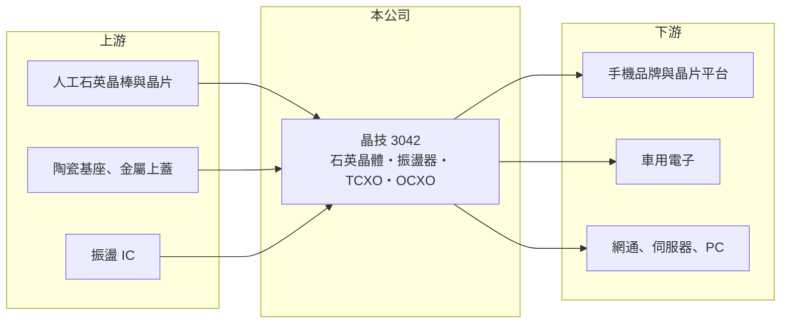

# 3042 晶技

> 上市｜[[產業索引-電子零組件業|電子零組件業]]｜上市（櫃）日期 2002/08/26

# 第一章：企業模式與商業藍圖

> [!info] 撰寫說明
> 精簡版，由 Claude 依公開資料整理，架構比照 [[2330台積電]]，資料截至 2026-10-08。來源：證交所開放資料快照（基本資料、2026 年第二季資產負債與損益、股利）、Goodinfo 經營績效頁、富果整理之 2025 年 3 月法說會摘要。#待校對

台灣晶技（以下簡稱晶技）是全球主要的頻率控制元件供應商之一，產品是電子產品裡負責「打拍子」的[[石英晶體]]與[[石英振盪器]]。理解晶技的關鍵在於：這是一個單價低、用量大、但規格持續往高頻與小型化升級的利基市場。

- **核心業務：** 晶技成立於 1983 年，2002 年在證交所上市，產品包括石英晶體（Crystal）、一般振盪器（Oscillator）、溫度補償型振盪器（TCXO）與恆溫型振盪器（OCXO）。幾乎所有需要計時、通訊或處理資料的電子產品都要用到頻率元件，因為晶片需要一個穩定的時脈才能正確運作。這讓晶技的客戶群橫跨手機、網通、電腦、車用與工業設備，需求基礎相當廣。
- **營收結構：** 依 2025 年 3 月法說會，2024 年手機占營收約 37%（2023 年為 41%），車用由 16% 升到 22%，其餘為網通、運算、連網裝置等。車用比重快速上升的意義在於，[[車用電子]]元件驗證期長、單價較高，能降低公司對手機景氣的依賴。公司把 AI、5G 進階版與車用稱為「三大 A」，作為長期主軸。
- **營運據點：** 研發與高階產品首批量產在桃園平鎮，量產基地包括中國寧波（高階振盪器與高頻晶體、車用新廠）、重慶（成熟料號）與 2024 年興建、2025 年開始量產的印尼泗水廠。印尼廠讓公司在中國以外有第二個量產基地，可回應客戶分散供應鏈的要求。
- **長期方向：** 晶技推動以半導體黃光微影（Photolithography）取代部分傳統加工製程，2024 年小量出貨、2025 年放量，目標是做出更小、更高頻的晶片，以符合手機與光通訊模組的需求。另一個方向是 AI 資料中心與電信設備使用的高階 OCXO，客戶要求斷訊後仍能維持準確時間的「守時」能力，屬於技術門檻較高、單價也較高的產品。

# 第二章：護城河深度與競爭優勢

晶技的護城河來自規模、產品線廣度與長期客戶驗證，屬於中等深度：一般規格產品仍有價格競爭，高階產品則有明顯的技術差距。

- **競爭優勢：** 頻率元件雖小，但出問題會讓整台設備失靈，因此客戶導入新供應商前需要長時間驗證，車用更要通過車規認證，換供應商的成本高。晶技的產品線從低階晶體一路涵蓋到 OCXO，客戶可以一次買齊，這是規模較小的同業難以提供的。研發費用長期維持在營業費用約 8% 至 10%，讓公司能在小型化與高頻化的升級中維持領先。
- **主要對手：** 全球主要競爭者是日本廠商，包括精工愛普生（Epson）、日本電波工業（NDK）、大真空（KDS）與村田製作所；台灣同業有 [[2484希華]]、[[3221台嘉碩]]、[[8182加高]]、[[8289泰藝]]、[[6174安碁]]。另外美國 SiTime 以 MEMS 矽振盪器切入高階市場，是技術路線上的長期挑戰者（#待校對）。
- **觀察重點：** 長期最該追蹤的是車用與 AI 相關產品占營收的比重能否持續上升，以及毛利率能否守在三成以上。2021 至 2022 年毛利率曾達 37% 至 38%，2025 年降到 33.0%，反映一般晶體的價格競爭與新廠初期成本。高階產品比重越高，公司越能擺脫一般規格品的價格循環。

# 第三章：財務體質與盈利規模

資料日期：2026-10-08，表格是撰寫當時的快照；最新月營收、毛利率、累計 EPS 由自動排程寫在本筆記的屬性欄位（月營收、毛利率、累計EPS 等）。#待校對

晶技的財務呈現「穩健但有週期」的樣貌：營收規模在 110 億至 150 億元之間，毛利率長期三成以上，獲利高峰出現在 2021 年的電子產品拉貨潮。

| 年度 | 營收（億元） | [[毛利率]] | [[營業利益率]] | EPS（元） | [[ROE]] |
|---|---|---|---|---|---|
| 2021 | 152 | 36.9% | 22.8% | 10.06 | 27.8% |
| 2022 | 132 | 38.2% | 21.3% | 9.06 | 22.2% |
| 2023 | 109 | 35.6% | 17.2% | 5.53 | 14.1% |
| 2024 | 127 | 35.4% | 16.9% | 6.55 | 15.1% |
| 2025 | 133 | 33.0% | 15.2% | 5.28 | 11.1% |

（來源：Goodinfo 經營績效頁；2020 年營收 110 億元、EPS 4.61 元。）

- **營收規模：** 2020 至 2025 年營收由 110 億元增至 133 億元，年複合成長率約 3.9%（推算）。成長並非直線，2021 年衝高後連兩年下滑，2024 年起回升，典型反映消費性電子的庫存週期。2026 年上半年營收約 70.4 億元，毛利率 32.7%、營業利益率 16.0%。
- **獲利：** 近五年（2021 至 2025）平均 ROE 約 18.1%（推算），但趨勢由 27.8% 一路降到 11.1%。主要原因是毛利率下滑加上股東權益累積變大，獲利成長跟不上資本增加的速度。
- **財務特色：** 2026 年第二季總資產約 232.9 億元、歸屬母公司權益約 157.6 億元、負債約 74.2 億元，財務結構保守。公司章程規定每半年可分派一次盈餘，現金股利不低於股利總額的 50%；2024 年度配發現金股利 5.2 元，配發率約八成，屬於高配息、穩定配息的類型。
- **[[ROIC]] 與 [[WACC]]：** 以 2025 年營業利益約 20.2 億元（133 億元 × 15.2%）、稅率 20% 計算，稅後營業利益約 16.2 億元。有息負債未查得，投入資本以權益 157.6 億元到「權益加全部負債」231.8 億元為區間，ROIC 約 7.0% 至 10.3%（推算）；若扣除帳上數十億元的現金，實際營運資本的報酬會更高。WACC 以 CAPM 推估：無風險利率 1.75%、市場風險溢酬 6%、β 假設 0.9（電子零組件股常見值），權益成本約 7.2%；稅後負債成本假設 2%、負債占兩成，WACC 約 6.2%（推算）。ROIC 仍高於 WACC，代表公司長期持續創造價值，但利差已比 2021 至 2022 年明顯縮小。

# 第四章：總體風險與地緣政治

晶技的風險主要來自終端需求週期、一般規格品的價格競爭，以及中國生產比重高帶來的地緣政治風險。

- **產業週期：** 手機仍占營收近四成，手機與 PC 換機週期轉弱時，客戶會先消化庫存，頻率元件訂單隨之下滑，2023 年營收年減即是一例。這種庫存調整沿供應鏈放大的現象，是被動元件產業共同的特性。
- **營運風險：** 一般晶體規格成熟，中國同業擴產會壓低價格，侵蝕毛利率。新廠（寧波車用廠、印尼廠）初期產能利用率不高時，折舊會先壓低獲利；技術路線上若 MEMS 振盪器在更多應用取代石英，也會影響長期市場。
- **其他風險：** 主要量產基地在中國，面臨美中貿易與關稅政策變動的影響，這也是公司建置印尼廠的主因。營收以美元計價為主，新台幣升值會壓縮毛利率；黃金、銀等貴金屬與石英原料價格亦會影響成本。

# 專有名詞解析

## 應用

- **[[石英振盪器]]**：把石英晶體與振盪電路封裝在一起、可直接輸出時脈訊號的元件，TCXO、OCXO 為較高階的種類。
- **[[車用電子]]**：汽車上的電子控制與感測系統，零件需通過車規驗證，驗證期長、轉換成本高。

## 產業

- **[[石英晶體]]**：以石英的壓電特性產生穩定頻率的被動元件，是電子產品時脈的來源。

# 核心供應鏈

- 上游：人工石英晶棒與晶片、陶瓷封裝基座與金屬上蓋、振盪器使用的 IC；晶技以前段晶片自製比重提升來掌握關鍵材料。
- 下游／客戶：手機品牌與晶片平台、美系與中國電動車廠（法說會提及，未具名）、網通設備、伺服器與筆電廠商。
- 同業：[[2484希華]]、[[3221台嘉碩]]、[[8182加高]]、[[8289泰藝]]、[[6174安碁]]；國際同業有 Epson、NDK、KDS、SiTime。

## 最新新聞
<!-- news:start（自動產生，請勿手動編輯此範圍） -->
- 2026-10-12 🏛️ 重訊 17:51｜代子公司台晶(重慶)電子有限公司公告處分中國建設銀行股份有限公司理財商品｜[觀測站](https://mops.twse.com.tw/mops/#/web/t05st01)
- 2026-10-05 📰 媒體 16:21｜手機應用出貨增 晶技9月營收14.15億元年增14.6% Q3達41.96億元登頂｜[鉅亨網](https://news.cnyes.com/news/id/6621714)

完整紀錄：[[3042晶技 新聞]]
<!-- news:end -->

## 相關連結
- [公開資訊觀測站](https://mopsov.twse.com.tw/mops/web/t05st03?step=1&firstin=1&co_id=3042)
- [Goodinfo](https://goodinfo.tw/tw/StockDetail.asp?STOCK_ID=3042)
- [Yahoo 股市](https://tw.stock.yahoo.com/quote/3042)
- [鉅亨網新聞](https://www.cnyes.com/twstock/3042/news)
